# barkhorn: Dogs Barking's horn speaker, after Friendly Pressure, in bark, acrylic and stone

The owner's idea of 2026-10-10 was speakers that look like their reference photograph of Friendly Pressure's horns
(`reference/friendly-pressure-owner-2026-10-10.jpg`, with two more of the same speakers in a bar and a studio beside
it). The brand is **Dogs Barking** (the owner, round 10); barkhorn stays the project's name in this repository.

Status: **concept, round 10**. The proportions follow the photograph. The sizes are scaled from its turntable (about 450
wide), and the horn from the cabinet (round 4). The horn runs the cabinet's full depth on a 2 in driver (round 5).
Decided by the owner: no wood (the cabinet is pressed recycled HDPE), smoked resin on birch and bottle green on
eucalyptus, the solid neck round the throat, and a port in each bottom corner (round 6). The disc takes a neutral that
suits each cabinet, the woofer's ring the same colour, and a patterned horn has its pattern cast in, not printed (round
7). Round 8 made the speakers three lines, and round 10 names them Bark (pressed recycled plastic in the pattern of a
bark: eucalyptus, autumn birch, manzanita, striped maple), Cloud (translucent cast acrylic: Poison, Smoke, Fog) and
Crag (cast stone: cobalt marble, malachite, lapis lazuli, turquoise). Each speaker has an acrylic mark, its line's shape
in its own colour. The brand has no logo for now.

## Round 10: the owner's notes of 2026-10-13 (night)

| the note | what changed |
|---|---|
| "The travertine is boring and the rhodochristite is too much like a pink malachite. Let's replace the two of them with one more interesting rock. Something that will pop, that is a different color than the other options." | **Turquoise** (spiderweb) replaces both: sky blue-green, polished waxy, in a dark web of matrix whose veins swell and thin, with a finer web in patches. It is a new `turquoise` preset in the engine's stone shader (warped Voronoi edges). `crag-turquoise` has a cover in the stone's colour, and stands on a terracotta sweep. The two stones' flavours and look book pages are gone; their presets stay in the engine's library. |
| "Poison should have a matching green cover and frame around the driver." | **Poison's cover and ring in its own bottle green** (#2E4A2C; the ring follows the disc), as Smoke's and Fog's follow theirs. |
| "The brand name is dogs barking, not bark horn." | **Dogs Barking** wherever the speakers are presented: the look book's cover and pages. |
| "Like an old electricity PSA ... How can we get to design agency level quality ... Retro PSA brand logo with stamps/badges for each speaker", then "I want a dog with a horn head ... Reference similar brand systems", then "Just drop the branding for now. Do the lookbook with just the dogs barking brand name and no logo or marks." | **The branding is parked.** The look book carries the name in type only, with no logo. What was found and tried is noted below for when it resumes. `stickers.py` and its marks are gone. |
| (of round 8's clouds) "These acrylic marks, without the circular framing (ie just the geometric cloud), are great. Representative of the speaker design and theme. Also these aren't the Y2K ones, the theme is Cloud or Air or something like that." Then: "Acrylic style marks for each theme, with a distinct color for each speaker. Trees, Clouds, Stones ... The tree could be a vertical rectangle with circles at the top", and: "I like the cloud because it combines multiple shapes and sizes with large enough gaps between the overlapping strokes of each shape. The tree and stone need to accomplish the same thing ... For the stone we could make an exception and do something more like the rock option, but that front left side looks too much like a house shape." | **Y2K is now Cloud**, and **every speaker has an acrylic mark** (`marks.py`, below): Bark a tree, Cloud the cloud as approved, Crag a stone, each speaker its line's shape in its own colour. The look book carries them. |

### The marks

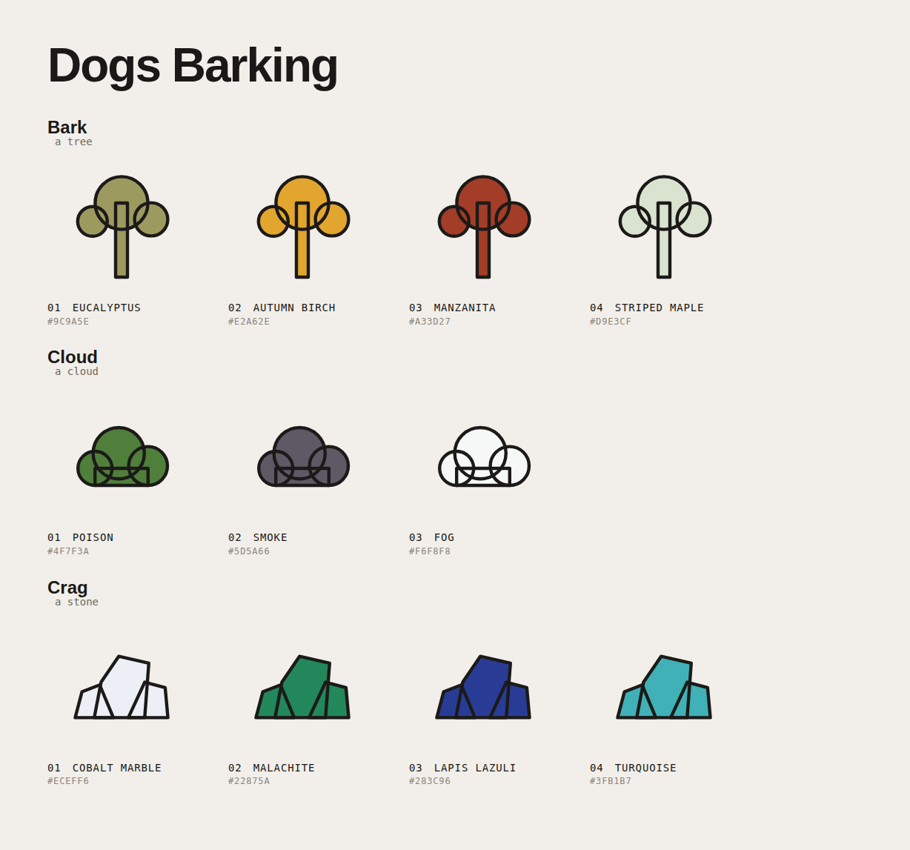

Each line is one shape built from a few primitives of different sizes, and each speaker is that shape in its own colour.
The acrylic: every primitive is filled, then every outline is drawn over all of them, so the construction shows through
as if each piece were clear acrylic laid on the others. All three keep the cloud's rules, measured against the cloud
itself:

- The primitives overlap deeply.
- A rectangle's corners sit on circles' centres, so its edges cross them square on.
- Strokes that come close without crossing stay at least 2 U apart, the cloud's own narrowest gap. On a 1000 artboard
  the tree's narrowest is 48, and the stone has none.
- Crossings stay open: the tree's at 70 degrees or more, the stone's at 33 or more.
- Tangents fall only on the silhouette, where the lines merge.

| line | shape | speakers, and their colours |
|---|---|---|
| Bark | a tree: a crown of three circles of three sizes, the trunk's top at the big one's centre, clear of the small ones | Eucalyptus (olive), Autumn Birch (gold), Manzanita (red), Striped Maple (pale green) |
| Cloud | the cloud: three circles on a rectangle from the outer two's centres down to their common tangent | Poison (bottle green), Smoke (smoke grey), Fog (white) |
| Crag | a stone, the exception in straight lines: a big plate spanning the base and a smaller plate either side, overlapping it but not each other, its top a tilted slab so no face reads as a house | Cobalt Marble (cool white), Malachite (green), Lapis Lazuli (ultramarine), Turquoise (turquoise) |

`marks.py` writes `marks/<key>.svg` for each speaker (transparent round it) and `marks/sheet.html`.

### The lines

| line | the cabinet | the horn | speakers |
|---|---|---|---|
| Bark | recycled plastic, pressed in the pattern of a bark | clear cast resin, the pattern cast in (the autumn birch's tinted golden yellow) | eucalyptus, autumn birch, manzanita, striped maple |
| Cloud | cast acrylic, translucent, one colour | clear cast resin, tinted to match | Poison (green), Smoke, Fog (frosted) |
| Crag | cast stone: resin or Jesmonite filled with stone dust, as cultured marble is made | the same stone | cobalt marble, malachite, lapis lazuli, turquoise |

The Cloud flavours keep their keys (`eucalyptus-y2k-green`, `birch-y2k-smoke`, `birch-y2k-ice`), so earlier renders and
shots still resolve.

Crag as cast stone is a proposal. In round 6 the cobalt marble's kind of marbling was pressed in HDPE at the bark
line's cost, and the banded stones could be pressed too. Cast stone is heavier, and a cultured-marble shop makes it in
moulds, by quote. But it is stone dust in resin, and it takes a polish.

### The Crag line

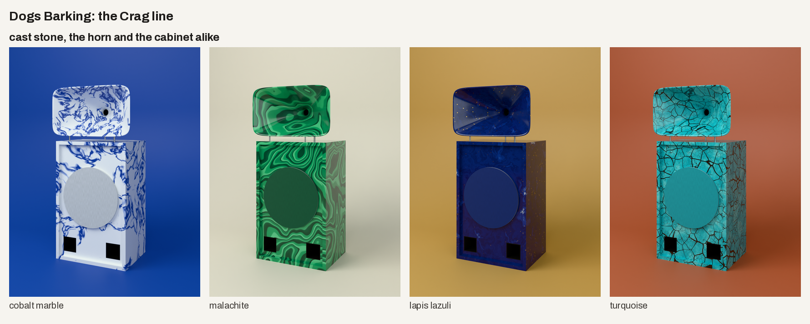

Each stone makes the horn and the cabinet alike, with a cover in the stone's own colour (a one-colour cabinet keeps a
matching cover, round 7):

- **Malachite**: bands of dark, mid and light green ringing its eyes, polished. A deep green cover.
- **Lapis lazuli**: deep blue, mottled, with white calcite and flecks of gold pyrite, polished. A deep blue cover.
- **Turquoise**: spiderweb turquoise, sky blue-green with darker and lighter patches, polished waxy, crossed by a web
  of dark matrix whose veins swell and thin, with a finer web in patches. A turquoise cover, on terracotta.

The cobalt marble keeps its mist cover.

### The look book

[The look book](https://claude.ai/artifact/5GzQJd9n2ExaceCDKsaYU9) (version 12) opens on the name, Dogs Barking, set in
type, with the eleven marks by line. Each line opens with its name, one line on how it is made, and its marks. Its
speakers follow, cover on and off, each page with its mark, its line and number (Cloud 01), its name, and Dogs Barking
at its foot. The specification and the drawings close it. It is private until the owner shares it from its Share menu.

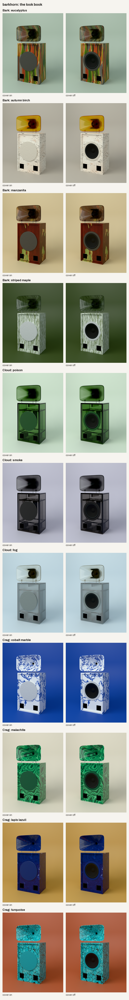

### The branding, parked

The owner's notes ran from a retro electricity PSA logo with a badge for each speaker, to a dog whose head is the
speaker's horn, to dropping the branding for now. What was found and tried, for when it resumes:

- **The heritage.** The best-known dog-and-horn mark in audio is His Master's Voice (1898): Nipper, a terrier listening
  to a gramophone horn, later HMV's, Victor's and RCA's. A dog with a horn for a head turns it round, since this dog
  barks through the horn. That inversion is the idea, and it keeps the brand clear of that trademark.
- **The references.** Reddy Kilowatt (Alabama Power, 1926), the electricity PSA mascot, is built from what he stands for
  (lightning-bolt limbs, a bulb for a nose), the same logic as a dog whose head is the horn. Lester Beall's posters for
  the Rural Electrification Administration (1937 to 1941) say it with flat colour, few words and simple icons. Merit
  badges keep one edge and one central picture each. Collins cut Mailchimp's mascot (2018) to a one-colour silhouette
  that works at any size, with a wordmark drawn to sit beside it. JKR made Burger King's own product its logo (2021),
  so it could not be for anything else.
- **Tried, not kept.** A merit-badge roundel for each speaker. A dog in profile whose head is the horn as the speaker's
  side elevation shows it (the flat mouth, the flare, the pod), with ears on the pod and the bark in arcs of the mouth's
  own shape, alone and as two dogs back to back (a stereo pair). The owner dropped the branding before either was
  finished, so neither is in the repository.

## Round 9 (superseded)

The brand mark was one dog's head in profile, barking its name in a horn-shaped badge (`stickers.py`). Round 10 parks
the branding and removes `stickers.py` and its marks.

## Round 8: the owner's notes of 2026-10-13

| the note | what changed |
|---|---|
| "Not stickers of the speakers. Stickers of a visual metaphor that represents each speaker. The brand is as important as the speakers themselves." | **New marks**. Each is its line's shape carrying one mark for the material: strips for the eucalyptus, a curl for the manzanita, rings for the malachite. None draws the speaker. |
| "And I think bark is more of a product style/line. Y2K another. Crag another, which would include marble and such." | **Three lines**: Bark, Y2K and Crag, each with a shape (a circle, a rounded square, a triangle). Proposed: each line is also one way of making the cabinet: pressed recycled plastic, cast acrylic, cast stone. The look book is now in three parts, each opened by its line. |
| "Remove Phoenix, red vein, cherry." | Gone from the look book and from the product's flavours. Their bark presets stay in the engine's library. |
| "Only do the autumn birch for the birch option." | The birch page is gone from the look book. The autumn birch is the Bark line's birch. The `birch` flavour and the pick6 renders (smoked horn) are unchanged. |
| "Getting there with the symbolism, but I'd like it to work in black and white, meaning we can't rely on color to communicate the design of each speaker." | **One colour first**: every mark says everything in one ink, and colour goes on top of the same drawing, for the stickers. The look book uses the one-colour marks, in each page's ink. |
| "The marble should look more marbly, the malachite should look more wavy, the lazuli is just dots. The birch can just be the horizontal lines, no leaf. The ice is inverted in color relative to the other ones. ... A lot of the icons need to be centered, like the manzanita." | **Stamps**: every mark is now a solid shape with its mark cut out and centred, so none is inverted against another. The marble's veins swell and branch, the malachite's rings wave unevenly, the lapis has pyrite's square crystals instead of dots, the rhodochrosite nested bands instead of chevrons (they read as arrows), and the birch its dashes alone. |
| "What if we changed Y2K to cloud: poison, smoke, fog, and used the same shape but different color." | **Y2K is three clouds**: Poison (the green acrylic), Smoke and Fog (the frosted ice), one cloud in three colours. In one ink they keep their colours by heraldry's hatching, made for exactly this: diagonal lines for green, cross-hatching for black, plain for white. |
| "What about dogs barking for the brand name, back to back dogs with horns for head, with roar-like shapes emitting from the horn. Again, I want to stress minimalism. Something that could work as a stamp." | **The brand mark**: two dogs back to back, each with a horn for a head, three arcs out of each horn. A pair facing out is a stereo pair. It reads barkhorn as a horn that barks, which fits all three lines; the name stays. |
| "Let's explore some more stone/crag options. Malachite maybe." | **Four stones join the cobalt marble in Crag**: malachite, rhodochrosite, lapis lazuli and travertine (`crag-malachite` and so on), all in the look book. They use a new cast-stone shader in the engine: colour bands ringing a folded noise (malachite, rhodochrosite, lapis's mottling), or layers laid down (travertine), with crystals (lapis's gold pyrite) and open pores (travertine). |

Round 10 renamed Y2K Cloud, replaced these marks with the acrylic marks and replaced the rhodochrosite and the
travertine with turquoise (above).

## Round 7: the owner's note of 2026-10-12 (night)

| the note | what changed |
|---|---|
| "I'm not sure I like the rust disc anymore. I think more neutral colors, depending on the cabinet, will help the cabinet and horn pop more." | **The disc in a neutral that suits each cabinet**, chosen from a study of four on each bark (below). Proposed: **oat on birch, graphite on eucalyptus**. Rust is gone from every flavour. Round 6's renders of the line, the printed horns and the other cabinets are redone with the new discs. |
| "Why do the horns need printing? Why can't they be resin cast like the body?" | They don't. The horn is cast in resin either way; the print was only one way to put the bark's pattern into it. The other is to cast the pattern in: tinted resin laid into the open mould in the bark's patches, then the clear horn poured behind it (round 6's second method). It needs no film or coating, so it can't wear off, but it is hand work and no two horns match. The line's cabinet is pressed, not cast: coloured flakes laid in the pattern and pressed into flat, opaque sheet, which can't make the horn's deep, see-through shape. |
| "And yes, cast-in." | **Decided**: the bark horns have their pattern cast in by hand. The samples' hydro-dip proof gives way to a cast-in test tile, from the same resin and tints as the step wedge. |
| "That white ring around the driver when there's no cover is a little much." | **The woofer's ring takes the disc's colour** (oat on birch, graphite on eucalyptus, and so on), so with the cover off the cone sits in the same quiet circle the cover makes. The look book shows it. |
| "Why did you get rid of the birch and eucalyptus cast-in horns?" | I read "yes, cast-in" as how a patterned horn would be made, and gave the look book round 6's smoked and bottle-green horns. The birch and eucalyptus pages now wear their bark's pattern in the horn, cast in (drawn as round 6's printed horns, the same artwork; a cast-in horn's edges come out a little softer). The line's flavours (`birch`, `eucalyptus` and the pick6 renders) still carry smoked and bottle green until the owner says otherwise. |
| "We should also do a manzanita." | **A third bark**: manzanita's smooth bark, deep red and polished, peeling in thin curls to a fresh underbark of green, tan and orange (`manzanita_bark`, the eucalyptus's shader with its layers retuned, and `pressed_manzanita_bark` for the line). Its horn wears the bark's pattern cast in (`manzanita`, `manzanita-pressed`; `manzanita-ember` tints it red instead), with a graphite disc and ring. It is in the look book on a sand backdrop. |
| "Lots of cool barks we can work with" (photos of two snakebark maples) | **Two snakebark maples**: a striped maple after *Acer tegmentosum* 'Joe Witt' (chalk white with fine green pinstripes) and one after *Acer* × *conspicuum* 'Phoenix' (coral, red veins and a scatter of dark lenticels). `snakebark_white` and `snakebark_coral` are the eucalyptus's shader again, with flat layers of fine stripes, plus pressed versions for the line; the flavours `snakebark-white` and `snakebark-coral` (and `-pressed`) cast each pattern into the horn, with a mist disc on the white and stone on the coral. Both are in the look book, on deep olive and deep teal. |
| (photos of a Tibetan cherry and the redvein maple 'Albolimbatum') | **Two more**: a Tibetan cherry after *Prunus serrula* (polished mahogany ringed by rough lenticel bands, amber shards where it exfoliates: the first bark whose layers run round the trunk, wide and short) and the redvein maple after *Acer rufinerve* 'Albolimbatum' (olive green with red veins, white streaks and diamond scars). `cherry_bark` and `redvein_bark` with pressed versions; the flavours `cherry` and `snakebark-redvein` (and `-pressed`) cast each pattern into the horn, with a graphite disc on the cherry and stone on the redvein. Both are in the look book, on fog and terracotta. |
| "Also might be cool to try a yellow for the horn on birch to showcase what the tree looks like in the fall." | **Autumn birch**: the birch with a clear horn tinted golden yellow, its leaves in the fall (`birch-autumn`, `birch-autumn-pressed`). Seen against a blue backdrop the yellow horn turns green where the backdrop shows through it, so it is shot on a warm grey. In the look book beside the birch. |
| "I like when the driver covers are the same color for the monochromatic options, like the green and ice and black." | **Kept as the rule**: on a cabinet of one colour (the green acrylic, the frosted ice, the smoke) the cover matches the cabinet, so the front reads as one colour (graphite, pewter and charcoal, as rendered). |
| "The words in the look book are a little lame ... It would be cool to have a more structured design system ... Something that could come as a sticker representative of the specific speaker style. A rudimentary but intuitive visual language. Minimal. Bold. Direct." | **The look book rebuilt** on a sticker system (below): one die-cut sticker per speaker from one grammar, every page on one template, the copy cut to plain specifications. |
| "I want to create a little look book that I can share out. For each cabinet, I want a version with the driver cover on and off. Each page should be designed to accent the speaker being showcased. ... make the marble a white and cobalt instead of white and black." | **The look book** (below): eucalyptus, birch, green acrylic, frosted ice, smoke and a new white-and-cobalt marble, each on a seamless backdrop in its own colour, with the cover on and off. |

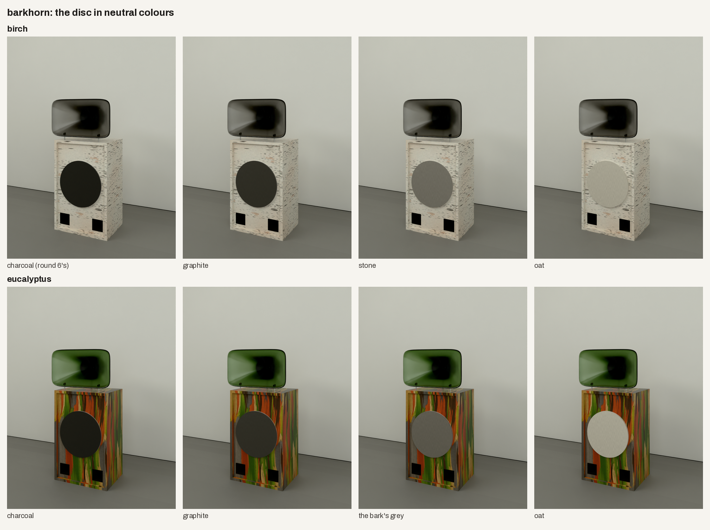

The study puts four warm neutrals on each bark, dark to light, on the line (pressed HDPE, the smoked and bottle-green
horns). The neutral that helps is the one closest in value to the cabinet's own ground. Then the disc reads as part of
the cabinet, not as a third shape beside the cabinet and the horn:

- **Birch: oat** (`#CFC8BA`). It sits tone on tone with the white bark, a step darker, so the cabinet reads as one pale
  block and the smoked horn is the only dark shape. Charcoal (rounds 4 to 6) and graphite each make a second dark shape
  that competes with the horn. Stone, the mid grey, reads flat.
- **Eucalyptus: graphite** (`#4B4844`). It reads as the woofer's shadow, so the strips run round it and carry the
  colour, with the bottle-green horn above. Oat is a bright target on the busy bark, and charcoal reads as a hole. The
  bark's own grey (`#7C776F`) comes close, but looks flat against the strips' colours.

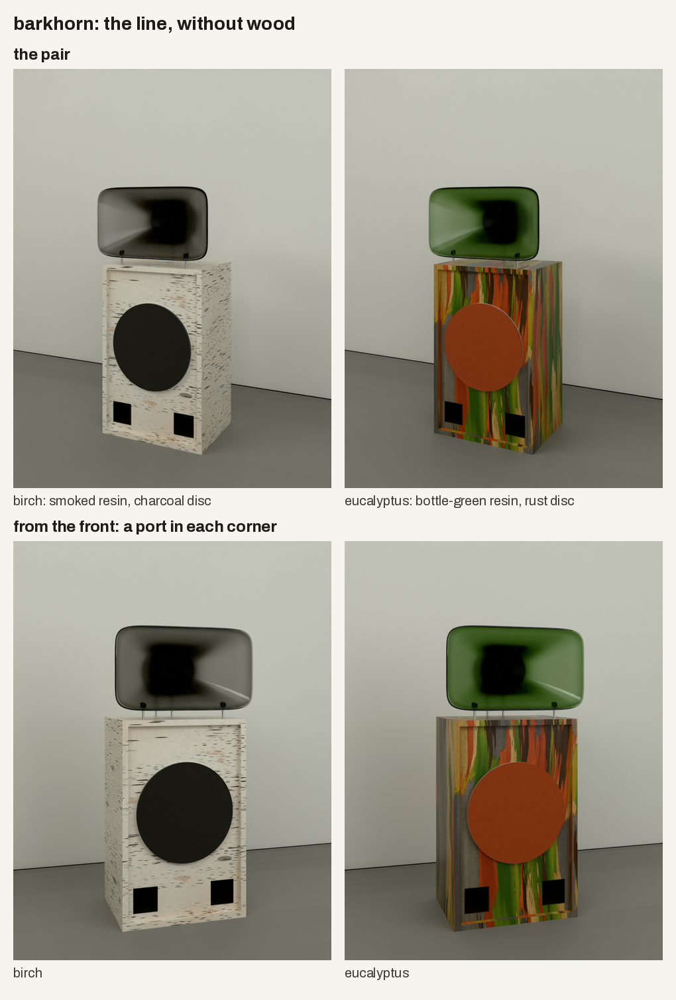

The same rule picks the disc on round 6's other cabinets, and their renders below now show it:

| cabinet | its ground | disc |
|---|---|---|
| birch; terrazzo, cultured marble, marbled black and white | warm white | oat `#CFC8BA` |
| frosted ice acrylic | cool mid grey (the frost over the dark inside) | pewter `#7A807E` |
| white-and-cobalt marble (the look book's) | cool white | mist `#C8CACA` |
| manzanita | deep red, mid-dark | graphite `#4B4844` |
| striped maple | cool white with green stripes | mist `#C8CACA` |
| Phoenix maple | coral, mid-light | stone `#8E8981` |
| Tibetan cherry | mahogany, dark | graphite `#4B4844` |
| redvein maple | olive green, mid | stone `#8E8981` |
| eucalyptus; marbled in the bark's colours, green acrylic, green onyx, green swirled through amber | busy, or dark and coloured | graphite `#4B4844` |
| smoked acrylic, smoke swirled through clear | near black | charcoal `#2E2C2A`, as before |

The colour is each flavour's `disc` token (`product.py`), so any colour from the study is a one-line change. The
frosted ice first had mist, a pale grey: the frost renders mid grey with the dark inside showing through it, so mist
was the brightest thing on the cabinet. Pewter sits into it.

### The look book

(As round 7 left it; round 8 regrouped it by line, above.)
[The look book](https://claude.ai/artifact/5GzQJd9n2ExaceCDKsaYU9) is a deck to share: twelve speakers, each with the
cover on and off. Each stands on a seamless backdrop in a colour drawn from it: gum-leaf sage for the eucalyptus, peeled
apricot for the birch, an overcast warm grey for the autumn birch, chaparral sand for the manzanita, deep olive for the
striped maple, deep teal for the Phoenix maple, fog for the Tibetan cherry, terracotta for the redvein maple, pale mint
for the green acrylic, lavender grey for the smoke, ice blue for the frosted ice, and deep cobalt for the marble. The
seven barks wear their pattern in the horn, cast in clear resin, and the autumn birch a golden yellow one; the acrylic
speakers keep their tinted horns. The marble is new: the marbled speaker's veins in cobalt through a cool white, the
horn and the cabinet alike (`birch-marbled-cobalt`).

Every page follows one template. A panel holds the speaker's sticker, its number and name, and four plain rows:
surface, cabinet, horn and cover. The two photographs run full height beside it. The panel is a gradient sampled down
the edge of the first photograph, so it runs on into the backdrop without a seam, and each page uses one ink, dark or
light, whichever reads on its backdrop. The type is Instrument Sans and IBM Plex Mono. The cover is the twelve stickers
in a row, and the last page gives the specification they share.

### The stickers

(Round 7's; replaced in round 8, and in round 10 by the acrylic marks, above. `stickers.py` is gone.)

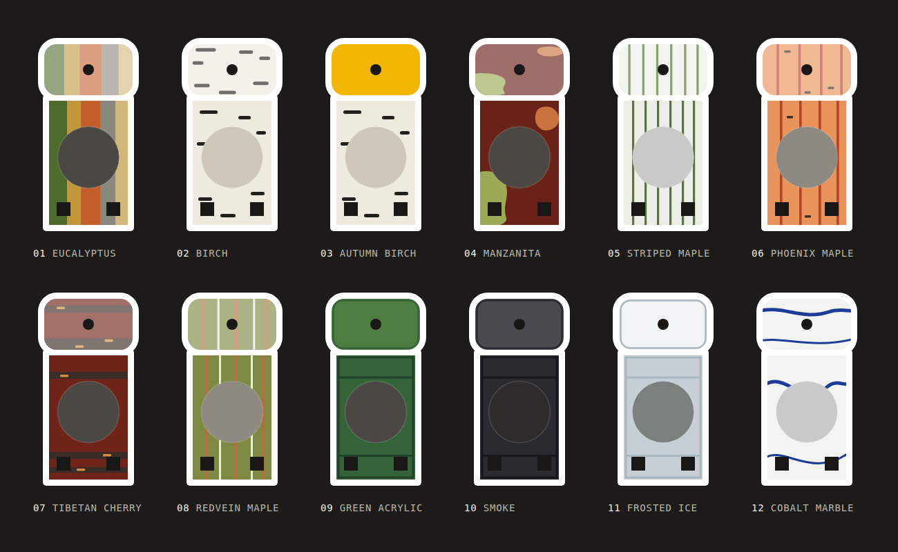

One die-cut sticker for each speaker, all drawn from one grammar (`stickers.py` writes them to `stickers/`). The
sticker is the speaker reduced to its parts, in proportion: the horn (a rounded rectangle), its throat (a dark dot),
the cabinet, the cover (a disc 437 across, its centre 45.7 % down) and the two ports. A style changes three things and
nothing else:

| part | how it varies |
|---|---|
| cabinet | the surface as a pattern code: bands (eucalyptus), dashes (birch), patches (manzanita), lines (the maples), rings (the cherry), veins (the marble), or a flat tint with its frame showing (the acrylics) |
| horn | the cabinet's pattern, lightened, where the pattern is cast in; otherwise its tint (golden yellow, bottle green, smoked, clear) |
| cover | its colour, as the speaker has it |

Each sits on a white die-cut edge with a hairline round it, so it reads on any ground. A new style needs a new
pattern code and three colours.

## Round 6: the owner's notes of 2026-10-12 (evening)

| the note | what changed |
|---|---|
| "I like the smoked and bottle green resin." | **Decided**: smoked resin on birch, bottle green on eucalyptus (the `birch` and `eucalyptus` flavours). |
| "I like the solid horn neck I think, assuming that's what's pictured." | **Decided**: yes, every round 5 render shows the solid neck, the dark disc round the throat in the clear and smoked resins. |
| "I want to go wood free with this if possible." | **Decided**: it is possible, and it is the line now: `pressed.py`, every panel 25 mm pressed recycled HDPE, welded (round 5). The plywood and bark build (`product.py`) stays as the reference. The renders below are all the cabinet without wood. |
| "What's with the standalone black square on the bottom right of the cabinets? ... I prefer symmetry." | It is the **bass port**: the opening that lets the air in the box resonate at 38 Hz and extend the bass. The reference speaker has one in each bottom corner, so ours does too now, tuned together (below). |
| "One thing we haven't tried is the same bark patterns as the speakers for the horn, except semitransparent." | **The horn printed with its bark**, in translucent inks on clear resin and on a light tint (below), and how it would be made. |
| "I think the marbling would be cool for a marble patterned speaker though. Same with the swirl." / "there's some cool opportunities with resin cabinets, like semitransparent cabinets ... some that look like stone" | **The cabinet in other plastics**, still without wood: translucent acrylic like late-90s electronics, stone looks, and whole speakers marbled or swirled (below). |
| "How do you get samples? From who and how much?" | Researched (below). |

### Two ports

The two square ports are 100 mm each, one in each bottom corner, and tuned together. Together they have twice one
port's area, so for the same 38 Hz tuning each is longer: 236 mm in the HDPE cabinet (196 in plywood, against 73 and
53 for one). The air through each moves half as fast, about 23 m/s at full power against 50, so they chuff less at
high levels. The tuning and the bass are unchanged: the -3 dB point is still about 49 Hz in HDPE. The side and back
ribs now run only between the two braces, where the panels' spans need them. Below the lower brace the spans are short
and already stiff, and that is where the ports run.

### The horn printed with its bark

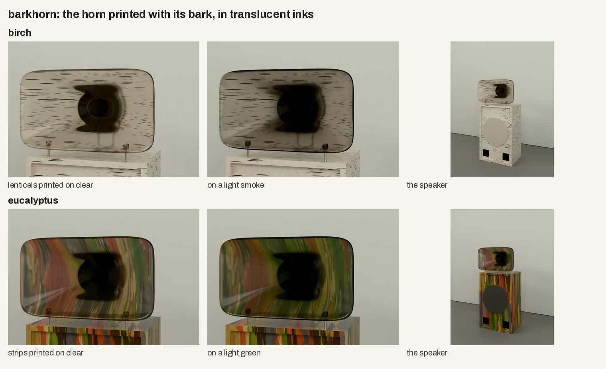

The bark's own pattern, as the cabinet wears it, printed on the clear horn in translucent inks. On birch, the
lenticels are dark dashes on clear, with the white skin printed as nothing at all. On eucalyptus, the strips become
stained glass in green, ochre, rust and grey. Each is shown on clear resin and on a light tint of the line's colour.
The print is projected from the front, so it reads straight from the listening seat and stretches along the flare's
walls, as a film laid over the horn would.

It can be made three ways, in order of how repeatable they are:

1. **Hydrographic (water transfer) printing.** The bark artwork is printed on a water-soluble film, the film is floated
   on water, and the cast clear horn is dipped through it. The pattern wraps the horn's compound curves, and a clear
   2K coat seals it. With translucent inks and no white base coat, a clear part shows the print as stained glass. Every
   horn comes out the same. Custom film is a print run (see the samples below).
2. **Laid in the mould by hand.** Tinted resin is painted into the open silicone mould in the bark's patches and left to
   gel, then the horn is cast clear behind it. The pattern sits in the resin's skin with no film and no coating. It is
   a resin artist's job, and every horn is its own.
3. **UV printing on the part.** Printers with a deep print gap can print on curved parts, but not 278 mm down inside
   the flare. The outside of the pod could be printed, not the mouth.

A dip trial on a cast offcut is the first step: whether the inks stay translucent enough over clear resin is the open
question.

### The cabinet in other plastics

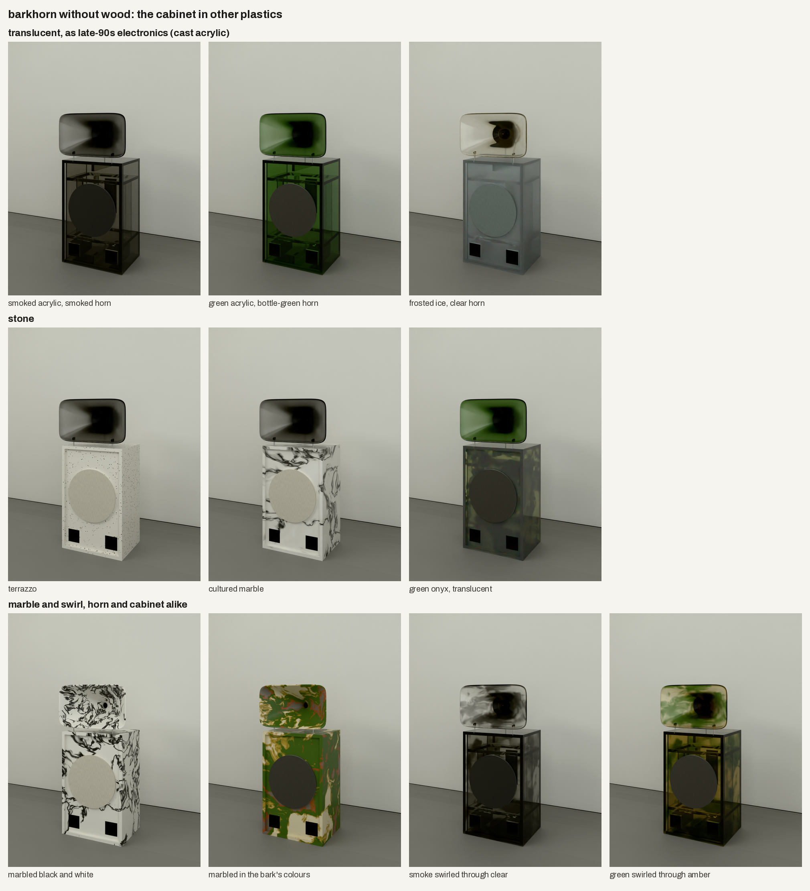

All of these are without wood, on the same welded box with its braces and ribs:

- **Translucent, as late-90s electronics.** Cast acrylic, 20 to 25 mm, CNC-cut and cemented (a two-part acrylic
  cement makes airtight joints as strong as the sheet). Acrylic is about three times as stiff as HDPE (3.2 GPa), so 25 mm
  bends about as little as 18 mm birch plywood. But it is much heavier per square metre, so it keeps the ribs, which
  show as fins. The cabinet weighs about 63 kg at 25 mm, or 50 at 20 mm. You see inside: the braces, the ribs, the
  ports, the woofer's basket and the amplifier. So those are designed to be seen, and the damping is a thin felt on
  the back panel instead of fibre fill. Shown:
  smoked acrylic with the smoked horn, green with the bottle-green horn, and frosted ice with a clear horn.
- **Stone.** Terrazzo comes most naturally: a sheet press makes it from recycled chips in a coloured ground, or it can
  be cast in Jesmonite. Cultured marble (cast resin or Jesmonite veined as it is poured) and cultured onyx (the same,
  translucent: it glows when lit from behind) are heavier and cast in moulds, but they are real trades, used for
  vanities and wall panels.
- **Marble and swirl, horn and cabinet alike.** Marbling is what a sheet press does when the flakes flow, so a marbled
  HDPE cabinet costs no more than the bark one. The horns are cast marbled. The swirled speakers are clear resin with a
  second colour folded through it: the most striking and the most expensive, since a cabinet of cast resin panels is
  about 53 L of resin.

**How they compare** (per cabinet; resin and acrylic prices from the sample research below):

| cabinet | material | weight | made by | cost |
|---|---|---|---|---|
| bark pattern, marble, terrazzo (the line) | pressed recycled HDPE, 25 mm | about 50 kg | a sheet-press workspace, welded | on request (a made-to-order 10 mm sheet is EUR 150 a square metre) |
| translucent | cast acrylic, 20 to 25 mm | 50 to 63 kg | any plastics fabricator, cemented | about $1,000 to $1,300 of 3/4 in smoked sheet |
| cultured marble or onyx | cast resin with mineral filler | heavier still | a cultured-marble shop, in moulds | by quote |
| swirled clear | cast clear resin panels | about 58 kg | a resin caster | about $1,100 to $2,700 of resin (deep-pour epoxy to water-clear urethane) |

### Samples: who from, and how much

Searched 2026-10-12. The figures come from search results (the pages themselves could not be opened from here), and
most prices carry no date, so confirm each one before ordering. US sources first.

**Pressed recycled sheet in a laid pattern** (the cabinet):

| who | what | samples | sheets | how |
|---|---|---|---|---|
| [Marble Plastics](https://marbleplastics.com/), Columbus, Ohio | pressed 100 % recycled sheet, mostly HIPS (polystyrene), some HDPE; custom pattern work for clients | trade samples through Material Bank; a 10 x 15 cm sample on the Precious Plastic Bazar (price not found) | 1/2 to 1 in thick, pressed in steel moulds | price on request: 614-582-8972 |
| [Yemm & Hart](https://yemmhart.com/), Marquand, Missouri | "Origins" recycled HDPE panels, colours and patterns made per batch | library samples exist (price not found) | 4 x 8 ft; 1/2 in solid colour about $609 to $742 a panel in batches of 15 to 30 (a 2021 price table); 10-sheet minimum; about 8 weeks | quote |
| a made-to-order HDPE seller on the [Precious Plastic Bazar](https://bazar.preciousplastic.com/) | HDPE from bottle caps, pressed to your colours ("contact before ordering") | none listed | 1 x 1 m at 5, 10 or 20 mm; EUR 150 for 1 m x 10 mm, unfinished, before tax | message the seller |
| other Bazar sellers (India, Czechia, France) | HDPE, PP or PS, some up to 25 to 30 mm | none listed | e.g. 1 x 1 m HDPE, 8 to 25 mm, EUR 60 plus EUR 170 shipping to the US; a French maker presses marble-look PS to your colours in 2 to 3 weeks | message the seller |
| [Smile Plastics](https://smile-plastics.com/), Wales | recycled HDPE, HIPS and PET panels; bespoke service | 100 x 60 mm pieces at GBP 1.50, a 200 x 200 mm sample at GBP 18 (trade customers) | 3000 x 1200 mm at 12 or 20 mm; quote only; bespoke minimums not published | info@smile-plastics.com |
| [Polygood](https://polygood.com/), Netherlands | recycled polystyrene panels, 50+ patterns including terrazzo; 100+ custom patterns made | a box of 14 samples for EUR 24.79 | 2800 x 1400 mm and smaller, 12 or 19 mm | sample shop; custom work through an account manager |
| [Plasticiet](https://www.plasticiet.com/), Netherlands | translucent and pearl recycled sheet | a pack of 8 for EUR 29; a custom colour, 4 small pieces, EUR 250 | about 1 x 1 m, 10 to 12 mm; custom colours from 10 m2 | web shop |

Nobody publishes a price for a custom-laid 200 mm sample. The made-to-order Bazar sheet (EUR 150 a square metre at
10 mm) is the nearest thing: a whole small sheet laid to the pattern. Several makers press polystyrene rather than
HDPE. Polystyrene is about twice as stiff and glues well with solvent cement, so it would also suit the cabinet, joined
by gluing instead of welding.

**The horn**: upload the STEP to Xometry for an instant urethane-casting quote (parts up to 30 in; 2 to 4 weeks), and
ask Quickparts, protoCAD (parts up to 4 x 3 x 1 ft), Printform and Meisner Art Casting (New York, clear and pigmented
sculptural castings). No service publishes a price for a part this size. Published guides put a large silicone mould
at $1,200 to $3,000. The resin for one horn is about one 15 lb kit of water-clear urethane, $316 to $420 (Polytek
Poly-Optic 1411, Smooth-On Crystal Clear 200). Crystal Clear 200 pours at most 3 in at a time, so the solid neck
(about 13 cm across) would be cast in layers. Tints: Smooth-On's SO-Strong sampler, about $47. Alumilite warns that
its translucent green turns blue in epoxy, so test the bottle green.

**The printed horn**: TWN (Water Transfer Network) prints custom digital hydrographic film from your artwork at
$30 a metre, minimum 3 m, in 1 or 2 days, and refers you to one of about 1,300 dip shops; Liquid Concepts prints
custom film with no minimum. Shops charge from about $50 a project. None confirmed dipping a clear part without a
base coat, so the first step is a proof on a cast offcut.

**Acrylic** (the translucent cabinets): 3/4 in smoked grey cast acrylic (TruCast 2064) is $1,003 for a 4 x 8 ft
sheet at A&C Plastics, about one sheet a cabinet. Reynolds Polymer casts 3/4 to 4 in acrylic in custom colours,
including green, and a frosted 1 in sheet, by quote. Tint sample sets cost about $9 to $15 (eplastics). Thick panels
are joined with a two-part reactive cement (Weld-On 40 or 42), not a solvent one.

**Stone**: Jesmonite kits from $44 (875 g) to $1,081 (70 kg) through FTC Creative, its US hub. Corian sends 3
samples free, and Hi-Macs samples are $3.99 at Home Depot. Cultured-marble and cultured-onyx shops (for example
Classic Cultured Marble, Florida) cast panels by quote.

**What to order first**:

| | sample | from | cost |
|---|---|---|---|
| 1 | a custom-laid HDPE test sheet in each pattern, 20 to 25 mm, to judge the pattern, the flatness, the machining and a weld | the Bazar's made-to-order seller, and a quote from Marble Plastics | about $175 to $265, plus duties |
| 2 | finished recycled panels to compare against | Polygood's sample box, Smile's 200 mm sample, Plasticiet's pack | about $35 to $65 |
| 3 | a step wedge of the horn's resin, 10 to 75 mm thick, smoked and bottle green | a pint of Crystal Clear 200 ($56) and two dyes (about $10 each) | about $76 |
| 4 | acrylic tints | eplastics' sample sets | about $24 |

The core plan is about $310 to $430, plus shipping and tax. A hydro-dip proof adds about $140, and the horn and
resin-casting quotes are free.

## Round 5: the owner's notes of 2026-10-12

| the note | what changed |
|---|---|
| "Shell back." | The shell is the horn's back now. The tub stays in the code as an option (`P['horn']['cast']['back']`), made flush the same way. |
| "Is there a reason it doesn't stretch the full depth of the speaker, so the back of the shell lines up with the back of the box?" | There was no acoustic reason. The flare's depth (200) set its coverage, and the pod only had to hold the driver, so it ended where the driver did, about 120 short of the back. **Now the horn runs the cabinet's full 420**: the flare is 278 deep, the pod behind it 130 and its cap 12, so the back is flush with the cabinet's, as the front is. |
| "Also the tweeter hole looks too small." / "Yes for number 4" | **A 2 in compression driver**: the B&C DE1085TN (16 ohm, 100 mm titanium diaphragm) in place of the 1 in BMS 4550. The throat is 51 across now; the photograph's is about 50, and round 4's was 25. The driver is 154 across, so the pod is 200 (below). |
| "I kind of like the idea of having something semitransparent for the shell. That or something entirely darker, like black on birch and green on eucalyptus. Or more obvious texture if not monochromatic." | **Five resins for each bark** (below), with three new materials: clear resin tinted the way glass is, opaque cast resin, and marbled resin. My proposal takes the first two notes at once: clear resin tinted dark, **smoked on birch and bottle green on eucalyptus**. |
| "I like the eucalyptus patterns in the waveguide examples more than the pattern on the barkhorn page." | **The pressed sheets now carry the bark's own pattern.** On eucalyptus: the long peeling strips, laid out in flakes and pressed flat. On birch: the lenticels on milk. Round 4's strips and confetti are kept, to compare. |
| "I still like the idea of not relying on wood at all." | **A cabinet with no wood in it** (`pressed.py`). Every panel is 25 mm pressed recycled HDPE in the bark's pattern, welded, with two braces and ribs inside. The ring and the disc's frame are HDPE too. |

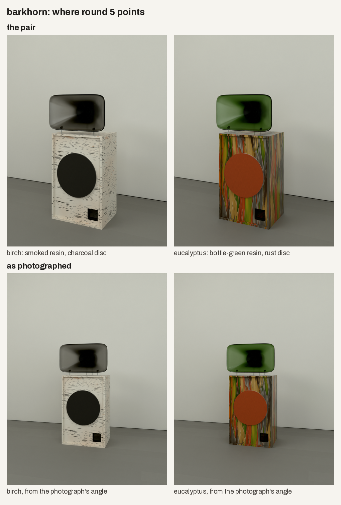

### The horn, the cabinet's full depth

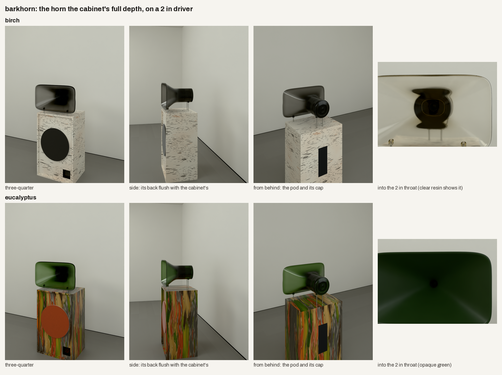

| | round 4 | round 5 |
|---|---|---|
| outside | 626 x 361 | 625 x 362 |
| flare | 610 x 346 mouth, 200 deep, 1 in throat | 610 x 346 mouth, 278 deep, 2 in throat |
| coverage | about 113 x 82 degrees | about 95 x 63 degrees |
| behind the throat | a pod 140 across and 70 long, a cap 30 | a pod 200 across and 130 long, a cap 12 |
| depth in all | about 300, 120 short of the back | 420, flush with the cabinet's back |
| posts showing | 55 in front, 148 behind | 49 in front, 118 behind |
| resin | about 2.4 L | about 5.4 L, the neck round the throat solid (3.0 L hollow) |
| driver | BMS 4550-16: 1 in exit, 44 mm polyester diaphragm | B&C DE1085TN-16: 2 in exit, 100 mm titanium diaphragm |

The deeper flare narrows the coverage. That suits a room: less sound goes to the side walls and the ceiling, and the
horn's pattern is closer to the 15 in woofer's own near the crossover. The mouth is unchanged, so the horn's lower
limit is still near 210 Hz, far below the crossover.

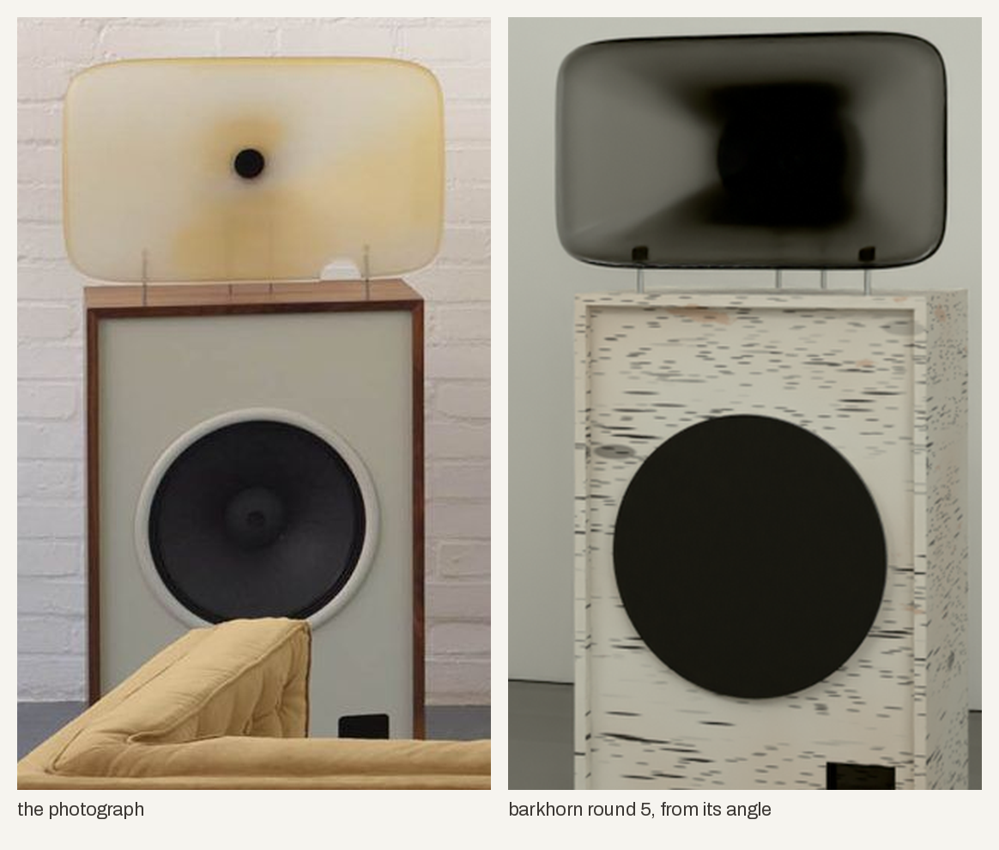

From the photograph's angle, the horn keeps its size and shape, and its throat is now the photograph's size. A 2 in
throat is still only 8 % of a 610 mm mouth, so in opaque resin it reads as a modest hole (the green throat frame
above). In the smoked resin, the solid neck round it reads as a dark disc about 200 across. The photograph's frosted
resin shows only the throat.

**Why the pod is 200 across.** A compression driver's four M6 holes are blind threads in its front plate, because its
magnet sits right behind them, so the screws have to come from the horn's side. Round 4's mount, screws from a boss cast
solid behind the throat, could not have been put together. Now the driver screws to an aluminium adaptor ring first
(countersunk M6, from the ring's front face). Then the ring screws to brass inserts in the horn's boss, with M5 socket
caps on a 170 circle. That circle is outside the driver's 154 flange, so a ball-end key reaches the screws past the
driver once the cap is off. The pod is that circle, a wall and some clearance: 200 across.

**The driver.** It came from a search of current 2 in drivers (figures from makers' and retailers' pages, seen
2026-10-12; confirm on the datasheet before casting the boss):

| driver | diaphragm | lowest crossover | size, weight | price seen | why or why not |
|---|---|---|---|---|---|
| **B&C DE1085TN** (the pick, 16 ohm) | titanium, 100 mm coil | 800 Hz, 12 dB/oct or steeper | 154 x 86, 3.6 kg | EUR 472 (Sonovente) | standard 4 x M6 on 102; in stock; bench-tested by audioXpress |
| B&C DE1095TN | titanium, 100 mm | 800 Hz | 127 x 89, 2.1 kg | EUR 387 (Toutlehautparleur) | a smaller pod, but 8 ohm only (more hiss) |
| Celestion Axi2050 | titanium, 125 mm | usable from 300 Hz | 198 x 111, 7.5 kg | USD 1,000 (Parts Express) | could cross much lower, but twice the weight and size |
| FaitalPRO HF1440 (1.4 in) | polymer, 86 mm | 700 Hz | 124 x 75, 2.1 kg | EUR 420 (Sound Imports) | the fallback; the same bolt pattern, so the same pod fits |

B&C asks for 800 Hz or above at 12 dB/oct or steeper, so the crossover stays at 800 Hz (LR4). What the bigger driver
buys is headroom. A 100 mm diaphragm moves far less than a 44 mm one at 800 Hz, so it plays the bottom of its range
cleaner and louder. The 16 ohm version is 3 dB less sensitive per volt (108 dB at 2.83 V), so the amplifier's hiss is
3 dB lower through it. Crossing lower than 800 Hz at home levels is possible, but measure the distortion before
doing it. The pair adds about $720 to the parts list.

### The resin, close to

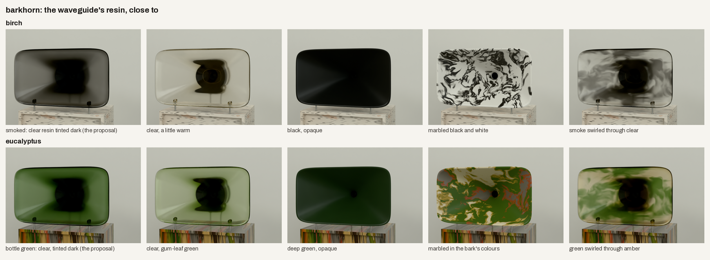

- **Semi-transparent** (`clear_resin`, new): clear resin tinted the way glass is. Light is absorbed as it crosses the
  resin, so a thin wall is pale, while the solid neck round the throat and an edge seen end-on go deep. The driver shows
  through it as a dark shape. The proposals are tinted dark: **smoked** on birch and **bottle green** on eucalyptus.
  The horn is dark in the room, and the driver shows through it against the light. The lighter tints (a little warm on
  birch, gum-leaf green on eucalyptus) read as glass.
- **Opaque** (`dark_resin`, new): pigmented resin, satin. Black on birch, deep green on eucalyptus.
- **Marbled** (`marbled_resin`, new): pigment folded through the pour. Black and white on birch. On eucalyptus, the
  bark's green with veins of rust, ochre, cream and grey. Cast resin or Jesmonite (a water-based acrylic composite).
- **Swirled**: a second colour folded through clear resin. Smoke on birch, green through amber on eucalyptus.
- Round 4's milky resins are still variants (`birch-milk`, `eucalyptus-amber`).

The clear resins are cast as round 4's were, in a two-part silicone mould from a CNC-cut plug, but polished satin
instead of bead-blasted, so they stay see-through. The neck round the throat is solid, 2.4 L of the 5.4, so it wants a
slow, low-heat resin: a deep-pour epoxy, or a water-clear polyurethane poured in stages. It can also be cast hollow, two
6 mm skins with 3.0 L in all, which shows through clear resin as a second surface. The opaque and marbled finishes are
the same mould with pigment.

In the renders, the lamp behind the horn is hidden from rays through clear resin (`transmission: false`, new in the
engine), so it does not show through as a bright patch. A flavour can now carry its own material settings, such as
the marble's colours, under `materials`.

### Without wood

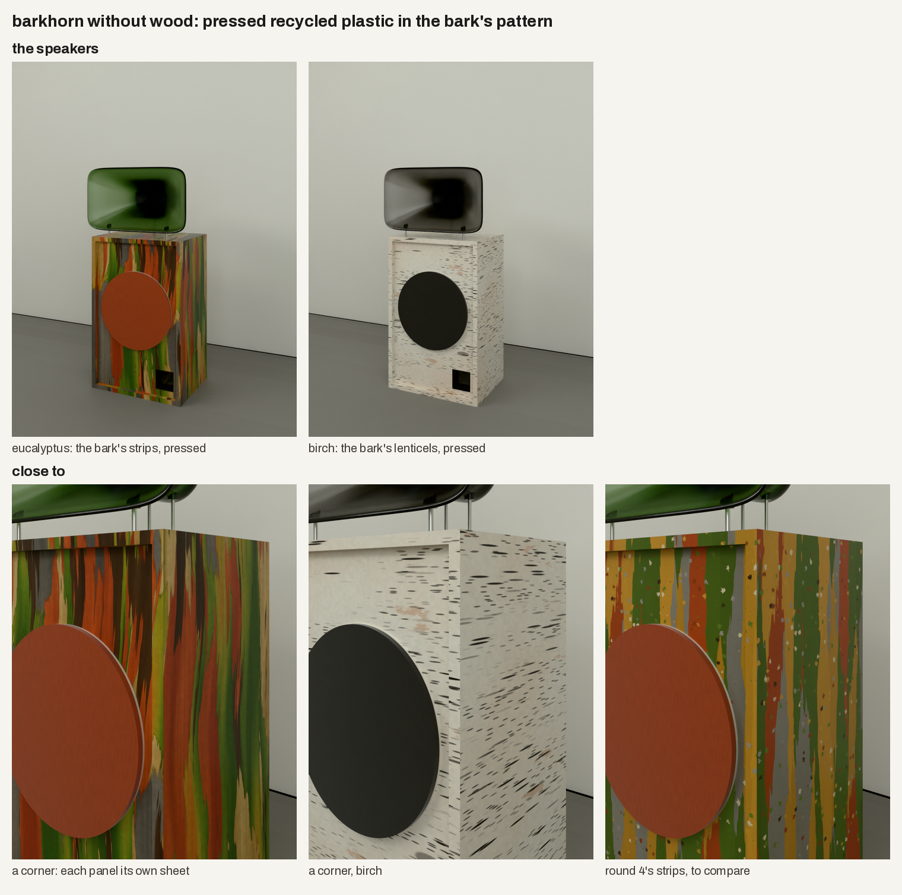

`pressed.py` builds a cabinet with no wood in it into `out-pressed/`:

- **Every panel is 25 mm pressed recycled HDPE**: the sides, top, bottom, back, front panel, two braces and the ribs. Each panel
  is one sheet, pressed to order in the bark's pattern; the largest, a side, is 420 x 880, inside a 1 m sheet. The ring
  (6 mm) and the disc's frame (12 mm) are HDPE too. No plywood and no MDF.
- **Welded, with no glue and no screws.** The corners are hot-plate butt welded, the bead planed flush. The front panel,
  the back, the braces and the ribs are extrusion welded inside, so the box is airtight. The woofer and the posts screw into
  threaded inserts made for plastics; HDPE will not hold a hammered T-nut.
- **Nothing moves against anything else.** HDPE grows 2 to 3.5 mm on an 880 mm panel over 20 degrees, and plywood hardly
  at all. That is why round 4's sheets on plywood needed loose screws and corner gaps. An all-HDPE box grows as one.
- **Stiffness.** HDPE is about a tenth as stiff as birch plywood. A 25 mm panel has about 40 % of the bending stiffness
  of 18 mm plywood, so a panel of the same span rings at about 0.45 of the plywood's frequency. Braces alone are not
  enough, because a side panel's first resonance is set mostly by its short span, front to back. So ribs 25 x 60 are
  welded on edge inside: one up each side at mid-depth, a pair up the back, one under the top and one over the bottom.
  A second brace (z 700, between the woofer and the top) shortens the long spans. As simply supported plates, the
  panels then ring at or above the plywood cabinet's: a side at about 550 Hz against 300, the top at about 320 against
  330. HDPE's own damping, several times plywood's, keeps whatever still rings low.
- **Weight**: about 52 kg a cabinet, against 24 in plywood: about 70 kg a speaker with its horn, woofer and amplifier,
  against 42. That is the real cost of no wood. Rotomoulding (below) is the way to a light one.
- **Inside**: 132 L net against 152. The port grows to 73 long to keep the box at 38 Hz, and the bass's -3 dB point
  rises from about 44 Hz to 49.
- **Production**: rotomoulded, double-walled recycled PE, as Technomad makes its speakers. The pattern would then be
  speckled rather than laid out.

**The pattern, as a maker would press it** (replacing round 4's; a 200 mm sample first, then one full sheet from a single
batch, since colour ratios drift between batches):

- **eucalyptus**, laid in layers as the bark sheds. The base is fresh underbark: streaks running up the sheet in deep
  green, olive, yellow and orange. Over it go patches of the older layers, each 50 to 200 wide and up to the panel's
  full height, drawn out up the sheet with their ends torn: straw, rust and grey patches, and a few brown ones. Lay a thin line of
  dark brown flake along each patch's edge, where the bark's shadow falls. Press near the final thickness so the layout
  does not smear.
- **birch**: a milk-white base of natural HDPE milk-bottle flake, about 90 %. In the top layer, black pieces 2 to 4 by
  10 to 40 laid horizontally in loose bands, the lenticels. Add apricot patches where birch peels and a few dark scars.

The renders use the barks' own shaders with a pressed finish (`pressed_eucalyptus_bark`, `pressed_birch_bark`). They
add flake mottle, crumbs of other colours and a satin face. The bark's shadows become lines of dark flake, and its
lifting edges are gone. Each panel's pattern starts afresh, as separate sheets do.

## Round 4: the owner's notes of 2026-10-11 (evening)

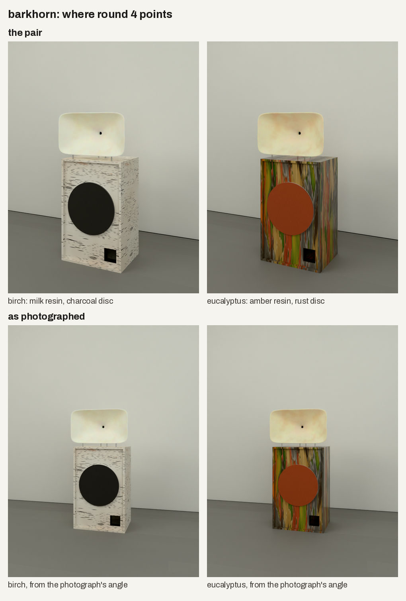

| the note | what changed |
|---|---|
| "I like the disc and your color recommendations." | The disc on the bark face is the **standard front** now, not an option: charcoal on birch (apricot the alternative), rust on eucalyptus. The other covers are out of the build; `P['cover']['alternatives']` brings them back as options. |
| "The way it's connected doesn't seem symmetrical or realistic." | **Four posts in the photograph's layout**, symmetric about the centre: a wide pair under the front of the mouth (183 each side of centre, 35 back) and a narrow pair under the driver (35 each side). Each post is stainless lamp tube, 10 x 7, threaded M10 x 1 at both ends. One end screws into a brass insert bonded in a pad cast under the horn; the other into an insert in the cabinet's top. The HF cable runs down inside a rear post, so no wire shows. The horn sits low, as photographed: its rim is 39 above the top (it was 80; the photograph's is about 37). |
| "I'm not sure about the waveguide. The shape ... still seem off." | **The photograph measured again.** Its horn is 629 x 366 outside: 1.72 : 1. Round 1 read 2.1 : 1, so every horn since was about 75 mm too short. Its rim is thin, its flare runs almost to the edge, and its corners are squarer (about 70 mm). The new horn is built to that: 626 x 361, a 10 mm rim rounded over, a 6 mm shell following the flare. It has two possible backs (below). |
| "... and the texture/color still seem off." | **A new resin** (`cast_resin` in `studio/engine/materials.py`): milky where it is thin, deepening toward honey where it is thick or seen edge-on, cloudy, bead-blasted, as the photograph's horn glows. The frames add a soft lamp behind the horn, as the photograph has the room behind it. The tints are below. |
| "Yes take the pressed recycled plastic further." | **Researched and made buildable** (below): who presses it, how stiff it is, how it joins and moulds; a buildable version (8 mm pressed HDPE sheet on the plywood, screwed from inside, never glued; round 5 made `pressed.py` the cabinet without wood, and `P['finish'] = 'faced'` still builds this one) with its own cut files, parts list and drawings; a pattern specification a maker can press to; renders with a new sheet material. |

### The horn, measured again

| | the photograph (scaled from the cabinet, 560 wide) | rounds 1 to 3 | round 4 |
|---|---|---|---|
| outside | 629 x 366 (1.72 : 1) | 633 x 292 (2.17 : 1) | 626 x 361 (1.73 : 1) |
| rim | thin; the flare runs almost to the edge | 10 flat (round 2), up to 30 (pebble) | 10, rounded over |
| corners | about 70 | rounder (superellipse 4.5) | about 70 (superellipse 7) |
| rim above the cabinet's top | about 37 | 80 | 39 |
| supports | four posts: a wide pair in front, a narrow pair behind | three rods: two in front, one behind | four posts, as photographed |

The flare: a 610 x 346 mouth, 200 deep from the 1 in throat, covering about 113 x 82 degrees (round 3's: 612 x 272,
170 deep, about 120 x 75). The mouth's area puts the horn's lower limit near 210 Hz, far below the 800 Hz crossover.

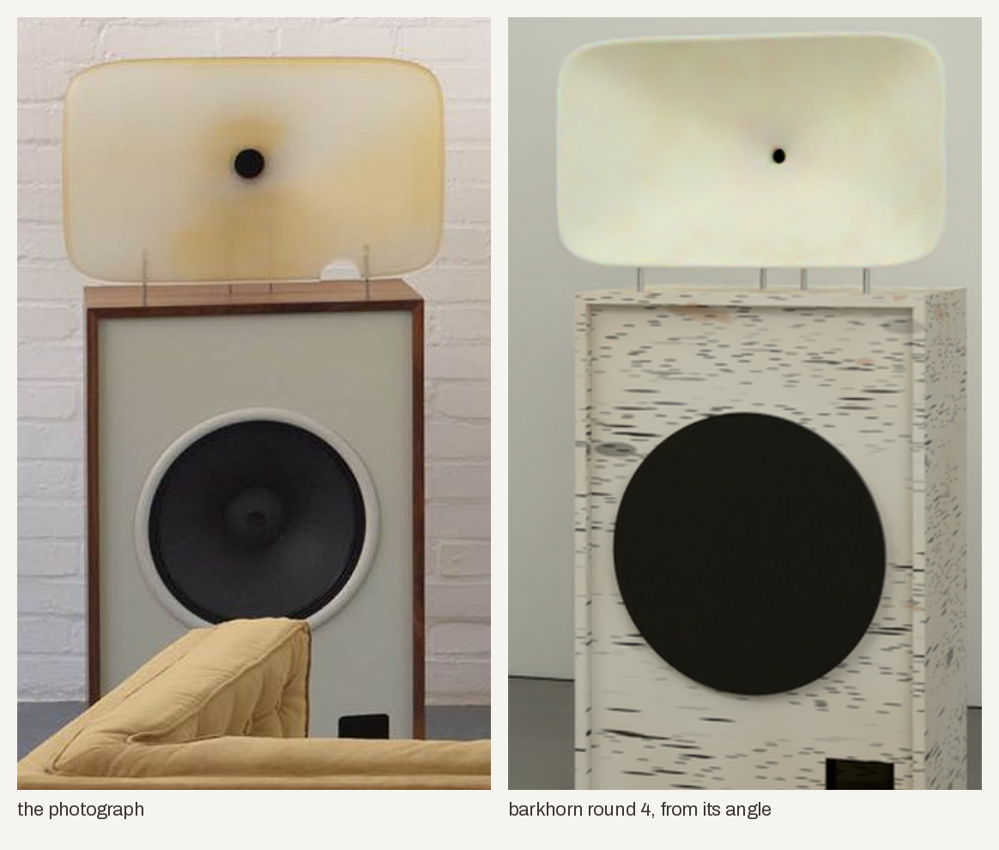

Seen from the photograph's angle and scaled to the same cabinet (`compare.py`), the horn now matches its width, height
and shape within a few per cent, and the posts stand where the photograph's do: an outer pair in front, an inner pair
behind. One difference is left: the photograph's dark throat is about twice ours (about 50 across against 25). A
compression driver with a 1.4 or 2 in exit, in place of the BMS 4550's 1 in, would match it; it would also change the
flare's throat.

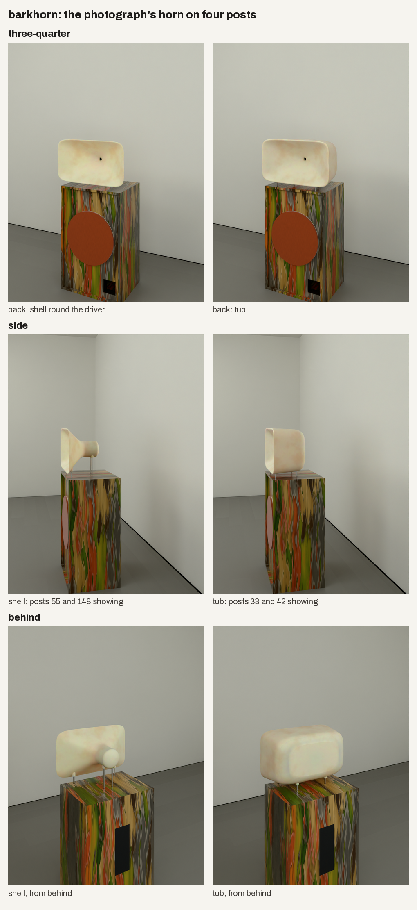

**Two backs**, the same from the front:

- **Shell** (the photograph's; my pick): the 6 mm shell follows the flare back to a round pod round the driver, closed
  by a cap; the neck round the throat is cast solid, so it deepens to a round halo as the photograph's does. It is the
  sleeker of the two and shows what it is: a horn. Its rear posts stand 148 under the pod (the front pair 55). Resin:
  about 2.4 L.
- **Tub**: the outside runs straight back from the rim to a flat back that hides the driver; the flare is its own skin
  inside, the space between filled with damping foam. All four posts are short (33 and 42) and the rear pair spreads
  wider (120 each side). It hides everything, but it is a 276 mm deep box: from the side it is the bulk round 1's horn
  had. Resin: about 4.9 L.

### The resin, close to

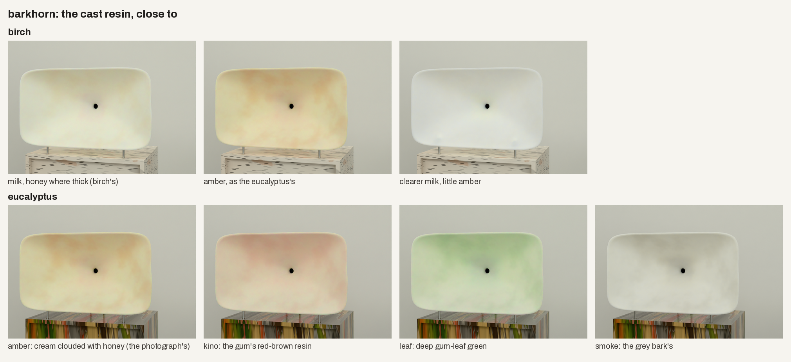

My picks: **milk on birch** (white, warming to honey where thick, faintly clouded) and **amber on eucalyptus** (cream
clouded with honey: the photograph's own, which takes up the gum's ochre). The red-brown kino read pink at a horn's
thinness and the leaf green as mint; the smoke is quiet but plain.
Cast resin glows only with light behind it, so the frames keep a soft lamp behind the horn, as the photograph has the
room behind it.

### Pressed recycled plastic, taken further

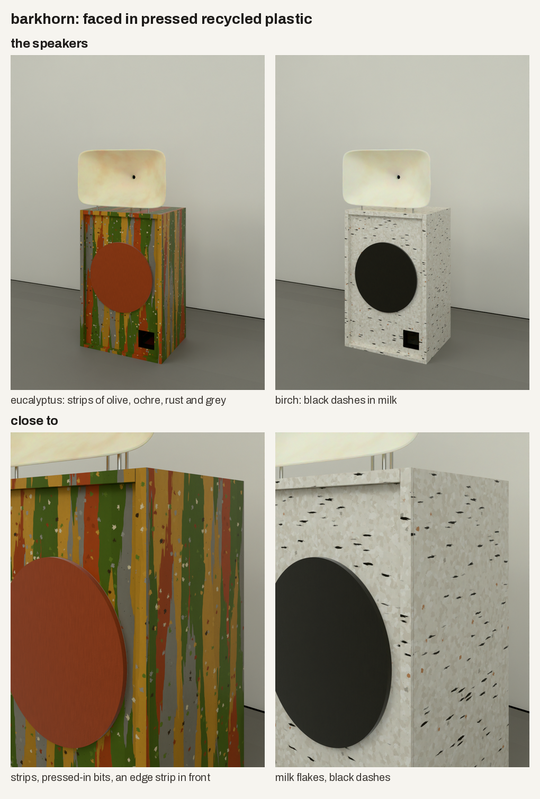

**What it is.** Coloured flakes of recycled plastic laid out by hand and hot-pressed into sheet, as a coloured record is
pressed. Laid flakes pressed without moving stay as patches; flow draws them into streaks. Makers press it to order:

| maker | plastic | sheets | custom patterns | published price |
|---|---|---|---|---|
| a Precious Plastic sheet-press workspace (many, worldwide) | HDPE, PP | up to 1 x 1 m, 5 to 30 thick (the SPR 2.3 press: 1.2 x 1.2 m) | yes: the buyer chooses the shred and the colours | stock 1 m HDPE sheets about EUR 50 to 60 plus shipping (undated listings, seen 2026-10-11) |
| The Good Plastic Company (Polygood) | recycled polystyrene | 2800 x 1400 and smaller, 10 to 20 thick | over 100 made for brands | about EUR 250 for 1 x 1 m (a resale listing, undated) |
| Smile Plastics (Wales) | recycled PET, HIPS, HDPE | 3000 x 1200, 12 or 20 thick | colour matching, gradients, fleck sizes (a 20-panel minimum on an old page) | panels by quote; samples about GBP 18 (undated) |
| Plasticiet (Rotterdam) | recycled polycarbonate | about 1 x 1 m, 12 to 19 thick | from 10 m2 | about EUR 575 to 625 / m2 (undated) |
| Yemm & Hart (Missouri) | post-consumer HDPE | up to 5 x 12 ft, 1/8 to 2 in thick | colours isolated in the feedstock | by quote; 8 to 12 weeks |

**Why the plywood stays.** Recycled HDPE is about a tenth as stiff as birch plywood (0.5 to 1.5 GPa against about
10). To be as stiff as 18 mm plywood, a panel would have to be about 40 mm thick; the box would go from about 28 kg to
80 and lose about 40 L inside. HDPE also grows 2 to 3.5 mm on an 880 mm panel over 20 degrees and creeps under load.
So the plywood box stays the structure, and the plastic is its face.

**How it was built in round 4** (now `P['finish'] = 'faced'` in `product.py`; round 5's `pressed.py` has no wood in it):

- each side, the top and the back faced in 8 mm pressed HDPE, and strips of it over the shell's front edges;
- each sheet screwed from inside through 8 mm holes in the plywood (stainless No. 8 pan heads and washers, about 150
  apart), never glued: HDPE glues badly (only special acrylics, 3M DP8005 or DP8010, hold at all), and every sheet
  must be free to move;
- 1.5 mm gaps at every corner for that movement; the posts pass through 14 mm holes in the top sheet, free of it;
- the front panel faced in 5 mm of the same sheet instead of bark;
- five 1 m sheets of 8 mm and two of 5 mm for the pair.

**The pattern, as a maker would press it** (to send with an order; a 200 mm sample first, then one full sheet from a
single batch, since colour ratios drift between batches):

- eucalyptus: full-height vertical strips 20 to 80 wide, cut from thin single-colour pressings and laid side by side,
  olive about 35 %, ochre 25 %, rust 20 %, grey 20 %, with a few smaller pieces of cream, brown and green among them.
  Load the mould near its final thickness so the strips do not smear, and keep any flow vertical;
- birch: a milk-white base (natural HDPE milk-bottle flake, about 90 %) with black pieces 2 to 4 x 10 to 40 laid
  horizontally in the top layer, about 3 to 6 % of the face, and a few tan pieces where birch peels.

The renders use a new procedural sheet material (`pressed_eucalyptus_sheet`, `pressed_birch_sheet`): melted flakes at
three sizes, their edges smeared by the press's flow, each strip a little lighter or darker than the next and marbled
inside, a waxy face.

**The moulded enclosure** (the owner's first idea: one moulding that the wires run through). The closest thing made
today is rotomoulding: Technomad rotomoulds one-piece polyethylene speaker shells with the horn, the driver's cavities,
the port and the fixings moulded in, in recycled polyethylene (90 % post-industrial, 10 % post-consumer), and its Berlin model is this speaker's layout (a 15 in
woofer and a compression driver on a horn). Rotomoulding colour-sorted flakes gives a speckled terrazzo, not strips;
moulds run from a few thousand dollars to over a hundred thousand. Compressing the horn itself from flakes is not
realistic: a part this size needs a press of about 200 tonnes, and thick HDPE sinks and warps as it cools. That makes
rotomoulding a production route, after a pair has been built with pressed sheet on plywood.

Sources (searched 2026-10-11; prices are as listed, mostly undated):
[Precious Plastic sheet-press workspace](https://community.preciousplastic.com/library/set-up-a-sheetpress-workspace),
[SPR 2.3](https://community.preciousplastic.com/library/spr---23),
[Bazar HDPE sheet](https://bazar.preciousplastic.com/raw-material/sheets/multi-color-hdpe-sheet-1x1-meter-size-and-8-25-mm-thickness-ready-stock-available/),
[Polygood](https://en.wikipedia.org/wiki/Polygood),
[Polygood sizes](https://thegoodplasticcompany.com/workability/),
[Smile Plastics custom](https://smile-plastics.com/custom/),
[Smile Plastics sizes](https://smile-plastics.com/materials/mawn),
[Plasticiet Karlite](https://www.plasticiet.com/karlite),
[Yemm & Hart patterns](https://yemmhart.com/wordpress/pioneers-in-eco-materials/colorful_plastic_sheet/origins-patterns/),
[HDPE modulus](https://engineeringtoolbox.com/young-modulus-d_417.html),
[birch plywood](https://www.metsagroup.com/globalassets/metsa-wood/dop-documents/dop_metsa_wood_birch_plywood_muf_2019-12-2_en.pdf),
[HDPE movement](https://smile-plastics.com/materials/grey-mist),
[3M DP8010](https://multimedia.3m.com/mws/media/2365938O/3m-scotch-weld-structural-plastic-adhesive-dp8010-blue.pdf),
[HDPE on plywood](https://yemmhart.com/wordpress/pioneers-in-eco-materials/colorful_plastic_sheet/origins-fabrication-installation/),
[Technomad](https://www.svconline.com/news/howttsmade-story-behind-how-technomad-manufactures-its-weather-tech-loudspeakers-364916),
[Technomad Berlin](https://www.fullcompass.com/common/files/11672-TechnomadBerlin9040.pdf),
[rotomould costs](https://www.jinhongmold.com/news/how-much-does-a-rotational-mold-cost/),
[compression pressures](https://books.byui.edu/plastics_materials_a/compression_molding).

## Round 3: the owner's notes of 2026-10-11

| the note | what changed |
|---|---|
| "Maybe bark face with a solid color cloth grille." | Both readings are rendered, on both barks (`../../renders/2026-10-11/barkhorn/front.png`). The first is the front faced in bark under a full cloth grille in one colour, so the bark shows when the grille comes off. The second is a **cloth disc** over the woofer alone, so the bark and the colour show together. The disc is a new option: a 12 mm MDF ring frame on the woofer's ring, the cloth across its face and round its edge, held by magnets, its face 18.5 clear of the cone. |
| "The eucalyptus is sick." | Kept as it is. |
| "The waveguide still needs work." | A **study of five forms** (below; `../../renders/2026-10-11/barkhorn/study.png`). Each is built in the CAD on the same speaker and seen from the front, the side and behind. |
| "Also open to more experimental shit." | **Material experiments** (below; `../../renders/2026-10-11/barkhorn/experiments.png`): the cabinet in pressed recycled plastic, and the waveguide in strata or terrazzo resin. |

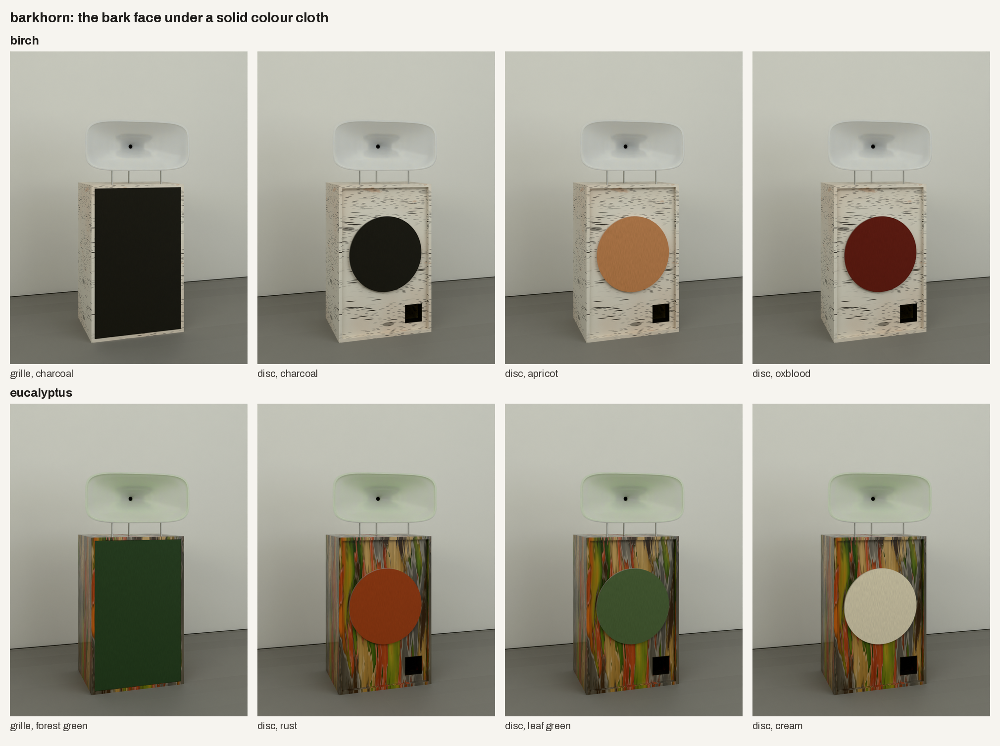

**My picks for the front:** the disc, charcoal or apricot on birch and rust on eucalyptus. Each takes a colour the
bark already has: birch's lenticels or its peel, the gum's rust strips.

### The waveguide study

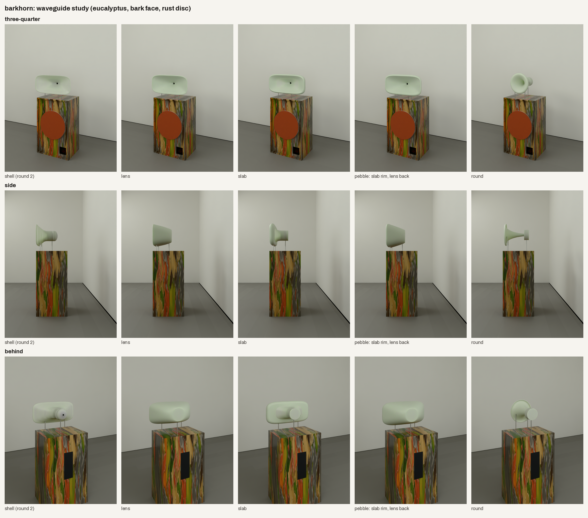

What was wrong with round 2's shell, now that it is seen from every side:

- From the front it reads as a moulded basin, not as frosted resin with any depth.
- From the side, a funnel with a can behind it reads as a megaphone.
- From behind, the pod is a bulb stuck on.

| form | what it is | resin (production) | read |
|---|---|---|---|
| shell (round 2) | a 6 mm shell following the flare, a pod behind round the driver | 1.5 L | thinnest; a megaphone from the side, a bulb from behind |
| lens | thin at its edge, curving back to a round back that holds the driver | about 5 L cast hollow (18 L solid) | one stone, nothing showing; from the front much as the shell |
| slab | a 64 mm slab with fully rounded edges (the photograph's soft rim), the rest of the flare in a tail behind | 6 L solid (about 4 L hollow) | the most presence from the front; a neck and pod behind |
| **pebble** | the slab's rolled rim (30 round the mouth) on the lens's smooth back | about 5 L cast hollow (19 L solid) | the soft rim from the front, a stone from the side and behind |
| round | a round tractrix horn for 400 Hz, its lip rolled back, a closed can behind | 1.1 L | a trumpet; rhymes with the disc, beams more at high frequencies |

The hollow volumes are a 7 mm skin over every face, from the CAD's surface areas. The shell, lens, slab and pebble
share one flare: 612 x 272 at the mouth, 170 deep, about 120 x 75 degrees. They
differ only in how they look and what they weigh. Each was checked against the rods (cut to its underside) and the
driver (no clashes). The round horn is acoustically different: it is axisymmetric, and its coverage narrows as the
frequency rises.

**My pick: the pebble**, in strata resin on eucalyptus and in terrazzo on birch (below). It hides the driver as the
round-1 block did, but tapers to a thin edge, so it reads as one sculpted stone rather than a box. The resin's
thickness shows as a glow and a deepening of colour, which the thin shell could not.

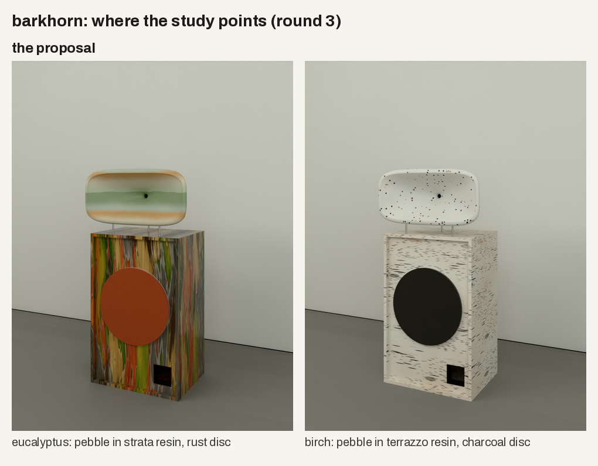

### Material experiments

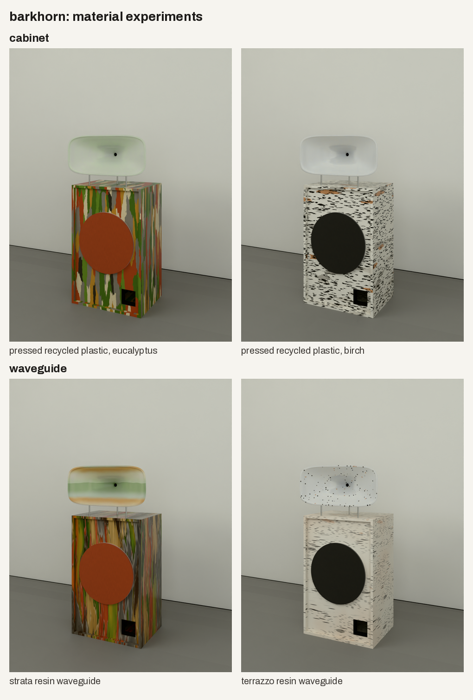

- **Pressed recycled plastic** (the owner's vinyl-pressing idea of 2026-10-11). Flakes of coloured HDPE are laid out
  and hot-pressed into sheet, the press's flow drawing them out:
  - eucalyptus: strands of green, ochre, rust and grey stretch into camo strips;
  - birch: black flakes in white stretch into lenticel dashes.

  The sheet is welded, not glued. A cast or rotomoulded cabinet in the same pattern would need ribs or a stone-filled
  resin to be as stiff as the plywood.
- **Strata resin**: the waveguide poured in layers of the gum's colours (sage, cream, honey), each a few centimetres
  thick, their boundaries wavy. It reads as agate and glows where the resin is thick.
- **Terrazzo resin**: milky resin with recycled plastic chips cast through it (black, grey, apricot): birch's
  lenticels again.

These are renders of the idea. The materials are procedural (`pressed_eucalyptus`, `pressed_birch`, `frosted_strata`,
`frosted_terrazzo` in `studio/engine/materials.py`). A sample from a maker comes before any of them is drawn up.

## Round 2: the owner's notes of 2026-10-10

| the note | what changed |
|---|---|
| "It's interesting that you made the waveguides so thick. I kind of like that less of the innards are exposed that way potentially, but it does make it look less sleek and more pudgy." | The waveguide is now a **thin cast shell**. It is 6 mm thick and follows the flare outside as well as in, with a 10 mm rim at the mouth. Behind the throat, a round **pod** 148 across closes round the compression driver, and a cap closes the pod. Nothing inside shows, and the horn reads as one sheet bent into shape (`../../renders/2026-10-10/barkhorn/back-v3.png`). It uses about 1.5 L of resin. It stands on three rods (two under the mouth, one under the pod), each cut to meet the shell's underside. |
| "The eucalyptus looks too pastel and not like the long strips of peely camo-ish bark. Like a eucalyptus after rain." | The bark is redrawn as a smooth-barked gum sheds it, in **layers**. The fresh underbark is streaked deep green, olive, yellow and orange. Over it lie older layers in long vertical strips: straw, rust, grey, then brown. Each strip's edge lifts, with a dark shadow under it and a lit, curled lip. Everything is **wet**: deeper and more saturated, glossy, with rain-darkened runs (`../../renders/2026-10-10/barkhorn/eucalyptus-detail-v3.png`). |
| "Open to ideas on front panel covers" | **Five covers**, each built in the CAD with its own cut files and parts list, and rendered on both barks (below). |

## What the photograph shows, and how it is built here

| in the photograph | here |
|---|---|
| a bass cabinet about 1 : 1.6 | 560 wide, 880 tall, 420 deep, standing on felt glides |
| a thin walnut shell framing a pale front panel set back in it | The shell (sides, top, bottom, back) is 18 mm birch plywood faced in **bark**, wrapped round its front edges. The front panel is set back 24 mm and painted pale. 24 mm is deep enough for a cover to clear the cone. |
| a 15 in black cone in a wide off-white ring, its centre a little above the middle | FaitalPRO 15PR400-8 (treated paper cone, 99 dB), flush in its rebate, its centre 45.7 % down. A 6 mm MDF ring 436 across lies over its frame, with pockets behind for the screw heads. |
| a small square port at the bottom right | A 100 mm square printed port, bottom right, 53 long. The box is about 152 L net, tuned to 38 Hz; f3 is about 44 Hz in half space before room gain (`.venv-fab/bin/python spinoffs/barkhorn/product.py`). |
| a frosted, translucent rounded-rectangle waveguide about 629 x 366 (1.72 : 1), wider than the cabinet, its rim thin, the throat a dark dot near its centre | Since round 4: 626 x 361 outside, a 610 x 346 mouth, a 10 mm rim rounded over. Its flare is 200 deep, with the pod 70 behind it. It is a superellipse waveguide: round at the 1 in throat, squaring toward the mouth (corners about 70), covering about 113 x 82 degrees. It is a 6 mm shell cast in tinted translucent polyurethane, its neck solid, bead-blasted to frost. (Rounds 1 to 3: 633 x 292, read wrongly as 2.1 : 1.) |
| it stands on four slim posts, a wide pair in front and a narrow pair behind, its rim just above the cabinet | Since round 4, four posts in that layout: stainless lamp tube 10 x 7, M10 x 1 into brass inserts in pads under the horn and in the top, the HF cable inside a rear one; the rim 39 above the top. (Rounds 1 to 3: three rods, 80 clear.) |
| (not visible) | A BMS 4550-16 compression driver (polyester diaphragm, 113 dB) sits in the pod. A Hypex FusionAmp FA122 on the cabinet's back crosses at about 800 Hz and pads the HF channel about 14 dB. Part of the pad is a passive L-pad after the amplifier, so its hiss stays inaudible. |

## The two finishes (proposals)

| | shell | front panel | ring | waveguide |
|---|---|---|---|---|
| birch | paper birch: chalk white, dark lenticels in bands, a few scars, apricot where it has peeled | faced in its bark, under an oat cloth disc `#CFC8BA` (round 7; charcoal `#2E2C2A` in rounds 4 to 6; the paint behind, pale warm grey `#D8D5CD`) | the disc's oat (round 7; off-white `#EEEAE2` before) | milk resin `#F2EEE6`, warming to honey `#D9AE6E` where thick, faintly clouded (round 4) |
| eucalyptus | a smooth-barked gum after rain: underbark streaked green, olive, yellow and orange under strips of straw, rust, grey and brown, wet | faced in its bark, under a graphite cloth disc `#4B4844` (round 7; rust `#9A4526` in rounds 4 to 6; the paint behind, pale sage grey `#CBCFC4`) | the disc's graphite (round 7; cream `#E8E2D4` before) | cream resin `#EFE5D0` clouded with amber `#D6A04E`, the photograph's own (round 4; round 2's sage read pastel) |

- **The renders.**
  - Both barks are procedural materials (`birch_bark` and `eucalyptus_bark`).
  - The waveguides use a cast translucent resin (`cast_resin`, random-walk subsurface scattering, since round 4;
    `frosted` before), and the covers use `cloth` and `cork`.
  - All of them are in `studio/engine/materials.py`.
  - Photographed CC0 bark (Poly Haven, ambientCG) would need those hosts allowed in the environment's network
    settings.
- **The real finish.**
  - Birch: real bark sheet (*Betula papyrifera*, from fallen or felled trees) laminated with PVA in a vacuum bag and
    sealed matt.
  - Eucalyptus: the shed bark of a smooth-barked gum (a snow or spotted gum) pressed flat and laminated the same way,
    or a UV-printed veneer of it. The wet look is a satin or gloss sealer, which deepens bark's colours as rain does.

  Approve a sample board first.
- **The waveguide** is cast in a two-part silicone mould from a CNC-cut plug, and the cap in a small mould of its own.
  The parts list spreads a mould budget of $900 for the shell and $250 for the cap over the pair. Tinting the resin per
  finish costs nothing more.

## Front covers (options)

Since round 4 the disc on the bark face is the standard front, and the other covers below are out of the build
(`P['cover']['alternatives'] = True` brings them back as options, the disc and the bark face with them).

Each cover sits in the 24 mm recess, 1.5 clear of the shell all round. A grille stands flush with the shell's front on
four pegs into cups in the panel's corners. Its back stays at least 16 clear of the cone at rest, which leaves 4.5 mm
even at twice the woofer's Xmax. The woofer plays only below 800 Hz, so a slotted grille open about a quarter of its
face costs it nothing audible: the air behind it resonates in the slots near 1.9 kHz, over an octave above the
crossover.

| option | what it is | the look |
|---|---|---|
| bare (as now) | the painted panel, the ring and the cone, as photographed | the reference, unchanged |
| cloth grille | acoustically transparent knit stretched over a 6 mm MDF frame (sprayed black), its face 1 back from the shell's front; oatmeal `#DCD6C8` on birch, eucalyptus-leaf green `#6F7F66` on eucalyptus | calm and flat: the bark and the horn carry it alone |
| lenticel grille (birch's own) | 6 mm birch plywood sprayed the panel's colour, cut with 394 round-ended 6 mm slots in rows of short dashes of random length, as birch's lenticels; 24 % open | the woofer hidden behind the bark's own pattern: dark dashes on pale, as on the shell |
| strip grille (eucalyptus's own) | 6 mm spotted-gum plywood (a eucalypt hardwood face), oiled, cut with 124 long vertical slots in columns, bridged at random heights, as the bark's strips; 28 % open | warm timber under the wet bark: the tree's wood in front, its bark round it |
| bark face | the panel faced in the bark itself (1 mm), cut round the ring and the port | a log with a speaker in it; the boldest |
| cork face | 3 mm cork sheet laid on the panel round the ring and the port; dark, as smoked expanded cork | cork is bark too (the cork oak's): a third bark, dark behind the white ring |
| cloth disc (round 3) | the woofer alone covered: a 12 mm MDF ring frame on the woofer's ring, the cloth across its face and round its edge; four magnet pairs hold it, their partners in pockets behind the ring, so the ring's face stays clean without it; any solid colour | a circle of colour on the panel or on its bark face; the bark shows round it |

The slot patterns are seeded, so a rebuild cuts the same panel. Their cut files are in `out/dxf/`, nested on sheets of
their own. The covers' materials are budgets only where the kit has a rate: the cloth, the pegs, the bark, the cork
sheet and the spotted-gum plywood show [PRICE] until a supplier's figure is entered. The woofer's roll height is
proportioned (the datasheet gives none). Confirm on a driver that its roll does not stand proud of its flange before a
grille is fitted.

**My picks:** the **lenticel grille on birch** and the **strip grille on eucalyptus**, each cover drawn from its own
tree. Bare stays the reference for both.

## The fabrication package

Built with the fab kit (`studio/fabkit`):

    .venv-fab/bin/python studio/fabkit/build.py spinoffs/barkhorn/product.py
    .venv-fab/bin/python studio/fabkit/build.py spinoffs/barkhorn/pressed.py --out spinoffs/barkhorn/out-pressed
    python3 spinoffs/barkhorn/frames.py horn5           # a comparison sheet (each set is listed in frames.py)
    python3 spinoffs/barkhorn/compare.py renders/2026-10-12/barkhorn/pick5/pick5-photo-birch.png OUT.png

The waveguide's form is `P['horn']['form']` in `product.py`: `cast` as built today (the photograph's, its back
`P['horn']['cast']['back']`: `shell`, the owner's pick, or `tub`); round 3's study forms (`shell`, `lens`, `slab`,
`pebble`, `round`) are still there, on round 4's 1 in throat. `frames.py` builds the study models a set needs into
`out/study/` first. The resins are flavours (`VARIANTS`, from `HORNS`): `birch` and `eucalyptus` take the proposal,
and `birch-clear`, `birch-black`, `eucalyptus-green` and the rest take the others.

`product.py` writes `out/`:

- STEP and STL;
- DXF cut files for the plywood (three 1525 mm sheets), the MDF ring and the disc's frame;
- the checks (no clashes);
- the parts list (`bom.md`): about $4,680 for the pair at budget rates (round 4: $3,520; the 2 in drivers add about
  $720 and the larger horn's resin the rest), before the unpriced items (the bark, the cloth, the magnets, the fixings,
  the posts' inserts and a few small parts);
- 14 A3 drawing sheets (`out/drawings/barkhorn-sheets.pdf`): the assembly, each sheet part (the ring and the disc's
  frame with their magnet pockets), the cast horn, its cap, the driver's adaptor ring and the posts, and the notes;
- the render model.

`pressed.py` builds the cabinet without wood, the line since round 6, into `out-pressed/`. Every panel, brace and rib
nests on ten 1 m sheets of 25 mm HDPE for the pair, the rings on one of 6 mm and the disc's frames on one of 12 mm.
The parts list is about $4,350 before the unpriced items; the pressed sheet has no published dated price, so its lines
stay open, as does the weld rod. There are 15 drawing sheets.

The shots are in `studio/shots/barkhorn/`:

- `front`: the pair, as photographed;
- `birch` and `eucalyptus`, round 7's `manzanita` and `snakebark`, and round 8's `crag`;
- `eucalyptus-detail`: the bark close to;
- `back`: the waveguide from behind;
- one folder per comparison sheet, one shot per frame: `covers/` (round 2), `front/`, `study/`, `experiments/`,
  `proposal/` (round 3), `horn/`, `resin/`, `pressed/` and `pick/` (round 4), `horn5/`, `shells/`, `woodfree/` and
  `pick5/` (round 5), `pick6/`, `printed/` and `cabinets/` (round 6), `discs/` and `lookbook/` (round 7).

## Open questions for the owner

1. **The line names.** Bark, Cloud and Crag, or the plain Tree, Cloud and Stone? (The owner: "Trees, Clouds, Stones.
   Maybe there's a better name for each category though.") Bark and Crag are kept as the proposal: Bark echoes the
   brand, and Cloud and Crag alliterate.
2. **The marks' colours.** One for each speaker, from its material (the table above). Change any?
3. **Crag as cast stone** (heavier, by quote), or pressed HDPE where the pattern allows (the marble and the banded
   stones)?
4. **The disc.** Oat on birch and graphite on eucalyptus, or another neutral from the study?
5. **The bark horns for the line.** Do the cast-in bark horns replace smoked and bottle green on the birch and
   eucalyptus everywhere (the default flavours and pick6), and on clear resin or on round 6's light smoke and green?
6. **Samples.** Order the core set (about $310 to $430 plus shipping): a custom-laid HDPE test sheet in each pattern,
   the commercial benchmarks, a resin step wedge and acrylic tints? And send the horn for casting quotes?
7. **Price.** [PAIR PRICE] stays open.
