# barkhorn: EARF's horn speaker, after Friendly Pressure, in bark, acrylic and stone

The owner's idea of 2026-10-10 was speakers that look like their reference photograph of Friendly Pressure's horns
(`reference/friendly-pressure-owner-2026-10-10.jpg`, with two more of the same speakers in a bar and a studio beside
it). The brand is **EARF**, its logo the B3 globe of circles beside the name built of the marks' shapes (the owner, round
11, "B3 final for now"; Dogs Barking before it, round 10); barkhorn stays the project's name in this repository.

Status: **concept, round 20**. The proportions follow the photograph. The sizes are scaled from its turntable (about 450
wide), and the horn from the cabinet (round 4). The horn runs the cabinet's full depth on a 2 in driver (round 5).
Decided by the owner: no wood (the cabinet is pressed recycled HDPE), the solid neck round the throat, and a port in
each bottom corner (round 6). The disc takes a colour that suits each cabinet, the woofer's ring the same colour, and a
patterned horn has its pattern cast in, not printed (round 7). The horn is golden yellow on birch and the cast-in bark
pattern on eucalyptus everywhere, and the discs on eucalyptus and manzanita take their bark's colour (round 11). Round 8 made the speakers three lines, and round 10 names them Bark (pressed recycled plastic in the pattern of a
bark: eucalyptus, autumn birch, manzanita, striped maple), Cloud (translucent cast acrylic: Poison, Smoke, Fog) and
Crag (pressed recycled plastic in the pattern of a stone, the horn cast resin: cobalt marble, malachite, lapis lazuli,
turquoise). Each speaker has an acrylic mark, its line's shape in its own colour, and the brand's globe and wordmark are
drawn the same way. Round 13 lines every cabinet, the lining showing as cloud through the Cloud line's acrylic. It also
makes the design real where a reality check found it was not: what holds the horn, seals the box, encloses the
amplifier, protects the drivers and carries the wiring. Round 14 settles what the owner chose from that: the back comes
off, the speaker stands on levelling feet, and the ports are round tubes framed square. It draws the Cloud cabinet in
cemented acrylic and proposes a price, and shows the choices still open side by side. Round 15 builds what the owner
picked from those: rounded port mouths, the 20 mm sheet for every cabinet without wood (the Cloud's in acrylic), the
Cloud's ports in its own acrylic, and the price: $16,000 a pair for Bark and Crag and $19,000 for Cloud, sold direct.
Round 16 holds the horn's cap on a twist-lock, so no screw shows, and makes the back's screws black; it renders
three speakers as a sheet press would really make them, and weighs recycled plastic against new plastic and wood.
Round 17 makes Cloud the line (the owner: no wood, Bark and Crag paused): two more colours, Acid and Haze, the look
book Cloud's alone, and the makers of recycled cast acrylic to approach. Round 18 adds Dust and Ice, calls the line
the Clouds, gives the R a bowl flat from the stem, draws the logo in the seven colours, and finds that the cabinet's
top and bottom want more lining. Round 19 makes the Clouds a full spectrum of eight (Ember added in red, Smoke made
black, all numbered again in that order) and draws the R's bowl as a circle again, on stems widened to meet it, each
letter as wide as its shape needs. Round 20 draws the globe as a colour wheel of the Clouds, eight circles through one
centre, and animates the brand as a film studio's ident: a pen draws the circles at one steady speed, or they
bloom out of one, then the name.

## Round 20: the wheel, and the ident (the owner's notes of 2026-10-15)

> I wonder if the earth can be formed a different way, like overlapping concentric circles that form a larger circle,
> kind of like a color wheel. I also would love the brand to work like a movie studio animation before a movie
> starts, where the world and/or earf are animated somehow, like a Spirograph type thing where a black dot rotates
> around several times to create a circle of circles, each adopting a color as its mini circle is traced.

A first version set the circles in a ring round a black dot, the rim drawn between them. The owner's note on it:

> It's too much like a film reel and the acceleration changes too much as it draws. It should be on fluid motion, and
> it shouldn't have to create a stroke outside of each circle. I'm open to more ideas here as well.

So the ring, the rim and the dot have gone, and the wheel and its ident are drawn again.

### The wheel

The globe drawn as a colour wheel of the eight Clouds (`wheel` in `brand.py`; `brand/globe-wheel.svg`). There is one
circle for each Cloud, in spectrum order, from Ember at the top clockwise to Smoke. Each circle's radius is half the
wheel's, and each passes through the wheel's centre, so the eight overlap like petals. Their outer edges trace the
larger circle without its being drawn.

- **On paper**, each circle is its acrylic's own tint. Where circles overlap the tints multiply, as sheets of tinted
  acrylic do laid one on another, and Fog's white frosts what lies under it. The lines are lighter than the letters'
  (4.95 against 17.6 at the lockup's size), because they are many and close.
- **As light** (`brand/globe-wheel-light.svg`), on a near-black ground, the speakers' own colours add towards white
  where they overlap, and Smoke's black shades what it covers.

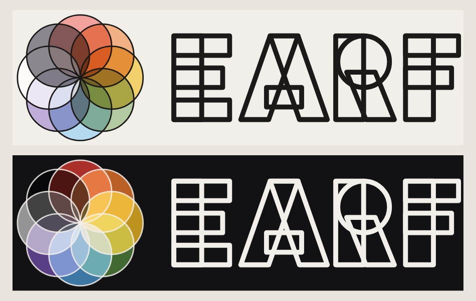

### The ident

`ident.py` writes `brand/ident.html`, a page that plays the brand the way a film studio's ident plays before the
film. It is also published privately as an Artifact, *EARF Ident*. The wheel comes on in one of two ways, on either
ground, and the page lets you pick:

- **Pen.** A dot draws each circle at one steady speed, from its outermost point, clockwise, and the circle's tint
  sweeps in behind it. At that point each circle runs along the wheel's edge, so between circles the pen swings along
  the edge to the next, drawing nothing. It never stops and never turns a corner. It speeds up once, as it starts, and
  slows once, at the end, lifting as it comes back to the top where it began. Each circle takes 0.63 seconds.
- **Bloom.** The eight circles start stacked as one, grown from a dot, and part in one movement, turning as they
  spiral out to their places. Stacked, the eight tints multiply to nearly black, as eight sheets of the acrylic would,
  and as light they add to white. So on paper a black disc opens into the colours, and as light white parts into the
  spectrum.

Then the wheel moves aside and shrinks to its place in the lockup. EARF is drawn beside it, letter by letter at a
steady pace, then the line, NEATURE-INSPIRED LOUDSPEAKERS.

It also writes an MP4 of each, 1280 x 720 at 30 frames a second: `brand/ident-pen-paper.mp4` and
`brand/ident-pen-light.mp4` (10.4 seconds), and `brand/ident-bloom-paper.mp4` and `brand/ident-bloom-light.mp4`
(7.3 seconds).

The page draws on a canvas from the same geometry as the marks, so it stays sharp at any size and weighs about 17 KB.
On earf.world it could play as the site opens, in place of a video. The letters are drawn as outlines; their blue fill
can come back. The look book keeps the B3 globe until the owner picks (an open question).

## Round 19: the full spectrum, and the R a circle again (the owner's notes of 2026-10-15)

> What if we did a full spectrum, red orange yellow green blue purple white and black
>
> No I think it should still be a circle but the vertical rectangle could be slightly wider to achieve the same
> effect, no?
>
> And should each of the letters be the same width or no? What's standard design convention?
>
> Smoke was meant to be the black one

### The full spectrum

The Clouds are now eight, in spectrum order, and numbered again in that order. One red speaker is added, Smoke goes
from grey to black, and round 10's grey leaves the line (`cloud-red` and `cloud-black` in `product.py`):

| | name | the acrylic | the horn | the cover and ring |
|---|---|---|---|---|
| 01 | **Ember** (new; a working name) | red (#F2A29C through 25 mm) | red (#C8262B) | oxblood (#7A1A1C) |
| 02 | Dust | orange | orange | rust |
| 03 | Acid | golden yellow | golden yellow | ochre |
| 04 | Poison | bottle green | bottle green | bottle green |
| 05 | Ice | ice blue | blue | deep blue |
| 06 | Haze | violet | deep violet | deep violet |
| 07 | Fog | frosted white | clear | pewter |
| 08 | **Smoke**, now black | a deep smoked black (#8A888E through 25 mm) | smoked black (#2A292C) | black |

- **Ember** is a working name. A cloud of embers hangs in the air as the other seven names do. Other candidates are
  Flare (a flare's red smoke) and Blaze.
- **The black Smoke.** The owner: "Smoke was meant to be the black one". Round 10 had drawn it smoked grey. It stays
  translucent: deep enough to read as black, light enough that the braces and the lining show inside as shadows. A
  first try at #6E6C72 hid them altogether.
- **The new numbers.** Poison, Cloud 01 since round 10, is Cloud 04 now. The room page says so.

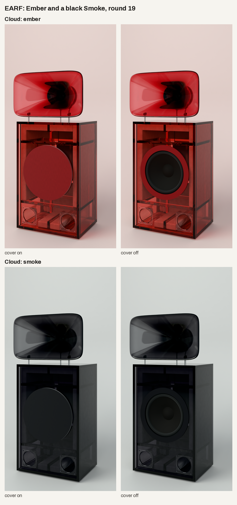

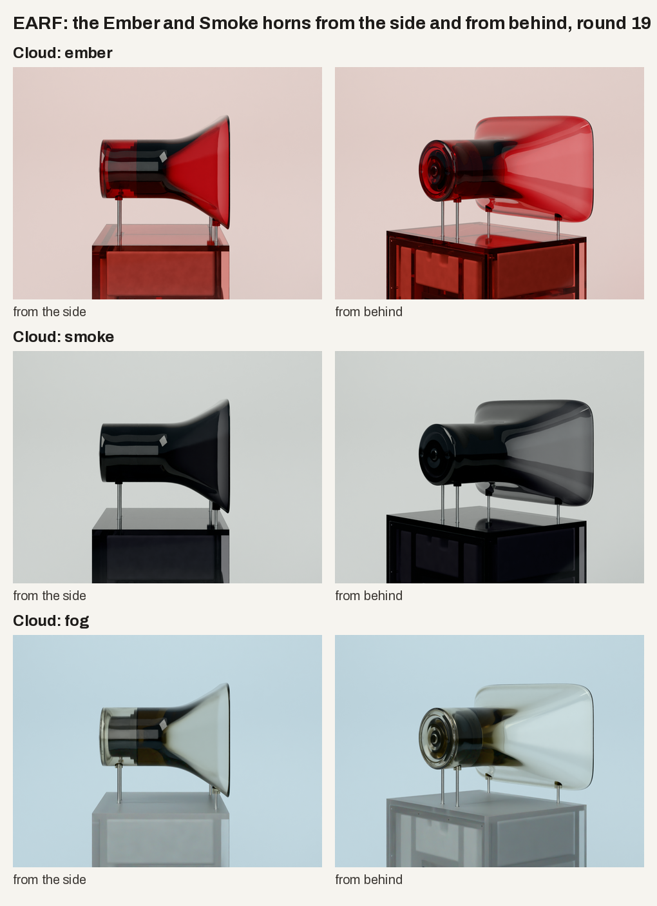

### The R, a circle on a wider stem

The owner's idea works. A circle meets the cap line at one point, its top. If the stem's right edge reaches exactly
that point, the stem's top edge runs flat into the circle, with no notch.

- **The stem must be 100 wide** (it was 74). The bowl is 185 tall, ending where the E's middle bar does, so the
  circle's radius is 92.5. With its centre on the stem's right edge, it must also stay inside the stem's left edge.
  Any narrower and the circle would bulge out past the stem's left side.
- **Every stem is 100, so the letters keep one weight**: the E's and the F's too.
- **The diagonals match.** The A's legs and the R's leg are drawn as heavy as the stems, measured square to their run.

### Should the letters be the same width?

No. In type, letters are proportional: each is as wide as its shape needs. What stays constant is:

- the stroke weight;
- the cap height;
- the space between letters, as the eye judges it (round and slanted letters sit a little closer).

Equal widths belong to monospaced type, such as typewriter faces and code, and are a deliberate style. The usual order,
widest first:

1. **A**, a triangle;
2. **R**, with its bowl and leg;
3. **E**;
4. **F**, drawn narrower because its open foot makes it look wider than it is.

EARF now follows that order: A 310, R 210, E 200 and F 190, on a cap height of 300. Before, E, R and F were all 200.
The rules are written in `marks.py` (`_wordmark`).

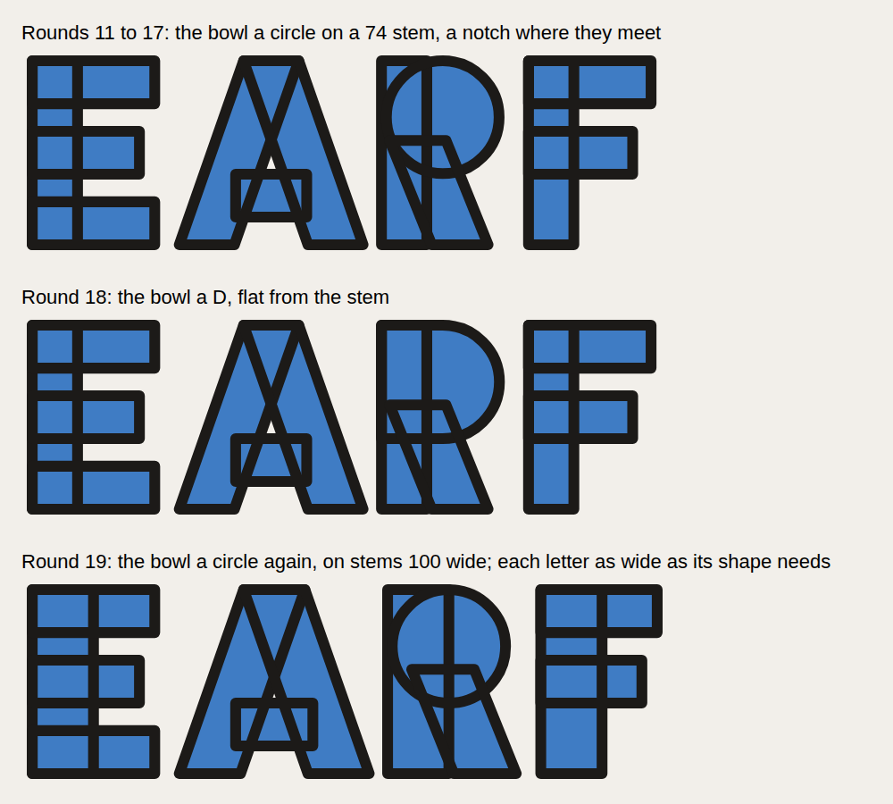

The marks and the brand sheet (`brand/sheet.html`) are drawn again with the new letters and the eight colours. In the
strokes version, Fog's white is left out on paper and Smoke's black on ink.

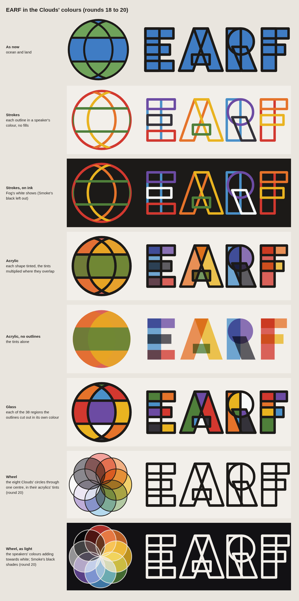

### The look book

The book now holds the eight Clouds, on 16 pages:

- **The cover** reads "Eight floor-standing horn speakers, in cast acrylic", over the eight marks.
- **The line's page** shows its eight marks, a little smaller.
- **Ember and the black Smoke** have pages of their own.
- **The horn pages** run the spectrum across the spread, four horns a page: Ember, Dust, Acid and Poison from the side;
  Ice, Haze, Fog and Smoke from behind.
- **The last page** reads "Eight colours, one horn."
- **The new wordmark** is on the cover and the last page.

## Round 18: the Clouds (the owner's notes of 2026-10-15)

> Can we do dust in an orange color, and ice in a blue color? Are those types of clouds? Is cloud the right term
> still? I think we should pluralize it at least. Should there be more insulation on the bottom of the cabinet or
> elsewhere, or are we good there? One thing about the logo that's bothering me is it feels like the top of the R,
> where the circle meets the rectangle, should be a flat line. There's currently a divot. We should update the other
> letters to make sure they all follow the same conventions based on how we update the R. I'm also interested in
> exploring the brand further, like a version of the logo and letters that includes all of the speaker colors, either
> as unfilled strokes or as the colored in portions of each shape that happens as a result of the overlapping
> strokes. My goal is to buy earf.world and host a marketing site there with the speakers, record players, lights,
> and other products.

| the note | what this round does |
|---|---|
| Dust in orange, Ice in blue | **Two more Clouds**, Dust and Ice (below), made as the others are, rendered cover on and off with their horns. |
| "Are those types of clouds? Is cloud the right term still?" | **Yes, both are clouds**, so the name holds (below). |
| "I think we should pluralize it at least" | **The line is now the Clouds**. One speaker of it is still a Cloud (Cloud 06, Dust). |
| More insulation? | **Not quite good yet: the top and the bottom want more** (below). It changes what shows through the acrylic, so it is the owner's call (an open question). |
| The R's divot | **The R's bowl starts flat from the stem**, and the letters follow one set of rules (below). |
| The logo in every speaker's colour | **Five versions** in `brand.py`: strokes, acrylic, glass (below). |
| earf.world | **Unregistered, $3.99 for the first year** through Vercel. Not bought; a site plan is below. |

### Dust and Ice

`cloud-orange` and `cloud-blue` in `product.py`, made as Poison is: the cabinet in tinted cast acrylic, lined in
white, the horn polished clear resin tinted to match, the cover and the ring in the colour, deeper. The flavours are
keyed orange and blue, because `ice` has been Fog's key since round 8.

| | the acrylic | the horn | the cover and ring | name |
|---|---|---|---|---|
| orange | orange (#F2B184 through 25 mm) | orange (#E0661C) | rust (#8C3B14) | **Dust**, the owner's |
| blue | ice blue (#B5D9EE through 25 mm) | blue (#3C86C2) | deep blue (#24557E) | **Ice**, the owner's |

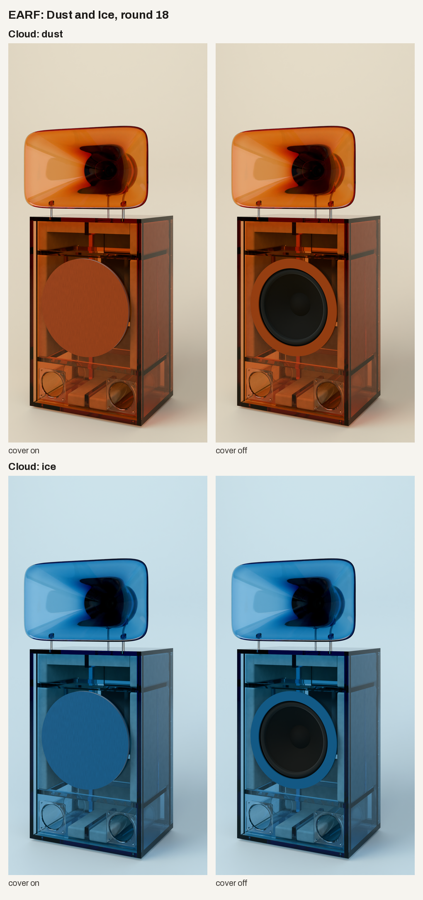

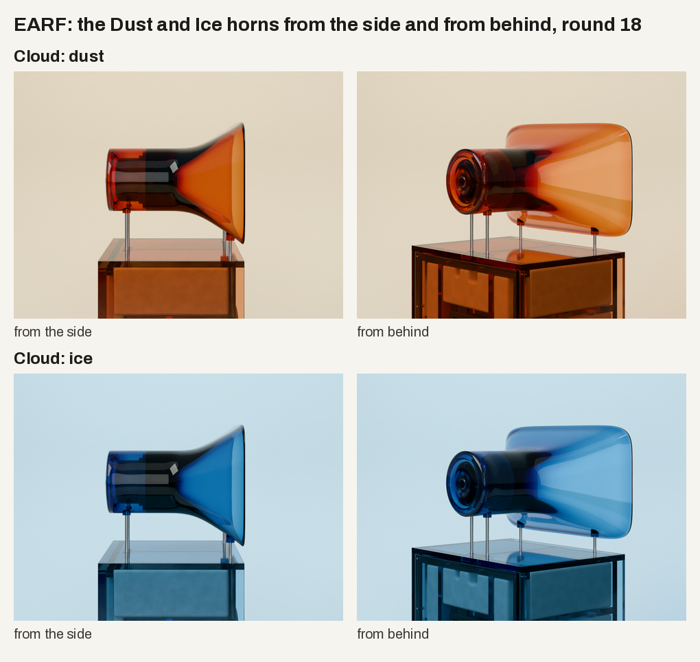

The Clouds are now seven: Poison, Smoke, Fog, Acid, Haze, Dust and Ice. Each has its mark in its own colour
(`marks.py`: Dust #E5732A, Ice #4A90C8).

**Are they clouds?** Yes, both:

- A **dust cloud** is what a dust storm raises: a haboob's wall, or the Saharan dust that crosses the Atlantic.
- An **ice cloud** is a meteorologist's term: cirrus, and the anvil tops of thunderclouds, are made of ice crystals,
  not droplets.

All seven names hang in the air: a cloud of poison, smoke, fog, acid, haze, dust or ice. So the name holds. The
plural reads as the line ("the Clouds"), and each speaker stays "a Cloud": Cloud 01, Poison, to Cloud 07, Ice.

### More lining? (the cabinet's standing waves)

The owner asked whether the bottom, or anywhere else, needs more insulation. `lining.py` works it out for the Cloud's
cabinet: 520 x 356 x 840 mm inside, lined with 50 mm batts.

- **The box's strongest standing wave runs from top to bottom**, at 204 Hz, where its height is half a wavelength.
  Its second is at 408 Hz. Both fall well inside the woofer's band, which runs up to the horn at 800 Hz.
- **The woofer barely drives the first and drives the second hard.** Its centre is a little above half height (458
  of 840 mm), close to the still point of the 204 Hz wave (0.14 of full) and close to the loud point of the 408 Hz
  wave (0.80).
- **The ports pick up both.** Their inner ends sit low (85 mm up), where both waves are near their loudest (0.95 and
  0.80), so whatever rings there leaks out of the ports.
- **The waves bounce between the top and the bottom, the least lined faces.** The bottom is 29 % lined: only a strip
  between the two ports' tubes, which take its sides. The top is 63 % lined, cut round the pad, the HF lead's gland
  and the tie rod's anchor. Below the lower brace there are no side batts at all, since the ports run 20 mm from the
  sides.
- **A 50 mm batt absorbs little that low**: 15 % at 200 Hz and 40 % at 400 Hz (Miki's model; polyester at about 30
  kg/m3). At 100 mm: 52 % and 87 %.

Each mode's Q, the lining's share of its damping (lower damps better; under about 5 is well damped):

| the box's mode | Hz | the woofer drives it | the ports pick it up | Q now | top and bottom at 100 mm | every batt at 100 mm |
|---|---|---|---|---|---|---|
| top to bottom, first | 204 | 0.14 | 0.95 | 15 | 6 | 3 |
| side to side | 330 | 0 (the woofer is centred) | 0.87, the two ports opposite, so they cancel | 8 | 6 | 2 |
| top to bottom, second | 408 | 0.80 | 0.80 | 8 | 4 | 2 |
| front to back | 482 | 1.00 | 0.22 | 7 | 5 | 2 |

The cone, the ports and the acrylic damp these modes too, so the real Qs are lower; the comparison between linings
holds.

The recommendation: **double the top's and the bottom's batts to 100 mm**, the bottom's still kept clear of the
ports' tubes. That damps the 204 Hz wave about two and a half times as well (its Q from about 15 to 6) and the 408 Hz
wave twice as well (8 to 4), for a second layer of batt over the top's and the bottom's (about 0.17 m2 a speaker, a
few dollars). Doubling every batt damps everything (Q 2 to 3), but it crowds the woofer's frame (63 mm from each
side) and brings the back's batts to 50 mm from the ports' inner ends (100 mm now), which need the room. Through the
acrylic, the white bands at the top and the bottom would grow from 50 to 100 mm deep, and the top's zone (140 mm
between the upper brace and the top) would look nearly full. The first sample's impedance curve and a microphone at
a port settle it either way.

While measuring this, a fault in the drawing set came to light: the top's batt has been one piece since round 15,
notched round the rib under the top and the pad, but its cut file drew only one side of the rib (198 x 295, and so
the parts list). The kit took the outline from one piece of the batt's face where a pocket split it; it now joins
the pieces (`studio/fabkit/flats.py`), and the Cloud's package is built again with the batt's true outline.

### The R, and one set of rules for the letters

The R's bowl was a circle beside the stem, so its top met the stem's corner in a notch. It is now a D: it starts at
the stem's outer edge, runs flat along the cap line and turns in a half circle down to 185, the height where the E's
middle bar ends and the A's crossbar starts. The letters now keep one set of rules (`marks.py`, `_wordmark`):

- every bar and bowl starts at the stem's outer edge and runs flat;
- every bar is 70 deep;
- the middle bars and the R's bowl end on 185, where the A's crossbar starts.

The E and the A kept these already. The F's middle bar moves up 5 to end on 185. The cover and the last page of the
look book carry the new R, and so do the marks (`marks/`).

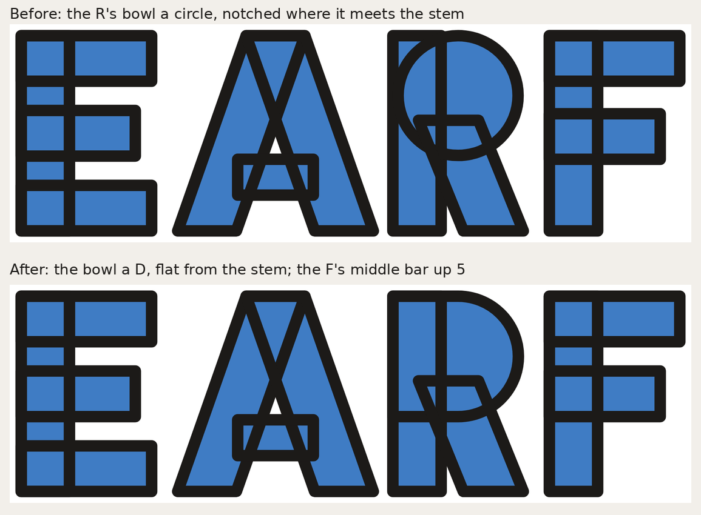

### EARF in the Clouds' colours

The owner: "a version of the logo and letters that includes all of the speaker colors, either as unfilled strokes or
as the colored in portions of each shape that happens as a result of the overlapping strokes". `brand.py` draws the
globe and the wordmark five ways (`brand/sheet.html`, each also as its own SVG):

- **Strokes**: no fills, each shape's outline in a speaker's colour, the colours taken in turn. On paper, Fog's white
  is left out, since it disappears there; on ink, all seven.
- **Acrylic**: each shape filled with a speaker's colour, the fills multiplied where they overlap, as tinted acrylic
  sheets darken where they are laid on one another (the Clouds' own material); with the ink outlines and without them.
- **Glass**: every region the overlapping outlines cut out (38 of them) filled with its own colour, no two that share
  an edge alike, the outlines in ink over them, as a leaded window is.

### earf.world

The owner: "My goal is to buy earf.world and host a marketing site there with the speakers, record players, lights,
and other products."

- **earf.world is unregistered** (checked 2026-10-15 through Vercel, the host this session can reach): $3.99 for the
  first year, then $38.10 a year. It is not bought: buying it is the owner's call (an open question below).
- **A plan for the site**, built from the look book's pages and photographs:
  - the home page: the lockup, the room, "Seven colours, one horn";
  - the Clouds, each with its cover on and off;
  - the horn;
  - the materials: recycled cast acrylic, and its maker once chosen;
  - the specification and the drawings;
  - "coming": record players and lights, once drawn;
  - a way to get in touch.

  It would be a static site on Vercel, with the domain pointed at it.

### The look book

The book now holds the seven Clouds, on 15 pages:

- The cover reads "Seven floor-standing horn speakers, in cast acrylic", over the seven marks.
- The line's page is CLOUDS, its seven marks on a narrower pitch.
- Dust and Ice have pages of their own.
- The horn pages show the five tinted horns (Poison, Acid, Haze, Dust, Ice), each frame cropped close so that five
  fit across at the size three had.
- The specification is "common to all seven".
- The last page reads "Seven colours, one horn.", and the R on the cover and the last page is the new one.

## Round 17: Cloud, the line (the owner's direction of 2026-10-15)

After round 16's realism study and the environmental comparison, the owner:

> I don't want to use wood. Let's put a pause on bark and crag. The cloud line I think is the strongest aesthetically.
> It presents other opportunities. If we can find a good recycled acrylic partner, we can make other components, like
> record players, lights, etc. Let's add some other colors to the mix, like the autumn color from the birch horn. Not
> sure what I'd call a yellow cloud though. Acid maybe. Purple could be cool too.

So:

- **No wood.** Round 16's plywood recommendation is set aside.
- **Bark and Crag are paused.** Their builds, renders and pages are kept, but the look book now shows Cloud only. Its
  builder lists the lines it shows (`ACTIVE`), so Bark and Crag come back by adding them.
- **Two more Cloud speakers**, made as Poison is: the cabinet in tinted cast acrylic, lined in white; the horn polished
  clear resin, tinted to match; the cover and the ring in the colour, deeper (`cloud-amber` and `cloud-violet` in
  `product.py`):

| | the acrylic | the horn | the cover and ring | working name |
|---|---|---|---|---|
| amber | golden yellow (#F2D06B through 25 mm) | the autumn birch's horn as it was, golden yellow (#F2B705) | ochre (#9A6A12) | **Acid**, the owner's |
| violet | violet (#BEADD8 through 25 mm) | deep violet (#5E3F8F), about as deep as Poison's bottle green | deep violet (#3F2A5E) | **Haze**, proposed |

Acid usually names a sharp, greenish yellow, and this is a warm golden one: the names are the owner's to settle (an
open question below).

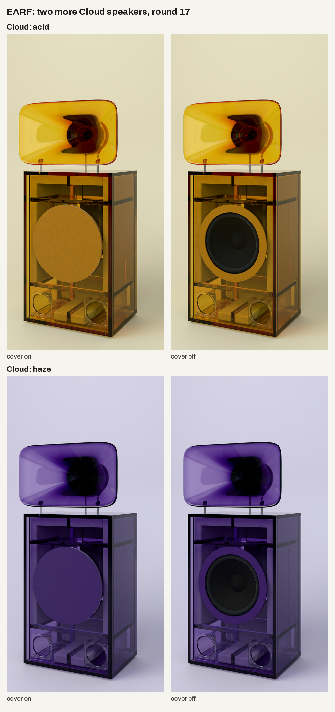

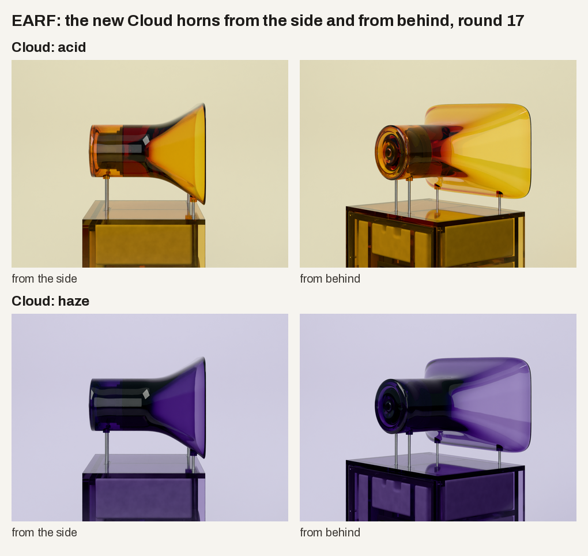

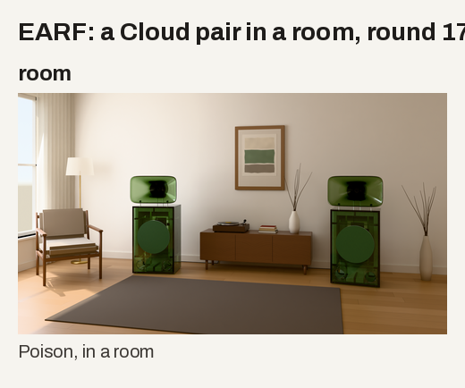

### The look book

The book now holds Cloud alone: the cover, the room (a Poison pair in place of Eucalyptus), the line, its five
speakers (Poison, Smoke, Fog, Acid, Haze), the horn pages (Poison, Acid and Haze), the specification ("common to all
five"), the drawings (now Cloud's own set: the cabinet in cast acrylic, cemented) and the last page ("Five colours, one
horn.").

### A recycled cast acrylic partner

The owner: "If we can find a good recycled acrylic partner, we can make other components." The cabinet wants cast
sheet, 20 mm, tinted through, in five colours; chemically recycled acrylic (PMMA broken back down to its monomer,
methyl methacrylate, and cast again) is as clear and as strong as new, so it can. Searched 2026-10-15; confirm each
before ordering:

| who | what | thickness | colours | where | notes |
|---|---|---|---|---|---|
| [Madreperla](https://spotmaterial.com/article/green-cast-recycled-acrylic-sheet/), Italy: Green Cast | cast sheet of 100 % recycled MMA, made by Madreperla itself | clear 3 to 10 mm stocked, up to 25 mm to order ([Induflex](https://induflex.dk/uk/materials-old/plastics/recycled-acrylic)) | more than 50 shades, opaque and translucent, some with minimum orders ([Image Reports](https://imagereportsmag.co.uk/new-to-amari-comes-green-cast/)); a frosted range | in the US through [MakerStock](https://makerstock.com/products/recycled-acrylic-yellow-nearly-opaque) (3 mm only, seen) | 2.13 kg CO2 a kilogram, about 75 % below new ([EPD](https://environdec.com/library/epd3495), lapsed March 2026) |
| [Plastiglas de México](https://harborsales.net/YesYouCan/Substrates/EcogreenRecycledAcrylicSheet.aspx) (Unigel): Chemcast EcoGreen | cell-cast sheet, 100 % recycled MMA | 3 mm to 25 mm (0.118 to 1.00 in), 48 x 96 and 80 x 120 in ([data sheet](https://harborsales.net/Portals/0/docs/ecogreentds.pdf)) | clear, whites, black listed; other colours by asking | made in North America; sold by Harbor Sales, [Multicraft](https://www.multicraftplastics.com/plastics-and-substrates/acrylic/100-recycled-cast-acrylic-sheet.html) | an [EPD](https://www.environdec.com/library/epd2009) valid to 2027 |
| [Perspex](https://perspex.co.uk/about-us/all-news/coloured-perspex-acrylic-sheet-your-questions-a), UK: Perspex re | cast sheet from recycled cast acrylic waste ([Simply Plastics](https://www.simplyplastics.com/catalog/perspexre-100-recycled-black-cast-acrylic-sheet/c-24/p-1162)) | not published | "can be produced in any colour", by its colour-matching service | UK | |
| [Trinseo](https://www.trinseo.com/solutions/acrylic-cast-sheets/emea-and-apac-cast-sheets/altuglas-r-life-cn-cast-sheets): Altuglas R-Life | cast sheet from chemically recycled MMA | not published | a wide range | made in France and Denmark, sold in Europe | US supply not confirmed |
| [Röhm / Polyvantis](https://www.roehm.com/en/detail/new-and-sustainable-plexiglas-r-proterra-is-a-recycled-high-performance-plastic-with-a-proven-brand-quality): PLEXIGLAS proTerra | about 90 % recycled, but extruded, 2 to 8 mm, clear, white and black | | | Europe | not for the cabinet; its maker takes back offcuts ([with Pekutherm](https://renewable-carbon.eu/news/?p=166207)) |

The first two to ask: **Plastiglas de México** (North American, cell cast to 1 in, 100 % recycled; ask whether it will
cast the five tints at 20 mm and at what minimum) and **Madreperla** (the widest recycled colour range, to 25 mm; a 4 x
8 ft sheet of 20 mm weighs about 71 kg, so it would cross by sea). Ask each also to take back the router's offcuts and
swarf, which go back to monomer. The horns stay cast resin: methyl methacrylate shrinks about a fifth as it sets, which
rules out casting a thick horn in acrylic; bio-based epoxy is their lower-carbon resin (round 16).

**Beyond the speakers.** A partner that casts the five colours in sheet, rod and block lets one fabricator make a
family in them: a record player's plinth (cemented layers, CNC cut, as acrylic turntables are made) and its platter,
lamps (tinted acrylic glows when lit through), stands. Each needs its own design (a turntable's motor and arm, a
lamp's listed driver), so none is drawn yet: an open question below.

## Round 16: the owner's picks of 2026-10-15

Asked to keep refining the design (round 15), three details:

| the question | the answer | what changed |
|---|---|---|
| The horn's back cap comes off for servicing: how is it held? | "Twist-lock (Recommended)" | **A twist-lock** (below): no screw shows. |
| The sixteen screws round the back: what finish? | "Black (Recommended)" | **Black** (A2 stainless, black finish), on black nylon washers. |
| The four posts the horn stands on: what finish? | "Stainless, as now (Recommended)" | Kept, as photographed. |

### The horn's cap, on a twist-lock

The cap closes the pod behind the compression driver, and comes off to reach the HF lead's connector and the tie rod's
thumb nut. Until now the notes said three M4 screws held it, and the renders showed none. It is now held by a
twist-lock (`twist_lock` in `studio/fabkit/speaker/horn.py`):

- **Three lugs** are cast on the cap's spigot, 12 wide, standing 2.6 proud of it. They go into three L-slots cut 2.7
  deep into the pod's 6 mm wall: in along the slot's entry, then an eighth of a turn (45 degrees, clockwise seen
  from behind) along its run. A small bump in each slot clicks the lugs home (in the cap's notes, not modelled).
  This is less than the quarter turn the question described: three lugs at 120 degrees leave room for 45-degree runs
  with the pod's wall kept whole between them.
- **An O-ring** (182 x 2, EPDM) in a groove on the spigot, beyond the lugs, seals the cap and stops it rattling. It
  runs on the bore past the slots' ends, so it seals all round. The spigot is lengthened from 10 to 16 mm to carry it,
  still 4 mm clear of the driver's back.
- **Two shallow finger dimples** in the cap's dome, at its sides, 24 across and 1.5 deep, show where to take it and
  turn it.
- **The joint** between the cap and the pod is a fine line, both edges chamfered 0.8 mm.

From behind, the horn now shows a plain dome with two soft dimples and a fine seam round its edge.

### The back's screws, black

The sixteen M5 button heads are now black, as the ports' screws at the front are. They read quieter against the
patterned and tinted backs.

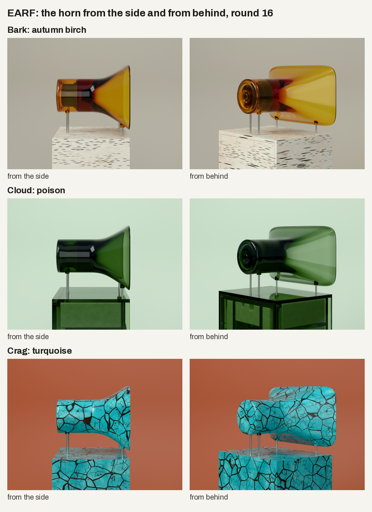

The cap's O-ring adds about $10 to a pair's cost (`price.py`): about $7,930 for Bark and Crag and $8,550 for
Cloud on a first batch. The price's multiples stay 2.0 and 2.2.

### The look book

The horn pages are rendered again, so the cap shows its seam and dimples, and the horn-back page now says the cap
twists off by hand, with no screws. The drawings page and the specification's views come from round 16's drawing set.

### Would pressed recycled plastic really look like this? (a realism study)

The owner asked: "Do you think it's actually possible to achieve these looks from recycled plastic, or do you think
they will look entirely different?" In short: Cloud's tinted acrylic and the resin horns can look as rendered. The bark
and stone patterns come out softer, coarser and more handmade, and the finest marks don't survive a sheet press
(birch's dashes, the stones' bands and webs). To show this, three speakers were rendered again as a sheet press would
really make them, beside the look book's renders (the owner: "Yes, a few"). Eucalyptus should press well; Autumn Birch
and Malachite should not. Malachite is also shown in cast resin (the owner: "Show both side by side").

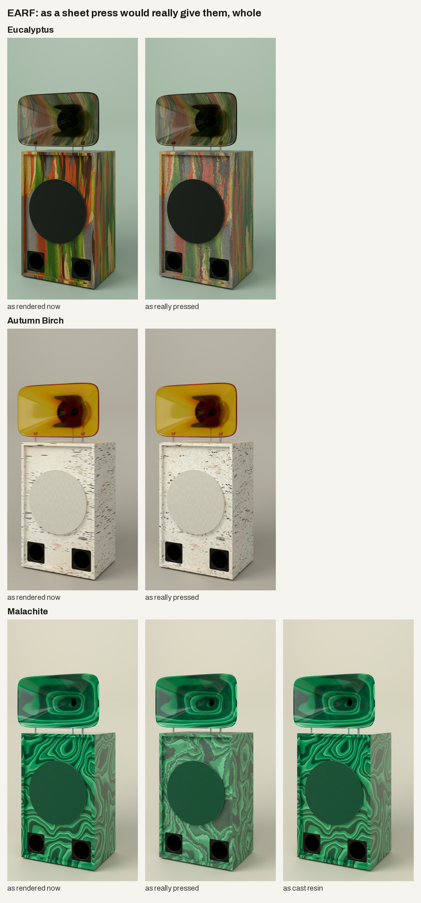

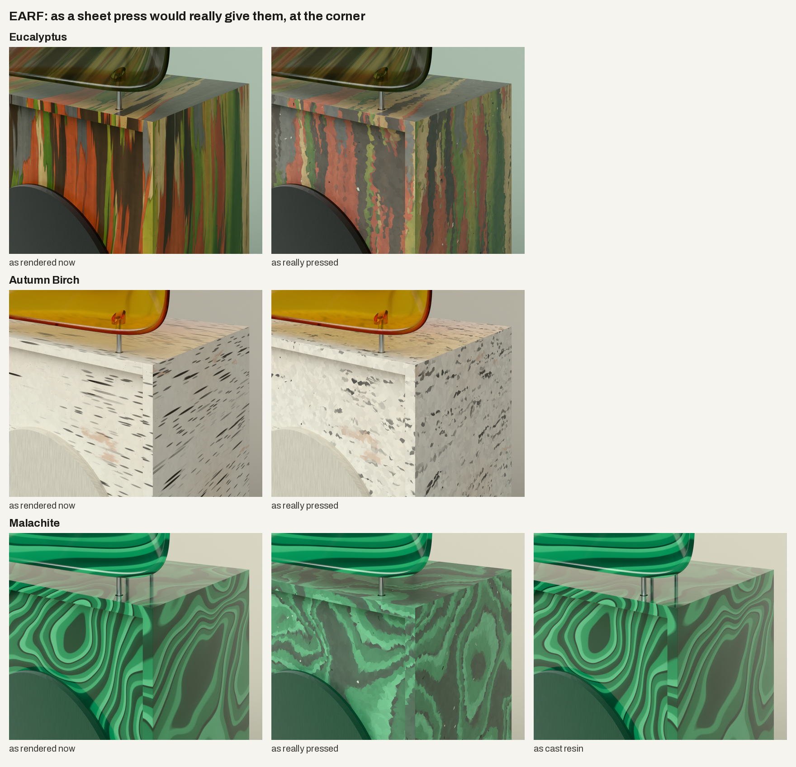

**What the realistic renders model** (`frames.py real16`; the press settings in `studio/engine/materials.py`, which any
material now takes, `ANY_PRESET`):

- **Flakes.** A pressed sheet is made from shredded flakes, each one colour, laid in a mould and pressed hot. The
  pattern is broken into flakes about 7 mm across (9 for the stone). Every colour edge goes ragged, and a mark smaller
  than a few flakes smears or breaks up.
- **Flow.** The plastic moves as the press closes and warps the laid pattern: long soft waves about 160 mm across and
  a short smear about 30 mm. A stone's bands, laid over a whole panel, swirl harder.
- **Each panel is its own pressing**, as the Bark renders already were.
- **Milky colour.** HDPE is a little translucent and white, so every colour is lifted about 12 % toward white and
  mottled.
- **Stray flakes** of other colours, about 5 % dark and 3 % light.
- **A waxy satin face**, as planed and buffed HDPE has, not the gloss the look book shows.

These settings are the best a skilled maker could hope for with hand-laid flakes, not the worst.

**What they show:**

| speaker | as really pressed | verdict |
|---|---|---|
| Eucalyptus | Still long strips of green, rust, ochre and grey, but softer and milkier: the strips' edges ragged, the darkest browns gone grey, stray flakes between them | **Close.** From across a room it reads as the render; close to, as pressed plastic in the bark's colours. The kind of pattern a press does best. |
| Autumn Birch | The short black dashes break into ragged dark flecks, the finest lost; the white shows its flakes | **Different.** White plastic flecked with black, a terrazzo, more than birch. |
| Malachite | The bands blur into a coarse, ragged marbling of two greens; the darkest greens go grey-green; each panel's bands differ and stop at its edges | **Inspired by the stone, not like it.** Green marbled plastic, under a horn whose cast bands stay crisp. |
| Malachite in cast resin | The bands as crisp as the render's, running on round the corners (one cast shell), under a polished face | **Keeps the stone.** The look book's Crag renders are, in effect, cast resin. |

By the same reasoning (not rendered): Manzanita and Cobalt Marble, flowing patterns, should press as close as
Eucalyptus; Striped Maple's fine pinstripes will fare as birch's dashes do; Lapis's gold flecks and Turquoise's dark
web as Malachite's bands. The dark colours come out greyer than rendered because HDPE is milky; more pigment in the
flakes wins some depth back. Laying cut pieces by hand would keep birch's dashes and the pinstripes sharper, at a
cost. Pressed sample tiles (the samples above) are still what settles it.

**Cast resin for Crag.** Solid surface (Corian's kind) and cultured marble are cast from resin filled with mineral
powder. They weigh about 1.7 g/cm³ (a [paper on Corian](https://agro.icm.edu.pl/agro/element/bwmeta1.element.agro-9db306f5-e288-42e7-a362-2474ce74eaf0/c/54.pdf)
measured 1.71; a [Corian data sheet](https://leeuwerik.nl/amfile/file/download/file/119/product/19084) gives 1.75),
and their modulus is about 8 to 10 GPa, against 0.5 to 1.5 for recycled HDPE (secondary sources; confirm against the
maker's data sheet). So 10 to 12 mm of it weighs about what the 20 mm HDPE does (19 kg a square metre) and is as
stiff or stiffer. The pattern is poured into the mould, so veins and bands stay crisp. A cabinet can be cast as one
shell, so the pattern runs on round the corners, as the renders show. It polishes to the renders' gloss. But it is
not recycled (the resin is new), and it carries about four times recycled HDPE's carbon a square metre (the
environment, below).

**A correction.** The answer to the owner said the pattern would not run round the corners unbroken as it does in the
renders. That is true of Crag only. The Bark renders already start the pattern afresh on each panel, as separate
pressings would, so their corners meet with a break. Only the Crag stones run on round the corners, which only a cast
shell could give.

### Recycled plastic, new plastic or wood? (the environment)

The owner asked: "Environmentally speaking, is it even worth using recycled plastic over new plastic? Is the
pollution output the better by any means? Is it better than using wood?", and whether another material could give
these looks at a lower cost or a lower impact.

**Carbon, to make each material** (cradle to gate: from the raw material to the sheet, per square metre of the
cabinet's wall; from published averages and makers' declarations, so read them as estimates):

| a square metre of wall | kg CO2e | from |
|---|---|---|
| birch plywood, 18 mm | about 5 (and it stores about 16 kg of CO2 while in use) | [Koskisen's EPD](https://koskisen.fi/en/downloads/epd-koskistandard), 291 kg a cubic metre |
| plywood faced in linoleum | about 4 to 5 | linoleum is about carbon-neutral to make ([Specification Online](https://specificationonline.co.uk/articles/2023-08-01/forbo-s-marmoleum-achieves-climate-positive-status)) |
| plywood faced in printed laminate (HPL) | about 7 | [One Click LCA](https://materials.oneclicklca.com/en/material/hpl-laminated-plywood-panel/69b444df2ee9922dc96273ce), 372 kg a cubic metre |
| recycled HDPE, 20 mm, from a small press | about 14 to 18 | 71 % below virgin resin ([APR, via Waste Dive](https://www.wastedive.com/news/apr-recycled-plastics-reduce-energy-consumption-ghg-emissions/547027/)), plus an estimate of a small electric press's heat (0.5 to 1 kWh a kilogram, from the [Precious Plastic sheetpress](https://onearmy.github.io/academy/build/sheetpress)'s 15 kW and heating times) |
| virgin HDPE, 20 mm | about 36, before the sheet is made | 1.91 kg a kilogram ([EPA](https://www.epa.gov/sites/default/files/2018-02/documents/lca_tv.pdf)) |
| recycled cast acrylic, 20 mm | about 51 | [Green Cast](https://spotmaterial.com/article/green-cast-recycled-acrylic-sheet/), 2.13 kg a kilogram ([its EPD](https://environdec.com/library/epd3495) lapsed in March 2026) |
| cast solid surface (Crag in resin), 12 mm | about 69 | one maker's EPD ([Durasein](https://durasein.com/uk/the-durasein-global-warming-potential-gwp-difference-sustainable-surfaces-for-modern-design/)), 5,780 kg a cubic metre |
| virgin cast acrylic, 20 mm | about 200 | 8.56 kg a kilogram ([AusLCI, via Climatiq](https://www.climatiq.io/data/emission-factor/b9b3d21d-c2ac-4ea0-a45e-147aa9126b6b)) |

For a pair, from the parts lists' masses: the Bark and Crag cabinets' 94 kg of recycled HDPE about 70 to 90 kg CO2e
(about 180 if virgin); the plywood cabinets' 51 kg about 20 to 25; Cloud's 110 kg of cast acrylic about 940 (about 235
if recycled); and the two horns' 12 kg of epoxy about 70 to 100 (6 to 8.5 kg a kilogram,
[a study](https://www.nepjol.info/index.php/TUJ/article/view/93711)), as much as both recycled cabinets. The
electronics and shipping are not counted.

So:

- **Recycled over new plastic: worth it.** About half the carbon of virgin sheet here, even after a small press's heat
  (the recyclers' own figure, for pellets, is 71 % less carbon and 88 % less energy), and it keeps waste in use. A
  welded, all-HDPE cabinet can be shredded and pressed again at the end of its life.
- **Wood beats both on carbon.** Birch plywood is about a third of recycled HDPE's footprint a square metre, stores
  carbon while in use, and is about ten times as stiff, so it needs fewer ribs. The plywood cabinet's parts list is
  about $2,000 a pair cheaper than the pressed one's (before its face is priced).
- **The biggest levers are not the bark cabinets**: Cloud's acrylic, and the resin horns.
- **Pollution besides carbon.** Recycled feedstock can carry old additives: flame retardants (decaBDE) were found in
  recycled HDPE pellets from 24 facilities ([Food Packaging Forum](https://www.foodpackagingforum.org/?p=330341)), and
  491 chemicals in recycled polyethylene pellets ([a dataset](https://www.ncbi.nlm.nih.gov/pmc/articles/PMC10641591/)).
  A speaker indoors is a low-exposure use, but clean, traced feedstock (post-industrial, or sorted bottle caps) matters,
  and machining's swarf and dust must be caught and pressed again. Plywood's issue is its glue: formaldehyde-free
  soy-glued plywood ([PureBond](https://columbiaforestproducts.com/purebond)) costs about the same as the usual.
  Epoxy can't be recycled, and uncured it sensitises the skin of whoever casts it.

**Materials that could give these looks at a lower cost or impact:**

1. **Printed laminate on plywood.** [Abet Laminati](https://abetlaminati.com/en/?p=9122) prints any image on HPL with
   no minimum order ([its specification](https://abetlaminati.com/wp-content/uploads/2023/12/Abet-Laminati-Digital-Print-Specifications-19oct23.pdf)):
   exactly the rendered patterns, at the lowest cost and about half recycled HDPE's carbon. But it is a print: the
   edges show the core, and the recycled story goes.
2. **Engineered wood veneer.** [Alpi's ALPIlignum](https://www.alpi.it/en/info): dyed poplar and ayous layers glued and
   sliced again into designed patterns ([MaterialDistrict](https://materialdistrict.com/material/alpilignum-design-collection/)),
   from plantation and FSC wood, with an [EPD](https://environdec.com/library/epd28314). Stripes come naturally to it
   (Eucalyptus, Striped Maple); a design of one's own needs volume.
3. **Real birch bark**, sold on plywood tiles for walls ([Freund](https://www.architonic.com/en/p/birch-bark-1500586)):
   true to Autumn Birch, but fragile. The plywood design has allowed a bark face since round 1.
4. **Linoleum** (Marmoleum): 97 to 98 % natural materials, about carbon-neutral to make
   ([Material Source](https://www.materialsource.co.uk/carbon-12-forbo-marmoleum-/)). Its marbling looks much like
   pressed flakes, so on plywood it could carry soft marble colourways, but not malachite's bands.
5. **Crag's cast-stone look**: [Jesmonite](https://jesmonite.com/product-range/what-is-ac100/) (a water-based acrylic
   and mineral composite, cast with veins; no carbon figure published) or [Durat](https://durat.fi/en/collections/all)
   (a solid surface with about 30 % recycled plastic, taken back at the end). Cast resin is about four times recycled
   HDPE's carbon a square metre.
6. **Cloud in recycled acrylic** ([Green Cast](https://spotmaterial.com/article/green-cast-recycled-acrylic-sheet/),
   100 % recycled monomer, in transparent colours): about 75 % less carbon than virgin, the line's biggest single cut.
7. **Bio-based epoxy for the horns**: 10 to 60 % less, by product ([Entropy Resins' LCA](https://entropyresins.com/?p=11605),
   [European Coatings](https://www.european-coatings.com/articles/archiv/enabling-sustainable-epoxy-resins); the high
   end is the makers' claim).
8. **New plastic from sugarcane** ([Braskem's I'm green HDPE](https://fkur.com/wp-content/uploads/braskem-brochure-i-m-green.pdf))
   claims a negative footprint (the company's figures; land use is the caveat).

The recommendation: if a low impact matters most, FSC birch plywood with formaldehyde-free glue, faced in engineered
veneer, linoleum or printed laminate (about two-thirds less carbon in the cabinets, and cheaper); if the recycled
story is the brand, keep pressed HDPE (honest, and half of virgin). Either way, Cloud in recycled acrylic. The owner's
answer: no wood, and Cloud the line (round 17, above).

## Round 15: the owner's picks of 2026-10-14

Round 14's open choices, asked together, each with the renders beside it.

| the question | the answer | what changed |
|---|---|---|
| The ports: which mouth, and front or back? | "Rounded, in front (Recommended)" | **Both mouths rounded on R8**, in every cabinet; the ports stay in front (below). |
| The Cloud's ports: black, or in its own acrylic? | "In its acrylic (Recommended)" | **The Cloud's ports in its acrylic**: a tube flared over a mandrel, cemented into a frame cut from sheet (below). |
| How should the pressed sheet for Bark and Crag be made? | "20 mm, more ribs (Recommended)" | **`pressed.py` at 20 mm**, with round 14's ribs (below). The Cloud stays 25 mm. |
| What should EARF charge for a pair at launch? | "$16k and $19k, direct (Recommended)" | **Decided**: $16,000 a pair for Bark and Crag, $19,000 for Cloud, sold direct (below). |

Then four more, from what those answers opened:

| the question | the answer | what changed |
|---|---|---|
| Should the Cloud go to 20 mm acrylic too? | "Yes, 20 mm (Recommended)" | **`cloud.py` at 20 mm** on its own ribs (below). |
| Should the look book show the price? | "Not yet (Recommended)" | It stays out until a shop's quote confirms the cost: the figures are still budgets. |
| What should come next? | "Keep refining the design" | No requests for quotes yet; the design goes on. |
| The power leads in the room photograph? | "Show them, tidy (Recommended)" | **Each speaker's mains lead** is in the room (below). |

### The ports, rounded

Each mouth is rounded on R8: the front one in the frame, the inner one rolled out into a bell, so the air turns the
corner at full output without chuffing (round 14). A rounded end cannot be trimmed, so the ports are no longer cut to
tune on each speaker: on the first sample three are made 10 mm apart, the one whose impedance minimum falls at the box's
38 Hz is kept, and the rest are made to it.

Round 14's port screws went 15 deep into the panel, which ran them out through the back of the 20 mm sheet and the
plywood's 18. Their length now follows the panel: 4 x 16 in the 20 mm HDPE, 4 x 14 in the plywood, M4 x 16 into the
Cloud's tapped 20 mm acrylic, each hole stopping 2 short of the panel's back.

### The pressed sheet, 20 mm

`pressed.py` is now 20 mm, with the ribs of round 14's study model: two up each side, four up the back (two each side
of the amplifier), two under the top and two over the bottom. As plates, the panels ring at or above the 25 mm
cabinet's. Against the 25 mm cabinet:

| | 25 mm (round 14) | 20 mm (now) |
|---|---|---|
| sheet, a cabinet | 52 kg | 47 kg |
| net volume | 124 L | 131 L |
| the ports' length | 251 mm | 233 mm |
| -3 dB | 50 Hz | 49 Hz |
| the ports' first pipe resonance (the preset's notch) | 515 Hz | 543 Hz |
| sheets a pair | ten 1 m sheets of 25 mm | ten 1 m sheets of 20 mm |
| the parts list, a pair | $7,734 | $7,414 |

Thinner sheet left only 5 mm of the top under the horn's brass sockets, too little for the tie rod's insert or the HF
lead's gland. So a pad of the same sheet (108 x 28) is welded under the top between the rear posts: the insert and the
gland's thread now have 25 mm to hold in. The plywood cabinet had the same trouble (3 mm under its sockets: the tie rod
went to a flange nut epoxied below, and the gland held by about two threads). It now gets the same pad, glued and screwed.

### The Cloud: 20 mm, its ports in its acrylic

The Cloud goes to 20 mm too, but on round 14's ribs (one up each side, two up the back, one under the top and one over
the bottom), not the pressed cabinet's doubled ones. Acrylic is about three times as stiff as HDPE, so a 20 mm acrylic
panel is stiffer than the 25 mm HDPE one was, at the same weight a square metre. The top's rib now ends at the pad
under the top, which the Cloud needs too at 20 mm.

| | 25 mm (round 14) | 20 mm (now) |
|---|---|---|
| sheet, a cabinet | 65 kg | 53 kg |
| net volume | 124 L | 135 L |
| the ports' length | 251 mm | 224 mm |
| the ports' first pipe resonance | 515 Hz | 560 Hz |
| sheets a pair | three 4 x 8 ft of 25 mm | three 4 x 8 ft of 20 mm |
| the parts list, a pair | $8,530 (with the acrylic ports) | $7,968 |

Its ports are now its own acrylic, in two parts cemented together:

- **The frame** is cut from 8 mm cast acrylic on the router. It is 140 square, its corners R10, and it is thick enough
  to hold the whole rounded front mouth (R8), so no joint shows in the mouth. The mouth is rounded over and flame polished,
  and the frame has four holes countersunk for M4 screws into tapped threads.
- **The tube** is cast acrylic, 121 x 4 (113 bore). It is cut to the length found on the first sample, and its inner
  end is flared to R8 over a heated mandrel and annealed. It is then cemented square into the frame's back face.

Two things came into the drawing kit with it. A formed part (a tube flared over a mandrel) is now priced by its own
volume, as a casting is. And a sheet part's holes that are countersunk or rounded over from its face are now cut at
their bore, the countersink or the rounding said in words on the cut file ("4 holes countersunk 90 deg from the outer
face", "the 113 hole at 70, 70 rounded over from the outer face"). Until now such a hole was left out of the cut file.

### The price, decided

The owner picked round 14's proposal: **$16,000 a pair for Bark and Crag and $19,000 for Cloud, sold direct.**
`price.py` works each cabinet's cost a pair from its parts list again, on the picked cabinet, and prints the price as a
multiple of it:

| a pair | Bark and Crag (pressed, 20 mm) | Cloud (acrylic, 20 mm) |
|---|---|---|
| cost, a first batch of 25 pairs | $7,920 | $8,540 |
| cost, a leaner batch (the sheet pressed in-house, trade prices on the drivers and the amplifier, batches of 50) | $6,230 | $7,810 |
| **the price, sold direct** | **$16,000** | **$19,000** |
| the price over the first batch's cost | 2.0 | 2.2 |
| the price over the leaner batch's cost | 2.6 | 2.4 |

The 20 mm sheet takes about $270 off a Bark or Crag pair's cost on a first batch: about $310 less sheet, and an hour
more welding. The Cloud's 20 mm acrylic and its own ports take about $530 off its cost: about $560 less sheet, the
ports about $30 more (the tubes, their mandrel and an hour forming and cementing them). The figures are still budgets,
not quotes (round 14), so the price stays out of the look book until a shop's quote confirms them (the owner: "Not
yet").

### The look book

All eleven speakers are rendered again on the picked cabinet, so the rounded ports and the feet show on every speaker
page. So are the horn pages and the room. The Cloud speakers now come from their own build: 20 mm acrylic, their ports
in it. The drawings page and the specification's views come from the 20 mm drawing set.

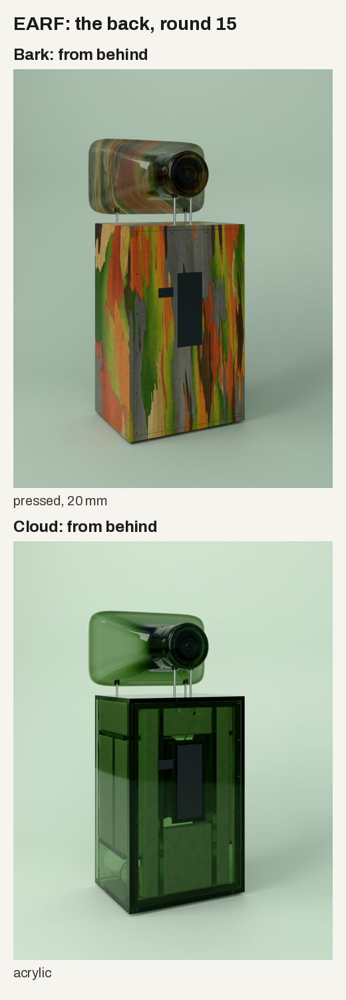

From round 13's list of what the renders left out:

- **The shell's edges** are broken on 1 mm in the render materials. No sheet's edge stays sharp once it is welded and
  planed, cemented and polished, or wrapped in bark. The seams between panels now catch the light as the welds would.
- **The back** is rendered for the first time (`frames.py back15`), on its gasket and sixteen screws, with the
  amplifier's plate and the rating plate beside it.
- **The mains leads** (the owner: "Show them, tidy"). Each runs from its plug low on the amplifier's plate, down behind
  the speaker to the floor, back to the wall and along the skirting to a socket behind the sideboard (`mains_lead` in
  `frames.py`, drawn with the engine's new `cable` prop). Seen from the room, each is a thin dark line along the
  skirting.

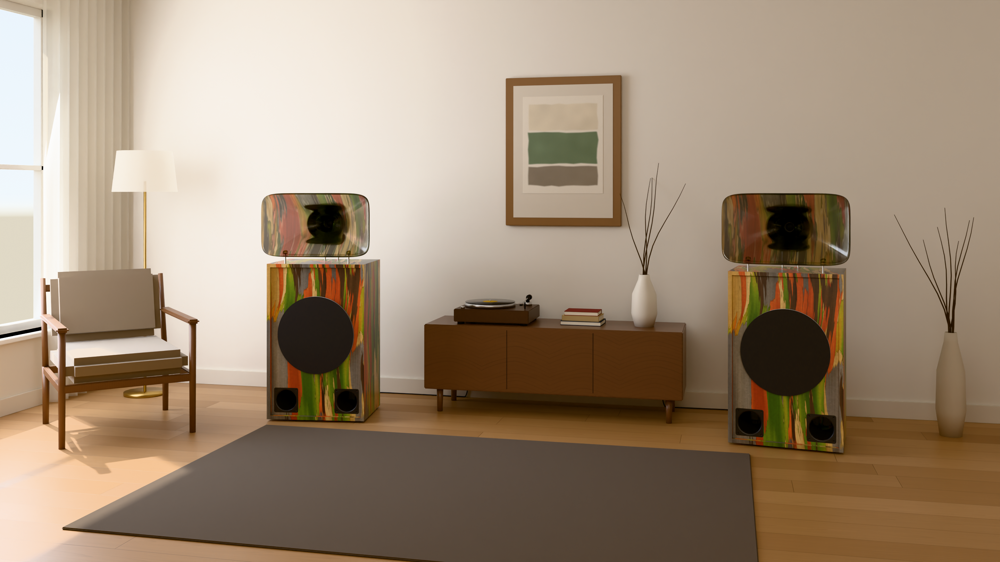
- Still left out: the horn's cap screws and its parting line.

## Round 14: the owner's answers of 2026-10-14

Round 13's open questions, asked one at a time.

| the question | the answer | what changed |
|---|---|---|
| The back: off on a gasket and screws, or welded from outside? | "Removable back (Recommended)" | **The back comes off** (below). |
| The ports' mouths: rounded, or square? | "It's not meant to be a square opening. It's meant to be cylindrical with square framing around the end. I'm open to seeing this vs rounded. Also open to front facing vs in the back if that makes a difference." | **Round ports in square frames** (below), drawn with plain mouths; rounded mouths rendered beside them; front or back answered below. |
| Feet, or glides? | "Levelling feet (Recommended)" | **Four levelling feet**, 12 under the cabinet: 1293 mm tall in all. |
| The Cloud's ports: in its acrylic, or black? | "I'd like to see both options" | Rendered both ways (below). |
| The pressed sheet: 25 mm, or another route? | "I'd like to see what each of these options would look like" | The three routes modelled and rendered (below). |
| A drawing set for the Cloud cabinet? | "Yes, next (Recommended)" | **`cloud.py`**, its own drawing set (below). |
| The horn: on its sockets, or fixed down? | "Sockets + tie rod (Recommended)" | Kept. |
| The ring: hidden magnets, or screws? | "Hidden magnets (Recommended)" | Kept. |
| The marks' colours | "Keep them (Recommended)" | Kept. |
| The look book's last page | "Use EARF generically" | It now ends "To talk about EARF as a maker, a partner or a friend, get in touch with EARF", with no name or address. |
| Price | "Propose a range" | **A price range**, from the parts list up (below). |

### The ports: round, in square frames

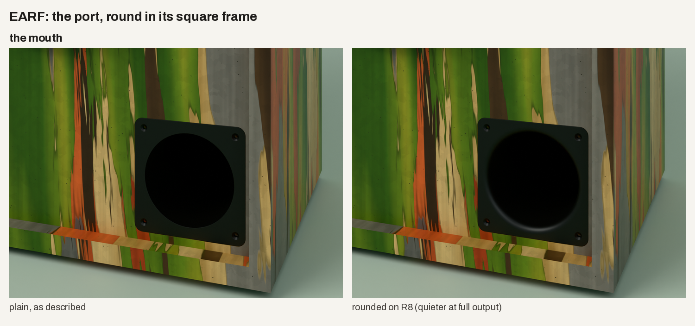

The photograph's dark square is the end of a round tube, framed square. Each port is now a tube 113 mm across inside
(the area of round 6's 100 square, so the box tunes as before) and 4 thick, printed in black ASA in one with a 140 square
frame, its corners rounded on R10. The frame sits flush in a 6 mm recess in the front panel, on a foam gasket, held by
four black countersunk screws in its corners. The port goes in from the front, so round 13's flange behind the panel is
gone. Each port's centre is on its corner's diagonal, 105 in from the side and the bottom, as in the photograph. The
ports run 250 mm from the panel's face (the back's land strips take a little room: the box is 124 L net, its -3 dB
point 50 Hz), and their first pipe resonance is near 515 Hz, where the preset's notch now sits.

**Plain or rounded.** At the amplifier's full output the air in each port moves at about 22 m/s, fast enough for a
sharp mouth to hiss and chuff on deep bass (the reality check's r10). A mouth rounded on R8 at both ends (a bell
inside) lets the air turn the corner, and is the usual cure. Seen from the room, the plain mouth is a crisp black circle
in its square; the rounded one shows a soft ring of light where the flare turns in. It is a parameter
(`P['port']['flare']`), so either builds.

**Front or back.** It makes a difference, though not a large one at these frequencies:

- Ports at the back put their hiss and the midrange the box leaks behind the speaker, so less reaches the listener.
- But they need the wall at least 20 to 30 cm away to breathe, and the bass then changes with that distance.
- They would sit on the back that now comes off, beside the amplifier.
- The front would lose the photograph's two dark squares.

Front ports let the speaker stand anywhere and keep the look, so they stay in front (recommended).

### The back comes off

The back closes on a 3 mm EPDM gasket against four land strips fixed inside the shell, 25 wide and as thick as the
sheet. They are extrusion welded in the HDPE cabinet, cemented in the Cloud's acrylic, and glued and screwed in
plywood. Sixteen M5 button heads go through the back into inserts in the strips, 12.5 in from its edges. The back
stands 1 clear of the shell all round, a shadow line round it from behind. It is the way in to the amplifier, the
L-pad and the leads, and to trim the ports.

What comes off with the back:

- the amplifier's compartment;
- the back's two ribs, which now run its full height;
- its batts, now full-height columns between those ribs.

The leads stay in the cabinet. The HF lead now rises straight from its gland on the compartment, through brace-2's
window, to the gland under the top. Each lead unplugs at its connector by the compartment.

The braces now end short of the back's ribs. Each is still a closed frame round its window, its back member as wide
as its front. The top's and the bottom's ribs end at the back's batts. The sides' batts end at the land strips. The
lining is now 14 batts a speaker.

### The feet

Four levelling feet (M8, a 40 swivel base on a rubber pad) screw into inserts in the bottom, 50 in from its edges, and
lift the cabinet 12 mm. Set and locked, they stand a 1.29 m speaker with 10 kg at its top level on any floor; the felt
glides are gone. From the front they leave a thin shadow under the cabinet.

### The Cloud's ports

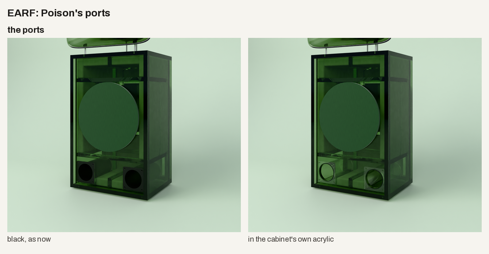

Black (as now), the two ports are the speaker's only dark squares besides the cone, and anchor its base as the
photograph's do. In the acrylic, a turned and cemented tube with a cut frame, they turn to two clear rings, the lining
behind them, and the cabinet reads as one piece of tinted glass. Either suits the line. Clear goes further with the
Cloud's idea, a speaker you see into; black keeps the family look with Bark and Crag.

### The pressed sheet: three routes

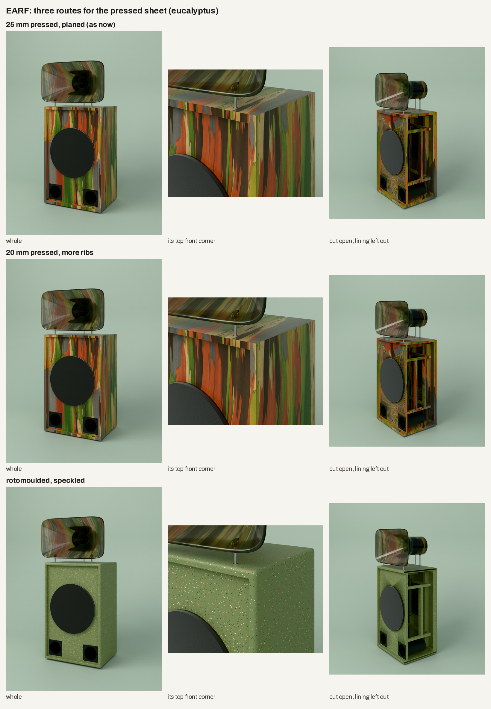

Each is the eucalyptus speaker. Each is shown whole, at its top front corner, and cut open down its right side with
its lining left out, so the ribs show. The 20 mm and the rotomoulded cabinets are study models (`frames.py options14`;
`P['T']`, `P['ribs']` and `P['roto']` in `product.py`); all three check clean of clashes.

| route | the sheet | inside | plastic a cabinet | the look | the catch |
|---|---|---|---|---|---|
| 25 mm pressed, planed (as now) | recycled HDPE pressed to order in the bark's pattern, planed both faces | a rib up each side, two up the back, one under the top and over the bottom | 52 kg | the laid-out pattern, crisp square edges, the shell's frame 25 wide round the front panel | few presses make 25 mm; a thick sheet cools with voids in its core and is planed, which cuts into the pattern; ten sheets a pair from one batch |
| 20 mm pressed, more ribs | the same, 20 mm, as most of the presses named here make | two ribs up each side, four up the back, two under the top and over the bottom, so the panels ring no lower than now | 46 kg | the same pattern, its frame 20 wide | more ribs to weld (about an hour a pair); the sheet about $400 a pair cheaper |
| rotomoulded | recycled PE powder, the sides, the top and the bottom moulded as one hollow part, two 6 mm skins | the braces, ribs and panels inside as now | 38 kg | speckled, not patterned: the bark's colours as flecks; every outside edge rounded on R12 | a mould, about $10,000 to $30,000; about $1,000 a pair cheaper once made (no shell sheet to buy, weld or plane), so worth it from a few hundred pairs; the bark's pattern is lost |

### The Cloud's drawing set

`cloud.py` builds the Cloud cabinet into `out-cloud/`. Its geometry is the pressed cabinet's in tinted cast acrylic,
25 mm, cut from three 4 x 8 ft sheets a pair. What changes is how it is made:

- **Cemented, not welded.** Acrylic bonds well. The corners, the braces, the ribs and the back's land strips are
  cemented with a two-part polymerising cement for thick sheet (Acrifix 1R 0192 or alike), clear and about as strong as
  the sheet. A solvent cement would craze it.
- **Machined, polished, annealed.** Each panel's edges are milled square and polished where they show. The panels are
  annealed before cementing and the box after, so no stress is left where cement or a screw meets an edge.
- **Nothing pressed in.** Acrylic is brittle. The brass sockets, the inserts and the magnets are bonded with epoxy in
  clearance holes, and the port frames' screws go into tapped threads.
- **The lining** is held by dots of clear acrylic foam tape, nearly invisible through the wall.

Acrylic is a quarter denser than HDPE, so the cabinet's sheet weighs about 65 kg against 52. Its parts list is about
$8,330 for the pair. The kit's notes and fixings now follow the shell's material (`shell_kind()` in `product.py`), so
the Cloud's parts list asks for cement, clear tape and bonded inserts, not weld rod.

Two fixes to the drawing kit came out of this. The parts list and the notes now run on to sheets of their own when one
sheet cannot hold them: until now the last sheet stopped after two notes and left the rest off, in every set. And the
exploded view's balloons now fit the sheet however many there are.

### A price

Every line of the parts list now has a budget (the small parts as marked estimates in `components.json`). The pressed
sheet is priced at a made-to-order rate: about EUR 150 a square metre at 10 mm from the Precious Plastic sellers, so
about $400 at 25 mm. Cast acrylic is priced at about $1,400 a 4 x 8 ft sheet at 25 mm. From there
(`.venv-fab/bin/python spinoffs/barkhorn/price.py`):

| a pair | Bark and Crag (pressed) | Cloud (acrylic) | plywood, bark-faced |
|---|---|---|---|
| parts, the moulds left out | $6,310 | $6,910 | $3,920, before the bark |
| labour (25 to 30 hours) | $1,420 | $1,720 | $1,330 |
| packing, certification, moulds spread over 25 pairs | $450 | $450 | $450 |
| **cost, a first batch of 25 pairs** | **$8,190** | **$9,080** | **$5,690** |
| cost, sheet pressed in-house, trade prices on the drivers and the amplifier, batches of 50 | $6,380 | $8,360 | $5,040 |

The drivers and the amplifier are $2,260 a pair of it, the pressed sheet $2,690.

| | Bark and Crag | Cloud |
|---|---|---|
| **proposed, sold direct** (about 2.2 to 2.5 times cost) | **$15,000 to $18,000 a pair** | **$18,000 to $21,000 a pair** |
| through dealers (about 3.3 to 4 times cost) | $22,000 to $27,000 | $28,000 to $33,000 |

For comparison, Klipsch lists its La Scala AL6, a passive three-way horn, at $15,399 a pair, and $3,499 more for its
active crossover ([Stereophile](https://stereophile.com/content/klipsch-debut-red-oak-finish-active-crossover-audio-advice-live)).
Avantgarde's active Uno SD is EUR 22,440 a pair before VAT ([HiFi Pig](https://www.hifipig.com/?p=158888)).

My proposal: launch Bark and Crag at **$16,000 a pair** and Cloud at **$19,000**, sold direct. That is about 2.3 to 2.5
times the lean cost: enough for the brand to carry its own costs and marketing and still make a profit. On a first
batch it is about 2 times. The biggest lever is the sheet. Pressing it in-house takes about $1,100 off each pair, the
20 mm route about $400 more, and rotomoulding (with its mould) about $1,000.

The figures are budgets, not quotes:

- a shop's quote replaces the labour;
- a supplier's quote replaces the sheet;
- a dealer's terms replace the multiples;
- the bark sheet for the plywood finish is still unpriced.

## Round 13: the owner's notes of 2026-10-14

| the note | what changed |
|---|---|
| "Question about the cloud speakers. Most speakers to my knowledge have insulation in them. Would that mean insulation would have to be visible in these speakers? If done right it could help with the cloud effect." | Yes. A box this size needs its walls lined, and in the Cloud cabinets the lining shows. The answer proposed batting against the walls between the ribs, behind voile. |
| "Yes, let's do what has to be done. And continue refining the designs in this sense. We need to get as close to reality as possible." | **The lining** in every cabinet, seen through the Cloud's acrylic, and Poison, Smoke and Fog rendered again with it (below). **A reality check** of the whole design by a fresh reviewer briefed as a loudspeaker product engineer: 5.5 out of 10, fifteen findings (below). Everything it found inside the box or behind it is fixed. What would change the look is in the open questions. |

### The lining

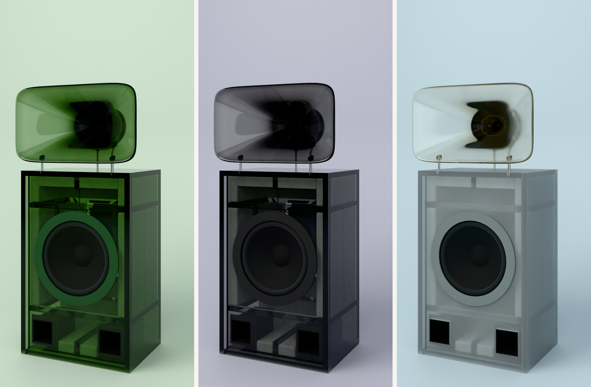

A box this size rings at its own resonances, all of them in the woofer's range: about 205 Hz top to bottom, 340 side
to side, 415 (top to bottom again) and 495 front to back. The ports leak them too. Round 6's thin felt on the acrylic
cabinets' back was too little for that, and the plastic cabinets had only a bag of fibre in the parts list, drawn
nowhere. Every cabinet is now lined.

- **What.** Polyester batts, 50 mm thick, of an acoustic grade at about 30 kg/m3 (the light batts sold for walls
  absorb less in the midrange): thermally bonded, with no binder, and with recycled PET in them. Each batt is sewn
  into a sleeve of white polyester voile, so no fibre can reach the ports or the woofer, and its face stays even.
- **Where.** A batt to each bay between the braces and the ribs, on the sides, the back, the top and the bottom: 15 a
  speaker, 57 % of the inside walls. There are none on the front panel. The ports run 26 mm from the sides, so the
  bottom bay's sides stay bare. Elsewhere the batts keep clear of the ports' tubes and flanges, and the 79 mm between
  each port's inner end and the back's batt stays open. The back's middle bay has a batt only under the amplifier's
  compartment (below).
- **How it is held.** Each batt is cut 10 mm full each way and pressed into its bay, where friction between the ribs
  and the braces holds it. Four dots of double-sided tape hold it flat on the wall. On HDPE the tape is one made for
  low-energy plastics. On the Cloud's acrylic it is clear acrylic foam tape (VHB 4910 or alike), all but invisible
  through the wall. The light frames proposed before are not needed.
- **What it does.** Bare acrylic or HDPE sends back nearly all the sound that strikes it. A lined wall takes about
  half of it at the resonances the woofer drives hardest, the second top to bottom (415 Hz) and front to back
  (495 Hz), and most of it above 800 Hz (Miki's model for the batt). The lowest, top to bottom at 205 Hz, it barely
  touches. But the woofer sits near that resonance's node at half height, so it barely excites it either. Side to
  side (340 Hz) the centred woofer does not excite at all. The batts are 98 % air and make the box act a little
  larger. The ports are trimmed to tune on the built box anyway.
- **What it costs.** 1.2 kg of batting a speaker (39 L of it), cut from four 1200 x 600 batts a pair, about 3 m2 of
  voile a speaker, and about 60 dots of tape.
- **How it looks.** In Smoke it is a grey storm cloud, in Poison a green glow, and in Fog a box of mist. The batts
  fill the walls between the clear ribs and braces, so each side reads as a panel of cloud in a frame. Through the
  front panel, with the cover off, the back's batts frame the woofer. The smoke's tint is neutral now: its grey was a
  little warm, and seen through two walls, lit through several, that warmth turned the lining olive.

In the CAD it is `lining()` in `product.py` (the sizes in `P['lining']`): every batt is a cut part, in the cut list,
the parts list and the drawings. The render rounds the batts' edges, as a sleeved batt's are. The engine has a new
material for it, `batting`: a white fibre web in soft clouds of denser and thinner, light carried a few millimetres
into it, and the voile's sheen.

### The reality check

The owner asked for the design "as close to reality as possible". A render critic asks whether a picture would ship,
and the drawing checker whether a shop could build from the sheets. This asks whether the speaker, as designed and as
rendered, is what a real one would be (`critic/PROMPT-reality.md`). A fresh reviewer, briefed as a loudspeaker product
engineer, read the README, the acoustics report, the pressed cabinet's drawings and parts list, and the renders. Its
reply is `critic/rounds/2026-10-14/reality-r1.json`, logged in `critic/LOG.md`.

> "Close in its fundamentals, short in its details. The drivers, the amplifier, the box tuning and the horn are real,
> matched parts ... What separates it from a product is everything that holds, seals, protects and connects."

It scored the design 5.5 out of 10. Fixed, each inside the box or behind it:

- **The horn is held down** (r1). About 10 kg stood loose on four plain pins in their sockets: tipped or bumped, it
  would lift off, and it would buzz in the sockets' clearance. Now an M6 rod runs down the free rear post, from a
  thumb nut inside the pod to an insert under the top. With the cap off and the nut undone, the horn and its posts
  still lift off as one. Each post's foot stands in a polyurethane sleeve in its socket, which centres it, takes up
  the casting's scatter and stops the buzz. The front pads' inserts are 10 mm deep, not 14, which left as little as
  3 mm of resin under the flare.
- **The box is airtight again** (r2). The amplifier is vented, and Hypex asks for a sealed compartment, which the
  drawings left out. At full output the box runs at about 1 kPa inside, so any leak hisses. The amplifier now sits in
  a compartment of its own: 1.5 mm aluminium, black anodised, on an EPDM gasket on the back's inner face. Its mains
  electronics are enclosed in metal, as the safety standard asks (neither HDPE nor polyester could be that
  enclosure). The leads leave through cable glands, and the HF lead's open hole under the top is a gland too.
- **Nothing is glued to HDPE** (r3), which no ordinary adhesive or sealant holds. The posts' sockets are knurled and
  pressed in. The ports have a flange behind the panel, screwed to it on a foam seal. The magnets are pressed into
  their pockets. The woofer's inserts go in 9 mm holes (7 mm took only the bare screw). The cloth disc goes on tape
  made for low-energy plastics.
- **The L-pad has a place** (r5). At full output its series resistor would burn about 20 W. Its two resistors are
  25 W aluminium-housed parts on an aluminium plate in the compartment, behind a 33 µF film capacitor that keeps low
  frequencies off the driver if the amplifier's preset is ever lost.
- **The bass is protected** (r6). Below the ports' tuning a vented box stops holding the cone. At full output it
  passes its 5.75 mm limit below about 30 Hz, and a record's warp drives it there. The preset stored before the
  speaker ships gets a 4th-order high-pass at 28 Hz, limiters, and a notch at the ports' pipe resonance (about
  540 Hz). By the box model in `studio/fabkit/speaker/box.py`, the cone then peaks at 5.3 mm, and the bass's -3 dB
  point moves from 49.7 to 50.1 Hz.
- **The ring is held** (r7). It had no fixing, and lifting the cover lifted it too. Now four magnets in the panel
  hold four steel discs in the ring's back. The cover's magnets hold to the same steel through the ring, more weakly,
  so the cover comes away alone. Nothing shows.
- **The wiring is drawn** (r8). The HF lead, a round silicone cable 5 mm across, climbs the back rib on screw-mount
  tie bases, passes brace-2's window and goes in through the gland under the top and up the cable post. The woofer's
  lead runs under the motor to the basket. Each lead has a polarised connector at the compartment, so the amplifier
  comes out whole.
- **A rating plate** (r12) beside the amplifier carries the model, the serial number, the ratings, the marks and the
  maker's address. The finished speaker still needs an EMC pre-scan and an IEC 62368-1 assessment by a test lab.

The Cloud renders show what a photograph would (part of r9): the lining, the brass sockets and their sleeves at the
posts' feet, and, behind the woofer, the compartment and the HF lead on its way up to the top. The other speakers'
pages are as they were. Of these fixes they would show only the sockets' brass rims and, from behind, the rating
plate.

Not fixed, because each changes the look: the back (r4), the ports' mouths (r10), feet (r11) and the Cloud's ports
(r9). They are in the open questions. So are what the renders still leave out (r13 to r15): weld lines, broken edges
and cut faces on the plastic cabinets; the horn's cap screws and parting line; cables in the room; and a view of the
back. They are the next full re-render, and the weld lines wait on the back.

## Round 12: the owner's notes of 2026-10-13 (night)

| the note | what changed |
|---|---|
| "Do 1-3" (the three next steps: check the horn's acoustics by simulation, an image that gives scale, a second critic round on the look book) | Below: **the horn, by simulation** (it works, and its shape stays), **in a room** (a new page 2 of the look book), and **the look book's second critic round** (6.0 blind, its eight changes applied). |
| "Line names are fine for now unless the critic recommends something else." | The critic's card opened the names to advice, and it recommends keeping them: "Each is a one-syllable nature noun that matches its fixed mark (tree, cloud, outcrop) and names the motif rather than the material ... 'Stone' would be flatter and would no longer match the outcrop mark." **Bark, Cloud and Crag stay.** |
| "EARF is fine." | **EARF stays**, and the open question on clearing the name is closed. |
| "No samples yet." | **No samples are ordered**; the open question is closed for now. |
| "Forget the earmilk idea for now." | The earmilk threads are parked: its bookshelf version, the exploded view and the earnest valve amplifier. |
| "These look way better." | (the look book after round 11) |
| "Brand is way too big on the front of the look book. The sizing on the last page is best." | **The cover's logo is back at the closing page's size and place** (the critic's c1 had set it at 150 %). The line on what EARF makes stays. |
| "The text overlay on the scale page makes it hard to read, and the speakers look more grey than they should." | **The room page:** the photograph across the top, every word on a paper band below it. **The room rendered again:** the bark's pattern is laid in the world, so the right speaker stood on the eucalyptus's grey strips; now each speaker wears its own pattern (the engine's new `space: object`), the same face as its look book page. The window raked across their fronts, so a soft warm lamp of their own lights them (light linking), and the white point sits on the daylight (6300 K). |

### The horn, by simulation

The horn's shape was traced from the photograph and had never been simulated. `horn_sim.py` meshes it from the same
section formulas as the CAD (sections through both agree) and solves its sound field by boundary elements, the solver
checked against the pulsating sphere. The full report is `acoustics/README.md`.

- **It works.** From 1 to 8 kHz it holds about the coverage its walls are drawn for: 70 to 100 degrees across (the
  walls open to 95) and 40 to 70 up and down (the walls: 63). It loads the driver fully from about 900 Hz.
- **Its shape stays.** A bell-flared lip, simulated as the obvious alternative to the thin rim, moves the coverage by a
  few degrees and leaves the ripple below 2 kHz where it was: it comes from the mouth's size, not its edge.
- **The crossover stays at 800 Hz.** There the horn narrows to 53 degrees across while the woofer spreads to 139.
  Crossing higher matches the two at the handover but narrows the vertical window, and over 400 Hz to 2 kHz the sound
  off axis is no smoother. 900 Hz is the setting to try on a measured prototype.
- One dip on the axis at 4.5 to 5 kHz, about 4 dB, the same on two meshes; the DSP can level it.

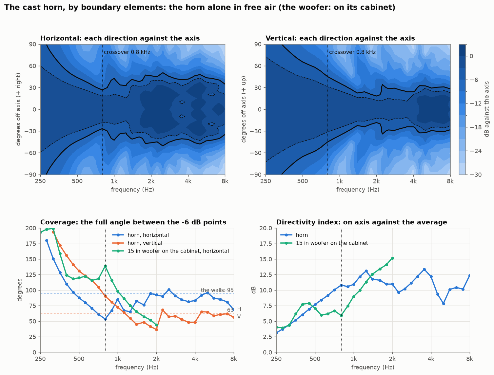

### In a room

The critic's last open note of round 1 was "an image that gives scale". The pair stands in a living room, 2.6 m apart
and 44 cm out from the wall, either side of a sideboard 52 cm high with a record player on it. An armchair (a new prop
in the engine: a wooden frame, a seat and a back cushion) stands beside the left one at the same depth, so the two
compare directly, with a floor lamp, a print and the window's light from the left (`frames.py room12`). It is page 2 of
the look book: the photograph across the top with two dimension lines on it, 1281 against 520, and the words on a paper
band below. Each speaker wears its own pattern (laid in the world, the right one stood on the grey strips of its
eucalyptus), lit by a soft warm lamp of its own.

### The look book's second critic round

A fresh reviewer saw only the pages (the room page new) and its card, with the round-1 prompt (`critic/LOG.md`,
`critic/rounds/2026-10-13/lookbook-r2.json`). **6.0 blind** (round 1: 5.8), its estimate 7.0 with its changes. All
eight were layout and copy, and all are applied:

- **The cover:** one line on what EARF makes: "Eleven floor-standing horn speakers, in three lines." (Its lockup at
  150 % went back to the closing page's size: the owner, "Brand is way too big".)
- **The speaker pages:** the two photographs parted by a 16 px gutter, each trimmed 8 px, the panel darkened 14 % so
  they read as two photographs, not one with a crease (less on Lapis Lazuli, to keep its type at 4.5:1). Each
  speaker's surface now sits under its name, and the table keeps cabinet, horn and cover.
- **The room page:** its type in black, and the two dimension lines. (The owner then found the type hard to read over
  the photograph: it now sits on a paper band below it.)
- **A closing page (21):** the lockup, "Eleven speakers, three lines, one horn." and a line to write to. **The name and
  the address are the owner's to give** (`[NAME]`, `[EMAIL]` for now).
- **The dividers, the specification and the drawings page:** each divider's sentence in two lines in black, the cabinet
  then the horn; every specification row on one line (the two widths as a pair); the drawings' captions under their
  drawings.

Not applied, because each would change something fixed: re-rendering each pair on one sweep, the room with richer
furniture and a textured rug, macro renders of each finish, sharper horn textures, and moving the section marks on the
general arrangement. The critic also warns that NEATURE, the owner's spelling, reads as a typo to a cold reader; it
stays.

## Round 11: the owner's notes of 2026-10-13 (late)

| the note | what changed |
|---|---|
| "I don't like the graphite discs on eucalyptus or manzanita. I think we can do something closer to the bark color for each, or black." Then, of the test below: "Black on eucalyptus is preferred. Makes the cabinet pop more" | **Black on eucalyptus** (#1E1C1A) and **red-brown on manzanita** (#5B2B22, its bark's own), the rings with them, from a test of each bark's colour beside black. Every eucalyptus flavour takes black. Oat stays on birch. |
| "And the cast-in pattern should be used for eucalyptus and the yellow gold can be used for birch everywhere." | **The line's horns**: the default `birch` and `eucalyptus` flavours, and everything built on them (the pressed cabinets, round 4's sheets), now have the golden yellow horn and the cast-in bark pattern. Smoked resin and bottle green stay as the options `birch-smoked` and `eucalyptus-bottle`; the Cloud speakers keep their tinted horns. Older renders (round 6's pick6 and before) still show the old horns. |
| "Do a critic pass on the look book after these updates" | **A critic round on the whole look book**: a fresh reviewer that saw only the pages and a card of what is fixed (`critic/card-lookbook.md`, `critic/PROMPT-lookbook.md`), a blind score first, then changes marked up like a proof (`critic/rounds/2026-10-13/lookbook-r1.json`, `critic/LOG.md`). **5.8 blind**, its estimate 7.0 with its nine changes. All nine are in, but one line: the joint between the two photographs faded; one grid on every page of a type, the product pages' header and facts hung from fixed lines; the dividers' marks 1.6 times larger across the page, with one sentence each; the cover's marks at the product pages' size; EARF and the page number on one bottom baseline from page 2; CONCEPT RENDERS on the cover; a key to the exploded view's 20 balloons; the horn pages' and the specification's copy. Not applied: its tagline "FLOOR-STANDING HORN LOUDSPEAKERS", because the cover line is the owner's. The rest of the way to a 9 is in the renders and the drawings, which the card fixes: sharper renders (twice the resolution), a smudge on the lapis cabinet, the horn throats of Poison and Smoke, the drawings' type and line work, and an image that gives scale. |
| "Okay new brand idea EARF and the logo is a globe made of geometric shapes" | **EARF**, with **a globe of geometric shapes** in the marks' acrylic style: the ocean a circle, the land a triangle, a parallelogram and a circle cut by it (`marks/globe.svg`). The alternate is the cloud's ingredients, three equal circles side by side, the outer two cut by the middle one as meridians, and a band across as the tropics (`marks/globe-alt.svg`). The look book's cover sets the globe beside EARF over FLOOR STANDING LOUDSPEAKERS, and every page's foot says EARF. Round 10's geometric dog is gone with Dogs Barking. |
| "I like the geometric shape earf logo, except the top of the A shouldn't have the parallelograms protruding past each other. They should overlap cleanly at the very top. On the R, the parallelogram should come out more so it's flush with or just past the edge of the circle like it is in type. I like B2 for the globe but would be interested in seeing one where the green shapes overlap more to form continents", then: "I meant I liked B3, not B2, but wanted to try one that incorporated the geometric shapes in a way that looks more like land." | **The wordmark**: EARF built of the marks' primitives (rectangles; two leaning slabs and a bar for the A; a stem, a circle and a slab for the R), filled ocean blue and outlined like the marks (`marks/earf.svg`). The A's legs now lean exactly enough for their tops to coincide, one clean top, and the R's leg runs out to just past its bowl (by 8 on a cap height of 300). **The globe is B3**: a circle of ocean, two equal circles of land cut by it (their arcs the meridians) and a band of ocean across them (`marks/globe.svg`; `marks/earf-lockup.svg` sets it beside the wordmark). **The continents** were shown as an option (the Americas, Eurasia, Africa and Australia of parallelograms and triangles, alone and on B3's band; B3's meridians made the land too busy), and are replaced by the next note's options. The look book's cover carries the lockup. The first globe, of three separate shapes, is gone. |
| "B3 is still the strongest. C2 was also okay, but I'd prefer to have the shapes overlap and for the triangle to not look italicized. For that one, the continent doesn't need to look geographically correct. One other option is to put a triangle inside the circle and a square inside the triangle and cover, with the points of each shape at the stroke of the outer shape, then coloring in the smaller shapes created as green or blue." | **B3 stays the logo.** Two options beside it (`marks/globe-<option>.svg`): **C2 overlapped**, an upright, equilateral triangle, a circle and a parallelogram overlapping into one continent of three sizes, placed by a search so no two outlines come within 60 and none cross under 28 degrees (`c2-overlap`), and the same with a square, so nothing leans (`c2-square`); and **the nested globe**, an equilateral triangle in the circle with its corners on it, the square standing on the triangle's base with its top corners on its sides, the regions between them ocean or land, in four colourings: ocean, land, ocean (`nested`), land, ocean, land (`nested-land`), one more circle in the square, reading "and cover" as "and so on" (`nested-circle`), and the land north, the ocean south (`nested-mixed`). They replace the continents. |
| "B3 final for now" | **B3 is the logo**, decided. The options (C2 overlapped, the nested globe) stay in `marks.py` and on the marks sheet, set aside. |
| "Yes fix critic flaws" | **The rest of the critic's flaws fixed, and every page inside the slide format** the look book is published in (no masks, no preformatted or balanced lines, one value to a gap, no line height under half the type). Each speaker's two photographs are now **one picture**, the joint blended into the backdrop row by row, so no seam shows without a mask (the critic: it "reads as a pasting error"); the captions COVER ON and COVER OFF moved up to the eyebrow's line. **Renders at twice the size**: the eleven pairs again at 1080 x 2160, the strip a page shows, the lens longer by 840/546 to hold the framing (`frames.py` set `lookbook2`; the speakers stand a little lower in the frame). **The Crag horns** no longer read as solid blocks where they can be clear: malachite and turquoise are cast in clear resin with the stone in it and a little milk, so the flare shows through (the next note made them opaque again); cobalt and lapis stay opaque (in clear resin either reads as smoke); the cobalt horn is polished and its veins run down the walls into the throat, as a pour runs down a mould, so its flare reads too. **The lapis smudge** was the white calcite in its pattern: lapis now has bands of its own blues (`LAPIS_BANDS`). **Poison's and Smoke's throats**: both horns polished (roughness 0.03), the driver crisp through them. **The drawings**: the kit now draws a view of anything with a lofted surface from meshes, which hide behind every surface (the exact algorithm finds no outline on the horn's shell, so the cabinet's edges ran on under the horn in the plan and a cavity's rim inside the horn showed through as a tick), and traces the outline round the horn from its mesh filled on a raster, so the contour is whole and smooth (`studio/fabkit/drawings.py`); a hidden edge drawn twice no longer reads solid. The views' names, the general arrangement's figures and the exploded view's balloons are set in IBM Plex Mono, the look book's mono (OFL, `studio/fabkit/fonts/`), larger (`drawing_style` in `product.py`). Both drawing packages are regenerated. Still open from the critic: an image that gives scale. |
| "i kind of prefer the opaque waveguides for the stone options, but I could be convinced otherwise." | **All four Crag horns opaque.** Agreed: opaque is truer to stone, and it keeps the three lines apart (Bark's horns are clear resin with the pattern cast in, Cloud's translucent and tinted; a clear Crag horn read as a Bark one). The critic's "solid blocks with a dot" is answered as the cobalt horn's was: the pattern drawn out down the walls into the throat, so the flare reads. The malachite's bands become rings that follow the horn in, the turquoise's web is drawn in with them, and the lapis reads as it was (`DOWN` in `product.py`; `stretch_axis` and `web_stretch` for the stone shader). The malachite and turquoise pages and the turquoise horn views are rendered again. The clear horns stay an option (`crag(..., deep=...)`). |
| "Also I think the floor standing loudspeakers text should be placed under and left aligned with EARF, and then the text should be centered against the logo." | **The cover's lockup restacked**: the globe, and beside it EARF with FLOOR STANDING LOUDSPEAKERS under it, the line's first letter on EARF's left edge, the two together centred on the globe. EARF keeps its place and size; the line moved up from under the whole lockup. |
| "go with the sockets and the thin wire. Could also keep the thicker wire and go with slightly thicker posts." | **The posts stand in sockets, and the HF lead is a thin pair.** Asked how the driver fits: the B&C DE1085TN (154 across, 86 deep) screws to its aluminium ring from the front (its threads are blind holes in its front plate), the ring to brass inserts round the throat with four M5 socket caps, reached past the driver with a ball-end key with the cap off, and the cap closes the pod. Two things in the spec did not hold: a post threaded at both ends into fixed inserts cannot be screwed home, and the 2 x 1.5 mm2 cable (about 7.5 thick) would not pass the post's 7 bore. Now each post screws into its pad's insert and its plain foot stands in a brass socket in the top (the same 14 hole, a cup with a floor), so the horn and its posts lift off as one; the HF lead is a twisted pair of 0.75 mm2 silicone wires (about 4.5 thick) from the L-pad up the rear post into the pod, on a lever connector there; to lift the horn off, the cap off and the pair unplugged. Thicker posts (about 13 across, a 9 bore) would take the round cable but lose the photograph's slim posts: noted, not taken. Both drawing packages and parts lists are regenerated. |
| "Can you change the subtitle to NEATURE-INSPIRED LOUDSPEAKERS", then "NEATURE" | **The cover's line is NEATURE-INSPIRED LOUDSPEAKERS**, spelled as the owner wrote and confirmed, in the same place under EARF. It replaces FLOOR STANDING LOUDSPEAKERS and settles the open question of the cover line. |

EARF reads three ways: earth (the globe, and Bark, Cloud and Crag are the earth's own), ear (earmilk, earworm and
earwig's family) and arf, a dog's bark, which keeps something of Dogs Barking.

The name needs clearing before it is used. One search found no mark for EARF, but EARFUN is a registered audio brand
covering headphones and speakers ([its US mark](https://trademarks.justia.com/881/47/earfun-88147257.html)), close
enough in sound and goods that a trademark search by a professional should come first.

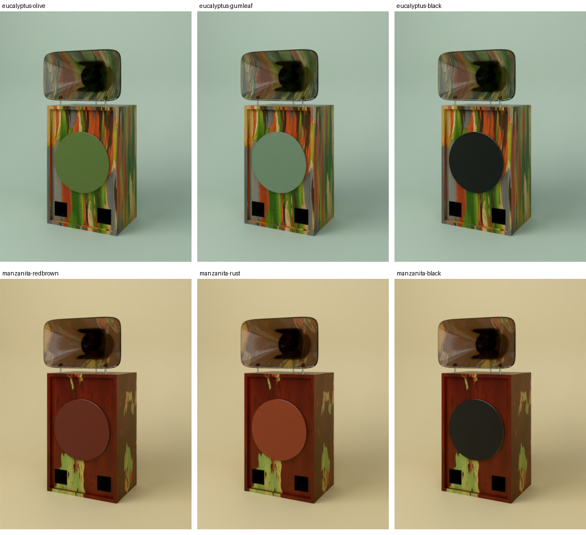

## Round 10: the owner's notes of 2026-10-13 (night)

| the note | what changed |
|---|---|
| "The travertine is boring and the rhodochristite is too much like a pink malachite. Let's replace the two of them with one more interesting rock. Something that will pop, that is a different color than the other options." | **Turquoise** (spiderweb) replaces both: sky blue-green, polished waxy, in a dark web of matrix whose veins swell and thin, with a finer web in patches. It is a new `turquoise` preset in the engine's stone shader (warped Voronoi edges). `crag-turquoise` has a cover in the stone's colour, and stands on a terracotta sweep. The two stones' flavours and look book pages are gone; their presets stay in the engine's library. |
| "Poison should have a matching green cover and frame around the driver." | **Poison's cover and ring in its own bottle green** (#2E4A2C; the ring follows the disc), as Smoke's and Fog's follow theirs. |
| "The brand name is dogs barking, not bark horn." | **Dogs Barking** wherever the speakers are presented: the look book's cover and pages. |
| "Like an old electricity PSA ... How can we get to design agency level quality ... Retro PSA brand logo with stamps/badges for each speaker", then "I want a dog with a horn head ... Reference similar brand systems", then "Just drop the branding for now. Do the lookbook with just the dogs barking brand name and no logo or marks." | **The branding is parked.** The look book carries the name in type only, with no logo. What was found and tried is noted below for when it resumes. `stickers.py` and its marks are gone. |
| (of round 8's clouds) "These acrylic marks, without the circular framing (ie just the geometric cloud), are great. Representative of the speaker design and theme. Also these aren't the Y2K ones, the theme is Cloud or Air or something like that." Then: "Acrylic style marks for each theme, with a distinct color for each speaker. Trees, Clouds, Stones ... The tree could be a vertical rectangle with circles at the top", and: "I like the cloud because it combines multiple shapes and sizes with large enough gaps between the overlapping strokes of each shape. The tree and stone need to accomplish the same thing ... For the stone we could make an exception and do something more like the rock option, but that front left side looks too much like a house shape." | **Y2K is now Cloud**, and **every speaker has an acrylic mark** (`marks.py`, below): Bark a tree, Cloud the cloud as approved, Crag a stone, each speaker its line's shape in its own colour. The look book carries them. |
| "The previous three tree was better. The two smaller circles feel too detached. The cloud and the tree use very uniform shapes. The stone should do the same. Clean parallelograms, squares/rectangles, and triangles are best I think." | **The three-circle tree is back**, its crown three circles overlapping deeply. **The stone is now a crag** of uniform shapes. |
| (of a draft of three leaning slabs, with a rectangle across their feet) "I like this, but without the bottom rectangle" | **The crag is the three slabs**: parallelograms of three sizes standing on one base line, the outer two leaning in and the tall one between them leaning with the left. |
| "If you can make a dog barking out of geometric shapes, that could be cool." | **A dog of rectangles and parallelograms with the horn for its head** (the pod a rectangle, the flare a trapezoid), two triangles for ears, barking in three arcs, in the marks' acrylic style (`marks/dog.svg`). It is proposed, and not in the look book. |
| "Also, add some back or side shots of the horn" | **Two pages of the horn** in the look book, from the side and from behind, on one speaker of each line: the autumn birch, Poison and turquoise, each on its own sweep (`frames.py horn10`). |
| "Instead of LOOK BOOK 2026 on the cover, put FLOOR STANDING LOUDSPEAKERS" | Done. |
| "Also the stone aren't going to be cast stone, they'll be plastic and resin. I imagine cast stone would be way too expensive and heavy." | **Crag is plastic and resin**: the cabinet pressed recycled plastic in the stone's pattern (as round 6 pressed the marble), the horn cast resin with the pattern cast in, as the bark horns are. The renders are unchanged. |

### The marks

Each line is one shape built from a few primitives of different sizes, and each speaker is that shape in its own colour.
The acrylic: every primitive is filled, then every outline is drawn over all of them, so the construction shows through
as if each piece were clear acrylic laid on the others. They follow the cloud:

- The primitives overlap deeply.
- In the cloud, the rectangle's corners sit on the outer circles' centres, so its edges cross them square on.
- Tangents fall only on the silhouette, where the lines merge: the cloud's and the crag's along their base.
- The shapes are uniform: circles for the tree and the cloud, parallelograms for the crag.

| line | shape | speakers, and their colours |
|---|---|---|
| Bark | a tree: a crown of three circles overlapping deeply, the trunk's top inside them | Eucalyptus (olive), Autumn Birch (gold), Manzanita (red), Striped Maple (pale green) |
| Cloud | the cloud: three circles on a rectangle from the outer two's centres down to their common tangent | Poison (bottle green), Smoke (smoke grey), Fog (white) |
| Crag | a crag: three slabs, parallelograms of three sizes standing on one base line, the outer two leaning in and the tall one between them leaning with the left | Cobalt Marble (cool white), Malachite (green), Lapis Lazuli (ultramarine), Turquoise (turquoise) |
| (the logo) | EARF's globe, B3: the ocean a circle, two equal circles of land and a band of ocean cut by it, beside EARF built of rectangles, slabs and a circle (round 11); the options: C2 overlapped (an upright triangle, a circle and a parallelogram or a square) and the nested globe (a triangle in the circle, a square in the triangle) | ocean blue and land green |

`marks.py` writes `marks/<key>.svg` for each speaker (transparent round it), `marks/globe.svg` and `marks/earf.svg`
(the logo's globe and wordmark), `marks/earf-lockup.svg` (the two side by side), `marks/globe-<option>.svg` for
each option and `marks/sheet.html`.

### The lines

| line | the cabinet | the horn | speakers |
|---|---|---|---|
| Bark | recycled plastic, pressed in the pattern of a bark | clear cast resin, the pattern cast in (the autumn birch's tinted golden yellow) | eucalyptus, autumn birch, manzanita, striped maple |
| Cloud | cast acrylic, translucent, one colour | clear cast resin, tinted to match | Poison (green), Smoke, Fog (frosted) |
| Crag | recycled plastic, pressed in the pattern of a stone | cast resin in the stone's pattern, opaque, the pattern drawn down the walls into the throat (round 11) | cobalt marble, malachite, lapis lazuli, turquoise |

The Cloud flavours keep their keys (`eucalyptus-y2k-green`, `birch-y2k-smoke`, `birch-y2k-ice`), so earlier renders and
shots still resolve.

Crag is plastic and resin (the owner: "I imagine cast stone would be way too expensive and heavy"). Round 6 pressed
the cobalt marble's kind of marbling in HDPE at the bark line's cost, and the banded and flecked stones press the same
way, coloured flakes laid in the pattern. The renders still show the stones polished, as a sample would decide.

### The Crag line

Each stone's pattern runs over the horn and the cabinet alike, with a cover in the stone's own colour (a one-colour
cabinet keeps a matching cover, round 7):

- **Malachite**: bands of dark, mid and light green ringing its eyes, polished. A deep green cover.
- **Lapis lazuli**: deep blue, mottled, with white calcite and flecks of gold pyrite, polished. A deep blue cover.
- **Turquoise**: spiderweb turquoise, sky blue-green with darker and lighter patches, polished waxy, crossed by a web
  of dark matrix whose veins swell and thin, with a finer web in patches. A turquoise cover, on terracotta.

The cobalt marble keeps its mist cover.

### The look book

[The look book](https://claude.ai/artifact/5GzQJd9n2ExaceCDKsaYU9) (version 18) opens on EARF's logo, the B3 globe
beside the wordmark, over FLOOR STANDING LOUDSPEAKERS, with the eleven marks by line and CONCEPT RENDERS at the top.
Each line opens with its name, one sentence on how it is made, and its marks across the page. Its speakers follow, cover
on and off, each page hung from the same lines: its mark, its line and number (Cloud 01), its name, four facts. Two
pages show the horn from the side and from behind, then the specification beside the general arrangement, and the
section and exploded view with a key to its parts. From page 2 every page carries EARF and its number. It is private
until the owner shares it from its Share menu.

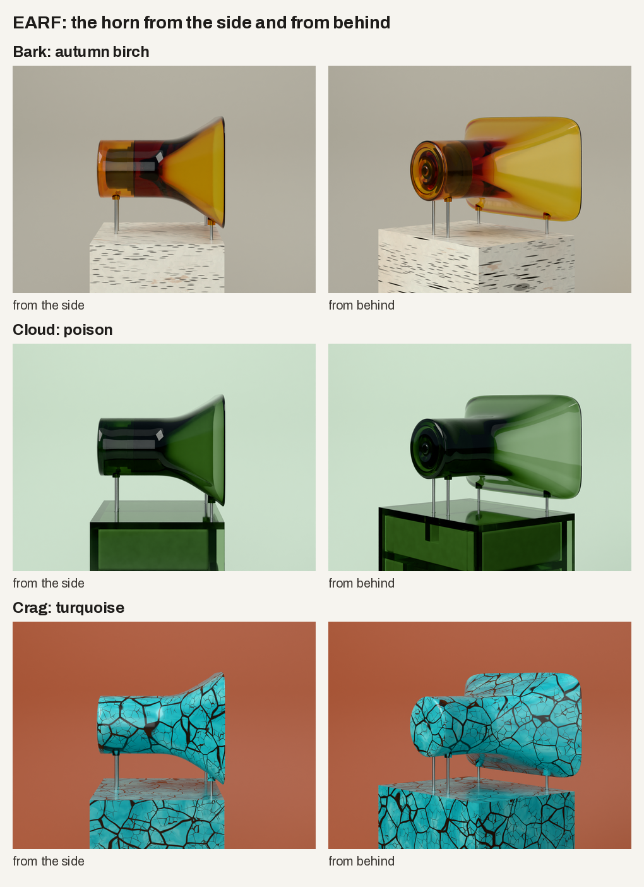

### The branding, parked

The owner's notes ran from a retro electricity PSA logo with a badge for each speaker, to a dog whose head is the
speaker's horn, to dropping the branding for now. What was found and tried, for when it resumes:

- **The heritage.** The best-known dog-and-horn mark in audio is His Master's Voice (1898): Nipper, a terrier listening
  to a gramophone horn, later HMV's, Victor's and RCA's. A dog with a horn for a head turns it round, since this dog
  barks through the horn. That inversion is the idea, and it keeps the brand clear of that trademark.
- **The references.** Reddy Kilowatt (Alabama Power, 1926), the electricity PSA mascot, is built from what he stands for
  (lightning-bolt limbs, a bulb for a nose), the same logic as a dog whose head is the horn. Lester Beall's posters for
  the Rural Electrification Administration (1937 to 1941) say it with flat colour, few words and simple icons. Merit
  badges keep one edge and one central picture each. Collins cut Mailchimp's mascot (2018) to a one-colour silhouette
  that works at any size, with a wordmark drawn to sit beside it. JKR made Burger King's own product its logo (2021),
  so it could not be for anything else.
- **Tried, not kept.** A merit-badge roundel for each speaker. A dog in profile whose head is the horn as the speaker's
  side elevation shows it (the flat mouth, the flare, the pod), with ears on the pod and the bark in arcs of the mouth's
  own shape, alone and as two dogs back to back (a stereo pair). The owner dropped the branding before either was
  finished, so neither is in the repository.

## Round 9 (superseded)

The brand mark was one dog's head in profile, barking its name in a horn-shaped badge (`stickers.py`). Round 10 parks
the branding and removes `stickers.py` and its marks.

## Round 8: the owner's notes of 2026-10-13

| the note | what changed |
|---|---|
| "Not stickers of the speakers. Stickers of a visual metaphor that represents each speaker. The brand is as important as the speakers themselves." | **New marks**. Each is its line's shape carrying one mark for the material: strips for the eucalyptus, a curl for the manzanita, rings for the malachite. None draws the speaker. |
| "And I think bark is more of a product style/line. Y2K another. Crag another, which would include marble and such." | **Three lines**: Bark, Y2K and Crag, each with a shape (a circle, a rounded square, a triangle). Proposed: each line is also one way of making the cabinet: pressed recycled plastic, cast acrylic, cast stone. The look book is now in three parts, each opened by its line. |
| "Remove Phoenix, red vein, cherry." | Gone from the look book and from the product's flavours. Their bark presets stay in the engine's library. |
| "Only do the autumn birch for the birch option." | The birch page is gone from the look book. The autumn birch is the Bark line's birch. The `birch` flavour and the pick6 renders (smoked horn) are unchanged. |
| "Getting there with the symbolism, but I'd like it to work in black and white, meaning we can't rely on color to communicate the design of each speaker." | **One colour first**: every mark says everything in one ink, and colour goes on top of the same drawing, for the stickers. The look book uses the one-colour marks, in each page's ink. |
| "The marble should look more marbly, the malachite should look more wavy, the lazuli is just dots. The birch can just be the horizontal lines, no leaf. The ice is inverted in color relative to the other ones. ... A lot of the icons need to be centered, like the manzanita." | **Stamps**: every mark is now a solid shape with its mark cut out and centred, so none is inverted against another. The marble's veins swell and branch, the malachite's rings wave unevenly, the lapis has pyrite's square crystals instead of dots, the rhodochrosite nested bands instead of chevrons (they read as arrows), and the birch its dashes alone. |
| "What if we changed Y2K to cloud: poison, smoke, fog, and used the same shape but different color." | **Y2K is three clouds**: Poison (the green acrylic), Smoke and Fog (the frosted ice), one cloud in three colours. In one ink they keep their colours by heraldry's hatching, made for exactly this: diagonal lines for green, cross-hatching for black, plain for white. |
| "What about dogs barking for the brand name, back to back dogs with horns for head, with roar-like shapes emitting from the horn. Again, I want to stress minimalism. Something that could work as a stamp." | **The brand mark**: two dogs back to back, each with a horn for a head, three arcs out of each horn. A pair facing out is a stereo pair. It reads barkhorn as a horn that barks, which fits all three lines; the name stays. |
| "Let's explore some more stone/crag options. Malachite maybe." | **Four stones join the cobalt marble in Crag**: malachite, rhodochrosite, lapis lazuli and travertine (`crag-malachite` and so on), all in the look book. They use a new cast-stone shader in the engine: colour bands ringing a folded noise (malachite, rhodochrosite, lapis's mottling), or layers laid down (travertine), with crystals (lapis's gold pyrite) and open pores (travertine). |

Round 10 renamed Y2K Cloud, replaced these marks with the acrylic marks and replaced the rhodochrosite and the
travertine with turquoise (above).

## Round 7: the owner's note of 2026-10-12 (night)

| the note | what changed |
|---|---|
| "I'm not sure I like the rust disc anymore. I think more neutral colors, depending on the cabinet, will help the cabinet and horn pop more." | **The disc in a neutral that suits each cabinet**, chosen from a study of four on each bark (below). Proposed: **oat on birch, graphite on eucalyptus**. Rust is gone from every flavour. Round 6's renders of the line, the printed horns and the other cabinets are redone with the new discs. |
| "Why do the horns need printing? Why can't they be resin cast like the body?" | They don't. The horn is cast in resin either way; the print was only one way to put the bark's pattern into it. The other is to cast the pattern in: tinted resin laid into the open mould in the bark's patches, then the clear horn poured behind it (round 6's second method). It needs no film or coating, so it can't wear off, but it is hand work and no two horns match. The line's cabinet is pressed, not cast: coloured flakes laid in the pattern and pressed into flat, opaque sheet, which can't make the horn's deep, see-through shape. |
| "And yes, cast-in." | **Decided**: the bark horns have their pattern cast in by hand. The samples' hydro-dip proof gives way to a cast-in test tile, from the same resin and tints as the step wedge. |
| "That white ring around the driver when there's no cover is a little much." | **The woofer's ring takes the disc's colour** (oat on birch, graphite on eucalyptus, and so on), so with the cover off the cone sits in the same quiet circle the cover makes. The look book shows it. |
| "Why did you get rid of the birch and eucalyptus cast-in horns?" | I read "yes, cast-in" as how a patterned horn would be made, and gave the look book round 6's smoked and bottle-green horns. The birch and eucalyptus pages now wear their bark's pattern in the horn, cast in (drawn as round 6's printed horns, the same artwork; a cast-in horn's edges come out a little softer). The line's flavours (`birch`, `eucalyptus` and the pick6 renders) still carry smoked and bottle green until the owner says otherwise. |
| "We should also do a manzanita." | **A third bark**: manzanita's smooth bark, deep red and polished, peeling in thin curls to a fresh underbark of green, tan and orange (`manzanita_bark`, the eucalyptus's shader with its layers retuned, and `pressed_manzanita_bark` for the line). Its horn wears the bark's pattern cast in (`manzanita`, `manzanita-pressed`; `manzanita-ember` tints it red instead), with a graphite disc and ring. It is in the look book on a sand backdrop. |
| "Lots of cool barks we can work with" (photos of two snakebark maples) | **Two snakebark maples**: a striped maple after *Acer tegmentosum* 'Joe Witt' (chalk white with fine green pinstripes) and one after *Acer* × *conspicuum* 'Phoenix' (coral, red veins and a scatter of dark lenticels). `snakebark_white` and `snakebark_coral` are the eucalyptus's shader again, with flat layers of fine stripes, plus pressed versions for the line; the flavours `snakebark-white` and `snakebark-coral` (and `-pressed`) cast each pattern into the horn, with a mist disc on the white and stone on the coral. Both are in the look book, on deep olive and deep teal. |
| (photos of a Tibetan cherry and the redvein maple 'Albolimbatum') | **Two more**: a Tibetan cherry after *Prunus serrula* (polished mahogany ringed by rough lenticel bands, amber shards where it exfoliates: the first bark whose layers run round the trunk, wide and short) and the redvein maple after *Acer rufinerve* 'Albolimbatum' (olive green with red veins, white streaks and diamond scars). `cherry_bark` and `redvein_bark` with pressed versions; the flavours `cherry` and `snakebark-redvein` (and `-pressed`) cast each pattern into the horn, with a graphite disc on the cherry and stone on the redvein. Both are in the look book, on fog and terracotta. |
| "Also might be cool to try a yellow for the horn on birch to showcase what the tree looks like in the fall." | **Autumn birch**: the birch with a clear horn tinted golden yellow, its leaves in the fall (`birch-autumn`, `birch-autumn-pressed`). Seen against a blue backdrop the yellow horn turns green where the backdrop shows through it, so it is shot on a warm grey. In the look book beside the birch. |
| "I like when the driver covers are the same color for the monochromatic options, like the green and ice and black." | **Kept as the rule**: on a cabinet of one colour (the green acrylic, the frosted ice, the smoke) the cover matches the cabinet, so the front reads as one colour (graphite, pewter and charcoal, as rendered). |
| "The words in the look book are a little lame ... It would be cool to have a more structured design system ... Something that could come as a sticker representative of the specific speaker style. A rudimentary but intuitive visual language. Minimal. Bold. Direct." | **The look book rebuilt** on a sticker system (below): one die-cut sticker per speaker from one grammar, every page on one template, the copy cut to plain specifications. |
| "I want to create a little look book that I can share out. For each cabinet, I want a version with the driver cover on and off. Each page should be designed to accent the speaker being showcased. ... make the marble a white and cobalt instead of white and black." | **The look book** (below): eucalyptus, birch, green acrylic, frosted ice, smoke and a new white-and-cobalt marble, each on a seamless backdrop in its own colour, with the cover on and off. |

The study puts four warm neutrals on each bark, dark to light, on the line (pressed HDPE, the smoked and bottle-green
horns). The neutral that helps is the one closest in value to the cabinet's own ground. Then the disc reads as part of
the cabinet, not as a third shape beside the cabinet and the horn:

- **Birch: oat** (`#CFC8BA`). It sits tone on tone with the white bark, a step darker, so the cabinet reads as one pale
  block and the smoked horn is the only dark shape. Charcoal (rounds 4 to 6) and graphite each make a second dark shape
  that competes with the horn. Stone, the mid grey, reads flat.
- **Eucalyptus: graphite** (`#4B4844`). It reads as the woofer's shadow, so the strips run round it and carry the
  colour, with the bottle-green horn above. Oat is a bright target on the busy bark, and charcoal reads as a hole. The
  bark's own grey (`#7C776F`) comes close, but looks flat against the strips' colours.

The same rule picks the disc on round 6's other cabinets, and their renders below now show it:

| cabinet | its ground | disc |
|---|---|---|
| birch; terrazzo, cultured marble, marbled black and white | warm white | oat `#CFC8BA` |
| frosted ice acrylic | cool mid grey (the frost over the dark inside) | pewter `#7A807E` |
| white-and-cobalt marble (the look book's) | cool white | mist `#C8CACA` |
| manzanita | deep red, mid-dark | graphite `#4B4844` |
| striped maple | cool white with green stripes | mist `#C8CACA` |
| Phoenix maple | coral, mid-light | stone `#8E8981` |
| Tibetan cherry | mahogany, dark | graphite `#4B4844` |
| redvein maple | olive green, mid | stone `#8E8981` |
| eucalyptus; marbled in the bark's colours, green acrylic, green onyx, green swirled through amber | busy, or dark and coloured | graphite `#4B4844` |
| smoked acrylic, smoke swirled through clear | near black | charcoal `#2E2C2A`, as before |

The colour is each flavour's `disc` token (`product.py`), so any colour from the study is a one-line change. The
frosted ice first had mist, a pale grey: the frost renders mid grey with the dark inside showing through it, so mist
was the brightest thing on the cabinet. Pewter sits into it.

### The look book

(As round 7 left it; round 8 regrouped it by line, above.)
[The look book](https://claude.ai/artifact/5GzQJd9n2ExaceCDKsaYU9) is a deck to share: twelve speakers, each with the
cover on and off. Each stands on a seamless backdrop in a colour drawn from it: gum-leaf sage for the eucalyptus, peeled
apricot for the birch, an overcast warm grey for the autumn birch, chaparral sand for the manzanita, deep olive for the
striped maple, deep teal for the Phoenix maple, fog for the Tibetan cherry, terracotta for the redvein maple, pale mint
for the green acrylic, lavender grey for the smoke, ice blue for the frosted ice, and deep cobalt for the marble. The
seven barks wear their pattern in the horn, cast in clear resin, and the autumn birch a golden yellow one; the acrylic
speakers keep their tinted horns. The marble is new: the marbled speaker's veins in cobalt through a cool white, the
horn and the cabinet alike (`birch-marbled-cobalt`).

Every page follows one template. A panel holds the speaker's sticker, its number and name, and four plain rows:
surface, cabinet, horn and cover. The two photographs run full height beside it. The panel is a gradient sampled down
the edge of the first photograph, so it runs on into the backdrop without a seam, and each page uses one ink, dark or
light, whichever reads on its backdrop. The type is Instrument Sans and IBM Plex Mono. The cover is the twelve stickers
in a row, and the last page gives the specification they share.

### The stickers

(Round 7's; replaced in round 8, and in round 10 by the acrylic marks, above. `stickers.py` is gone.)

One die-cut sticker for each speaker, all drawn from one grammar (`stickers.py` writes them to `stickers/`). The
sticker is the speaker reduced to its parts, in proportion: the horn (a rounded rectangle), its throat (a dark dot),
the cabinet, the cover (a disc 437 across, its centre 45.7 % down) and the two ports. A style changes three things and
nothing else:

| part | how it varies |
|---|---|
| cabinet | the surface as a pattern code: bands (eucalyptus), dashes (birch), patches (manzanita), lines (the maples), rings (the cherry), veins (the marble), or a flat tint with its frame showing (the acrylics) |
| horn | the cabinet's pattern, lightened, where the pattern is cast in; otherwise its tint (golden yellow, bottle green, smoked, clear) |
| cover | its colour, as the speaker has it |

Each sits on a white die-cut edge with a hairline round it, so it reads on any ground. A new style needs a new
pattern code and three colours.

## Round 6: the owner's notes of 2026-10-12 (evening)

| the note | what changed |
|---|---|
| "I like the smoked and bottle green resin." | **Decided**: smoked resin on birch, bottle green on eucalyptus (the `birch` and `eucalyptus` flavours). |
| "I like the solid horn neck I think, assuming that's what's pictured." | **Decided**: yes, every round 5 render shows the solid neck, the dark disc round the throat in the clear and smoked resins. |
| "I want to go wood free with this if possible." | **Decided**: it is possible, and it is the line now: `pressed.py`, every panel 25 mm pressed recycled HDPE, welded (round 5). The plywood and bark build (`product.py`) stays as the reference. The renders below are all the cabinet without wood. |
| "What's with the standalone black square on the bottom right of the cabinets? ... I prefer symmetry." | It is the **bass port**: the opening that lets the air in the box resonate at 38 Hz and extend the bass. The reference speaker has one in each bottom corner, so ours does too now, tuned together (below). |
| "One thing we haven't tried is the same bark patterns as the speakers for the horn, except semitransparent." | **The horn printed with its bark**, in translucent inks on clear resin and on a light tint (below), and how it would be made. |
| "I think the marbling would be cool for a marble patterned speaker though. Same with the swirl." / "there's some cool opportunities with resin cabinets, like semitransparent cabinets ... some that look like stone" | **The cabinet in other plastics**, still without wood: translucent acrylic like late-90s electronics, stone looks, and whole speakers marbled or swirled (below). |
| "How do you get samples? From who and how much?" | Researched (below). |

### Two ports

The two square ports are 100 mm each, one in each bottom corner, and tuned together. Together they have twice one
port's area, so for the same 38 Hz tuning each is longer: 236 mm in the HDPE cabinet (196 in plywood, against 73 and
53 for one). The air through each moves half as fast, about 23 m/s at full power against 50, so they chuff less at
high levels. The tuning and the bass are unchanged: the -3 dB point is still about 49 Hz in HDPE. The side and back
ribs now run only between the two braces, where the panels' spans need them. Below the lower brace the spans are short
and already stiff, and that is where the ports run.

### The horn printed with its bark

The bark's own pattern, as the cabinet wears it, printed on the clear horn in translucent inks. On birch, the
lenticels are dark dashes on clear, with the white skin printed as nothing at all. On eucalyptus, the strips become
stained glass in green, ochre, rust and grey. Each is shown on clear resin and on a light tint of the line's colour.
The print is projected from the front, so it reads straight from the listening seat and stretches along the flare's
walls, as a film laid over the horn would.

It can be made three ways, in order of how repeatable they are:

1. **Hydrographic (water transfer) printing.** The bark artwork is printed on a water-soluble film, the film is floated
   on water, and the cast clear horn is dipped through it. The pattern wraps the horn's compound curves, and a clear
   2K coat seals it. With translucent inks and no white base coat, a clear part shows the print as stained glass. Every
   horn comes out the same. Custom film is a print run (see the samples below).
2. **Laid in the mould by hand.** Tinted resin is painted into the open silicone mould in the bark's patches and left to
   gel, then the horn is cast clear behind it. The pattern sits in the resin's skin with no film and no coating. It is
   a resin artist's job, and every horn is its own.
3. **UV printing on the part.** Printers with a deep print gap can print on curved parts, but not 278 mm down inside
   the flare. The outside of the pod could be printed, not the mouth.

A dip trial on a cast offcut is the first step: whether the inks stay translucent enough over clear resin is the open
question.

### The cabinet in other plastics

All of these are without wood, on the same welded box with its braces and ribs:

- **Translucent, as late-90s electronics.** Cast acrylic, 20 to 25 mm, CNC-cut and cemented (a two-part acrylic
  cement makes airtight joints as strong as the sheet). Acrylic is about three times as stiff as HDPE (3.2 GPa), so 25 mm
  bends about as little as 18 mm birch plywood. But it is much heavier per square metre, so it keeps the ribs, which
  show as fins. The cabinet weighs about 63 kg at 25 mm, or 50 at 20 mm. You see inside: the braces, the ribs, the
  ports, the woofer's basket and the amplifier. So those are designed to be seen, and the damping was to be a thin felt
  on the back panel instead of fibre fill (round 13 found that too little and lines every bay instead, above). Shown:
  smoked acrylic with the smoked horn, green with the bottle-green horn, and frosted ice with a clear horn.
- **Stone.** Terrazzo comes most naturally: a sheet press makes it from recycled chips in a coloured ground, or it can
  be cast in Jesmonite. Cultured marble (cast resin or Jesmonite veined as it is poured) and cultured onyx (the same,
  translucent: it glows when lit from behind) are heavier and cast in moulds, but they are real trades, used for
  vanities and wall panels.
- **Marble and swirl, horn and cabinet alike.** Marbling is what a sheet press does when the flakes flow, so a marbled
  HDPE cabinet costs no more than the bark one. The horns are cast marbled. The swirled speakers are clear resin with a
  second colour folded through it: the most striking and the most expensive, since a cabinet of cast resin panels is
  about 53 L of resin.

**How they compare** (per cabinet; resin and acrylic prices from the sample research below):

| cabinet | material | weight | made by | cost |
|---|---|---|---|---|
| bark pattern, marble, terrazzo (the line) | pressed recycled HDPE, 25 mm | about 50 kg | a sheet-press workspace, welded | on request (a made-to-order 10 mm sheet is EUR 150 a square metre) |
| translucent | cast acrylic, 20 to 25 mm | 50 to 63 kg | any plastics fabricator, cemented | about $1,000 to $1,300 of 3/4 in smoked sheet |
| cultured marble or onyx | cast resin with mineral filler | heavier still | a cultured-marble shop, in moulds | by quote |
| swirled clear | cast clear resin panels | about 58 kg | a resin caster | about $1,100 to $2,700 of resin (deep-pour epoxy to water-clear urethane) |

### Samples: who from, and how much

Searched 2026-10-12. The figures come from search results (the pages themselves could not be opened from here), and
most prices carry no date, so confirm each one before ordering. US sources first.

**Pressed recycled sheet in a laid pattern** (the cabinet):

| who | what | samples | sheets | how |
|---|---|---|---|---|
| [Marble Plastics](https://marbleplastics.com/), Columbus, Ohio | pressed 100 % recycled sheet, mostly HIPS (polystyrene), some HDPE; custom pattern work for clients | trade samples through Material Bank; a 10 x 15 cm sample on the Precious Plastic Bazar (price not found) | 1/2 to 1 in thick, pressed in steel moulds | price on request: 614-582-8972 |
| [Yemm & Hart](https://yemmhart.com/), Marquand, Missouri | "Origins" recycled HDPE panels, colours and patterns made per batch | library samples exist (price not found) | 4 x 8 ft; 1/2 in solid colour about $609 to $742 a panel in batches of 15 to 30 (a 2021 price table); 10-sheet minimum; about 8 weeks | quote |
| a made-to-order HDPE seller on the [Precious Plastic Bazar](https://bazar.preciousplastic.com/) | HDPE from bottle caps, pressed to your colours ("contact before ordering") | none listed | 1 x 1 m at 5, 10 or 20 mm; EUR 150 for 1 m x 10 mm, unfinished, before tax | message the seller |
| other Bazar sellers (India, Czechia, France) | HDPE, PP or PS, some up to 25 to 30 mm | none listed | e.g. 1 x 1 m HDPE, 8 to 25 mm, EUR 60 plus EUR 170 shipping to the US; a French maker presses marble-look PS to your colours in 2 to 3 weeks | message the seller |
| [Smile Plastics](https://smile-plastics.com/), Wales | recycled HDPE, HIPS and PET panels; bespoke service | 100 x 60 mm pieces at GBP 1.50, a 200 x 200 mm sample at GBP 18 (trade customers) | 3000 x 1200 mm at 12 or 20 mm; quote only; bespoke minimums not published | info@smile-plastics.com |
| [Polygood](https://polygood.com/), Netherlands | recycled polystyrene panels, 50+ patterns including terrazzo; 100+ custom patterns made | a box of 14 samples for EUR 24.79 | 2800 x 1400 mm and smaller, 12 or 19 mm | sample shop; custom work through an account manager |
| [Plasticiet](https://www.plasticiet.com/), Netherlands | translucent and pearl recycled sheet | a pack of 8 for EUR 29; a custom colour, 4 small pieces, EUR 250 | about 1 x 1 m, 10 to 12 mm; custom colours from 10 m2 | web shop |

Nobody publishes a price for a custom-laid 200 mm sample. The made-to-order Bazar sheet (EUR 150 a square metre at
10 mm) is the nearest thing: a whole small sheet laid to the pattern. Several makers press polystyrene rather than
HDPE. Polystyrene is about twice as stiff and glues well with solvent cement, so it would also suit the cabinet, joined
by gluing instead of welding.

**The horn**: upload the STEP to Xometry for an instant urethane-casting quote (parts up to 30 in; 2 to 4 weeks), and
ask Quickparts, protoCAD (parts up to 4 x 3 x 1 ft), Printform and Meisner Art Casting (New York, clear and pigmented
sculptural castings). No service publishes a price for a part this size. Published guides put a large silicone mould
at $1,200 to $3,000. The resin for one horn is about one 15 lb kit of water-clear urethane, $316 to $420 (Polytek
Poly-Optic 1411, Smooth-On Crystal Clear 200). Crystal Clear 200 pours at most 3 in at a time, so the solid neck
(about 13 cm across) would be cast in layers. Tints: Smooth-On's SO-Strong sampler, about $47. Alumilite warns that
its translucent green turns blue in epoxy, so test the bottle green.

**The printed horn**: TWN (Water Transfer Network) prints custom digital hydrographic film from your artwork at
$30 a metre, minimum 3 m, in 1 or 2 days, and refers you to one of about 1,300 dip shops; Liquid Concepts prints
custom film with no minimum. Shops charge from about $50 a project. None confirmed dipping a clear part without a
base coat, so the first step is a proof on a cast offcut.

**Acrylic** (the translucent cabinets): 3/4 in smoked grey cast acrylic (TruCast 2064) is $1,003 for a 4 x 8 ft
sheet at A&C Plastics, about one sheet a cabinet. Reynolds Polymer casts 3/4 to 4 in acrylic in custom colours,
including green, and a frosted 1 in sheet, by quote. Tint sample sets cost about $9 to $15 (eplastics). Thick panels
are joined with a two-part reactive cement (Weld-On 40 or 42), not a solvent one.

**Stone**: Jesmonite kits from $44 (875 g) to $1,081 (70 kg) through FTC Creative, its US hub. Corian sends 3
samples free, and Hi-Macs samples are $3.99 at Home Depot. Cultured-marble and cultured-onyx shops (for example
Classic Cultured Marble, Florida) cast panels by quote.

**What to order first**:

| | sample | from | cost |
|---|---|---|---|
| 1 | a custom-laid HDPE test sheet in each pattern, 20 to 25 mm, to judge the pattern, the flatness, the machining and a weld | the Bazar's made-to-order seller, and a quote from Marble Plastics | about $175 to $265, plus duties |
| 2 | finished recycled panels to compare against | Polygood's sample box, Smile's 200 mm sample, Plasticiet's pack | about $35 to $65 |
| 3 | a step wedge of the horn's resin, 10 to 75 mm thick, smoked and bottle green | a pint of Crystal Clear 200 ($56) and two dyes (about $10 each) | about $76 |
| 4 | acrylic tints | eplastics' sample sets | about $24 |

The core plan is about $310 to $430, plus shipping and tax. A hydro-dip proof adds about $140, and the horn and
resin-casting quotes are free.

## Round 5: the owner's notes of 2026-10-12

| the note | what changed |
|---|---|
| "Shell back." | The shell is the horn's back now. The tub stays in the code as an option (`P['horn']['cast']['back']`), made flush the same way. |
| "Is there a reason it doesn't stretch the full depth of the speaker, so the back of the shell lines up with the back of the box?" | There was no acoustic reason. The flare's depth (200) set its coverage, and the pod only had to hold the driver, so it ended where the driver did, about 120 short of the back. **Now the horn runs the cabinet's full 420**: the flare is 278 deep, the pod behind it 130 and its cap 12, so the back is flush with the cabinet's, as the front is. |
| "Also the tweeter hole looks too small." / "Yes for number 4" | **A 2 in compression driver**: the B&C DE1085TN (16 ohm, 100 mm titanium diaphragm) in place of the 1 in BMS 4550. The throat is 51 across now; the photograph's is about 50, and round 4's was 25. The driver is 154 across, so the pod is 200 (below). |
| "I kind of like the idea of having something semitransparent for the shell. That or something entirely darker, like black on birch and green on eucalyptus. Or more obvious texture if not monochromatic." | **Five resins for each bark** (below), with three new materials: clear resin tinted the way glass is, opaque cast resin, and marbled resin. My proposal takes the first two notes at once: clear resin tinted dark, **smoked on birch and bottle green on eucalyptus**. |
| "I like the eucalyptus patterns in the waveguide examples more than the pattern on the barkhorn page." | **The pressed sheets now carry the bark's own pattern.** On eucalyptus: the long peeling strips, laid out in flakes and pressed flat. On birch: the lenticels on milk. Round 4's strips and confetti are kept, to compare. |
| "I still like the idea of not relying on wood at all." | **A cabinet with no wood in it** (`pressed.py`). Every panel is 25 mm pressed recycled HDPE in the bark's pattern, welded, with two braces and ribs inside. The ring and the disc's frame are HDPE too. |

### The horn, the cabinet's full depth

| | round 4 | round 5 |
|---|---|---|
| outside | 626 x 361 | 625 x 362 |
| flare | 610 x 346 mouth, 200 deep, 1 in throat | 610 x 346 mouth, 278 deep, 2 in throat |
| coverage | about 113 x 82 degrees | about 95 x 63 degrees |
| behind the throat | a pod 140 across and 70 long, a cap 30 | a pod 200 across and 130 long, a cap 12 |
| depth in all | about 300, 120 short of the back | 420, flush with the cabinet's back |
| posts showing | 55 in front, 148 behind | 49 in front, 118 behind |
| resin | about 2.4 L | about 5.4 L, the neck round the throat solid (3.0 L hollow) |
| driver | BMS 4550-16: 1 in exit, 44 mm polyester diaphragm | B&C DE1085TN-16: 2 in exit, 100 mm titanium diaphragm |

The deeper flare narrows the coverage. That suits a room: less sound goes to the side walls and the ceiling, and the
horn's pattern is closer to the 15 in woofer's own near the crossover. The mouth is unchanged, so the horn's lower
limit is still near 210 Hz, far below the crossover.

From the photograph's angle, the horn keeps its size and shape, and its throat is now the photograph's size. A 2 in
throat is still only 8 % of a 610 mm mouth, so in opaque resin it reads as a modest hole (the green throat frame
above). In the smoked resin, the solid neck round it reads as a dark disc about 200 across. The photograph's frosted
resin shows only the throat.

**Why the pod is 200 across.** A compression driver's four M6 holes are blind threads in its front plate, because its
magnet sits right behind them, so the screws have to come from the horn's side. Round 4's mount, screws from a boss cast
solid behind the throat, could not have been put together. Now the driver screws to an aluminium adaptor ring first
(countersunk M6, from the ring's front face). Then the ring screws to brass inserts in the horn's boss, with M5 socket
caps on a 170 circle. That circle is outside the driver's 154 flange, so a ball-end key reaches the screws past the
driver once the cap is off. The pod is that circle, a wall and some clearance: 200 across.

**The driver.** It came from a search of current 2 in drivers (figures from makers' and retailers' pages, seen
2026-10-12; confirm on the datasheet before casting the boss):

| driver | diaphragm | lowest crossover | size, weight | price seen | why or why not |
|---|---|---|---|---|---|
| **B&C DE1085TN** (the pick, 16 ohm) | titanium, 100 mm coil | 800 Hz, 12 dB/oct or steeper | 154 x 86, 3.6 kg | EUR 472 (Sonovente) | standard 4 x M6 on 102; in stock; bench-tested by audioXpress |
| B&C DE1095TN | titanium, 100 mm | 800 Hz | 127 x 89, 2.1 kg | EUR 387 (Toutlehautparleur) | a smaller pod, but 8 ohm only (more hiss) |
| Celestion Axi2050 | titanium, 125 mm | usable from 300 Hz | 198 x 111, 7.5 kg | USD 1,000 (Parts Express) | could cross much lower, but twice the weight and size |
| FaitalPRO HF1440 (1.4 in) | polymer, 86 mm | 700 Hz | 124 x 75, 2.1 kg | EUR 420 (Sound Imports) | the fallback; the same bolt pattern, so the same pod fits |

B&C asks for 800 Hz or above at 12 dB/oct or steeper, so the crossover stays at 800 Hz (LR4). What the bigger driver
buys is headroom. A 100 mm diaphragm moves far less than a 44 mm one at 800 Hz, so it plays the bottom of its range
cleaner and louder. The 16 ohm version is 3 dB less sensitive per volt (108 dB at 2.83 V), so the amplifier's hiss is
3 dB lower through it. Crossing lower than 800 Hz at home levels is possible, but measure the distortion before
doing it. The pair adds about $720 to the parts list.

### The resin, close to

- **Semi-transparent** (`clear_resin`, new): clear resin tinted the way glass is. Light is absorbed as it crosses the
  resin, so a thin wall is pale, while the solid neck round the throat and an edge seen end-on go deep. The driver shows
  through it as a dark shape. The proposals are tinted dark: **smoked** on birch and **bottle green** on eucalyptus.
  The horn is dark in the room, and the driver shows through it against the light. The lighter tints (a little warm on
  birch, gum-leaf green on eucalyptus) read as glass.
- **Opaque** (`dark_resin`, new): pigmented resin, satin. Black on birch, deep green on eucalyptus.
- **Marbled** (`marbled_resin`, new): pigment folded through the pour. Black and white on birch. On eucalyptus, the
  bark's green with veins of rust, ochre, cream and grey. Cast resin or Jesmonite (a water-based acrylic composite).
- **Swirled**: a second colour folded through clear resin. Smoke on birch, green through amber on eucalyptus.
- Round 4's milky resins are still variants (`birch-milk`, `eucalyptus-amber`).

The clear resins are cast as round 4's were, in a two-part silicone mould from a CNC-cut plug, but polished satin
instead of bead-blasted, so they stay see-through. The neck round the throat is solid, 2.4 L of the 5.4, so it wants a
slow, low-heat resin: a deep-pour epoxy, or a water-clear polyurethane poured in stages. It can also be cast hollow, two
6 mm skins with 3.0 L in all, which shows through clear resin as a second surface. The opaque and marbled finishes are
the same mould with pigment.

In the renders, the lamp behind the horn is hidden from rays through clear resin (`transmission: false`, new in the
engine), so it does not show through as a bright patch. A flavour can now carry its own material settings, such as
the marble's colours, under `materials`.

### Without wood

`pressed.py` builds a cabinet with no wood in it into `out-pressed/`:

- **Every panel is 25 mm pressed recycled HDPE**: the sides, top, bottom, back, front panel, two braces and the ribs. Each panel
  is one sheet, pressed to order in the bark's pattern; the largest, a side, is 420 x 880, inside a 1 m sheet. The ring
  (6 mm) and the disc's frame (12 mm) are HDPE too. No plywood and no MDF.
- **Welded, with no glue and no screws.** The corners are hot-plate butt welded, the bead planed flush. The front panel,
  the back, the braces and the ribs are extrusion welded inside, so the box is airtight. The woofer and the posts screw into
  threaded inserts made for plastics; HDPE will not hold a hammered T-nut.
- **Nothing moves against anything else.** HDPE grows 2 to 3.5 mm on an 880 mm panel over 20 degrees, and plywood hardly
  at all. That is why round 4's sheets on plywood needed loose screws and corner gaps. An all-HDPE box grows as one.
- **Stiffness.** HDPE is about a tenth as stiff as birch plywood. A 25 mm panel has about 40 % of the bending stiffness
  of 18 mm plywood, so a panel of the same span rings at about 0.45 of the plywood's frequency. Braces alone are not
  enough, because a side panel's first resonance is set mostly by its short span, front to back. So ribs 25 x 60 are
  welded on edge inside: one up each side at mid-depth, a pair up the back, one under the top and one over the bottom.
  A second brace (z 700, between the woofer and the top) shortens the long spans. As simply supported plates, the
  panels then ring at or above the plywood cabinet's: a side at about 550 Hz against 300, the top at about 320 against
  330. HDPE's own damping, several times plywood's, keeps whatever still rings low.
- **Weight**: about 52 kg a cabinet, against 24 in plywood: about 70 kg a speaker with its horn, woofer and amplifier,
  against 42. That is the real cost of no wood. Rotomoulding (below) is the way to a light one.
- **Inside**: 132 L net against 152. The port grows to 73 long to keep the box at 38 Hz, and the bass's -3 dB point
  rises from about 44 Hz to 49.
- **Production**: rotomoulded, double-walled recycled PE, as Technomad makes its speakers. The pattern would then be
  speckled rather than laid out.

**The pattern, as a maker would press it** (replacing round 4's; a 200 mm sample first, then one full sheet from a single
batch, since colour ratios drift between batches):

- **eucalyptus**, laid in layers as the bark sheds. The base is fresh underbark: streaks running up the sheet in deep
  green, olive, yellow and orange. Over it go patches of the older layers, each 50 to 200 wide and up to the panel's
  full height, drawn out up the sheet with their ends torn: straw, rust and grey patches, and a few brown ones. Lay a thin line of
  dark brown flake along each patch's edge, where the bark's shadow falls. Press near the final thickness so the layout
  does not smear.
- **birch**: a milk-white base of natural HDPE milk-bottle flake, about 90 %. In the top layer, black pieces 2 to 4 by
  10 to 40 laid horizontally in loose bands, the lenticels. Add apricot patches where birch peels and a few dark scars.

The renders use the barks' own shaders with a pressed finish (`pressed_eucalyptus_bark`, `pressed_birch_bark`). They
add flake mottle, crumbs of other colours and a satin face. The bark's shadows become lines of dark flake, and its
lifting edges are gone. Each panel's pattern starts afresh, as separate sheets do.

## Round 4: the owner's notes of 2026-10-11 (evening)

| the note | what changed |
|---|---|
| "I like the disc and your color recommendations." | The disc on the bark face is the **standard front** now, not an option: charcoal on birch (apricot the alternative), rust on eucalyptus. The other covers are out of the build; `P['cover']['alternatives']` brings them back as options. |
| "The way it's connected doesn't seem symmetrical or realistic." | **Four posts in the photograph's layout**, symmetric about the centre: a wide pair under the front of the mouth (183 each side of centre, 35 back) and a narrow pair under the driver (35 each side). Each post is stainless lamp tube, 10 x 7, threaded M10 x 1 at both ends. One end screws into a brass insert bonded in a pad cast under the horn; the other into an insert in the cabinet's top. The HF cable runs down inside a rear post, so no wire shows. The horn sits low, as photographed: its rim is 39 above the top (it was 80; the photograph's is about 37). |
| "I'm not sure about the waveguide. The shape ... still seem off." | **The photograph measured again.** Its horn is 629 x 366 outside: 1.72 : 1. Round 1 read 2.1 : 1, so every horn since was about 75 mm too short. Its rim is thin, its flare runs almost to the edge, and its corners are squarer (about 70 mm). The new horn is built to that: 626 x 361, a 10 mm rim rounded over, a 6 mm shell following the flare. It has two possible backs (below). |
| "... and the texture/color still seem off." | **A new resin** (`cast_resin` in `studio/engine/materials.py`): milky where it is thin, deepening toward honey where it is thick or seen edge-on, cloudy, bead-blasted, as the photograph's horn glows. The frames add a soft lamp behind the horn, as the photograph has the room behind it. The tints are below. |
| "Yes take the pressed recycled plastic further." | **Researched and made buildable** (below): who presses it, how stiff it is, how it joins and moulds; a buildable version (8 mm pressed HDPE sheet on the plywood, screwed from inside, never glued; round 5 made `pressed.py` the cabinet without wood, and `P['finish'] = 'faced'` still builds this one) with its own cut files, parts list and drawings; a pattern specification a maker can press to; renders with a new sheet material. |

### The horn, measured again

| | the photograph (scaled from the cabinet, 560 wide) | rounds 1 to 3 | round 4 |
|---|---|---|---|
| outside | 629 x 366 (1.72 : 1) | 633 x 292 (2.17 : 1) | 626 x 361 (1.73 : 1) |
| rim | thin; the flare runs almost to the edge | 10 flat (round 2), up to 30 (pebble) | 10, rounded over |
| corners | about 70 | rounder (superellipse 4.5) | about 70 (superellipse 7) |
| rim above the cabinet's top | about 37 | 80 | 39 |
| supports | four posts: a wide pair in front, a narrow pair behind | three rods: two in front, one behind | four posts, as photographed |

The flare: a 610 x 346 mouth, 200 deep from the 1 in throat, covering about 113 x 82 degrees (round 3's: 612 x 272,
170 deep, about 120 x 75). The mouth's area puts the horn's lower limit near 210 Hz, far below the 800 Hz crossover.

Seen from the photograph's angle and scaled to the same cabinet (`compare.py`), the horn now matches its width, height
and shape within a few per cent, and the posts stand where the photograph's do: an outer pair in front, an inner pair
behind. One difference is left: the photograph's dark throat is about twice ours (about 50 across against 25). A
compression driver with a 1.4 or 2 in exit, in place of the BMS 4550's 1 in, would match it; it would also change the
flare's throat.

**Two backs**, the same from the front:

- **Shell** (the photograph's; my pick): the 6 mm shell follows the flare back to a round pod round the driver, closed
  by a cap; the neck round the throat is cast solid, so it deepens to a round halo as the photograph's does. It is the
  sleeker of the two and shows what it is: a horn. Its rear posts stand 148 under the pod (the front pair 55). Resin:
  about 2.4 L.
- **Tub**: the outside runs straight back from the rim to a flat back that hides the driver; the flare is its own skin
  inside, the space between filled with damping foam. All four posts are short (33 and 42) and the rear pair spreads
  wider (120 each side). It hides everything, but it is a 276 mm deep box: from the side it is the bulk round 1's horn
  had. Resin: about 4.9 L.

### The resin, close to

My picks: **milk on birch** (white, warming to honey where thick, faintly clouded) and **amber on eucalyptus** (cream
clouded with honey: the photograph's own, which takes up the gum's ochre). The red-brown kino read pink at a horn's
thinness and the leaf green as mint; the smoke is quiet but plain.
Cast resin glows only with light behind it, so the frames keep a soft lamp behind the horn, as the photograph has the
room behind it.

### Pressed recycled plastic, taken further

**What it is.** Coloured flakes of recycled plastic laid out by hand and hot-pressed into sheet, as a coloured record is
pressed. Laid flakes pressed without moving stay as patches; flow draws them into streaks. Makers press it to order:

| maker | plastic | sheets | custom patterns | published price |
|---|---|---|---|---|
| a Precious Plastic sheet-press workspace (many, worldwide) | HDPE, PP | up to 1 x 1 m, 5 to 30 thick (the SPR 2.3 press: 1.2 x 1.2 m) | yes: the buyer chooses the shred and the colours | stock 1 m HDPE sheets about EUR 50 to 60 plus shipping (undated listings, seen 2026-10-11) |
| The Good Plastic Company (Polygood) | recycled polystyrene | 2800 x 1400 and smaller, 10 to 20 thick | over 100 made for brands | about EUR 250 for 1 x 1 m (a resale listing, undated) |
| Smile Plastics (Wales) | recycled PET, HIPS, HDPE | 3000 x 1200, 12 or 20 thick | colour matching, gradients, fleck sizes (a 20-panel minimum on an old page) | panels by quote; samples about GBP 18 (undated) |
| Plasticiet (Rotterdam) | recycled polycarbonate | about 1 x 1 m, 12 to 19 thick | from 10 m2 | about EUR 575 to 625 / m2 (undated) |
| Yemm & Hart (Missouri) | post-consumer HDPE | up to 5 x 12 ft, 1/8 to 2 in thick | colours isolated in the feedstock | by quote; 8 to 12 weeks |

**Why the plywood stays.** Recycled HDPE is about a tenth as stiff as birch plywood (0.5 to 1.5 GPa against about
10). To be as stiff as 18 mm plywood, a panel would have to be about 40 mm thick; the box would go from about 28 kg to
80 and lose about 40 L inside. HDPE also grows 2 to 3.5 mm on an 880 mm panel over 20 degrees and creeps under load.
So the plywood box stays the structure, and the plastic is its face.

**How it was built in round 4** (now `P['finish'] = 'faced'` in `product.py`; round 5's `pressed.py` has no wood in it):

- each side, the top and the back faced in 8 mm pressed HDPE, and strips of it over the shell's front edges;
- each sheet screwed from inside through 8 mm holes in the plywood (stainless No. 8 pan heads and washers, about 150
  apart), never glued: HDPE glues badly (only special acrylics, 3M DP8005 or DP8010, hold at all), and every sheet
  must be free to move;
- 1.5 mm gaps at every corner for that movement; the posts pass through 14 mm holes in the top sheet, free of it;
- the front panel faced in 5 mm of the same sheet instead of bark;
- five 1 m sheets of 8 mm and two of 5 mm for the pair.

**The pattern, as a maker would press it** (to send with an order; a 200 mm sample first, then one full sheet from a
single batch, since colour ratios drift between batches):

- eucalyptus: full-height vertical strips 20 to 80 wide, cut from thin single-colour pressings and laid side by side,
  olive about 35 %, ochre 25 %, rust 20 %, grey 20 %, with a few smaller pieces of cream, brown and green among them.
  Load the mould near its final thickness so the strips do not smear, and keep any flow vertical;
- birch: a milk-white base (natural HDPE milk-bottle flake, about 90 %) with black pieces 2 to 4 x 10 to 40 laid
  horizontally in the top layer, about 3 to 6 % of the face, and a few tan pieces where birch peels.

The renders use a new procedural sheet material (`pressed_eucalyptus_sheet`, `pressed_birch_sheet`): melted flakes at
three sizes, their edges smeared by the press's flow, each strip a little lighter or darker than the next and marbled
inside, a waxy face.

**The moulded enclosure** (the owner's first idea: one moulding that the wires run through). The closest thing made
today is rotomoulding: Technomad rotomoulds one-piece polyethylene speaker shells with the horn, the driver's cavities,
the port and the fixings moulded in, in recycled polyethylene (90 % post-industrial, 10 % post-consumer), and its Berlin model is this speaker's layout (a 15 in
woofer and a compression driver on a horn). Rotomoulding colour-sorted flakes gives a speckled terrazzo, not strips;
moulds run from a few thousand dollars to over a hundred thousand. Compressing the horn itself from flakes is not
realistic: a part this size needs a press of about 200 tonnes, and thick HDPE sinks and warps as it cools. That makes
rotomoulding a production route, after a pair has been built with pressed sheet on plywood.

Sources (searched 2026-10-11; prices are as listed, mostly undated):
[Precious Plastic sheet-press workspace](https://community.preciousplastic.com/library/set-up-a-sheetpress-workspace),
[SPR 2.3](https://community.preciousplastic.com/library/spr---23),
[Bazar HDPE sheet](https://bazar.preciousplastic.com/raw-material/sheets/multi-color-hdpe-sheet-1x1-meter-size-and-8-25-mm-thickness-ready-stock-available/),
[Polygood](https://en.wikipedia.org/wiki/Polygood),
[Polygood sizes](https://thegoodplasticcompany.com/workability/),
[Smile Plastics custom](https://smile-plastics.com/custom/),
[Smile Plastics sizes](https://smile-plastics.com/materials/mawn),
[Plasticiet Karlite](https://www.plasticiet.com/karlite),
[Yemm & Hart patterns](https://yemmhart.com/wordpress/pioneers-in-eco-materials/colorful_plastic_sheet/origins-patterns/),
[HDPE modulus](https://engineeringtoolbox.com/young-modulus-d_417.html),
[birch plywood](https://www.metsagroup.com/globalassets/metsa-wood/dop-documents/dop_metsa_wood_birch_plywood_muf_2019-12-2_en.pdf),
[HDPE movement](https://smile-plastics.com/materials/grey-mist),
[3M DP8010](https://multimedia.3m.com/mws/media/2365938O/3m-scotch-weld-structural-plastic-adhesive-dp8010-blue.pdf),
[HDPE on plywood](https://yemmhart.com/wordpress/pioneers-in-eco-materials/colorful_plastic_sheet/origins-fabrication-installation/),
[Technomad](https://www.svconline.com/news/howttsmade-story-behind-how-technomad-manufactures-its-weather-tech-loudspeakers-364916),
[Technomad Berlin](https://www.fullcompass.com/common/files/11672-TechnomadBerlin9040.pdf),
[rotomould costs](https://www.jinhongmold.com/news/how-much-does-a-rotational-mold-cost/),
[compression pressures](https://books.byui.edu/plastics_materials_a/compression_molding).

## Round 3: the owner's notes of 2026-10-11

| the note | what changed |
|---|---|
| "Maybe bark face with a solid color cloth grille." | Both readings are rendered, on both barks (`../../renders/2026-10-11/barkhorn/front.png`). The first is the front faced in bark under a full cloth grille in one colour, so the bark shows when the grille comes off. The second is a **cloth disc** over the woofer alone, so the bark and the colour show together. The disc is a new option: a 12 mm MDF ring frame on the woofer's ring, the cloth across its face and round its edge, held by magnets, its face 18.5 clear of the cone. |
| "The eucalyptus is sick." | Kept as it is. |
| "The waveguide still needs work." | A **study of five forms** (below; `../../renders/2026-10-11/barkhorn/study.png`). Each is built in the CAD on the same speaker and seen from the front, the side and behind. |
| "Also open to more experimental shit." | **Material experiments** (below; `../../renders/2026-10-11/barkhorn/experiments.png`): the cabinet in pressed recycled plastic, and the waveguide in strata or terrazzo resin. |

**My picks for the front:** the disc, charcoal or apricot on birch and rust on eucalyptus. Each takes a colour the
bark already has: birch's lenticels or its peel, the gum's rust strips.

### The waveguide study

What was wrong with round 2's shell, now that it is seen from every side:

- From the front it reads as a moulded basin, not as frosted resin with any depth.
- From the side, a funnel with a can behind it reads as a megaphone.
- From behind, the pod is a bulb stuck on.

| form | what it is | resin (production) | read |
|---|---|---|---|
| shell (round 2) | a 6 mm shell following the flare, a pod behind round the driver | 1.5 L | thinnest; a megaphone from the side, a bulb from behind |
| lens | thin at its edge, curving back to a round back that holds the driver | about 5 L cast hollow (18 L solid) | one stone, nothing showing; from the front much as the shell |
| slab | a 64 mm slab with fully rounded edges (the photograph's soft rim), the rest of the flare in a tail behind | 6 L solid (about 4 L hollow) | the most presence from the front; a neck and pod behind |
| **pebble** | the slab's rolled rim (30 round the mouth) on the lens's smooth back | about 5 L cast hollow (19 L solid) | the soft rim from the front, a stone from the side and behind |
| round | a round tractrix horn for 400 Hz, its lip rolled back, a closed can behind | 1.1 L | a trumpet; rhymes with the disc, beams more at high frequencies |

The hollow volumes are a 7 mm skin over every face, from the CAD's surface areas. The shell, lens, slab and pebble
share one flare: 612 x 272 at the mouth, 170 deep, about 120 x 75 degrees. They
differ only in how they look and what they weigh. Each was checked against the rods (cut to its underside) and the
driver (no clashes). The round horn is acoustically different: it is axisymmetric, and its coverage narrows as the
frequency rises.

**My pick: the pebble**, in strata resin on eucalyptus and in terrazzo on birch (below). It hides the driver as the
round-1 block did, but tapers to a thin edge, so it reads as one sculpted stone rather than a box. The resin's
thickness shows as a glow and a deepening of colour, which the thin shell could not.

### Material experiments

- **Pressed recycled plastic** (the owner's vinyl-pressing idea of 2026-10-11). Flakes of coloured HDPE are laid out
  and hot-pressed into sheet, the press's flow drawing them out:
  - eucalyptus: strands of green, ochre, rust and grey stretch into camo strips;
  - birch: black flakes in white stretch into lenticel dashes.

  The sheet is welded, not glued. A cast or rotomoulded cabinet in the same pattern would need ribs or a stone-filled
  resin to be as stiff as the plywood.
- **Strata resin**: the waveguide poured in layers of the gum's colours (sage, cream, honey), each a few centimetres
  thick, their boundaries wavy. It reads as agate and glows where the resin is thick.
- **Terrazzo resin**: milky resin with recycled plastic chips cast through it (black, grey, apricot): birch's
  lenticels again.

These are renders of the idea. The materials are procedural (`pressed_eucalyptus`, `pressed_birch`, `frosted_strata`,
`frosted_terrazzo` in `studio/engine/materials.py`). A sample from a maker comes before any of them is drawn up.

## Round 2: the owner's notes of 2026-10-10

| the note | what changed |
|---|---|
| "It's interesting that you made the waveguides so thick. I kind of like that less of the innards are exposed that way potentially, but it does make it look less sleek and more pudgy." | The waveguide is now a **thin cast shell**. It is 6 mm thick and follows the flare outside as well as in, with a 10 mm rim at the mouth. Behind the throat, a round **pod** 148 across closes round the compression driver, and a cap closes the pod. Nothing inside shows, and the horn reads as one sheet bent into shape (`../../renders/2026-10-10/barkhorn/back-v3.png`). It uses about 1.5 L of resin. It stands on three rods (two under the mouth, one under the pod), each cut to meet the shell's underside. |
| "The eucalyptus looks too pastel and not like the long strips of peely camo-ish bark. Like a eucalyptus after rain." | The bark is redrawn as a smooth-barked gum sheds it, in **layers**. The fresh underbark is streaked deep green, olive, yellow and orange. Over it lie older layers in long vertical strips: straw, rust, grey, then brown. Each strip's edge lifts, with a dark shadow under it and a lit, curled lip. Everything is **wet**: deeper and more saturated, glossy, with rain-darkened runs (`../../renders/2026-10-10/barkhorn/eucalyptus-detail-v3.png`). |
| "Open to ideas on front panel covers" | **Five covers**, each built in the CAD with its own cut files and parts list, and rendered on both barks (below). |

## What the photograph shows, and how it is built here

| in the photograph | here |
|---|---|
| a bass cabinet about 1 : 1.6 | 560 wide, 880 tall, 420 deep, on four levelling feet 12 above the floor (round 14) |
| a thin walnut shell framing a pale front panel set back in it | The shell (sides, top, bottom, back) is 18 mm birch plywood faced in **bark**, wrapped round its front edges. The front panel is set back 24 mm and painted pale. 24 mm is deep enough for a cover to clear the cone. |
| a 15 in black cone in a wide off-white ring, its centre a little above the middle | FaitalPRO 15PR400-8 (treated paper cone, 99 dB), flush in its rebate, its centre 45.7 % down. A 6 mm MDF ring 436 across lies over its frame, with pockets behind for the screw heads. |
| a small square port at the bottom right | A round port in each bottom corner (round 6), 113 across inside, in a 140 square frame printed in one with it in black (round 14, the owner: "cylindrical with square framing around the end"; the Cloud's in its own acrylic, round 15), both its mouths rounded on R8 (round 15). In the pressed cabinet (20 mm, round 15) it is 233 long, the box 131 L net, tuned to 38 Hz, its -3 dB point about 49 Hz in half space before room gain (`.venv-fab/bin/python spinoffs/barkhorn/product.py` for the plywood cabinet's numbers). |
| a frosted, translucent rounded-rectangle waveguide about 629 x 366 (1.72 : 1), wider than the cabinet, its rim thin, the throat a dark dot near its centre | Since round 4: 626 x 361 outside, a 610 x 346 mouth, a 10 mm rim rounded over. Its flare is 200 deep, with the pod 70 behind it. It is a superellipse waveguide: round at the 1 in throat, squaring toward the mouth (corners about 70), covering about 113 x 82 degrees. It is a 6 mm shell cast in tinted translucent polyurethane, its neck solid, bead-blasted to frost. (Rounds 1 to 3: 633 x 292, read wrongly as 2.1 : 1.) |
| it stands on four slim posts, a wide pair in front and a narrow pair behind, its rim just above the cabinet | Since round 4, four posts in that layout: stainless lamp tube 10 x 7, screwed M10 x 1 into brass inserts in pads under the horn, their feet standing in brass sockets in the top (round 11), the HF pair inside a rear one; the rim 39 above the top. (Rounds 1 to 3: three rods, 80 clear.) |
| (not visible) | A B&C DE1085TN-16 compression driver (2 in exit, titanium diaphragm) sits in the pod (round 5). A Hypex FusionAmp FA122 on the cabinet's back, in a sealed compartment of its own (round 13), crosses at about 800 Hz and pads the HF channel about 9 dB. Part of the pad is a passive L-pad after the amplifier, so its hiss stays inaudible. The back comes off (round 14). |

## The two finishes (proposals)

| | shell | front panel | ring | waveguide |
|---|---|---|---|---|
| birch | paper birch: chalk white, dark lenticels in bands, a few scars, apricot where it has peeled | faced in its bark, under an oat cloth disc `#CFC8BA` (round 7; charcoal `#2E2C2A` in rounds 4 to 6; the paint behind, pale warm grey `#D8D5CD`) | the disc's oat (round 7; off-white `#EEEAE2` before) | milk resin `#F2EEE6`, warming to honey `#D9AE6E` where thick, faintly clouded (round 4) |
| eucalyptus | a smooth-barked gum after rain: underbark streaked green, olive, yellow and orange under strips of straw, rust, grey and brown, wet | faced in its bark, under a graphite cloth disc `#4B4844` (round 7; rust `#9A4526` in rounds 4 to 6; the paint behind, pale sage grey `#CBCFC4`) | the disc's graphite (round 7; cream `#E8E2D4` before) | cream resin `#EFE5D0` clouded with amber `#D6A04E`, the photograph's own (round 4; round 2's sage read pastel) |

- **The renders.**
  - Both barks are procedural materials (`birch_bark` and `eucalyptus_bark`).
  - The waveguides use a cast translucent resin (`cast_resin`, random-walk subsurface scattering, since round 4;
    `frosted` before), and the covers use `cloth` and `cork`.
  - All of them are in `studio/engine/materials.py`.
  - Photographed CC0 bark (Poly Haven, ambientCG) would need those hosts allowed in the environment's network
    settings.
- **The real finish.**
  - Birch: real bark sheet (*Betula papyrifera*, from fallen or felled trees) laminated with PVA in a vacuum bag and
    sealed matt.
  - Eucalyptus: the shed bark of a smooth-barked gum (a snow or spotted gum) pressed flat and laminated the same way,
    or a UV-printed veneer of it. The wet look is a satin or gloss sealer, which deepens bark's colours as rain does.

  Approve a sample board first.
- **The waveguide** is cast in a two-part silicone mould from a CNC-cut plug, and the cap in a small mould of its own.
  The parts list spreads a mould budget of $900 for the shell and $250 for the cap over the pair. Tinting the resin per
  finish costs nothing more.

## Front covers (options)

Since round 4 the disc on the bark face is the standard front, and the other covers below are out of the build
(`P['cover']['alternatives'] = True` brings them back as options, the disc and the bark face with them).

Each cover sits in the 24 mm recess, 1.5 clear of the shell all round. A grille stands flush with the shell's front on
four pegs into cups in the panel's corners. Its back stays at least 16 clear of the cone at rest, which leaves 4.5 mm
even at twice the woofer's Xmax. The woofer plays only below 800 Hz, so a slotted grille open about a quarter of its
face costs it nothing audible: the air behind it resonates in the slots near 1.9 kHz, over an octave above the
crossover.

| option | what it is | the look |
|---|---|---|
| bare (as now) | the painted panel, the ring and the cone, as photographed | the reference, unchanged |
| cloth grille | acoustically transparent knit stretched over a 6 mm MDF frame (sprayed black), its face 1 back from the shell's front; oatmeal `#DCD6C8` on birch, eucalyptus-leaf green `#6F7F66` on eucalyptus | calm and flat: the bark and the horn carry it alone |
| lenticel grille (birch's own) | 6 mm birch plywood sprayed the panel's colour, cut with 394 round-ended 6 mm slots in rows of short dashes of random length, as birch's lenticels; 24 % open | the woofer hidden behind the bark's own pattern: dark dashes on pale, as on the shell |
| strip grille (eucalyptus's own) | 6 mm spotted-gum plywood (a eucalypt hardwood face), oiled, cut with 124 long vertical slots in columns, bridged at random heights, as the bark's strips; 28 % open | warm timber under the wet bark: the tree's wood in front, its bark round it |
| bark face | the panel faced in the bark itself (1 mm), cut round the ring and the port | a log with a speaker in it; the boldest |
| cork face | 3 mm cork sheet laid on the panel round the ring and the port; dark, as smoked expanded cork | cork is bark too (the cork oak's): a third bark, dark behind the white ring |
| cloth disc (round 3) | the woofer alone covered: a 12 mm MDF ring frame on the woofer's ring, the cloth across its face and round its edge; four magnet pairs hold it, their partners in pockets behind the ring, so the ring's face stays clean without it; any solid colour | a circle of colour on the panel or on its bark face; the bark shows round it |

The slot patterns are seeded, so a rebuild cuts the same panel. Their cut files are in `out/dxf/`, nested on sheets of
their own. The covers' materials are budgets only where the kit has a rate: the cloth, the pegs, the bark, the cork
sheet and the spotted-gum plywood show [PRICE] until a supplier's figure is entered. The woofer's roll height is
proportioned (the datasheet gives none). Confirm on a driver that its roll does not stand proud of its flange before a
grille is fitted.

**My picks:** the **lenticel grille on birch** and the **strip grille on eucalyptus**, each cover drawn from its own
tree. Bare stays the reference for both.

## The fabrication package

Built with the fab kit (`studio/fabkit`):

    .venv-fab/bin/python studio/fabkit/build.py spinoffs/barkhorn/product.py
    .venv-fab/bin/python studio/fabkit/build.py spinoffs/barkhorn/pressed.py --out spinoffs/barkhorn/out-pressed
    .venv-fab/bin/python studio/fabkit/build.py spinoffs/barkhorn/cloud.py --out spinoffs/barkhorn/out-cloud
    python3 spinoffs/barkhorn/frames.py horn5           # a comparison sheet (each set is listed in frames.py)
    python3 spinoffs/barkhorn/compare.py renders/2026-10-12/barkhorn/pick5/pick5-photo-birch.png OUT.png

The waveguide's form is `P['horn']['form']` in `product.py`: `cast` as built today (the photograph's, its back
`P['horn']['cast']['back']`: `shell`, the owner's pick, or `tub`); round 3's study forms (`shell`, `lens`, `slab`,
`pebble`, `round`) are still there, on round 4's 1 in throat. `frames.py` builds the study models a set needs into
`out/study/` first. The resins are flavours (`VARIANTS`, from `HORNS`): `birch` and `eucalyptus` take the proposal,
and `birch-clear`, `birch-black`, `eucalyptus-green` and the rest take the others.

`product.py` writes `out/`:

- STEP and STL;
- DXF cut files for the plywood (three 1525 mm sheets), the MDF ring and the disc's frame, and the lining's batts
  (six 1200 x 600 batts a pair);
- the checks (no clashes);
- the parts list (`bom.md`): about $5,340 for the pair at budget rates, every line priced since round 14 (the small
  parts as marked estimates) but the bark itself; the moulds are spread over the one pair;
- 26 A3 drawing sheets (`out/drawings/barkhorn-sheets.pdf`): the assembly, each sheet part (the ring and the disc's
  frame with their magnet pockets, the back's land strips with their inserts), the cast horn, its cap, the driver's
  adaptor ring, the posts, the amplifier's compartment, the parts list and the notes;
- the render model.

`pressed.py` builds the cabinet without wood, the line since round 6, into `out-pressed/`. Every panel, brace, rib and
the pad under the top nests on ten 1 m sheets of 20 mm HDPE for the pair (round 15), the rings on one of 6 mm, the
disc's frames on one of 12 mm and the lining on four 1200 x 600 batts. The parts list is about $7,420 for the pair: the
sheet priced at a made-to-order rate (about $320 a square metre at 20 mm), about $2,380 of it. There are 26 drawing
sheets.

`cloud.py` builds the Cloud cabinet into `out-cloud/` (round 14): the same geometry in tinted cast acrylic, 20 mm since
round 15 on round 14's ribs, on three 4 x 8 ft sheets for the pair, cemented and annealed, its inserts and sockets
bonded; its ports' frames on one sheet of 8 mm, their tubes formed (round 15). The parts list is about $7,980 for the
pair. There are 29 drawing sheets.

`price.py` works each cabinet's cost a pair from its parts list and prints the price as a multiple of it (rounds 14
and 15). `lining.py` finds the Cloud cabinet's standing waves and how well its lining damps each (round 18), and
`brand.py` draws the logo in the Clouds' colours (`brand/`, round 18) and the wheel (round 20), and `ident.py`
animates it (`brand/ident.html` and its videos, round 20).

The shots are in `studio/shots/barkhorn/`:

- `front`: the pair, as photographed;
- `birch` and `eucalyptus`, round 7's `manzanita` and `snakebark`, round 8's `crag` and round 17's `cloud`;
- `eucalyptus-detail`: the bark close to;
- `back`: the waveguide from behind;
- one folder per comparison sheet, one shot per frame: `covers/` (round 2), `front/`, `study/`, `experiments/`,
  `proposal/` (round 3), `horn/`, `resin/`, `pressed/` and `pick/` (round 4), `horn5/`, `shells/`, `woodfree/` and
  `pick5/` (round 5), `pick6/`, `printed/` and `cabinets/` (round 6), `discs/` and `lookbook/` (round 7), `options14/`
  (round 14), `lookbook15/`, `horn15/`, `room15/` and `back15/` (round 15), `horn16/`, `back16/` and `real16/`
  (round 16), `lookbook17/`, `horn17/` and `room17/` (round 17), `lookbook18/` and `horn18/` (round 18), `lookbook19/` and `horn19/` (round 19).

## Open questions for the owner

The owner's direction since round 15: keep refining the design (no requests for quotes yet); since round 17, no wood,
Bark and Crag paused, and the Clouds the line, in recycled cast acrylic once a maker is found.

1. **More lining** (round 18). Double the top's and the bottom's batts to 100 mm now (the renders change: the white
   bands at the top and the bottom deepen), or keep 50 mm and decide on the first sample's measurements?
2. **The names** (round 19). Ember for the new red (or Flare, or Blaze), Smoke kept for the black, and Acid, Haze,
   Dust and Ice: keep them? Acid usually names a sharper, greener yellow. And the new numbers, in spectrum order?
3. **The brand in colour** (round 18). Strokes, acrylic or glass: which to take further, and for what (the site, the
   packaging, the look book's cover)?
4. **earf.world** (round 18). Buy it now ($3.99 for the first year, $38.10 a year after, through Vercel), and build
   the site from the look book?
5. **The recycled acrylic partner** (round 17). Write to Plastiglas de México (Chemcast EcoGreen) and Madreperla
   (Green Cast) for the eight tints at 20 mm: minimums, prices, lead times, and whether they take back offcuts?
6. **Beyond the speakers.** A record player or a lamp in the Clouds' colours drawn next, or the speakers first?
7. **The EARF mark on the speaker.** The look book carries each speaker's acrylic mark; the speaker itself carries
   none yet. On the rating plate only (laser-etched, beside the amplifier), as a small acrylic mark on the back, or
   in a corner of the front panel's frame?
8. **The wheel** (round 20). Make it EARF's globe, in the lockup, the look book and the site? Which ident: the
   pen or the bloom, on paper or as light? And play it as earf.world opens?
9. **Lifting it.** A Cloud speaker weighs about 72 kg, its cabinet about 62 with the horn lifted off. Two people
   lift it by the bottom edges, as now, or two recessed grips cut into the back panel?

Still left out of the renders: the amplifier plate's own face. Its connectors are known (an IEC C14 inlet, XLR in
and out, an RCA output, AES, S/PDIF coaxial and optical inputs, and USB for setup), but not where each sits, so it
shows as a plain black plate until Hypex's drawing is to hand (their site could not be reached from this session).
