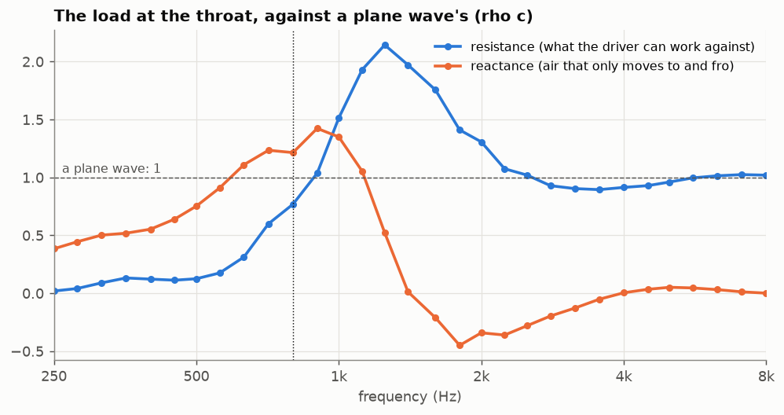
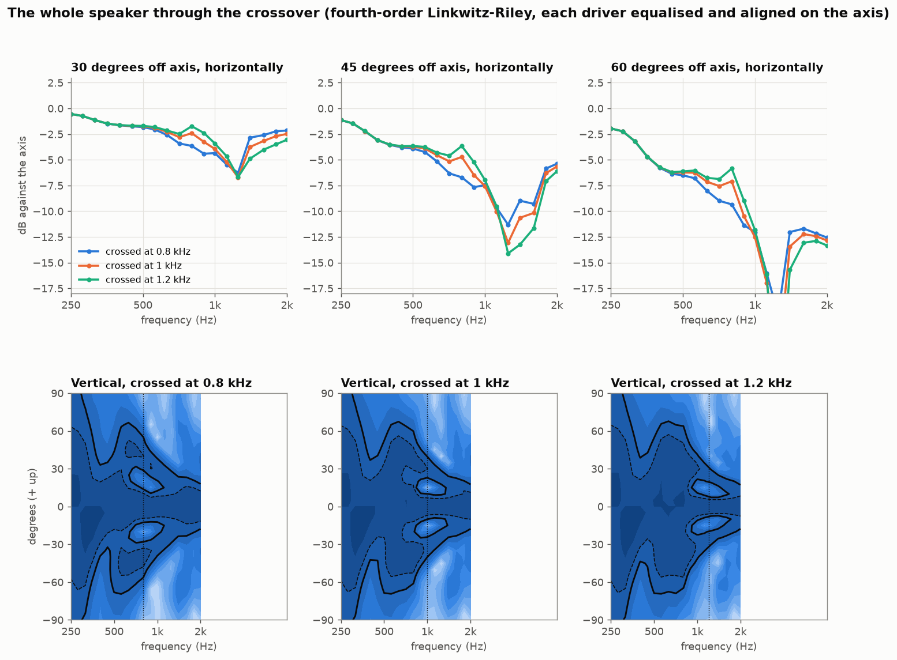
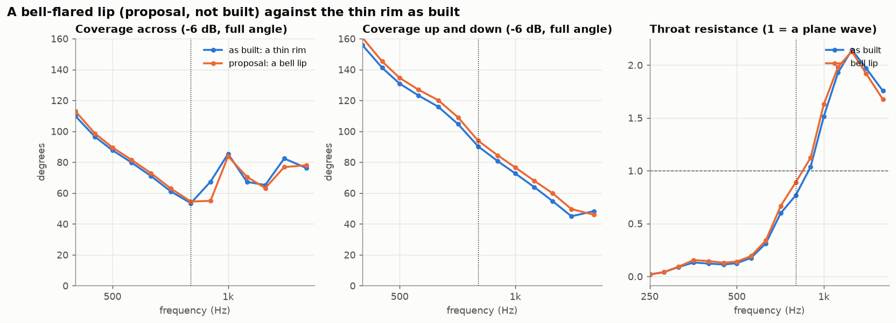

# The cast horn, by simulation (round 12, 2026-10-13)

The owner, 2026-10-13: "Do 1-3". The first of the three was to check the horn's acoustics by simulation. Its shape
was traced from the photograph (round 4) and had never been simulated.

**In short.** The horn works. From 1 kHz to 8 kHz it holds about the coverage its walls are drawn for: 70 to 100
degrees across (the walls open to 95) and 40 to 70 up and down (the walls: 63). It loads the driver fully from about 900 Hz.
No change to its shape is needed. A bell-flared lip, simulated as the obvious alternative to the thin rim, changes
nothing that matters, so the rim stays. The crossover can stay at 800 Hz, and 900 Hz is worth trying when a prototype
is measured.

## What was simulated

- **The horn as built.** product.py's `P['horn']['cast']`, through speaker/horn.py: a 610 x 346 mouth, 278 deep, on a
  2 in throat. The walls open to 47.6 degrees each side across and 31.6 up and down. The mouth's edge is a 10 mm rim
  rounded on about 4 mm, and the outside follows the flare back into the pod and its cap. The 2 in bore runs on 24 mm
  through the boss and the adaptor ring to the driver's exit.
- **The method** (`horn_sim.py`).
  - Boundary elements: bempp-cl, Burton-Miller, a direct solve.
  - The solver was checked against the pulsating sphere: the surface pressure and the radiation impedance agree
    within 0.1 %.
  - A flat piston at the driver's exit stands in for the compression driver. Every other surface is rigid.
  - The mesh is built from the same section formulas as the CAD, and sections through both agree.
  - Each band has its own mesh, at least six elements a wavelength inside the horn at the band's top.
- **Two set-ups.**
  - The horn alone in free air, from 250 Hz to 8 kHz.
  - The horn on its posts above the cabinet, with the woofer as a second piston of its effective area (805 cm2) on
    the cabinet's front, from 250 Hz to 2 kHz.
- **The crossover.** Each driver is equalised flat and aligned on the listening axis, as the amplifier's DSP can do,
  and the two are summed through a fourth-order Linkwitz-Riley.

## The horn alone

Coverage is the full angle between the -6 dB points. DI is the directivity index. Resistance is the throat's, against
a plane wave's (1 = rho c): what the driver can work against.

| f | across | up and down | DI (dB) | throat resistance |
|---|---|---|---|---|
| 500 Hz | 88 | 131 | 7.7 | 0.13 |
| 630 Hz | 71 | 116 | 9.1 | 0.31 |
| 800 Hz | **53** | 90 | 10.8 | 0.77 |
| 1 kHz | 85 | 73 | 10.9 | 1.51 |
| 1.25 kHz | 65 | 55 | 13.1 | 2.14 |
| 1.6 kHz | 76 | 48 | 11.6 | 1.76 |
| 2 kHz | 92 | **37** | 11.0 | 1.31 |
| 2.5 kHz | 101 | 57 | 10.2 | 1.02 |
| 3.15 kHz | 85 | 53 | 12.2 | 0.90 |
| 4 kHz | 83 | 48 | 12.2 | 0.91 |
| 5 kHz | 96 | 65 | 7.8 | 0.96 |
| 6.3 kHz | 85 | 61 | 10.4 | 1.01 |
| 8 kHz | 69 | 57 | 12.4 | 1.02 |

What it says:

1. **Above 1 kHz the horn holds its walls' coverage.** Across it covers 70 to 100 degrees (the walls open to 95),
   narrowing only at the top, 69 at 8 kHz. Up and down it covers 40 to 70 (the walls: 63). The directivity index sits
   at 10 to 13 dB, a well-behaved horn's.
2. **It loads the driver fully from about 900 Hz.** Below that the load falls away: a third of a plane wave's at
   630 Hz, an eighth at 500. Between 1 and 1.6 kHz it rises to twice a plane wave's (the mouth sends part of the wave
   back), a broad lift the DSP can level. Above 2.2 kHz it is flat at 0.9 to 1, as a horn's should be.
3. **One dip on the axis, at 4.5 to 5 kHz.** The level on the axis falls about 4 dB there while the sides hold, so the
   directivity index dips to 8 dB. Solved again on the coarser mesh, the two agree within 0.1 dB: it is the horn's,
   not the model's. The DSP can level it on the axis.
4. **Below 1 kHz the mouth sets the pattern, not the walls.** Across, the coverage narrows to 53 degrees at 800 Hz
   before it widens again: the mouth is 1.4 wavelengths wide there. Up and down, it narrows to about 40 degrees
   between 1.4 and 2 kHz, where the mouth is 1.4 to 2 wavelengths high. Every horn this size does both.

## On its cabinet, beside the woofer

| f | woofer across | woofer DI | horn across | horn DI |
|---|---|---|---|---|
| 500 Hz | 120 | 7.1 | 87 | 7.6 |
| 630 Hz | 116 | 6.2 | 72 | 8.6 |
| 800 Hz | **139** | **5.9** | **53** | **10.7** |
| 1 kHz | 98 | 9.0 | 88 | 10.6 |
| 1.25 kHz | 75 | 11.3 | 66 | 12.9 |
| 1.6 kHz | 57 | 13.4 | 76 | 11.5 |
| 2 kHz | 44 | 15.2 | 93 | 10.9 |

The cabinet below barely changes the horn: across it is the same, and up and down it is a few degrees wider below
1 kHz.

At 800 Hz the woofer spreads to 139 degrees across while the horn narrows to 53. The handover is a step in
directivity (5 dB in DI), so the speaker's sound off to the sides dips just above the crossover. At 1 kHz the two
nearly meet (98 and 88 degrees).

## Through the crossover

| crossover | DI step at the crossover | across, horn / woofer | smoothness 30 to 60 degrees off axis (rms, 400 Hz to 2 kHz) | smoothness of the DI (rms) | horn's load at three quarters of the crossover | vertical window (-6 dB) near the crossover |
|---|---|---|---|---|---|---|
| **800 Hz** (today) | 4.8 dB | 53 / 139 | **1.50 dB** | **1.31 dB** | 0.28 | **+-15 degrees** |
| 900 Hz | 2.9 dB | 69 / 116 | 1.56 dB | 1.49 dB | 0.53 | +-15 degrees |
| 1 kHz | 1.6 dB | 88 / 98 | 1.63 dB | 1.62 dB | 0.71 | +-10 degrees |
| 1.2 kHz | 1.8 dB | 67 / 79 | 1.73 dB | 1.71 dB | 1.15 | +-10 degrees |

What it says:

- **Moving the crossover up matches the two drivers at the handover**, and it gives the driver more to work against
  below it. But over the whole band from 400 Hz to 2 kHz the off-axis sound and the DI are no smoother: the woofer
  narrows fast above 1 kHz, and the horn's own ripple stays.
- **It also narrows the vertical window.** The woofer and the horn stand 0.62 m apart. Near the crossover their sum
  cancels a little above and below the axis. At 1 kHz the window is +-10 degrees: a seated listener is inside it, but
  a standing one at 3 m sits at its edge.
- **So the crossover stays at 800 Hz (LR4)**, as B&C allows (800 Hz or above, 12 dB/oct or steeper). **900 Hz is the
  one to try on a measured prototype.** It doubles the horn's load just below the crossover, cuts the handover's
  step from 4.8 to 2.9 dB and keeps the vertical window. It is a setting in the amplifier's DSP; no part changes.

## A bell-flared lip (a proposal, not built)

The thin rim was the first suspect for the ripple in the coverage. The proposal keeps the mouth (610 x 346) and the
outside's size. The flare stops 11 mm short of the mouth on a smaller mouth, and its last stretch curls outward on a
40 mm radius across (22 mm up and down) until it faces straight forward, a rounded bell instead of an edge.

| f | across, as built / bell | up and down, as built / bell | throat resistance, as built / bell |
|---|---|---|---|
| 800 Hz | 53 / 54 | 90 / 94 | 0.77 / 0.89 |
| 900 Hz | 67 / 55 | 81 / 84 | 1.04 / 1.12 |
| 1 kHz | 85 / 84 | 73 / 77 | 1.51 / 1.63 |
| 1.25 kHz | 65 / 63 | 55 / 60 | 2.14 / 2.13 |
| 1.6 kHz | 76 / 78 | 48 / 46 | 1.76 / 1.68 |

The bell moves the coverage by a few degrees either way and leaves the ripple where it was, which points to the
mouth's size rather than its edge. **The thin rim stays.**

## Limits

- The driver is a flat piston at its exit: no phase plug's own pattern, no diaphragm breakup. Its real response sits
  on top of these curves.
- Every surface is rigid. Cast resin 6 mm thick is stiff enough for that above a few hundred hertz; the posts are left
  out.
- Free air: no floor and no room. The cabinet's front is flat, and the woofer is a rigid flat piston, not a cone.
- The meshes have at least six elements a wavelength inside the horn at each band's top, coarser behind it, where
  little sound goes at those frequencies. Where two bands' meshes overlap (4.5 and 5 kHz, solved on both) they agree
  within 0.1 dB.
- The crossover sums assume ideal DSP alignment on the axis and the far field. The speaker's power adds the two
  drivers' as if they were unrelated (they stand more than half a wavelength apart above about 280 Hz).

## Files

| file | what |
|---|---|
| `../horn_sim.py` | the meshes and the solver (`check`, `mesh BAND`, `solve BAND`; `--bell R` for the proposal) |
| `../horn_plots.py` | the charts and `summary.json` |
| `horn-lo.json`, `horn-mid.json`, `horn-hi.json` | the horn alone: 250 Hz to 1.6 kHz, 1.8 to 4 kHz, 4.5 to 8 kHz |
| `horn-cab.json` | the horn on its cabinet with the woofer, 250 Hz to 2 kHz |
| `bell40-lo.json` | the bell lip, 250 Hz to 1.6 kHz |
| `summary.json` | coverage, DI and throat load per frequency, and the crossover sums |
