# The companions: a record player and a lamp in the Atmosphere acrylic (round 31)

The owner, 2026-10-18: "Let's work on a few more things now. Record player and lighting for one. All acrylic." In
round 17 the owner had also said: "If we can find a good recycled acrylic partner, we can make other components, like
record players, lights, etc." These are those two pieces. Both are in the Clouds' tinted cast acrylic and come in the
eight Atmosphere colours, and each is built with the fab kit the speakers are built with.

Status: **concept, built to the fab kit's standard: proposals until the owner signs them.** The speaker, its product
file and its CAD are untouched. The Cloud is built here only so that it can stand beside the companions in a shot.

| | **Cumulus**, the record player | **Bell**, the lamp |
|---|---|---|
| what | belt drive, the motor in its own pod, apart | table lamp, the horn's flare hung mouth down |
| size | 483 W x 373 D x 135 H (arm at rest) | 432 across the rim, 480 tall, foot 230 |
| acrylic | plinth 2 x 20 mm, platter 25 mm, pod 3 x 20 mm, feet 20 mm | foot 2 x 20 mm, shade formed from 5 mm (tinted 4x denser), stem tube 30 x 3 |
| weight | about 2.4 kg turning (platter and hub), about 9 kg in all | about 3.3 kg |
| parts list | **$2,775**, one off | **$563** + the LED strip (price not found), one off |
| product file | `turntable.py` | `lamp.py` |
| build | `out-turntable/` (cut files, drawings, parts list, checks) | `out-lamp/` |

    .venv-fab/bin/python studio/fabkit/build.py spinoffs/barkhorn/companions/turntable.py --out spinoffs/barkhorn/companions/out-turntable
    .venv-fab/bin/python studio/fabkit/build.py spinoffs/barkhorn/companions/lamp.py --out spinoffs/barkhorn/companions/out-lamp
    .venv-fab/bin/python spinoffs/barkhorn/companions/concepts.py      # the blockouts
    python3 spinoffs/barkhorn/companions/shots.py                      # the shot files
    PY=python3.11 spinoffs/barkhorn/companions/render_all.sh           # every shot (about an hour on 4 cores)

Both builds pass the kit's checks: no clashes, every sheet thickness in stock, every bought part in the library.
`components.json` beside them is the companions' own library. Its prices come from search snippets of 2026-10-18;
the pages themselves could not be opened from this environment.

## The concepts

Each concept is a quick blockout in the Clouds' acrylic on the look book's sweep (`concepts.py`; renders in
`renders/2026-10-18/barkhorn/companions/concepts/`). Each was judged on the same things: tinted cast acrylic; the speakers'
language (flat sheets, eased edges, cemented joints, the horn's soft curves); whether it is honest and buildable;
and whether it is sophisticated but witty.

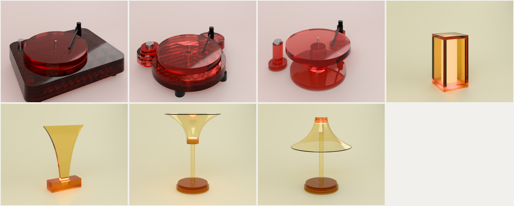

**Record player**

- **T1, the Slab.** Three 20 mm sheets cemented into a rounded rectangle, with the platter on top. This is how most
  acrylic turntables are made, and that is what's wrong with it: no one would know it was EARF's. Sixty millimetres
  of tint also go nearly opaque and muddy.
- **T2, Cumulus (picked).** The plinth is drawn the way the Atmosphere icons are drawn, from circles: one for the
  platter, one round the arm's pivot, one round the motor. The motor's circle has a hole in it, and the motor stands
  in that hole on its own feet, never touching the plinth. That is what a good belt drive does anyway (keep the
  motor's hum out of the arm), made visible. The joke is the cloud with a hole in it, and it is also the
  engineering, which is the brand's kind of wit. Two sheets keep the colour clear.
- **T3, the Mast.** A skeleton: the platter on a column of stacked discs, with the arm and the motor each on a pillar.
  It is striking, but three loose pieces on a shelf have to be set out by hand, and the arm must stay 222 mm from the
  spindle. That is a jig, not a product.

**Lamp**

- **L1, the Lantern.** The cabinet in small: five cemented 20 mm panels with an opal tube inside. It is honest and
  easy to build, but it is a box, and the cabinet already says that better.
- **L2, Edge.** One 20 mm sheet cut to the horn's section and lit from below through its edge. It reads as an
  award, and tinted edge light is dim.
- **L3, Bell.** The speaker's horn flare turned up to the ceiling, with the LED at the throat where the compression
  driver sits. That is the right idea, but upturned on a stem it reads as a trophy or a cocktail glass.
- **L3b, Bell turned over (picked).** The same flare hung mouth down from the top of the stem. Light pools on the
  table, the flare glows in its colour and deepens toward the rolled rim, and the light sits at the throat. The
  speaker plays sound out of its horn; this one plays light. It is a familiar lamp shape (a mushroom), so the
  horn's flare is what makes it EARF's.

## Cumulus, the record player

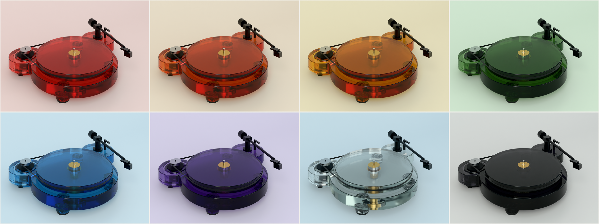

- **The plinth** is two 20 mm sheets cut as one outline and cemented with a two-part polymerising acrylic cement
  (as the cabinets are), then annealed. The outline is three circles: the platter's at 340, the arm's at 150 on the
  pivot, and the motor's at 136. The corners where they meet are R14, and every edge is eased R2 and polished. The
  cut files keep the square prism, and the easing is a note on each part.
- **The motor apart.** The pod is three 88 mm discs standing on three soft Sorbothane discs on the shelf, with a 4 mm
  gap all round to the plinth. The motor's lead goes down through the pod and out underneath, so nothing runs
  through the plinth.
- **The platter** is 25 mm of the same acrylic, 300 across. It weighs 2.1 kg, and 2.4 kg with its bonded brass hub
  (I = 0.024 kg m2, a little more than Rega's glass platters). The belt runs on its polished, crowned rim. There is
  no mat: acrylic is close to vinyl's own impedance, which is why acrylic platters exist.
- **The bearing** is turned for it. A brass housing runs through both sheets, its flange in a 6 mm pocket in the top
  on three M4 screws into bonded inserts. Inside are two sintered bronze bushes, and a ground stainless spindle (10,
  7.2 at the record) runs on a 6 mm tungsten carbide ball and a PTFE pad. The brass shows through the tint. I looked
  for a bearing sold on its own: Michell's inverted bearing is listed as discontinued, and Pro-Ject sells its
  bearing only with its platter. A lathe shop makes this one from a drawing (sheet 6 on).
- **Speed** comes from Rega's 24 V motor and Neo PSU MK2: 33/45 by a button, trimmed in 0.01 rpm steps, and the
  speed changes without moving the belt. The pulley is turned to the motor's measured speed. If it runs at 250 rpm,
  the belt face is 39.48 across for a belt on the 300 rim, which is close to 40.
- **The arm and cartridge** are Rega's RB330 at Rega's 222 mm and an Ortofon 2M Black (round 31b; the 2M Blue
  first drawn read as a stray blue accent on every colour, the lead's note). Moving magnet, so any phono stage; black
  in every colour. The 2M Red (red body) could ride on Ember.
- **The feet** are three 50 mm acrylic discs on M8 brass studs, each turned to level the platter, with Sorbothane
  under them. They are placed so the triangle holds the platter's centre.
- **The mark** is EARF, 44 wide, laser-etched in the arm's circle in front of the arm and filled with the colour,
  deeper. It is the only text on it.

| bought | source | price |
|---|---|---|
| Rega RB330 tonearm | [Safe and Sound HQ](https://www.safeandsoundhq.com/products/rega-rb330-tonearm) | $675 |
| Ortofon 2M Black | [Upscale Audio](https://upscaleaudio.com/collections/cartridges) | $749.99 |
| Rega 24 V motor upgrade kit | [HiFi Gear](https://www.hifigear.co.uk/rega-neo-mk2.html) | GBP 150 (~$200) |
| Rega Neo PSU MK2 (US, 60 Hz) | [Audio Advisor](https://www.audioadvisor.com/products/rega-neo-psu-mk2-60hz-turntable-psu-power-supply-black) | $445 |
| flat belt, 5 x 0.6, ~975 | a belt maker, cut to length | ~$25 (estimate) |
| sintered bronze bushes 10 x 14 x 12, carbide ball 6, PTFE pad | McMaster-Carr or a bearing supplier | ~$16 (estimate) |
| Sorbothane feet (3) and pod pads (3) | Isolate It / Sorbothane Inc. | ~$45 (estimate) |

The acrylic is $239 of the $2,775 and the turned parts (bearing, hub, spindle, pulley) $311. The rest is bought, and
the arm, the cartridge and the Neo are $1,870 of that.

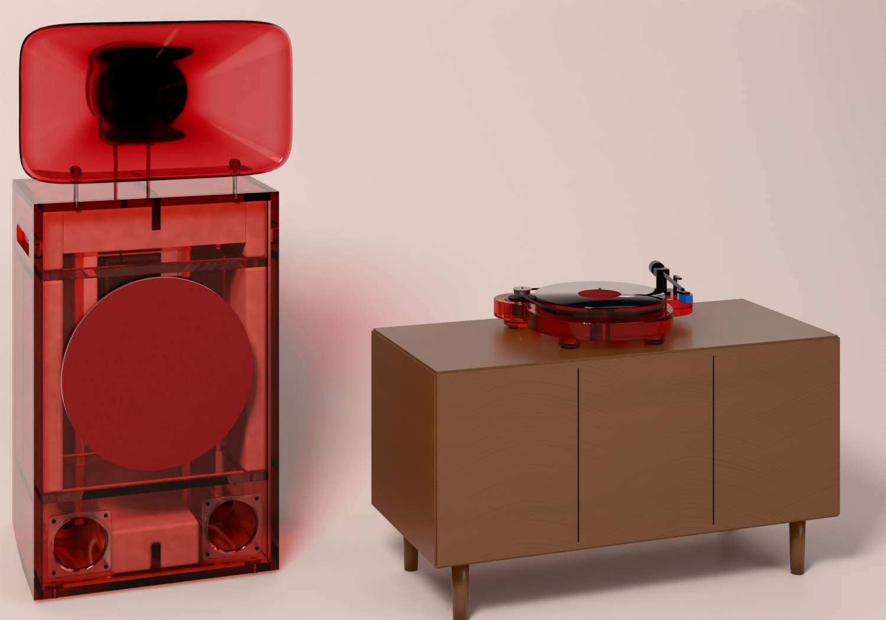

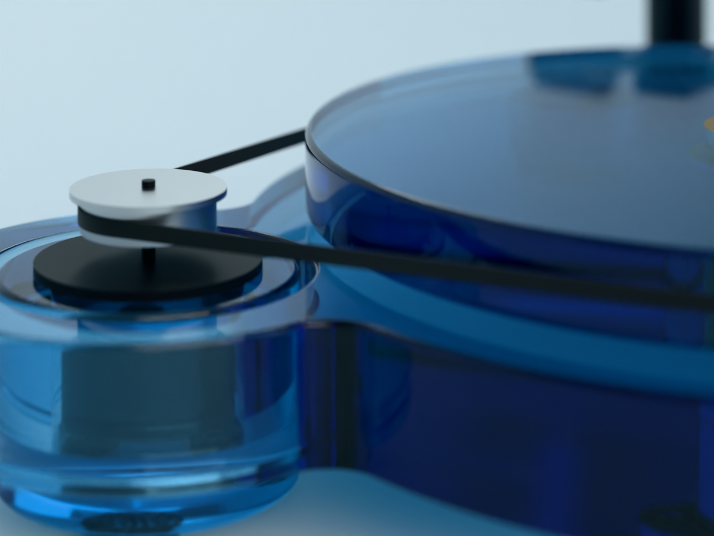

## Bell, the lamp

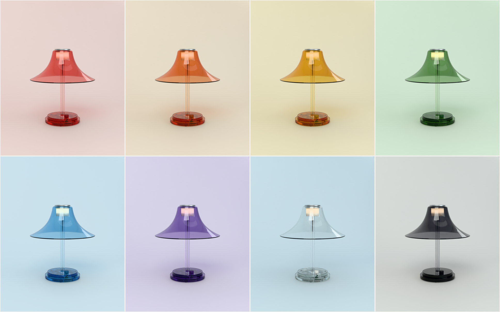

- **The shade** is formed (vacuum or drape) over a turned buck at about 160 C, then annealed. It has a flat collar at
  the crown, a R10 corner into the flare, and a rim rolled to R2.5, 420 across. The flare is the speaker's: it opens
  late, then rolls over. The sheet is 5 mm, so it is **cast four times as dense in the tint** as the cabinets' 20 mm,
  and reads the same. A caster makes any density. (At the cabinets' own tint, 5 mm is nearly clear: see the first
  proof.) The shade hangs by its collar, clamped between the hub's flange and the cap on a silicone ring with three
  M4 screws, so nothing presses on the formed wall.
- **The light** is 0.4 m of Waveform Lighting's CENTRIC WARM 24 V strip (95+ CRI, 450 lm a foot, 2700 K at full
  and dimming warm toward 2000 K, like a filament). It wraps twice round a turned aluminium hub, which is its heat
  sink, behind an opal acrylic sleeve so no dots show. That gives about 600 lm at full, a 60 W bulb's worth. I chose
  a strip round the stem over a single LED at the throat because the stem runs up the middle, and a strip lights
  the shade from inside all the way round.
- **Low voltage throughout.** A Mean Well 24 V wall adapter plugs into a 2.1 mm in-line socket. From there a clear
  18/2 cord goes into the foot's back, through the dimmer in the foot's pocket, and up inside the clear stem, where
  it shows. Nothing in the lamp is at mains voltage, which makes listing it simpler.
- **The foot** is two discs, 230 and 200, cemented. The dimmer's board sits in a pocket through the lower disc,
  closed by a 6 mm cover on four M3 screws, with six clear bumpers under it. **The knob** is on top at the front,
  turned from rod in the deeper colour. You turn the lamp up like a volume knob, which it nearly is. That is the one
  joke, and it is a quiet one.
- **The stem** is a cast acrylic tube 30 x 3, bonded into the foot's socket and the hub's bore.
- It holds about 1.7 kg in the foot and 1.6 kg in the head, and tips past about 28 degrees.

| bought | source | price |
|---|---|---|
| Waveform Lighting CENTRIC WARM strip, PN 3008.27 | [Waveform Lighting](https://store.waveformlighting.com/products/centric-warm-led-strip-lights), [datasheet](https://store.waveformlighting.com/cdn/shop/files/CS_3008.27.pdf) | reel price not seen |
| LEDSupply Single Color Mini Rotary Dimmer, 12-24 V PWM | [LEDSupply](https://ledsupply.com/led-dimmers/mini-rotary-knob-dimmer) | $8.84 |
| Mean Well GST25U24-P1J, 24 V 25 W wall adapter | [TRC Electronics](https://www.trcelectronics.com/products/mean-well-gst25u24-p1j) | ~$18 (the desktop GST25A24 is $19.42) |
| Satco/Nuvo 80-2374 clear 18/2 SPT-2 cord, 8 ft | [Lighting Supply](https://lightingsupply.com/products/satco-nuvo-80-2374) | $6.97 |
| 3M Bumpon SJ5302 clear, in-line DC socket, strain relief, fixings | any distributor | ~$20 (estimates) |

The turned and formed parts are most of the $563: the hub and cap ($114), the stem, sleeve and knob ($186), and the
shade ($139, with a tenth of a $900 buck, spread over a first run of ten).

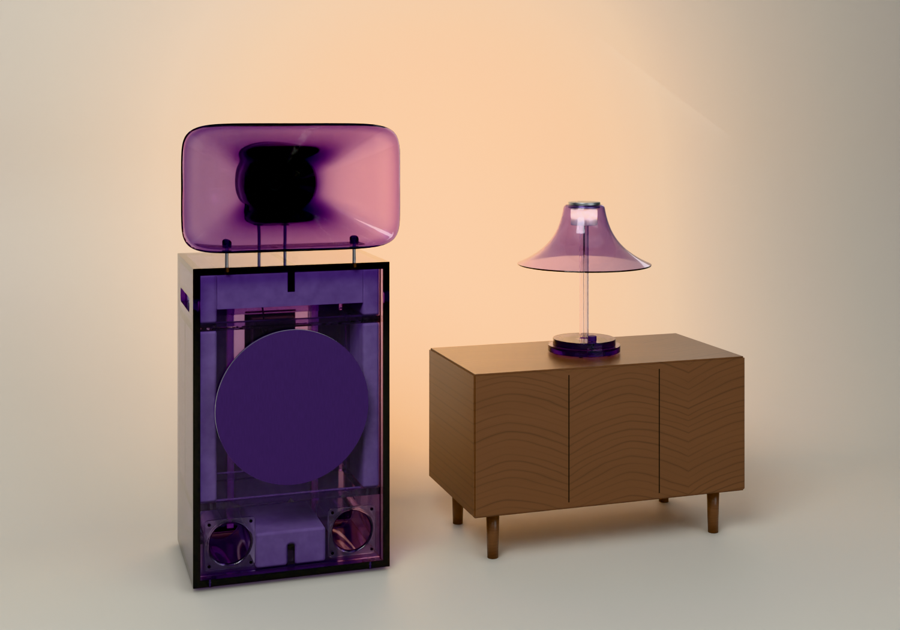

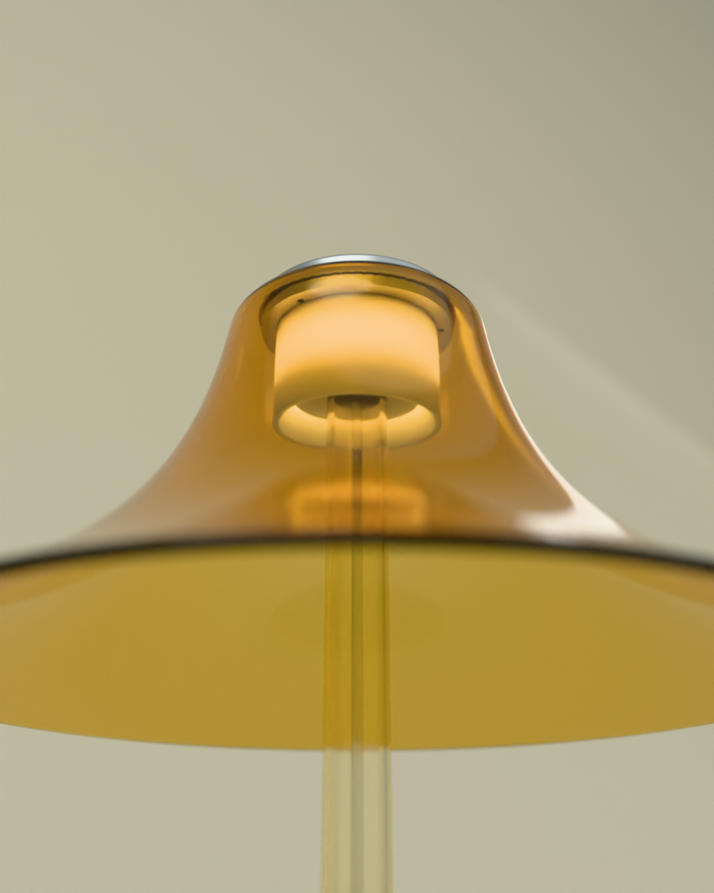

## The renders

The look book's frames come from the engine on the look book's sweep in each colour (lookbook21's key, fill and
wash), with the cabinets' own tinted-acrylic material: clear cast resin absorbing toward the colour after 25 mm.

- `look-turntable-<colour>.png` and `look-lamp-<colour>.png`: each product in each of the eight colours, the lamp lit
  (strip strength 88). On a bright studio sweep a lit lamp shows as its glowing sleeve, as real lamps photographed on
  a lit set do. `look-*-sheet.png` shows the eight together. Cumulus wears the black 2M Black in all eight.
- `detail-turntable.png`: the motor's pod in its ring, the belt to the rim (Ice). `detail-lamp.png`: from under the
  rim, the opal sleeve lit, the collar and cap (Acid).

**The heroes (round 31b).** The lead and the owner asked for campaign images for a $20,000 line: the companion the
subject, the speaker as context, a real setting with texture, Bell switched on. Both are now in one room at dusk:
oak boards, a Poly Haven plaster wall (beige_wall_001, 4k), a window at the left with the dusk sky outside, and Poly
Haven's scanned walnut cabinet (modern_wooden_cabinet, 4k) under the companion. Cumulus has Bell lit beside it.
Bell's light is three small lamps just outside its opal sleeve (an emitting strip that thin is all noise), hidden from
the camera and from reflections; `studio/engine/lights.py` gained that switch for point lamps.

They were judged by `critic/PROMPT-promo.md`, each pass a fresh blind critic given only the image, a short card
(`promo.py stage`), `critic/measure.py` and the prompt's text. Every pass's changes were applied unless they would put
the speaker inside the wall or change the product; `critic/LOG.md` here has every pass, and the replies are in
`critic/rounds/2026-10-18/promo-*.json`. The coordinator's stopping rule replaced 8.5 (no session reached it): stop
after two passes in a row gaining under half a point, then duel the best two blind.

| hero | passes (blind scores) | final | the duel |
|---|---|---|---|
| Cumulus | 5.0 (morning sun), 5.5, 5.5, 5.5 | `hero-turntable.png` (pass 3) | pass 3 beat pass 4, 6.0 to 5.0 |
| Bell | 5.0, 5.5, 5.5, 6.0, 5.0 | `hero-lamp.png` (pass 4) | pass 4 beat pass 5, 6.0 to 5.0 |

Honestly: neither is at the bar the owner set. The critics' last notes, for whoever takes them on: the wall still
outshines Cumulus and the grade is one warm red; the lower plinth crushes; the record reads as smoked glass (a vinyl
groove material would help); and the speaker beside each companion is either cropped to a coloured block or out of the
frame. The room is a box with one window; a deeper room (a corner, a second wall receding) is the next step.

**Final paths for the site** (`renders/2026-10-18/barkhorn/companions/`):

| colour | record player | lamp |
|---|---|---|
| Ember | `look-turntable-ember.png` | `look-lamp-ember.png` |
| Dust | `look-turntable-dust.png` | `look-lamp-dust.png` |
| Acid | `look-turntable-acid.png` | `look-lamp-acid.png` |
| Poison | `look-turntable-poison.png` | `look-lamp-poison.png` |
| Ice | `look-turntable-ice.png` | `look-lamp-ice.png` |
| Haze | `look-turntable-haze.png` | `look-lamp-haze.png` |
| Fog | `look-turntable-fog.png` | `look-lamp-fog.png` |
| Smoke | `look-turntable-smoke.png` | `look-lamp-smoke.png` |
| heroes | `hero-turntable.png` (Ember) | `hero-lamp.png` (Haze) |
| details | `detail-turntable.png` (Ice) | `detail-lamp.png` (Acid) |

The renderer's Python: the bpy wheel (5.0.1) is built for Python 3.11, and this container's `python3` is 3.13, so I
ran the renders with `python3.11` (`PY=python3.11 render_all.sh`). `studio/setup.sh` pins `bpy==5.0.1` on the
system `python3` and fails here. That is worth a line in setup.sh, but I didn't change it in this round.

## Open questions for the owner

1. **The names.** Cumulus and Bell are working names. The speakers are named for things in the air by colour, so the
   companions might take the colour's name too ("Cumulus in Haze").
2. **Recycled acrylic.** The formed shade and the 25 mm platter both need the casting partner (round 17's
   Plastiglas de México or Madreperla) to make the eight tints in 5 mm at four times the density and in 25 mm.
   Ask both.
3. **The cartridge.** Now the 2M Black ($749.99): black in every colour. A 2M Red on Ember only, or a moving coil
   (Hana) on all, are the alternatives.
4. **A dust cover?** None is drawn. A cover in clear acrylic hinged on the arm's circle is possible, but it would
   need a fourth circle in the plinth.
5. **The arm at rest** leaves the cartridge just past the plinth's front-right edge, as Rega's lift puts it. Should
   the arm's circle grow so the arm rests over acrylic?
6. **Listing.** The lamp is low voltage behind a listed adapter. The dimmer, once out of its housing, is not a
   listed part. For sale, a listed 24 V dimmer to fit the pocket. The record player's mains part is Rega's Neo, which
   is listed.
7. **The bearing** is made, not bought. Should we ask Rega or Pro-Ject for their bearing as a spare, or keep ours?
8. **Prices.** Neither has a selling price. At the speakers' multiple (round 15: $19,000 a pair against about $8,000
   of parts), Cumulus would sell for about $5,000 and Bell for about $1,400. These are for the owner to set.

## Round 32: the bar lamps (Moon, recommended)

The brief (the owner, 2026-10-19, through the coordinator): an acrylic table lamp and a hanging lamp for a bar, Planet
EARF first, and for sale. Three families were blocked out (`bar_lamps.py`, the sheet at
`renders/2026-10-19/barkhorn/barlamps/sheet.png`): F1 Block (rounded-square, squared), F2 Column (a lit cylinder),
F3 Moon (a frosted dome on a tinted column, and its pendant). **Moon is recommended**, F1 Block the alternative if
the owner wants the squared one.

Why Moon, for a bar:
- **It lights the table, not the eyes.** The light sits inside a frosted dome, above a seated guest's eye line in the
  table lamp and up a 46 mm baffle in the pendant (cut-off about 46° from the vertical). Nobody sees an LED.
- **It survives service.** The dome sheds a spill and the finial is round. The steel foot is sealed by O-rings
  (IP44, wipeable) and weighs about 1.5 kg, so a sleeve or an elbow doesn't tip it. It charges on a staff tray of
  six through gold rings, with no cable on the table.
- **It sells.** The cordless mushroom is the form bars already buy (Poldina, Bellhop, Panthella Portable), so the
  trade knows it. What is new is the material: a turned cast dome and a solid tinted column whose polished top
  glows, in the eight Atmosphere colours plus clear, frosted and smoked. The pendant is the same dome hung mouth
  down, so a room can be specified as one family.

Built as two fab-kit products, `moon.py` (geometry, parts, notes), `moon_table.py` and `moon_pendant.py`; checks pass:

    .venv-fab/bin/python studio/fabkit/build.py spinoffs/barkhorn/companions/moon_table.py --out spinoffs/barkhorn/companions/out-moon-table
    .venv-fab/bin/python studio/fabkit/build.py spinoffs/barkhorn/companions/moon_pendant.py --out spinoffs/barkhorn/companions/out-moon-pendant

| | table lamp | pendant |
|---|---|---|
| size | foot 120, 277 tall, about 1.9 kg | dome 200 across, disc 220, canopy 150 x 50, drop 600 (to cut) |
| light | warm-dim board 2200 to 2700 K, 2.5 W, about 200 lm; touch dimmer on the finial | 2700 K CRI 90 COB (Bridgelux Vero SE 10) on a Mean Well PCD-16-700B in the canopy (phase-cut) |
| power | 25 Wh (two 18650s), about 12 h at the bar setting; tray contacts or USB-C | mains, to be listed to UL 1598 |
| BOM, one-off shop rates | **$583** (`out-moon-table/bom.md`) | **$780** plus the listing (`out-moon-pendant/bom.md`) |
| BOM, a run of 200 (my estimate) | about $170 parts, $195 landed | about $180 parts, $205 landed, plus the listing spread over the run |
| target retail | **$450 to $495** (trade at 30 % off) | **$695 to $750** |

The one-off BOM is mostly the lathe (the turned dome alone is $212 in the table lamp and $344 in the pendant, and
the brass canopy $229). At volume, four changes bring it down:
- the domes cast in a mould and finished on the lathe, not turned from block;
- the brass parts turned in a batch;
- a spun canopy in place of a turned one;
- the foot cut from steel bar.

The run figures are my estimates, not quotes. At about $195 landed, $495 retail is about 2.5 times cost, thin once
the trade discount is taken off. The dome is where the cost has to come out. The benchmarks are about $300 to $500 for
a cordless bar lamp and $600 to $1,000 for a designer pendant; check them before setting a price. The prices are the
owner's to set.

**For Planet:** `studio/engine/kit_ext/earf_moon.py` places either lamp from its fab-kit model (the GLBs in
`out-moon-*/render/`, committed for this) with materials in any flavour and its light set up as Planet's loft does
(commit f7c99a4):
- the lamp is a point light inside the dome, hidden from the camera, from transmission and from glossy rays;
- the frosted dome glows by itself (`shade_glow`).

    {"kind": "kit", "shape": "ext", "module": "earf_moon", "fn": "table", "spots": [[x, y, z_table]], "flavour": "smoked"}
    {"kind": "kit", "shape": "ext", "module": "earf_moon", "fn": "pendant", "spots": [[x, y, z_rim]], "ceiling": 3.2, "flavour": "smoked"}

Other parameters:
- `lamp_w`: the power (default 4 for the table lamp, 14 for the pendant);
- `lamp_k`: the colour temperature (2700);
- `shade_glow`;
- `materials`: overrides;
- a spot can be `{"position", "flavour", "rotate_z"}`.

`lift_shot.py`'s `glow:lamp_w=2` scales the lamp's power. The frames in `renders/2026-10-19/barkhorn/moon/` are made
with this same piece (`moon_shots.py`), so they test exactly what Planet imports.

The frames (`renders/2026-10-19/barkhorn/moon/`):

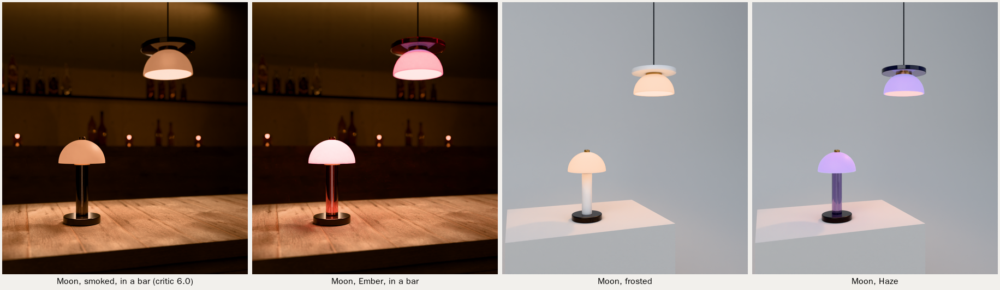

The critic (`critic/LOG.md`) ran three blind rounds on the smoked bar hero: 5.5, 5.5, then 6.0. Three rounds is the
family's limit, so I stopped there. Open on the hero:
- the smoked column still reads dark (its tint is dense);
- the pendant's underside clips, and the pendant is out of focus at f/2.8;
- the concrete shows no boards (the Poly Haven wall is smooth);
- the grade is all orange at a 3600 K balance.

A photographed hero would fix these. The shapes and finishes are fine.

**Warmth** (the coordinator: the dome read lavender-white in the bar frames). The cause was the neutral tints' own
glow, #FFB878: near white once a 3000 K balance takes it back, and pale enough to clip. It is now a warm ivory,
#FF9A50, in the products' flavours (`bar_lamps.VARIANTS`, rebuilt), so Planet gets it by default. The bar frames
also balance at 3600 K, as bar photography does, so 2700 K reads warm, not white.

**F1b, Block lit low** (`f1b.py`, kept ready in case the owner picks the square):
- the table lamp: F1 Block's tinted rounded-square block over a frosted lower sleeve, 22 to 130, with a hidden light
  inside it at 100, so the frost glows and lights the table around the foot; a steel shadow line between the two;
- the pendant: the same split, with a frosted band round the mouth, the block above, and the light 120 up inside
  (a cut-off of about 32°).

It is rendered in Moon's two bar frames (`renders/2026-10-19/barkhorn/f1b/`, beside Moon in `beside-moon.png`). These are blockouts: if the owner picks
it, it gets Moon's treatment (fab-kit products, a BOM, a kit piece).

Still open:
- the listing cost;
- the board (to make; a TI BQ25895-class charger with a touch dimmer);
- whether bars want the tray of six as its own product;
- the canopy in brass or blackened steel to match Planet's steel.

## Round 32c: the frost set within the acrylic, a shape study

The owner, on Moon beside Block: "I'm not sure I like the white section. Maybe if we do that for light dispersion it's
set within the acrylic. Not sure what shape I like yet."

**The treatment** (`study.py`): nothing white outside. Every visible surface of the shade is polished tinted cast
acrylic. The diffuser is a frosted liner (an acid-etched or bead-blasted tube or cup) set 1 mm inside the shell.
- Where a shade is open below (the domes, the cones, the pendants), a 3 mm tinted skin covers the liner's inside as
  well, so the wall is tint, frost, tint.
- The frost is seen only through acrylic, so the tint glows evenly from within and the source is never seen.
- In manufacture this is a cast-in liner (the frosted part cast into the block) or a bonded three-layer wall; the
  study doesn't choose yet.

**The shapes**, each a cordless table lamp with a matching pendant:
- **Dome:** Moon's dome on a column; the pendant's light is up a brass baffle.
- **Block:** the rounded square.
- **Column:** the cylinder.
- **Sphere:** a ball on a column, and a ball open below.
- **Cone:** mouth down, on a column and as the pendant. It is the classic bar shape, with the deepest cut-off.

The pendants are open below, with the light up inside them (cut-offs about 20° to 35° from the vertical).
The table lamps keep Moon's cordless foot.

**Rendering:** Moon's bar frame, in smoked and in Ember (`renders/2026-10-19/barkhorn/study/sheet.png`).
- In the render, the tint is cast denser than the Clouds' (a 5 mm depth for Ember, 8 mm for smoked) so it carries
  the colour in walls 8 to 12 mm thick. The liner glows at 0.25.
- A lamp close inside a closed form burned its liner white, so the block's, the column's and the sphere's lamps are
  lower.

These are blockouts. Whichever shape the owner picks gets Moon's full build.

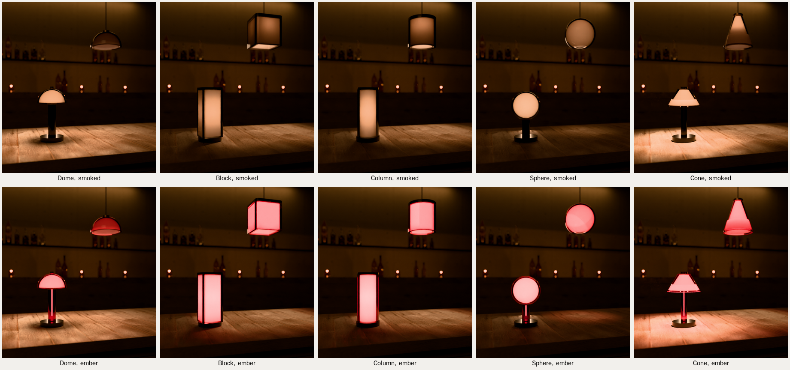

## Round 32d: the pick, Dome and Orb

The owner picked from the shape study: "I like the dome overhead lights, especially if the acrylic covers are easy to
swap out, but I'm also a sucker for the spheres. For the table lamp though, I'd want the spheres to be squatted rather
than raised, like a crystal ball." Both products keep round 32c's wall: tint, frost, tint, with nothing white outside.
They are built as fab-kit products (`crystal.py`, `dome_pendant.py`, `orb_table.py`); both pass their checks.

**Dome, the pendant, with covers that swap by hand.**
- **The cover:** the tinted dome, 200 across. A brass collar is bonded into its crown, with three L-slots in it.
- **The catch:** three pins on the fixture's brass hub make a quarter-turn bayonet (30°). To take the cover off, lift
  it 5 mm, turn it and lower it. To fit one, push it up, turn it until the spring plunger clicks into its dimple, and
  let go. The cover's weight holds each pin up in a notch at the end of its slot, so a knock can't turn it off. That
  is more secure than a magnet over a bar, and it needs no tools.
- **What stays up:** the COB (2700 K, 22 mm up a 46 mm bore, a cut-off of about 46°), the hub, the cord and the driver
  in the canopy. A cover is never a live part, and the fixture is listed (UL 1598) with any cover.
- **Spare covers** are sold separately in every tint.

**Orb, the table lamp, a crystal ball.**
- **The ball:** tinted, 160 across, sitting low in the cup of a short base, 180 tall overall. The base is a
  blackened-steel drum 120 across under a brass ring; the ring is the touch (tap to switch, hold to dim, 2200 to
  2700 K).
- **The guts:** Moon's (a 25 Wh battery, the tray contacts or USB-C, IP44), sealed in the base. The LED shines up
  through a sealed window into a brass-lined port under the ball.
- **The ball lifts off**, because nothing in it is electrical, so Orbs swap colour just as Domes do. It rests on a
  silicone ring in an 18 mm cup, enough to stop a nudge rolling it.
- **The weight** is about 2.6 kg with the ball.
- **Height:** at 180 it is below the brief's 250–300 mm, by the owner's choice (squat, not raised).

| | Dome pendant | Orb table lamp |
|---|---|---|
| BOM, one-off shop rates | **$1,421** plus the listing (`out-dome-pendant/bom.md`) | **$1,190** (`out-orb-table/bom.md`) |
| of which the three-layer cover | about $990 (three turned cups, the rim and the brass collar) | about $855 (three turned balls) |
| BOM, a run of 200 (my estimate) | about $200 parts, $230 landed; a spare cover about $100 | about $200 parts, $225 landed; a spare ball about $100 |
| target retail | **$795 to $895** with one cover; covers **$295 to $345** | **$595 to $695**; balls **$245 to $295** |

The one-off price is the lathe turning three nested layers from block. In a run, the layers are cast or moulded and
only finished on the lathe, and the frost is cast into the tinted block, which is the caster's question. The run
figures are my estimates, not quotes. The covers are where the line earns: a bar that buys the fixtures once can
change its colour by season. The prices are for the owner to set.

**For Planet** (`studio/engine/kit_ext/earf_moon.py`, the same piece as Moon's): `fn` is `dome` (spots: the rim;
`ceiling` stretches the cord) or `orb` (spots: the table).
- The liner glows by itself (`shade_glow`, default 0.25), and the lamp is hidden as before (`lamp_w` defaults to 9 and
  3).
- `hide` takes a pattern of part names, so a spare cover can stand alone (`"hub|pins|cob|gland|cord|canopy"`).
- `cover_drop` and `cover_turn` show the swap; `lamp: false` turns the light off.
- The GLBs are committed in `out-dome-pendant/render/` and `out-orb-table/render/`.

The frames (`crystal_shots.py`, `renders/2026-10-19/barkhorn/crystal/`) are made through that piece:
- the bar hero in smoked and in Ember;
- the swap (a Dome lowered off its fixture, three spare covers on the counter);
- the catch, close.

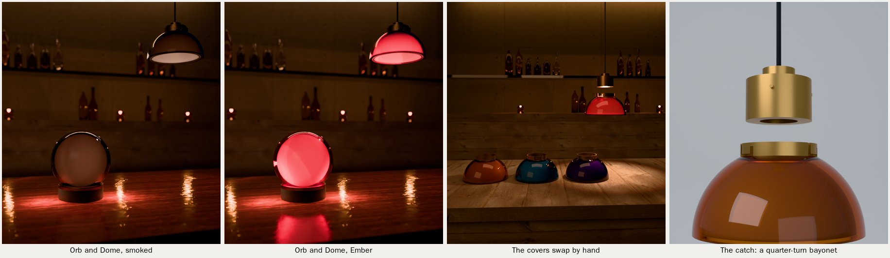

**Critic** (`critic/LOG.md`): three blind rounds on the smoked hero scored 5.0, 5.0 and 5.0. That is the family's
limit, so I stopped. It is lower than Moon's 6.0.

Two findings changed the products, not just the set:
- The smoked tint was cast too light and read cream through the frost; it is now denser (`crystal.VARIANTS`).
- The Orb's light sat below the ball's centre and drew a crescent in the frost; it is now centred (`ORB_LIGHT`, and
  the kit piece).

Open on the hero:
- the grade is all red-orange at 3200 K, and the counter reads as red lacquer;
- the smoked ball reads milky, with no hot core;
- the base is dark;
- the pendant's underside reads pale;
- the wall is flat.

Smoked is the hardest tint for this treatment: lit from within it glows a warm grey, not a colour. The Ember frame
shows the idea better.

## Round 33: EARFcoin

The owner, 2026-10-20: "One idea I had before bed: EARFcoin. Acrylic coins with the EARF globe on them that can be
exchanged for a song request. Each guest gets one." The coin is the site's acrylic coin (the colour picker and the
loader, `icons_real.py --coin`; the Coin ident) made real. Every dimension below is a proposal until the owner signs it.

**The coin** (`coin.py`; the fab kit `earf_coin.py`, a boxed set of eight; `out-earf-coin/`):
- **Stock:** cast acrylic in the eight speaker tints, 40 across and 6 thick, about 9.0 g (a casino chip is about 10 g).
  Both edges are rounded 1.5 and polished, so it feels like a coin and not a laser-cut disc.
- **Two faces, never overlapping:** a tinted coin shows both faces at once. The globe sits inside 25 across; the words
  sit in a band 15 to 17 from the centre, round the rim. Each reads the right way from the front.
- **The words:** GOOD FOR ONE SONG over the top and EARF under the bottom, in IBM Plex Mono SemiBold (the site's mono),
  caps 1.9 tall, engraved 0.12 into the front face. The one alternative: ONE COIN · ONE SONG.
- **The tints** are the speakers' swatches (`earth._C`), cast so that light through the coin and back off the paper
  lands on the swatch. Measured on the render of the eight (`coin_tints.py`), every hue is within 4° of its swatch in
  LCh: Ember 36° against Dust 52°, so it is one red and one orange. Smoke is cast lighter than its swatch (a
  transparent grey, like Perspex 9T20): at the swatch's density it rendered almost black (L 4) and hid the globe.

**The globe, three ways** (proofs below; all three are modelled, filed and costed):
- **A, reverse-engraved (recommended):** the brand's stroke globe (`earth.edge_lines`, lines 0.6 wide) laser-engraved
  0.2 deep into the back face from a mirrored file, so from the front it reads the right way round, 6 mm down in the
  tint. It works in all eight tints, it is the cheapest, and it is the most acrylic.
  - **The fill (the lead's test):** flat on white paper, frost alone nearly vanished, and a white paint fill was worse
    (white seen through the tint against white paper). Filled black, the globe reads in every tint, like the leading in
    stained glass and like the brand's black stroke mark (`renders/2026-10-20/barkhorn/coin/fills.png`: frost, white,
    black, left to right, in Ice, Acid and Haze).
  - So the globe is paint-filled black, except in Smoke, where black would vanish, so Smoke's is white. The words on
    the front are filled white: they are seen directly, not through the tint. The fill adds about $0.35 a coin.
- **B, printed in colour:** the six-colour globe (the flush discs) UV-printed on the back of a Fog coin, colour first
  and a white underlay over it (choked 0.08 so no white halo shows), then sealed. It is the most legible and the most
  "brand". But it is clear only, so the guest's colour is lost, and a print can scuff.
- **C, cast in:** the one-colour mosaic cut from 1 mm tinted sheet and set mid-thickness in a clear cast coin. The
  globe floats in the guest's colour. It is premium, and about four times the cost.

**The edge:** plain (rounded and polished) or reeded: 100 grooves 0.3 deep milled across it, like money. Reeding
catches the light along the edge and reads as currency in the hand; it costs about $0.45 a coin more at 1,000.
**Recommended: A, black-filled, with a reeded edge.**

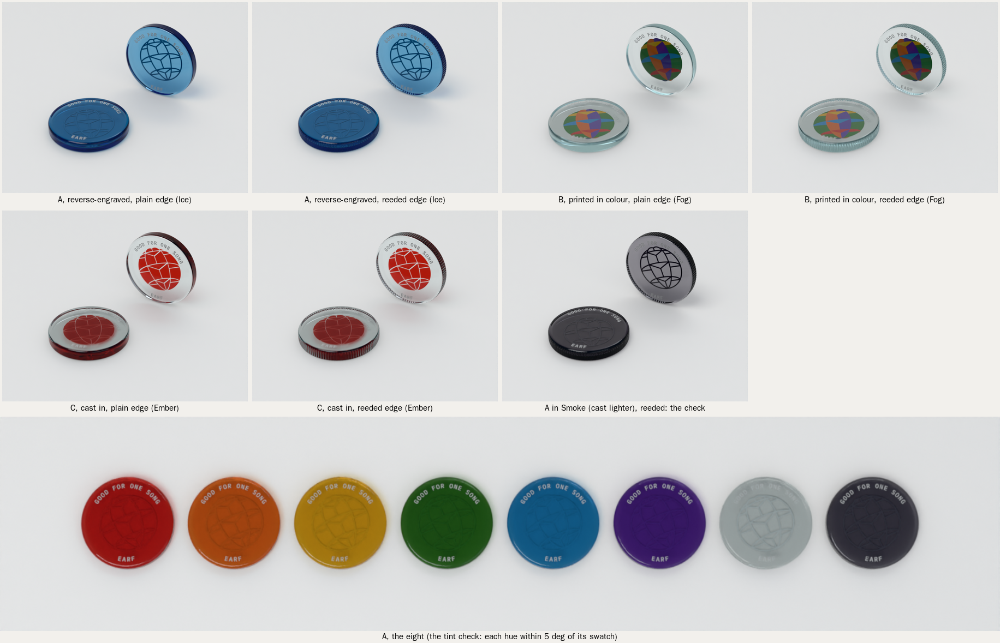

**The fab kit** (`out-earf-coin/`, `.venv-fab/bin/python studio/fabkit/build.py spinoffs/barkhorn/companions/earf_coin.py
--out spinoffs/barkhorn/companions/out-earf-coin`; it passes its checks):
- **Laser files** (`out-earf-coin/laser/`, written by `coin.py`, SVG and DXF in mm, layers named):
  - `coin-A-1-cut`: the 40 mm circle.
  - `coin-A-2-back-globe-MIRRORED`: the globe, mirrored. It's run with the coin face down, so it reads right from the
    front.
  - `coin-A-3-front-words`: the words, as read. Both engravings are paint-filled (the fill is a step, not a layer).
  - `coin-A-all-layers`: all three, registered.
  - `nest-600x400`: 104 coins on a 600 × 400 bed, cut, front and back layers registered.
  - B's print file (each colour and the white underlay, mirrored) and C's inlay cut file, for the faces not chosen.
- **The route:**
  1. Cut the sheet's coins with its masking left on.
  2. On a CNC router, hold 24 coins in a vacuum fixture. Round both arrises 1.5 with a roundover cutter, then mill the
     100 reeds (a 0.9 ball cutter, 0.3 deep).
  3. Vapour-polish the edges. Tumbling would strip the masking, and a flame can craze the acrylic. The faces stay the
     cast sheet's own, under the masking until the end.
  4. Put the coins back in the sheet's skeleton (the skeleton is the jig) and engrave the words through the front's
     masking.
  5. Flip each coin over in its own hole and engrave the mirrored globe through the back's masking.
  6. Paint-fill both engravings through the masking: the globe black (Smoke's white) and the words white. Scrape
     flush and dry.
  7. Peel, check, bag.
- **The request column** (`earf_coin_column.py`, `out-earf-coin-column/`, it passes its checks): a water-clear cast tube
  50 × 4 wall, 210 long (42 bore: 1 mm round a coin; holds 33), bonded into a Smoke acrylic base 96 × 24 with a brass
  cap ring.
  - Coins drop in at the top. A slot 6.8 tall through the base under the tube lets one coin out at the front, and the
    tube holds the next one back.
  - A finger through the notch at the back pushes the lowest coin out, so the queue plays from the bottom up.
  - **The light** (the lead, for Planet: in the bar the stack read as a dark column):
    - A 2700 K LED disc, 44 across, about 1.5 W at 5 V, from USB-C with an inline dimmer.
    - It sits on an aluminium plate in a 50 mm pocket milled up from under the base, under an opal diffuser and a
      3.2 mm window of the Smoke, with a 7 × 4 channel for the cable out at the back.
    - The tube's back half is bead-blasted inside. Lit from its foot, it glows behind the queue, so the coins read in
      their tints, backlit, like bottles on a lit shelf.
    - The frost is the part that matters. Lit only from below, polished clear coins send almost none of the light out
      sideways: the stack stayed dark but for the slot (proofs, 2026-10-20).
    - **A light bead-blast, its glow fading up the tube** (the lead, from Planet's bar: a heavy frost outshone the queue
      from a stool, 148 over the tube). Light let in at a wall's foot fades with height, so the frost glows brightest
      behind the queue and dims over the empty top.
      - In the kit piece: four bands at 1.0, 0.45, 0.15 and 0.05, set by `back_glow` (default 1.0).
      - From a stool at 1.2 m on 50 mm, the empty top now measures about 100.
      - The coins read as bands of their tints only where the frost lights them from behind: seen from the side,
        each coin is 40 mm of dense tint, so the stack itself stays dark (about 15). A warm pin spot on the decks
        lights their polished edges; that is the bar's job, not the column's.
  - **$438 one-off** at the kit's shop rates, with the light (`out-earf-coin-column/bom.md`; $322 without it).
    Proof: `renders/2026-10-20/barkhorn/coin/column-lit.png`.
- **BOM:** a boxed set of eight is **$33** at the kit's rates (`out-earf-coin/bom.md`, sheet plus the shop's work as
  estimated lines, plus a $9 box). Per coin, by run (`coin.py --costs`; estimates from shop rates, not quotes):

| a coin (the pick), USD | 500 | 1,000 | 5,000 |
|---|---|---|---|
| sheet | 0.26 | 0.26 | 0.26 |
| laser | 1.40 | 1.17 | 0.93 |
| edge | 1.33 | 1.11 | 0.89 |
| paint fill | 0.45 | 0.35 | 0.25 |
| polish | 0.40 | 0.30 | 0.20 |
| check and bag | 0.15 | 0.15 | 0.15 |
| setup | 1.20 | 0.60 | 0.12 |
| scrap 5 % | 0.26 | 0.20 | 0.14 |
| **total** | **5.46** | **4.14** | **2.95** |

| face, edge | 500 coins | 1,000 coins | 5,000 coins |
|---|---|---|---|
| engraved, reeded | $5.46 | $4.14 | $2.95 |
| engraved, plain | $4.93 | $3.70 | $2.60 |
| printed, reeded | $6.35 | $4.72 | $3.20 |
| cast, reeded | $18.42 | $13.64 | $9.17 |

- **Retail (merch):** a boxed set of eight (a Smoke acrylic slide-lid box, the coins standing in spectrum order)
  costs about $42 to make at 1,000; **$95** proposed.

**The ritual.** A bowl of all eight colours stands at the door, and each guest picks theirs. That coin is their one
request. At the decks, Ginza's "Sorry, no requests" card becomes a small Smoke acrylic block engraved **ONE COIN, ONE
SONG.** (the alternative: YES, REQUESTS. ONE EACH.). A guest hands over their coin with a song. It drops into the
request column, and the queue stands there as a column of colours, played from the bottom up: the DJ pushes the lowest
coin out of the slot when its song comes on. The spent coins go back into the bowl at the door, or home in a pocket as
a keepsake, which is the point: a bar token you'd want to keep.

**For Planet** (`studio/engine/kit_ext/earf_coin.py`; every coin render here was made through it):
- `coin`: spots with flavour, face (`engraved` the pick, `printed`, `cast` or `blank`), edge, `rotate`, `flip`.
- `stack`: a loose stack, `n` coins, `flavours` cycled from the bottom.
- `fan`: coins dealt along an arc, each resting on the one before. The tilt is solved from that contact, so it
  settles at about 11.5° for a 30 mm spread.
- `column`: the request column with its queue (`coins`, from the bottom), and the next coin pushed `out` of its slot.
  `base_glow` turns its light on (1.0 as designed): the LED, and the tube's frosted back half glowing behind the
  queue, fading up the tube; `back_glow` scales the frost against the LED (default 1.0, tuned from a stool).
- `bowl`: the bowl at the door, `n` coins in it in the eight tints.
- `flavour_materials` overrides one tint's materials. Checked: `renders/2026-10-20/barkhorn/coin/kit-check.png` (a bowl and a stack). The GLBs are committed (`out-coin-study/render/`,
  `out-coin-column/render/`).

**The renders** (`coin_shots.py`, through Planet's kit piece; `renders/2026-10-20/barkhorn/coin/`):
- the hero: one Acid coin on a bar's zinc in low light, the bar's lamps in the counter's sheen (1600 × 1067);
- the eight: in spectrum order, dealt in a fan on paper (1600 × 1067);
- the request column: beside an R3 Float, a queue of eighteen in mixed colours, two waiting on the walnut
  (1200 × 800).

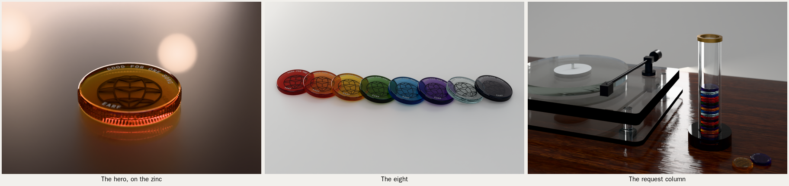

**The read test:** each final at 600 px, shown to a fresh judge told nothing (`critic/coin/READTEST.md`). All three
pass:
- the hero: "a single thick, translucent amber coin or token… with a knurled (reeded) edge… an engraved wire-frame
  globe with "GOOD FOR ONE SONG" around the top edge and "EARF"";
- the eight: "eight translucent, coin-like discs… in rainbow order… a dark line-drawn emblem… a faceted globe or gem";
- the column: "a clear acrylic turntable… beside a tall clear… tube… filled with a stack of coloured discs… like coins
  or poker chips".

**Critic** (`critic/LOG.md`, `critic/coin/rounds/`): two fresh critics a round on the hero. Three rounds is the
family's limit, so I stopped there.

| round | A | B |
|---|---|---|
| 1 | 6.0 | 5.5 |
| 2 | 6.0 | 6.0 |
| 3 | 5.0 | 5.5 |

- **The final is round 2**, the best of the three; round 3 is kept as `hero-r3-napkin.png`.
- **The brief's gate:** A has two passes in a row each gaining under 0.5. B gained +0.5, then lost 0.5.
- **Round 3:** I put a white cocktail napkin under the coin, which answered round 2 (the face glowed and the globe
  read). Both new critics wanted it gone, and the shallow focus back. The critics pulled against each other.
- **One finding changed the product:** frost or a white fill all but vanished on paper, so the globe is filled black
  (the lead's test).
- **Open on the hero:** the face is still a deep amber, darker than the critics want. The zinc is a plain satin
  surface: the photographed metal plate read as concrete, then as camouflage, at coin scale.

## Round 33b: the one-colour globes as real objects

The owner, 2026-10-20: "Is it possible to actually build the paper and black globes as well? Those could be cool with
light cast on them. Maybe not." They are built as the colour globe is (`../globe_mono.py`, after `globe_object.py`):
- **The six discs:** the three parallels and three meridians, leaning 23.4°, each slotted round those before it. The
  meridian facing us stays whole.
- **The light:** one hard raking spot and a little fill, so the rims draw their shadows across the discs and onto the
  ground.
- **The sizes:** a 300 mm desk globe, rendered; a 1 m bar piece, costed.

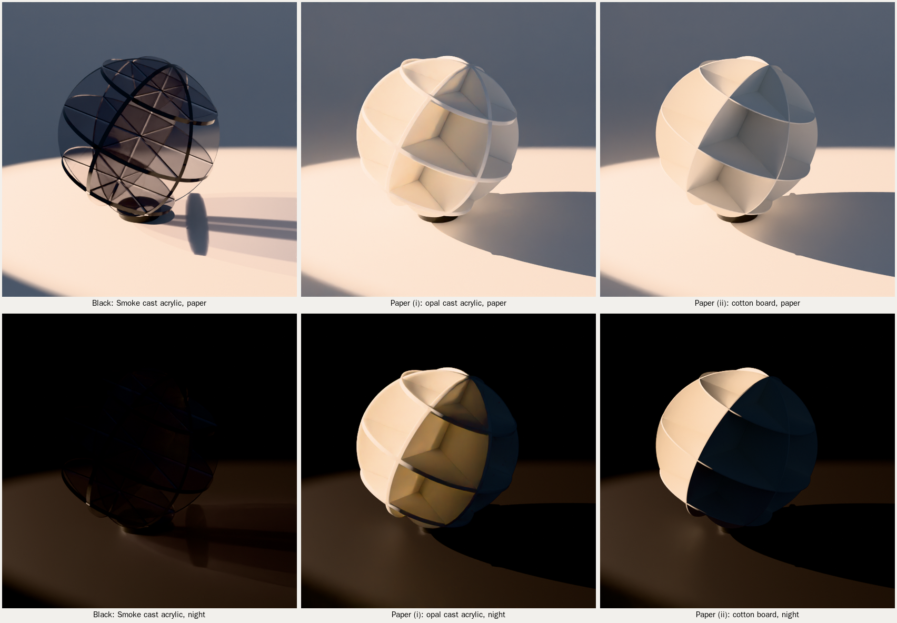

- **Black, in Smoke cast acrylic** (the Smoke speaker's own, 8 mm): the one that is the drawing. The faces are smoked
  windows, and each edge, seen along its disc, goes dark: the drawing's dark rims. Its shadow on the ground is the
  globe again, in line. On night it needs a rim light from behind or it disappears.
- **Paper (i), opal cast acrylic, 8 mm:** a white sculpture of planes that glows warm where the spot falls. It is not
  see-through, so it reads as a solid ball with fins more than as the drawing. It costs as much as the black, for less.
- **Paper (ii), cotton board, 2 mm:** the same sculpture, matte, with the crispest shadows. Half-lit on night it is the
  most dramatic of the three. Cheap, and fragile.

**Build notes:**
- **Slots** are the sheet's measured thickness plus clearance. Cast acrylic is ±10 % on its nominal, so measure the
  batch.
  - 8 mm acrylic: slot = measured + 0.3 (0.15 a side), cemented with a thickened solvent cement (Weld-On 16 or Acrifix
    1R 0192) in a jig. The edges are diamond-polished before assembly.
  - 2 mm board: slot = measured + 0.2, a push fit, then a line of PVA.
  - At 1 m in 20 mm sheet: slot = measured + 0.5, cemented.
- **Pieces:** the six discs can't be one set of half-lap slots, because three meridians cross at the poles. As modelled,
  the facing meridian is whole, the other two are halves, the equator is six pieces and each parallel is six: 23
  pieces, which want cement (or glue for the board), not friction alone. A friction-fit version is possible as a kit
  with one meridian and the three parallels on half-laps, the other two meridians as quarter discs slotted onto it; that
  is a different drawing (`globe_mono.py` builds the cemented one).
- **Desk globe, 300 across** (R 150), on a blackened-steel ring 80 across:
  - Black or opal: 0.46 m² of 8 mm sheet with offcut, about **$70**; cutting $60; polishing the edges $80; cementing
    23 pieces in a jig, about 3 hours, $180 (the jig $150 once); the ring $40. About **$450 to $550 one-off, $250 in a
    run of 50**. Retail **$650 to $850**.
  - Board: two sheets of museum board $30, cutting $25, gluing $90, the ring $40: about **$185 one-off**. Retail $195
    to $245, as a kit for less.
- **Bar piece, 1 m across** (R 500):
  - Black in 20 mm Smoke (the cabinets' stock): 5.1 m² with offcut, about **$1,950** of sheet; about **90 kg**, so it
    wants a steel cradle and a plinth, or 12 mm sheet (about 55 kg). With cutting $600, polishing $500, assembly $800
    and the cradle $400: **about $4,300**.
  - Paper at bar scale: 10 mm honeycomb paper board (Re-board): light (about 8 kg), crisp, about **$600** all in.

**Is it worth building?** Yes, the black one. It is the only one that is the mark as an object: see-through faces,
dark rims, and a shadow that draws the globe again on the wall or the counter. Where:
- **The back bar:** a 1 m Smoke globe under a hard spot, its shadow thrown up the wall behind. Planet's signature.
- **The shop:** the 300 mm desk globe, $650 to $850.
- **The site's dark band:** a turntable shot of it, lit from behind.

The paper ones are good sculpture but not the drawing (they're opaque). Build the board one first as a $185 prototype
to judge the scale. Skip the opal.
