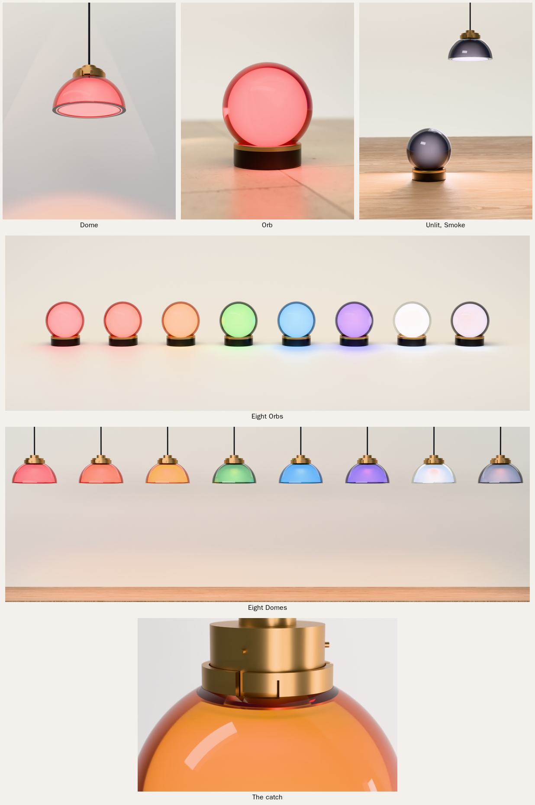
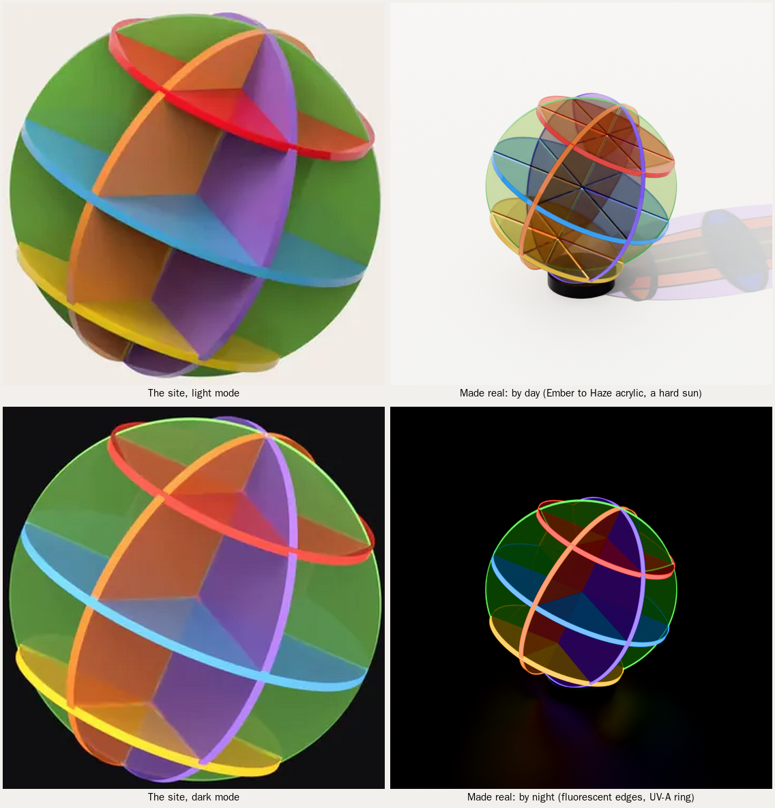
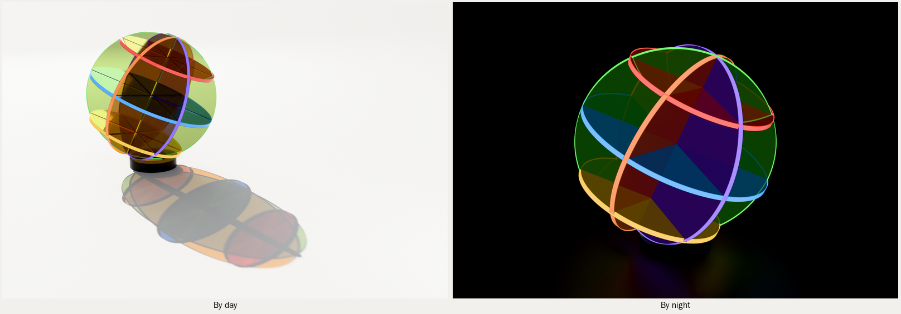
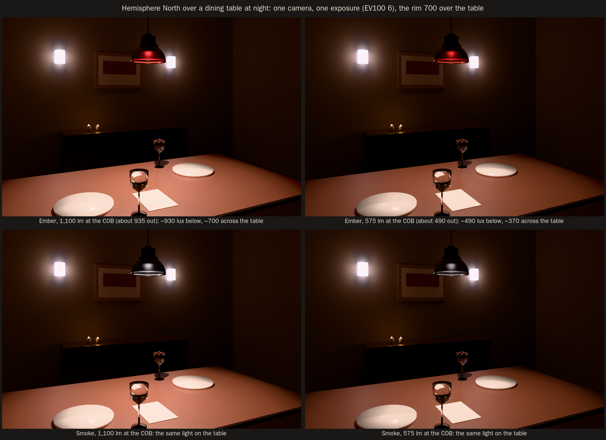
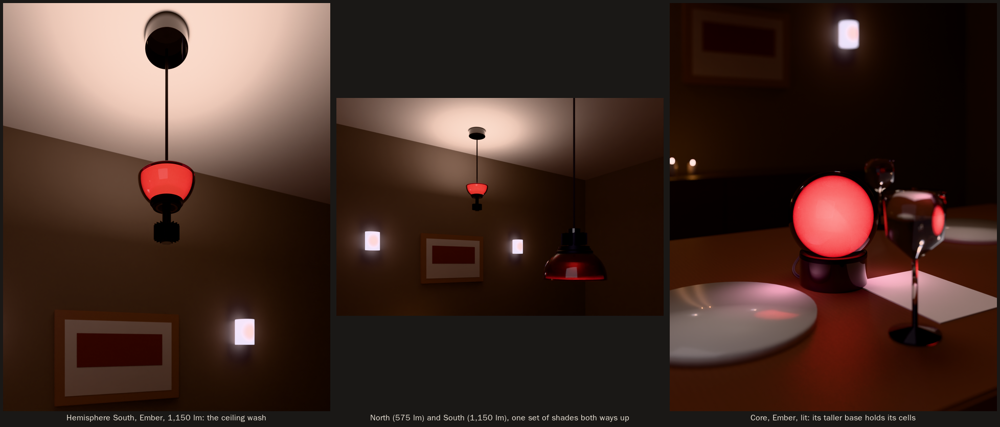

# The companions: a record player and a lamp in the Tropos acrylic (round 31)

The owner, 2026-10-18: "Let's work on a few more things now. Record player and lighting for one. All acrylic." In
round 17 the owner had also said: "If we can find a good recycled acrylic partner, we can make other components, like
record players, lights, etc." These are those two pieces. Both are in the Clouds' tinted cast acrylic and come in the
eight Tropos colours, and each is built with the fab kit the speakers are built with.

**Names, from round 35 (the owner, 2026-10-22), as amended in round 38 (2026-10-25):**
- the pendant is **Hemisphere** (the Dome until round 35, Hemisphere North in rounds 35 to 37);
- the table lamp is **Core** (was the Orb);
- the speakers are **Tropos** (Atmosphere until 2026-10-29, when the owner renamed them Troposphere and then Tropos), and the record player is **Mantle**.

**Hemisphere South is dropped** (the owner, 2026-10-25: "Get rid of south altogether and just call it hemisphere."). Its CAD (`hemisphere_south.py`, `out-hemisphere-south/`), its parts
and its renders (rounds 35 to 37) stay in the repo as a record; nothing in the line uses them.

The rounds below keep the names they were written with. The file names stay as they were.

Status: **concept, built to the fab kit's standard: proposals until the owner signs them.** The speaker, its product
file and its CAD are untouched. The Cloud is built here only so that it can stand beside the companions in a shot.

| | **Cumulus**, the record player | **Bell**, the lamp |
|---|---|---|
| what | belt drive, the motor in its own pod, apart | table lamp, the horn's flare hung mouth down |
| size | 483 W x 373 D x 135 H (arm at rest) | 432 across the rim, 480 tall, foot 230 |
| acrylic | plinth 2 x 20 mm, platter 25 mm, pod 3 x 20 mm, feet 20 mm | foot 2 x 20 mm, shade formed from 5 mm (tinted 4x denser), stem tube 30 x 3 |
| weight | about 2.4 kg turning (platter and hub), about 9 kg in all | about 3.3 kg |
| parts list | **$2,775**, one off | **$563** + the LED strip (price not found), one off |
| product file | `turntable.py` | `lamp.py` |
| build | `out-turntable/` (cut files, drawings, parts list, checks) | `out-lamp/` |

    .venv-fab/bin/python studio/fabkit/build.py spinoffs/barkhorn/companions/turntable.py --out spinoffs/barkhorn/companions/out-turntable
    .venv-fab/bin/python studio/fabkit/build.py spinoffs/barkhorn/companions/lamp.py --out spinoffs/barkhorn/companions/out-lamp
    .venv-fab/bin/python spinoffs/barkhorn/companions/concepts.py      # the blockouts
    python3 spinoffs/barkhorn/companions/shots.py                      # the shot files
    PY=python3.11 spinoffs/barkhorn/companions/render_all.sh           # every shot (about an hour on 4 cores)

Both builds pass the kit's checks: no clashes, every sheet thickness in stock, every bought part in the library.
`components.json` beside them is the companions' own library. Its prices come from search snippets of 2026-10-18;
the pages themselves could not be opened from this environment.

## The concepts

Each concept is a quick blockout in the Clouds' acrylic on the look book's sweep (`concepts.py`; renders in
`renders/2026-10-18/barkhorn/companions/concepts/`). Each was judged on the same things: tinted cast acrylic; the speakers'
language (flat sheets, eased edges, cemented joints, the horn's soft curves); whether it is honest and buildable;
and whether it is sophisticated but witty.

**Record player**

- **T1, the Slab.** Three 20 mm sheets cemented into a rounded rectangle, with the platter on top. This is how most
  acrylic turntables are made, and that is what's wrong with it: no one would know it was EARF's. Sixty millimetres
  of tint also go nearly opaque and muddy.
- **T2, Cumulus (picked).** The plinth is drawn the way the Atmosphere icons are drawn, from circles: one for the
  platter, one round the arm's pivot, one round the motor. The motor's circle has a hole in it, and the motor stands
  in that hole on its own feet, never touching the plinth. That is what a good belt drive does anyway (keep the
  motor's hum out of the arm), made visible. The joke is the cloud with a hole in it, and it is also the
  engineering, which is the brand's kind of wit. Two sheets keep the colour clear.
- **T3, the Mast.** A skeleton: the platter on a column of stacked discs, with the arm and the motor each on a pillar.
  It is striking, but three loose pieces on a shelf have to be set out by hand, and the arm must stay 222 mm from the
  spindle. That is a jig, not a product.

**Lamp**

- **L1, the Lantern.** The cabinet in small: five cemented 20 mm panels with an opal tube inside. It is honest and
  easy to build, but it is a box, and the cabinet already says that better.
- **L2, Edge.** One 20 mm sheet cut to the horn's section and lit from below through its edge. It reads as an
  award, and tinted edge light is dim.
- **L3, Bell.** The speaker's horn flare turned up to the ceiling, with the LED at the throat where the compression
  driver sits. That is the right idea, but upturned on a stem it reads as a trophy or a cocktail glass.
- **L3b, Bell turned over (picked).** The same flare hung mouth down from the top of the stem. Light pools on the
  table, the flare glows in its colour and deepens toward the rolled rim, and the light sits at the throat. The
  speaker plays sound out of its horn; this one plays light. It is a familiar lamp shape (a mushroom), so the
  horn's flare is what makes it EARF's.

## Cumulus, the record player

- **The plinth** is two 20 mm sheets cut as one outline and cemented with a two-part polymerising acrylic cement
  (as the cabinets are), then annealed. The outline is three circles: the platter's at 340, the arm's at 150 on the
  pivot, and the motor's at 136. The corners where they meet are R14, and every edge is eased R2 and polished. The
  cut files keep the square prism, and the easing is a note on each part.
- **The motor apart.** The pod is three 88 mm discs standing on three soft Sorbothane discs on the shelf, with a 4 mm
  gap all round to the plinth. The motor's lead goes down through the pod and out underneath, so nothing runs
  through the plinth.
- **The platter** is 25 mm of the same acrylic, 300 across. It weighs 2.1 kg, and 2.4 kg with its bonded brass hub
  (I = 0.024 kg m2, a little more than Rega's glass platters). The belt runs on its polished, crowned rim. There is
  no mat: acrylic is close to vinyl's own impedance, which is why acrylic platters exist.
- **The bearing** is turned for it. A brass housing runs through both sheets, its flange in a 6 mm pocket in the top
  on three M4 screws into bonded inserts. Inside are two sintered bronze bushes, and a ground stainless spindle (10,
  7.2 at the record) runs on a 6 mm tungsten carbide ball and a PTFE pad. The brass shows through the tint. I looked
  for a bearing sold on its own: Michell's inverted bearing is listed as discontinued, and Pro-Ject sells its
  bearing only with its platter. A lathe shop makes this one from a drawing (sheet 6 on).
- **Speed** comes from Rega's 24 V motor and Neo PSU MK2: 33/45 by a button, trimmed in 0.01 rpm steps, and the
  speed changes without moving the belt. The pulley is turned to the motor's measured speed. If it runs at 250 rpm,
  the belt face is 39.48 across for a belt on the 300 rim, which is close to 40.
- **The arm and cartridge** are Rega's RB330 at Rega's 222 mm and an Ortofon 2M Black (round 31b; the 2M Blue
  first drawn read as a stray blue accent on every colour, the lead's note). Moving magnet, so any phono stage; black
  in every colour. The 2M Red (red body) could ride on Ember.
- **The feet** are three 50 mm acrylic discs on M8 brass studs, each turned to level the platter, with Sorbothane
  under them. They are placed so the triangle holds the platter's centre.
- **The mark** is EARF, 44 wide, laser-etched in the arm's circle in front of the arm and filled with the colour,
  deeper. It is the only text on it.

| bought | source | price |
|---|---|---|
| Rega RB330 tonearm | [Safe and Sound HQ](https://www.safeandsoundhq.com/products/rega-rb330-tonearm) | $675 |
| Ortofon 2M Black | [Upscale Audio](https://upscaleaudio.com/collections/cartridges) | $749.99 |
| Rega 24 V motor upgrade kit | [HiFi Gear](https://www.hifigear.co.uk/rega-neo-mk2.html) | GBP 150 (~$200) |
| Rega Neo PSU MK2 (US, 60 Hz) | [Audio Advisor](https://www.audioadvisor.com/products/rega-neo-psu-mk2-60hz-turntable-psu-power-supply-black) | $445 |
| flat belt, 5 x 0.6, ~975 | a belt maker, cut to length | ~$25 (estimate) |
| sintered bronze bushes 10 x 14 x 12, carbide ball 6, PTFE pad | McMaster-Carr or a bearing supplier | ~$16 (estimate) |
| Sorbothane feet (3) and pod pads (3) | Isolate It / Sorbothane Inc. | ~$45 (estimate) |

The acrylic is $239 of the $2,775 and the turned parts (bearing, hub, spindle, pulley) $311. The rest is bought, and
the arm, the cartridge and the Neo are $1,870 of that.

## Bell, the lamp

- **The shade** is formed (vacuum or drape) over a turned buck at about 160 C, then annealed. It has a flat collar at
  the crown, a R10 corner into the flare, and a rim rolled to R2.5, 420 across. The flare is the speaker's: it opens
  late, then rolls over. The sheet is 5 mm, so it is **cast four times as dense in the tint** as the cabinets' 20 mm,
  and reads the same. A caster makes any density. (At the cabinets' own tint, 5 mm is nearly clear: see the first
  proof.) The shade hangs by its collar, clamped between the hub's flange and the cap on a silicone ring with three
  M4 screws, so nothing presses on the formed wall.
- **The light** is 0.4 m of Waveform Lighting's CENTRIC WARM 24 V strip (95+ CRI, 450 lm a foot, 2700 K at full
  and dimming warm toward 2000 K, like a filament). It wraps twice round a turned aluminium hub, which is its heat
  sink, behind an opal acrylic sleeve so no dots show. That gives about 600 lm at full, a 60 W bulb's worth. I chose
  a strip round the stem over a single LED at the throat because the stem runs up the middle, and a strip lights
  the shade from inside all the way round.
- **Low voltage throughout.** A Mean Well 24 V wall adapter plugs into a 2.1 mm in-line socket. From there a clear
  18/2 cord goes into the foot's back, through the dimmer in the foot's pocket, and up inside the clear stem, where
  it shows. Nothing in the lamp is at mains voltage, which makes listing it simpler.
- **The foot** is two discs, 230 and 200, cemented. The dimmer's board sits in a pocket through the lower disc,
  closed by a 6 mm cover on four M3 screws, with six clear bumpers under it. **The knob** is on top at the front,
  turned from rod in the deeper colour. You turn the lamp up like a volume knob, which it nearly is. That is the one
  joke, and it is a quiet one.
- **The stem** is a cast acrylic tube 30 x 3, bonded into the foot's socket and the hub's bore.
- It holds about 1.7 kg in the foot and 1.6 kg in the head, and tips past about 28 degrees.

| bought | source | price |
|---|---|---|
| Waveform Lighting CENTRIC WARM strip, PN 3008.27 | [Waveform Lighting](https://store.waveformlighting.com/products/centric-warm-led-strip-lights), [datasheet](https://store.waveformlighting.com/cdn/shop/files/CS_3008.27.pdf) | reel price not seen |
| LEDSupply Single Color Mini Rotary Dimmer, 12-24 V PWM | [LEDSupply](https://ledsupply.com/led-dimmers/mini-rotary-knob-dimmer) | $8.84 |
| Mean Well GST25U24-P1J, 24 V 25 W wall adapter | [TRC Electronics](https://www.trcelectronics.com/products/mean-well-gst25u24-p1j) | ~$18 (the desktop GST25A24 is $19.42) |
| Satco/Nuvo 80-2374 clear 18/2 SPT-2 cord, 8 ft | [Lighting Supply](https://lightingsupply.com/products/satco-nuvo-80-2374) | $6.97 |
| 3M Bumpon SJ5302 clear, in-line DC socket, strain relief, fixings | any distributor | ~$20 (estimates) |

The turned and formed parts are most of the $563: the hub and cap ($114), the stem, sleeve and knob ($186), and the
shade ($139, with a tenth of a $900 buck, spread over a first run of ten).

## The renders

The look book's frames come from the engine on the look book's sweep in each colour (lookbook21's key, fill and
wash), with the cabinets' own tinted-acrylic material: clear cast resin absorbing toward the colour after 25 mm.

- `look-turntable-<colour>.png` and `look-lamp-<colour>.png`: each product in each of the eight colours, the lamp lit
  (strip strength 88). On a bright studio sweep a lit lamp shows as its glowing sleeve, as real lamps photographed on
  a lit set do. `look-*-sheet.png` shows the eight together. Cumulus wears the black 2M Black in all eight.
- `detail-turntable.png`: the motor's pod in its ring, the belt to the rim (Ice). `detail-lamp.png`: from under the
  rim, the opal sleeve lit, the collar and cap (Acid).

**The heroes (round 31b).** The lead and the owner asked for campaign images for a $20,000 line: the companion the
subject, the speaker as context, a real setting with texture, Bell switched on. Both are now in one room at dusk:
oak boards, a Poly Haven plaster wall (beige_wall_001, 4k), a window at the left with the dusk sky outside, and Poly
Haven's scanned walnut cabinet (modern_wooden_cabinet, 4k) under the companion. Cumulus has Bell lit beside it.
Bell's light is three small lamps just outside its opal sleeve (an emitting strip that thin is all noise), hidden from
the camera and from reflections; `studio/engine/lights.py` gained that switch for point lamps.

They were judged by `critic/PROMPT-promo.md`, each pass a fresh blind critic given only the image, a short card
(`promo.py stage`), `critic/measure.py` and the prompt's text. Every pass's changes were applied unless they would put
the speaker inside the wall or change the product; `critic/LOG.md` here has every pass, and the replies are in
`critic/rounds/2026-10-18/promo-*.json`. The coordinator's stopping rule replaced 8.5 (no session reached it): stop
after two passes in a row gaining under half a point, then duel the best two blind.

| hero | passes (blind scores) | final | the duel |
|---|---|---|---|
| Cumulus | 5.0 (morning sun), 5.5, 5.5, 5.5 | `hero-turntable.png` (pass 3) | pass 3 beat pass 4, 6.0 to 5.0 |
| Bell | 5.0, 5.5, 5.5, 6.0, 5.0 | `hero-lamp.png` (pass 4) | pass 4 beat pass 5, 6.0 to 5.0 |

Honestly: neither is at the bar the owner set. The critics' last notes, for whoever takes them on: the wall still
outshines Cumulus and the grade is one warm red; the lower plinth crushes; the record reads as smoked glass (a vinyl
groove material would help); and the speaker beside each companion is either cropped to a coloured block or out of the
frame. The room is a box with one window; a deeper room (a corner, a second wall receding) is the next step.

**Final paths for the site** (`renders/2026-10-18/barkhorn/companions/`):

| colour | record player | lamp |
|---|---|---|
| Ember | `look-turntable-ember.png` | `look-lamp-ember.png` |
| Dust | `look-turntable-dust.png` | `look-lamp-dust.png` |
| Acid | `look-turntable-acid.png` | `look-lamp-acid.png` |
| Poison | `look-turntable-poison.png` | `look-lamp-poison.png` |
| Ice | `look-turntable-ice.png` | `look-lamp-ice.png` |
| Haze | `look-turntable-haze.png` | `look-lamp-haze.png` |
| Fog | `look-turntable-fog.png` | `look-lamp-fog.png` |
| Smoke | `look-turntable-smoke.png` | `look-lamp-smoke.png` |
| heroes | `hero-turntable.png` (Ember) | `hero-lamp.png` (Haze) |
| details | `detail-turntable.png` (Ice) | `detail-lamp.png` (Acid) |

The renderer's Python: the bpy wheel (5.0.1) is built for Python 3.11, and this container's `python3` is 3.13, so I
ran the renders with `python3.11` (`PY=python3.11 render_all.sh`). `studio/setup.sh` pins `bpy==5.0.1` on the
system `python3` and fails here. That is worth a line in setup.sh, but I didn't change it in this round.

## Open questions for the owner

1. **The names.** Cumulus and Bell are working names. The speakers are named for things in the air by colour, so the
   companions might take the colour's name too ("Cumulus in Haze").
2. **Recycled acrylic.** The formed shade and the 25 mm platter both need the casting partner (round 17's
   Plastiglas de México or Madreperla) to make the eight tints in 5 mm at four times the density and in 25 mm.
   Ask both.
3. **The cartridge.** Now the 2M Black ($749.99): black in every colour. A 2M Red on Ember only, or a moving coil
   (Hana) on all, are the alternatives.
4. **A dust cover?** None is drawn. A cover in clear acrylic hinged on the arm's circle is possible, but it would
   need a fourth circle in the plinth.
5. **The arm at rest** leaves the cartridge just past the plinth's front-right edge, as Rega's lift puts it. Should
   the arm's circle grow so the arm rests over acrylic?
6. **Listing.** The lamp is low voltage behind a listed adapter. The dimmer, once out of its housing, is not a
   listed part. For sale, a listed 24 V dimmer to fit the pocket. The record player's mains part is Rega's Neo, which
   is listed.
7. **The bearing** is made, not bought. Should we ask Rega or Pro-Ject for their bearing as a spare, or keep ours?
8. **Prices.** Neither has a selling price. At the speakers' multiple (round 15: $19,000 a pair against about $8,000
   of parts), Cumulus would sell for about $5,000 and Bell for about $1,400. These are for the owner to set.

## Round 32: the bar lamps (Moon, recommended)

The brief (the owner, 2026-10-19, through the coordinator): an acrylic table lamp and a hanging lamp for a bar, Planet
EARF first, and for sale. Three families were blocked out (`bar_lamps.py`, the sheet at
`renders/2026-10-19/barkhorn/barlamps/sheet.png`): F1 Block (rounded-square, squared), F2 Column (a lit cylinder),
F3 Moon (a frosted dome on a tinted column, and its pendant). **Moon is recommended**, F1 Block the alternative if
the owner wants the squared one.

Why Moon, for a bar:
- **It lights the table, not the eyes.** The light sits inside a frosted dome, above a seated guest's eye line in the
  table lamp and up a 46 mm baffle in the pendant (cut-off about 46° from the vertical). Nobody sees an LED.
- **It survives service.** The dome sheds a spill and the finial is round. The steel foot is sealed by O-rings
  (IP44, wipeable) and weighs about 1.5 kg, so a sleeve or an elbow doesn't tip it. It charges on a staff tray of
  six through gold rings, with no cable on the table.
- **It sells.** The cordless mushroom is the form bars already buy (Poldina, Bellhop, Panthella Portable), so the
  trade knows it. What is new is the material: a turned cast dome and a solid tinted column whose polished top
  glows, in the eight Tropos colours plus clear, frosted and smoked. The pendant is the same dome hung mouth
  down, so a room can be specified as one family.

Built as two fab-kit products, `moon.py` (geometry, parts, notes), `moon_table.py` and `moon_pendant.py`; checks pass:

    .venv-fab/bin/python studio/fabkit/build.py spinoffs/barkhorn/companions/moon_table.py --out spinoffs/barkhorn/companions/out-moon-table
    .venv-fab/bin/python studio/fabkit/build.py spinoffs/barkhorn/companions/moon_pendant.py --out spinoffs/barkhorn/companions/out-moon-pendant

| | table lamp | pendant |
|---|---|---|
| size | foot 120, 277 tall, about 1.9 kg | dome 200 across, disc 220, canopy 150 x 50, drop 600 (to cut) |
| light | warm-dim board 2200 to 2700 K, 2.5 W, about 200 lm; touch dimmer on the finial | 2700 K CRI 90 COB (Bridgelux Vero SE 10) on a Mean Well PCD-16-700B in the canopy (phase-cut) |
| power | 25 Wh (two 18650s), about 12 h at the bar setting; tray contacts or USB-C | mains, to be listed to UL 1598 |
| BOM, one-off shop rates | **$583** (`out-moon-table/bom.md`) | **$780** plus the listing (`out-moon-pendant/bom.md`) |
| BOM, a run of 200 (my estimate) | about $170 parts, $195 landed | about $180 parts, $205 landed, plus the listing spread over the run |
| target retail | **$450 to $495** (trade at 30 % off) | **$695 to $750** |

The one-off BOM is mostly the lathe (the turned dome alone is $212 in the table lamp and $344 in the pendant, and
the brass canopy $229). At volume, four changes bring it down:
- the domes cast in a mould and finished on the lathe, not turned from block;
- the brass parts turned in a batch;
- a spun canopy in place of a turned one;
- the foot cut from steel bar.

The run figures are my estimates, not quotes. At about $195 landed, $495 retail is about 2.5 times cost, thin once
the trade discount is taken off. The dome is where the cost has to come out. The benchmarks are about $300 to $500 for
a cordless bar lamp and $600 to $1,000 for a designer pendant; check them before setting a price. The prices are the
owner's to set.

**For Planet:** `studio/engine/kit_ext/earf_moon.py` places either lamp from its fab-kit model (the GLBs in
`out-moon-*/render/`, committed for this) with materials in any flavour and its light set up as Planet's loft does
(commit f7c99a4):
- the lamp is a point light inside the dome, hidden from the camera, from transmission and from glossy rays;
- the frosted dome glows by itself (`shade_glow`).

    {"kind": "kit", "shape": "ext", "module": "earf_moon", "fn": "table", "spots": [[x, y, z_table]], "flavour": "smoked"}
    {"kind": "kit", "shape": "ext", "module": "earf_moon", "fn": "pendant", "spots": [[x, y, z_rim]], "ceiling": 3.2, "flavour": "smoked"}

Other parameters:
- `lamp_w`: the power (default 4 for the table lamp, 14 for the pendant);
- `lamp_k`: the colour temperature (2700);
- `shade_glow`;
- `materials`: overrides;
- a spot can be `{"position", "flavour", "rotate_z"}`.

`lift_shot.py`'s `glow:lamp_w=2` scales the lamp's power. The frames in `renders/2026-10-19/barkhorn/moon/` are made
with this same piece (`moon_shots.py`), so they test exactly what Planet imports.

The frames (`renders/2026-10-19/barkhorn/moon/`):

The critic (`critic/LOG.md`) ran three blind rounds on the smoked bar hero: 5.5, 5.5, then 6.0. Three rounds is the
family's limit, so I stopped there. Open on the hero:
- the smoked column still reads dark (its tint is dense);
- the pendant's underside clips, and the pendant is out of focus at f/2.8;
- the concrete shows no boards (the Poly Haven wall is smooth);
- the grade is all orange at a 3600 K balance.

A photographed hero would fix these. The shapes and finishes are fine.

**Warmth** (the coordinator: the dome read lavender-white in the bar frames). The cause was the neutral tints' own
glow, #FFB878: near white once a 3000 K balance takes it back, and pale enough to clip. It is now a warm ivory,
#FF9A50, in the products' flavours (`bar_lamps.VARIANTS`, rebuilt), so Planet gets it by default. The bar frames
also balance at 3600 K, as bar photography does, so 2700 K reads warm, not white.

**F1b, Block lit low** (`f1b.py`, kept ready in case the owner picks the square):
- the table lamp: F1 Block's tinted rounded-square block over a frosted lower sleeve, 22 to 130, with a hidden light
  inside it at 100, so the frost glows and lights the table around the foot; a steel shadow line between the two;
- the pendant: the same split, with a frosted band round the mouth, the block above, and the light 120 up inside
  (a cut-off of about 32°).

It is rendered in Moon's two bar frames (`renders/2026-10-19/barkhorn/f1b/`, beside Moon in `beside-moon.png`). These are blockouts: if the owner picks
it, it gets Moon's treatment (fab-kit products, a BOM, a kit piece).

Still open:
- the listing cost;
- the board (to make; a TI BQ25895-class charger with a touch dimmer);
- whether bars want the tray of six as its own product;
- the canopy in brass or blackened steel to match Planet's steel.

## Round 32c: the frost set within the acrylic, a shape study

The owner, on Moon beside Block: "I'm not sure I like the white section. Maybe if we do that for light dispersion it's
set within the acrylic. Not sure what shape I like yet."

**The treatment** (`study.py`): nothing white outside. Every visible surface of the shade is polished tinted cast
acrylic. The diffuser is a frosted liner (an acid-etched or bead-blasted tube or cup) set 1 mm inside the shell.
- Where a shade is open below (the domes, the cones, the pendants), a 3 mm tinted skin covers the liner's inside as
  well, so the wall is tint, frost, tint.
- The frost is seen only through acrylic, so the tint glows evenly from within and the source is never seen.
- In manufacture this is a cast-in liner (the frosted part cast into the block) or a bonded three-layer wall; the
  study doesn't choose yet.

**The shapes**, each a cordless table lamp with a matching pendant:
- **Dome:** Moon's dome on a column; the pendant's light is up a brass baffle.
- **Block:** the rounded square.
- **Column:** the cylinder.
- **Sphere:** a ball on a column, and a ball open below.
- **Cone:** mouth down, on a column and as the pendant. It is the classic bar shape, with the deepest cut-off.

The pendants are open below, with the light up inside them (cut-offs about 20° to 35° from the vertical).
The table lamps keep Moon's cordless foot.

**Rendering:** Moon's bar frame, in smoked and in Ember (`renders/2026-10-19/barkhorn/study/sheet.png`).
- In the render, the tint is cast denser than the Clouds' (a 5 mm depth for Ember, 8 mm for smoked) so it carries
  the colour in walls 8 to 12 mm thick. The liner glows at 0.25.
- A lamp close inside a closed form burned its liner white, so the block's, the column's and the sphere's lamps are
  lower.

These are blockouts. Whichever shape the owner picks gets Moon's full build.

## Round 32d: the pick, Dome and Orb

The owner picked from the shape study: "I like the dome overhead lights, especially if the acrylic covers are easy to
swap out, but I'm also a sucker for the spheres. For the table lamp though, I'd want the spheres to be squatted rather
than raised, like a crystal ball." Both products keep round 32c's wall: tint, frost, tint, with nothing white outside.
They are built as fab-kit products (`crystal.py`, `dome_pendant.py`, `orb_table.py`); both pass their checks.

**Dome, the pendant, with covers that swap by hand.**
- **The cover:** the tinted dome, 200 across. A brass collar is bonded into its crown, with three L-slots in it.
- **The catch:** three pins on the fixture's brass hub make a quarter-turn bayonet (30°). To take the cover off, lift
  it 5 mm, turn it and lower it. To fit one, push it up, turn it until the spring plunger clicks into its dimple, and
  let go. The cover's weight holds each pin up in a notch at the end of its slot, so a knock can't turn it off. That
  is more secure than a magnet over a bar, and it needs no tools.
- **What stays up:** the COB (2700 K, 22 mm up a 46 mm bore, a cut-off of about 46°), the hub, the cord and the driver
  in the canopy. A cover is never a live part, and the fixture is listed (UL 1598) with any cover.
- **Spare covers** are sold separately in every tint.

**Orb, the table lamp, a crystal ball.**
- **The ball:** tinted, 160 across, sitting low in the cup of a short base, 180 tall overall. The base is a
  blackened-steel drum 120 across under a brass ring; the ring is the touch (tap to switch, hold to dim, 2200 to
  2700 K).
- **The guts:** Moon's (a 25 Wh battery, the tray contacts or USB-C, IP44), sealed in the base. The LED shines up
  through a sealed window into a brass-lined port under the ball.
- **The ball lifts off**, because nothing in it is electrical, so Orbs swap colour just as Domes do. It rests on a
  silicone ring in an 18 mm cup, enough to stop a nudge rolling it.
- **The weight** is about 3.2 kg with the ball (from the CAD: the ball 1.2, the base 1.4, the brass ring 0.3); see PARTICULARS.md.
- **Height:** at 180 it is below the brief's 250–300 mm, by the owner's choice (squat, not raised).

| | Dome pendant | Orb table lamp |
|---|---|---|
| BOM, one-off shop rates | **$1,421** plus the listing (`out-dome-pendant/bom.md`) | **$1,190** (`out-orb-table/bom.md`) |
| of which the three-layer cover | about $990 (three turned cups, the rim and the brass collar) | about $855 (three turned balls) |
| BOM, a run of 200 (my estimate) | about $200 parts, $230 landed; a spare cover about $100 | about $200 parts, $225 landed; a spare ball about $100 |
| target retail | **$795 to $895** with one cover; covers **$295 to $345** | **$595 to $695**; balls **$245 to $295** |

The one-off price is the lathe turning three nested layers from block. In a run, the layers are cast or moulded and
only finished on the lathe, and the frost is cast into the tinted block, which is the caster's question. The run
figures are my estimates, not quotes. The covers are where the line earns: a bar that buys the fixtures once can
change its colour by season. The prices are for the owner to set.

**For Planet** (`studio/engine/kit_ext/earf_moon.py`, the same piece as Moon's): `fn` is `dome` (spots: the rim;
`ceiling` stretches the cord) or `orb` (spots: the table).
- The liner glows by itself (`shade_glow`, default 0.25), and the lamp is hidden as before (`lamp_w` defaults to 9 and
  3).
- `hide` takes a pattern of part names, so a spare cover can stand alone (`"hub|pins|cob|gland|cord|canopy"`).
- `cover_drop` and `cover_turn` show the swap; `lamp: false` turns the light off.
- The GLBs are committed in `out-dome-pendant/render/` and `out-orb-table/render/`.

The frames (`crystal_shots.py`, `renders/2026-10-19/barkhorn/crystal/`) are made through that piece:
- the bar hero in smoked and in Ember;
- the swap (a Dome lowered off its fixture, three spare covers on the counter);
- the catch, close.

**Critic** (`critic/LOG.md`): three blind rounds on the smoked hero scored 5.0, 5.0 and 5.0. That is the family's
limit, so I stopped. It is lower than Moon's 6.0.

Two findings changed the products, not just the set:
- The smoked tint was cast too light and read cream through the frost; it is now denser (`crystal.VARIANTS`).
- The Orb's light sat below the ball's centre and drew a crescent in the frost; it is now centred (`ORB_LIGHT`, and
  the kit piece).

Open on the hero:
- the grade is all red-orange at 3200 K, and the counter reads as red lacquer;
- the smoked ball reads milky, with no hot core;
- the base is dark;
- the pendant's underside reads pale;
- the wall is flat.

Smoked is the hardest tint for this treatment: lit from within it glows a warm grey, not a colour. The Ember frame
shows the idea better.

## Round 32e: Dome and Orb for earf.world

The owner: "sick lamps. Add them to the site as well and work on some product images." Six frames for the site's pale
paper page (`crystal_promo.py`; the finals' shots in `studio/shots/barkhorn/crystal-promo/final/`, the images in
`renders/2026-10-19/barkhorn/crystal-promo/`):

| Frame | Size | What it shows | From pass |
|---|---|---|---|
| `dome-hero` | 1600 × 2000 | Ember, lit, from a little below: the glowing underside, the rim, the brass hub | p3 |
| `orb-hero` | 1600 × 2000 | Ember, lit, low, on pale oak: the crystal-ball silhouette, the brass touch ring, the pool | p2 |
| `orbs` | 2400 × 800 | all eight lit, in spectrum order Ember to Smoke | p2 |
| `domes` | 2400 × 800 | all eight at one height over a counter | p4 |
| `catch` | 1800 × 1200 | the bayonet close, the cover lowered: pins and L-slots | p3 |
| `unlit` | 1600 × 2000 | an Orb and a Dome in Smoke, switched off | p4 |

**The studio.** A paper sweep in #EAE4DA, washed by its own hidden area light. Each frame's wash is calibrated, in level
and in colour channel by channel, so the backdrop's top corner renders the page's #EAE4DA (the first passes read pink,
then lavender-grey). A ray through an Orb crosses 12 surfaces, so the studio sets 24 bounces and 20 transmission
bounces (the engine's 8 rendered the unlit ball black: **Planet, the same for any Orb**). The liner's frost was opal
(clear 0.1) and blocked the light; it is 0.85 in `crystal.py`.

**Critic.** Two fresh critics per frame per pass, the mean, with the coordinator's stop (two passes in a row gaining
under 0.5, then the best two duelled blind). Four passes; the means and duels are in `critic/LOG.md`. The best is the
Orb hero at **6.25**; the others land at 5.0 to 5.75 (the Dome hero 5.5, the Orbs row 5.5, the Domes row 4.5, the catch
5.5, the unlit pair 5.5). **The set does not meet the 6.0 gate.** What the critics still say, every pass:
- it reads as clean CG: the brass is too smooth (no brushing), the paper and the walls are flat, the glows fill flat;
- the pale Domes (Ice, Haze, Fog) show a pink hotspot at the crown;
- the Domes row sits tight to the top edge.

Next, if the owner wants the gate: a brushed-brass shader (an anisotropic, grained material in the engine), a
gradient in the liner's glow (brighter at the lamp), the Domes row reframed, and more samples.

**Read test on the finals** (600 px, a fresh judge told nothing). **It passes for three frames and fails for three:**

| Frame | Object | Material | Lit? | Expensive? |
|---|---|---|---|---|
| dome-hero | pendant, yes | "red glass or acrylic, brass cap" | on, yes | mid ("the dome reads as plastic") |
| orb-hero | sphere table lamp, yes | "red glass", black and brass base | on, yes | "fairly expensive" ("reads like a toy") |
| orbs | eight sphere lamps, yes | "coloured glass" | on, yes | **cheap** ("RGB mood-light merch") |
| domes | eight pendants, yes | "coloured glass, brass" | **"mostly off"** (wrong) | **mid to cheap** |
| catch | the collar and shade close up, yes | "brushed brass, amber glass" | **can't tell** | expensive |
| unlit | smoked pendant over smoked sphere, yes | "smoked glass, brass, wood" | the Orb off, yes; **the Dome "on"** (its underside reads lit) | expensive |

The judge reads the acrylic as glass throughout, which flatters the product but is not quite the brief's "names the
material". What it says hurts each frame: the Dome hero is washed out and small in its frame; the lit Orbs fill as a
flat blob with no inner detail; the Orbs row is small, and eight colours together read as merch; the Domes row is
cropped at the top and reads unlit; the catch is cropped too tight to read what it is; the unlit Orb is murky.

**Site particulars:** `PARTICULARS.md`, read from the fab kits, with what is unconfirmed marked.

## Round 32f: black hardware, the plug-in Orb, the tints matched lit

Four notes from the owner after the site set, relayed by the coordinator (and the first asked here directly):
- "Why do the domes have brass tops? Why not black acrylic?"
- "The orb base can be updated too"
- "Maybe the orbs are plug in and optionally rechargeable or something."
- "The orb lamps appear to have two reds and an orange instead of red orange yellow"

**Black hardware, so the tint is the only colour.** Where a part works, it is black anodised aluminium (6061, type II,
sealed, satin): the Dome's hub (the COB's heat sink and its baffle), its pins and its collar with the L-slots, the Orb's
touch ring and its port lining. Acrylic is brittle and notch-sensitive, so a bayonet's slots would wear and crack under
repeated quarter turns, and it softens near the COB's heat; a touch ring must be metal to sense a touch. Where a part is
trim, it is black cast acrylic, polished: the Dome's canopy (over a steel junction-box strap that carries the load) and
the cap over its cord grip, and the Orb's whole base drum. No brass anywhere. The aluminium is lighter than the brass
(the Dome's hub 0.58 kg, was 1.8) and cheaper to machine.

**The Orb plugs in; a cartridge makes it cordless.**
- Standard: USB-C PD in through a notch in the underside at the back left, so the base sits flat; a slim black fabric
  cable (2 m) and a 20 W listed adapter in the box; no battery. Inside the black acrylic drum, an aluminium chassis
  carries the board and the LED's heat, and a steel ballast (a plate round the bay and a ring under the cup) keeps the
  lamp planted: 2.0 kg with the ball (was 3.2 with the steel drum and the cells).
- The option: a battery cartridge slides into a bay under the base from the back and holds on two magnets and a detent,
  its back face the drum's, flush. One Li-ion pouch (about 8 x 60 x 90, about 22 Wh) with its own protection and fuel
  gauge: about 10 h at the bar setting. It charges in the lamp over the USB-C, or on the staff tray through two gold pads
  underneath, so a bar can run a fleet. Without it, a blanking cap closes the bay.
- Why this is better: the standard lamp is cheaper and simpler to certify (a low-voltage lamp on a listed adapter; the
  battery's IEC 62133-2 and UN38.3 move to the cartridge, sold as an accessory), and a bar chooses per table.
- A correction on the way: the two 18650 cells drawn in Moon's foot were 9 mm tall in the model; real 18650s are 18.4
  across and do not fit under the LED (13 mm). The cartridge's flat pouch does, at about 22 Wh rather than 25.

| | Dome pendant | Orb, plug-in | Orb battery cartridge |
|---|---|---|---|
| BOM, one-off shop rates | **$1,203** (was $1,421) | **$1,310** (with cable and adapter) | about **$40** (bought, estimate) |
| BOM, a run of 200 (my estimate) | about $185 parts, $215 landed | about $170 parts, $195 landed | about $28 parts, $35 landed |
| suggested retail (the owner sets prices) | $795 to $895 with one cover; covers $295 to $345 | **$545 to $645**; balls $245 to $295 | **$95 to $125** |

**For Planet** (`earf_moon.py`): the black is in the GLBs. The `orb` piece takes `cable` (default true) and
`cartridge`: `"none"` (default, the plug-in Orb with its blanking cap), `"in"`, or `"out"` (slid `cartridge_out` m,
default 0.045, out of the back). A cordless Orb is `cable: false, cartridge: "in"`.

**The tints, matched to the speakers when lit (a casting spec).** The owner saw "two reds and an orange instead of red
orange yellow" in the Orbs row: lit, Dust read at 33° (Ember's red) and Acid at 60° (orange). The cause is the tint's
depth, not the light: the rows' glow is about 3200 K under a 4300 K balance, near neutral, but a warm cast seen through
9 to 12 mm of tint pulls toward red, and harder the deeper it is. So each tint is cast to its own colour (`crystal.CAST`,
its absorption at the body's 5 mm radius), found by measurement: render the row, take the median LCh hue of each lamp's
glowing body (highlights and rim out), turn the cast's hue by the miss, again until it holds (Acid's response is steep
near yellow, so it was bisected). Ember is cast deeper than the rest so it reads red, not coral. Targets are the
speakers' swatches (`marks.SPEAKERS`).

| Tint | Cast (`deep`) | Speaker's hue | Lit Orb (h, C) | Lit Dome (h, C) |
|---|---|---|---|---|
| Ember | #CD8553 | 35.1° | 33.3° (−1.8), C 50 | 40.0° (+4.9), C 74 |
| Dust | #DDBA7B | 55.3° | 55.4° (+0.1), C 34 | 60.5° (+5.3), C 48 |
| Acid | #E2D481 | 84.1° | 83.1° (−1.0), C 35 | 88.6° (+4.5), C 52 |
| Poison | #A4C87C | 133.0° | 133.1° (+0.1), C 67 | 136.1° (+3.2), C 76 |
| Ice | #5AC0E7 | 262.3° | 258.2° (−4.1), C 33 | 270.5° (+8.2), C 49 |
| Haze | #A080D7 | 308.0° | 308.2° (+0.2), C 67 | 307.2° (−0.8), C 94 |
| Fog | #F7F8F7 | neutral (C 0.7) | neutral, C 2 | neutral, C 4 |
| Smoke | #787E87 | 300.7° at C 5.5 | 314.6° at C 6 | 287.2° at C 12 |

Six chromatic tints sit within 9° of their speakers on both lamps, most within 5°. Fog and Smoke are near-neutral, as
their swatches are, and a hue angle at chroma 2 to 12 swings with a few units of a or b: one cast cannot hold Smoke within
10° on both lamps (the Orb pulls it pink, the Dome blue), so it is held neutral grey (±14° at C 6 to 12). These are
render measurements: the caster matches the casts on chips 10 mm thick under a 2700 K source, and the first lit samples
are checked against the speakers' swatches the same way.

**The site set again, black and plug-in** (`lamps_site.py`; `renders/2026-10-19/barkhorn/lamps-site/`, in the names
the site picks up):

| Frame | Size | Passes (two critics, the mean) | Final |
|---|---|---|---|
| `lamp-orb` | 1600 × 2000 | s1 6.0, s2 6.0 | s2: **6.0, meets the gate**; the lamp turned 40° so its cable runs away behind the ball |
| `lamp-dome` | 1600 × 2000 | s1 5.25 | s1 (a counter under it put the camera level with the rim and lost the underside the brief asks for) |
| `lamps-orbs` | 2400 × 800 | s1 5.5, s2 5.5 | s2: a glow per tint (Fog clipped), no cables in the lineup |
| `lamps-domes` | 2400 × 800 | s1 4.5, s2 4.75, s3 4.75 | s3, by a blind duel over s2 (6 to 5): a dimmer room, each dome's pool on the counter in its tint |
| `lamps-unlit` | 1600 × 2000 | s1 5.5 | s1: the Orb cordless (its cartridge in) |
| `lamp-cartridge` | 1800 × 1200 | s1 4.5, s2 5.25 | s2: the cartridge half out of the back, lit |
| `lamp-catch` | 1800 × 1200 | (rendering) | |

The Orb hero clears 6.0; the rest stay at 4.75 to 5.5. What the critics still say: the studio reads as CG (a smooth
paper sweep, no room), every ball and dome carries the same strip reflection, the Domes row's wall reads mauve and its
oak warms the cool pools, the unlit Dome's underside reads faintly lit and the polished black base mirrors the oak as
wood, and the cartridge's top is crushed black. Next, if the owner wants the gate everywhere: a real room (a plaster
wall and a bar top with a back bar), a window-shaped key, a pale stone counter for the Domes, and a flag under the
unlit base.

**Read test** (600 px, a fresh judge told nothing; the catch still rendering): every object named; lit or off right
on all the lit frames, now the Domes row too (round 32e's read it as off), and the unlit Orb read as off; the unlit
Dome read as faintly on. Expensive: the unlit pair ("most expensive"), the Orb hero ("fairly expensive"); mid for the
Orbs row and the Dome hero; cheap for the Domes row and the cartridge. The material reads as glass throughout.

**The lamps' light in the site frames, for Planet to match** (the kit piece's `shade_glow` and `lamp_w`; the liner's
`materials.liner.glow_color`; every frame at exposure 0.15 and a 4300 K balance, as in `lamps_site.py`):

| Frame | `shade_glow` | `lamp_w` | `glow_color` |
|---|---|---|---|
| `lamps-orbs` (a piece a tint) | 1.3 × the tint's gain: Ember 1.3, Dust 1.3, Acid 1.17, Poison 1.17, Ice 0.975, Haze 1.105, Fog 0.585, Smoke 0.78 | 4.0 | #FFDCB8 |
| `lamp-orb` (Ember) | 0.8 | 3.0 | #FFDCB8 |
| `lamps-domes` | Ember and Dust 0.75, Acid and Poison 0.675, Ice 0.562, Haze 0.85, Fog 0.25, Smoke 0.45 | 4.5, plus a 18 W spot a dome in its tint, 40° | #FFF3E6 |
| `lamp-dome` (Ember) | 0.9 | 15.0 | #FFDCB8 |

An Orb blows to near white above about 1.3 for Ember and Dust (Acid's and the pale tints' gains are lower for that
reason): the liner glows evenly by design, so its level sets how saturated the ball reads.

`earf_moon.py` carries Planet's `noshadow` again (27f39bf on r32-planet; round 32f's kit had dropped it).

**The unlit pair, again** (the coordinator, for the caption "Off, in Smoke."): the Dome's underside read as a lit white
disc and a warm pool lay round the Orb's base. Both lamps were off; it was the helper lights. The light through the
ball keeps to a faint core (1.5 to 0.15), the one through the Dome's mouth nearly out (0.3 to 0.04, 3400 K), and the
bounce under them warm (5000 to 3500 K).

**The catch** (s1, 5.0, 5.0): with the hub black, its L-slots sink into black on black. Raking strips (s2, tried in a
proof) changed nothing: anodised black shows only a specular, so the slots need a reflector placed for the camera's
angle, or a lighter anodise on a sample. It stays at s1 for now; the read test named it a pendant's collar, off, mid.
Read again at 600 px: the Orb off; the Dome "faintly on" (a little glow at the rim, no pool), so closer to the caption
but not yet fully dark; and now "mid-range", where the lit-helper version read "most expensive": without that light
the smoked pair goes murky on the pale page. The next step for it is a crisp edge light on both, not light through them.

## Round 33: EARFcoin

The owner, 2026-10-20: "One idea I had before bed: EARFcoin. Acrylic coins with the EARF globe on them that can be
exchanged for a song request. Each guest gets one." The coin is the site's acrylic coin (the colour picker and the
loader, `icons_real.py --coin`; the Coin ident) made real. Every dimension below is a proposal until the owner signs it.

**The coin** (`coin.py`; the fab kit `earf_coin.py`, a boxed set of eight; `out-earf-coin/`):
- **Stock:** cast acrylic in the eight speaker tints, 40 across and 6 thick, about 9.0 g (a casino chip is about 10 g).
  Both edges are rounded 1.5 and polished, so it feels like a coin and not a laser-cut disc.
- **Two faces, never overlapping:** a tinted coin shows both faces at once. The globe sits inside 25 across; the words
  sit in a band 15 to 17 from the centre, round the rim. Each reads the right way from the front.
- **The words:** GOOD FOR ONE SONG over the top and EARF under the bottom, in IBM Plex Mono SemiBold (the site's mono),
  caps 1.9 tall, engraved 0.12 into the front face. The one alternative: ONE COIN · ONE SONG.
- **The tints** are the speakers' swatches (`earth._C`), cast so that light through the coin and back off the paper
  lands on the swatch. Measured on the render of the eight (`coin_tints.py`), every hue is within 4° of its swatch in
  LCh: Ember 36° against Dust 52°, so it is one red and one orange. Smoke is cast lighter than its swatch (a
  transparent grey, like Perspex 9T20): at the swatch's density it rendered almost black (L 4) and hid the globe.

**The globe, three ways** (proofs below; all three are modelled, filed and costed):
- **A, reverse-engraved (recommended):** the brand's stroke globe (`earth.edge_lines`, lines 0.6 wide) laser-engraved
  0.2 deep into the back face from a mirrored file, so from the front it reads the right way round, 6 mm down in the
  tint. It works in all eight tints, it is the cheapest, and it is the most acrylic.
  - **The fill (the lead's test):** flat on white paper, frost alone nearly vanished, and a white paint fill was worse
    (white seen through the tint against white paper). Filled black, the globe reads in every tint, like the leading in
    stained glass and like the brand's black stroke mark (`renders/2026-10-20/barkhorn/coin/fills.png`: frost, white,
    black, left to right, in Ice, Acid and Haze).
  - So the globe is paint-filled black, except in Smoke, where black would vanish, so Smoke's is white. The words on
    the front are filled white: they are seen directly, not through the tint. The fill adds about $0.35 a coin.
- **B, printed in colour:** the six-colour globe (the flush discs) UV-printed on the back of a Fog coin, colour first
  and a white underlay over it (choked 0.08 so no white halo shows), then sealed. It is the most legible and the most
  "brand". But it is clear only, so the guest's colour is lost, and a print can scuff.
- **C, cast in:** the one-colour mosaic cut from 1 mm tinted sheet and set mid-thickness in a clear cast coin. The
  globe floats in the guest's colour. It is premium, and about four times the cost.

**The edge:** plain (rounded and polished) or reeded: 100 grooves 0.3 deep milled across it, like money. Reeding
catches the light along the edge and reads as currency in the hand; it costs about $0.45 a coin more at 1,000.
**Recommended: A, black-filled, with a reeded edge.**

**Signed by the owner, 2026-10-20:** "EARFcoin: A, engraved, reeded edge". So the face is A: the globe reverse-engraved
into the back face, filled black (Smoke's filled white), the words engraved into the front and filled white. The edge
is reeded. B (printed in colour) and C (cast in) stay on the concept sheet as the alternates not chosen. The coin's
other dimensions remain proposals until the owner signs them (40 × 6, edges 1.5, the globe 25 across, the words'
band 15 to 17).

**The fab kit** (`out-earf-coin/`, `.venv-fab/bin/python studio/fabkit/build.py spinoffs/barkhorn/companions/earf_coin.py
--out spinoffs/barkhorn/companions/out-earf-coin`; it passes its checks):
- **Laser files** (`out-earf-coin/laser/`, written by `coin.py`, SVG and DXF in mm, layers named):
  - `coin-A-1-cut`: the 40 mm circle.
  - `coin-A-2-back-globe-MIRRORED`: the globe, mirrored. It's run with the coin face down, so it reads right from the
    front.
  - `coin-A-3-front-words`: the words, as read. Both engravings are paint-filled (the fill is a step, not a layer).
  - `coin-A-all-layers`: all three, registered.
  - `nest-600x400`: 104 coins on a 600 × 400 bed, cut, front and back layers registered.
  - B's print file (each colour and the white underlay, mirrored) and C's inlay cut file, for the faces not chosen.
- **The route:**
  1. Cut the sheet's coins with its masking left on.
  2. On a CNC router, hold 24 coins in a vacuum fixture. Round both arrises 1.5 with a roundover cutter, then mill the
     100 reeds (a 0.9 ball cutter, 0.3 deep).
  3. Vapour-polish the edges. Tumbling would strip the masking, and a flame can craze the acrylic. The faces stay the
     cast sheet's own, under the masking until the end.
  4. Put the coins back in the sheet's skeleton (the skeleton is the jig) and engrave the words through the front's
     masking.
  5. Flip each coin over in its own hole and engrave the mirrored globe through the back's masking.
  6. Paint-fill both engravings through the masking: the globe black (Smoke's white) and the words white. Scrape
     flush and dry.
  7. Peel, check, bag.
- **The request column** (`earf_coin_column.py`, `out-earf-coin-column/`, it passes its checks): a water-clear cast tube
  50 × 4 wall, 210 long (42 bore: 1 mm round a coin; holds 33), bonded into a Smoke acrylic base 96 × 24 with a brass
  cap ring.
  - Coins drop in at the top. A slot 6.8 tall through the base under the tube lets one coin out at the front, and the
    tube holds the next one back.
  - A finger through the notch at the back pushes the lowest coin out, so the queue plays from the bottom up.
  - **The light** (the lead, for Planet: in the bar the stack read as a dark column):
    - A 2700 K LED disc, 44 across, about 1.5 W at 5 V, from USB-C with an inline dimmer.
    - It sits on an aluminium plate in a 50 mm pocket milled up from under the base, under an opal diffuser and a
      3.2 mm window of the Smoke, with a 7 × 4 channel for the cable out at the back.
    - The tube's back half is bead-blasted inside. Lit from its foot, it glows behind the queue, so the coins read in
      their tints, backlit, like bottles on a lit shelf.
    - The frost is the part that matters. Lit only from below, polished clear coins send almost none of the light out
      sideways: the stack stayed dark but for the slot (proofs, 2026-10-20).
    - **A light bead-blast, its glow fading up the tube** (the lead, from Planet's bar: a heavy frost outshone the queue
      from a stool, 148 over the tube). Light let in at a wall's foot fades with height, so the frost glows brightest
      behind the queue and dims over the empty top.
      - In the kit piece: four bands at 1.0, 0.45, 0.15 and 0.05, set by `back_glow` (default 1.0).
      - From a stool at 1.2 m on 50 mm, the empty top now measures about 100.
      - The coins read as bands of their tints only where the frost lights them from behind: seen from the side,
        each coin is 40 mm of dense tint, so the stack itself stays dark (about 15). A warm pin spot on the decks
        lights their polished edges; that is the bar's job, not the column's.
  - **$438 one-off** at the kit's shop rates, with the light (`out-earf-coin-column/bom.md`; $322 without it).
    Proof: `renders/2026-10-20/barkhorn/coin/column-lit.png`.
- **BOM:** a boxed set of eight is **$33** at the kit's rates (`out-earf-coin/bom.md`, sheet plus the shop's work as
  estimated lines, plus a $9 box). Per coin, by run (`coin.py --costs`; estimates from shop rates, not quotes):

| a coin (the pick), USD | 500 | 1,000 | 5,000 |
|---|---|---|---|
| sheet | 0.26 | 0.26 | 0.26 |
| laser | 1.40 | 1.17 | 0.93 |
| edge | 1.33 | 1.11 | 0.89 |
| paint fill | 0.45 | 0.35 | 0.25 |
| polish | 0.40 | 0.30 | 0.20 |
| check and bag | 0.15 | 0.15 | 0.15 |
| setup | 1.20 | 0.60 | 0.12 |
| scrap 5 % | 0.26 | 0.20 | 0.14 |
| **total** | **5.46** | **4.14** | **2.95** |

| face, edge | 500 coins | 1,000 coins | 5,000 coins |
|---|---|---|---|
| engraved, reeded | $5.46 | $4.14 | $2.95 |
| engraved, plain | $4.93 | $3.70 | $2.60 |
| printed, reeded | $6.35 | $4.72 | $3.20 |
| cast, reeded | $18.42 | $13.64 | $9.17 |

- **Retail (merch):** a boxed set of eight (a Smoke acrylic slide-lid box, the coins standing in spectrum order)
  costs about $42 to make at 1,000; **$95** proposed.

**The ritual.** A bowl of all eight colours stands at the door, and each guest picks theirs. That coin is their one
request. At the decks, Ginza's "Sorry, no requests" card becomes a small Smoke acrylic block engraved **ONE COIN, ONE
SONG.** (the alternative: YES, REQUESTS. ONE EACH.). A guest hands over their coin with a song. It drops into the
request column, and the queue stands there as a column of colours, played from the bottom up: the DJ pushes the lowest
coin out of the slot when its song comes on. The spent coins go back into the bowl at the door, or home in a pocket as
a keepsake, which is the point: a bar token you'd want to keep.

**For Planet** (`studio/engine/kit_ext/earf_coin.py`; every coin render here was made through it):
- `coin`: spots with flavour, face (`engraved` the pick, `printed`, `cast` or `blank`), edge, `rotate`, `flip`.
- `stack`: a loose stack, `n` coins, `flavours` cycled from the bottom.
- `fan`: coins dealt along an arc, each resting on the one before. The tilt is solved from that contact, so it
  settles at about 11.5° for a 30 mm spread.
- `column`: the request column with its queue (`coins`, from the bottom), and the next coin pushed `out` of its slot.
  `base_glow` turns its light on (1.0 as designed): the LED, and the tube's frosted back half glowing behind the
  queue, fading up the tube; `back_glow` scales the frost against the LED (default 1.0, tuned from a stool).
- `bowl`: the bowl at the door, `n` coins in it in the eight tints.
- `flavour_materials` overrides one tint's materials. Checked: `renders/2026-10-20/barkhorn/coin/kit-check.png` (a bowl and a stack). The GLBs are committed (`out-coin-study/render/`,
  `out-coin-column/render/`).

**The renders** (`coin_shots.py`, through Planet's kit piece; `renders/2026-10-20/barkhorn/coin/`):
- the hero: one Acid coin on a bar's zinc in low light, the bar's lamps in the counter's sheen (1600 × 1067);
- the eight: in spectrum order, dealt in a fan on paper (1600 × 1067);
- the request column, lit: beside an R3 Float in a dim bar, a queue of eighteen in mixed colours glowing against the
  frost, two waiting on the walnut (1200 × 800); the first, unlit, by day is `column-day.png`.

**The read test:** each final at 600 px, shown to a fresh judge told nothing (`critic/coin/READTEST.md`). All three
pass:
- the hero: "a single thick, translucent amber coin or token… with a knurled (reeded) edge… an engraved wire-frame
  globe with "GOOD FOR ONE SONG" around the top edge and "EARF"";
- the eight: "eight translucent, coin-like discs… in rainbow order… a dark line-drawn emblem… a faceted globe or gem";
- the column, lit: "a turntable… and… a frosted translucent tube… filled with a stack of colorful discs in red, blue,
  orange and cream like a striped roll of poker chips" (the unlit one passed too).

**Critic** (`critic/LOG.md`, `critic/coin/rounds/`): two fresh critics a round on the hero. Three rounds is the
family's limit, so I stopped there.

| round | A | B |
|---|---|---|
| 1 | 6.0 | 5.5 |
| 2 | 6.0 | 6.0 |
| 3 | 5.0 | 5.5 |

- **The final is round 2**, the best of the three; round 3 is kept as `hero-r3-napkin.png`.
- **The brief's gate:** A has two passes in a row each gaining under 0.5. B gained +0.5, then lost 0.5.
- **Round 3:** I put a white cocktail napkin under the coin, which answered round 2 (the face glowed and the globe
  read). Both new critics wanted it gone, and the shallow focus back. The critics pulled against each other.
- **One finding changed the product:** frost or a white fill all but vanished on paper, so the globe is filled black
  (the lead's test).
- **Open on the hero:** the face is still a deep amber, darker than the critics want. The zinc is a plain satin
  surface: the photographed metal plate read as concrete, then as camouflage, at coin scale.

## Round 33b: the one-colour globes as real objects

The owner, 2026-10-20: "Is it possible to actually build the paper and black globes as well? Those could be cool with
light cast on them. Maybe not." They are built as the colour globe is (`../globe_mono.py`, after `globe_object.py`):
- **The six discs:** the three parallels and three meridians, leaning 23.4°, each slotted round those before it. The
  meridian facing us stays whole.
- **The light:** one hard raking spot and a little fill, so the rims draw their shadows across the discs and onto the
  ground.
- **The sizes:** a 300 mm desk globe, rendered; a 1 m bar piece, costed.

- **Black, in Smoke cast acrylic** (the Smoke speaker's own, 8 mm): the one that is the drawing. The faces are smoked
  windows, and each edge, seen along its disc, goes dark: the drawing's dark rims. Its shadow on the ground is the
  globe again, in line. On night it needs a rim light from behind or it disappears.
- **Paper (i), opal cast acrylic, 8 mm:** a white sculpture of planes that glows warm where the spot falls. It is not
  see-through, so it reads as a solid ball with fins more than as the drawing. It costs as much as the black, for less.
- **Paper (ii), cotton board, 2 mm:** the same sculpture, matte, with the crispest shadows. Half-lit on night it is the
  most dramatic of the three. Cheap, and fragile.

**Build notes:**
- **Slots** are the sheet's measured thickness plus clearance. Cast acrylic is ±10 % on its nominal, so measure the
  batch.
  - 8 mm acrylic: slot = measured + 0.3 (0.15 a side), cemented with a thickened solvent cement (Weld-On 16 or Acrifix
    1R 0192) in a jig. The edges are diamond-polished before assembly.
  - 2 mm board: slot = measured + 0.2, a push fit, then a line of PVA.
  - At 1 m in 20 mm sheet: slot = measured + 0.5, cemented.
- **Pieces:** the six discs can't be one set of half-lap slots, because three meridians cross at the poles. As modelled,
  the facing meridian is whole, the other two are halves, the equator is six pieces and each parallel is six: 23
  pieces, which want cement (or glue for the board), not friction alone. A friction-fit version is possible as a kit
  with one meridian and the three parallels on half-laps, the other two meridians as quarter discs slotted onto it; that
  is a different drawing (`globe_mono.py` builds the cemented one).
- **Desk globe, 300 across** (R 150), on a blackened-steel ring 80 across:
  - Black or opal: 0.46 m² of 8 mm sheet with offcut, about **$70**; cutting $60; polishing the edges $80; cementing
    23 pieces in a jig, about 3 hours, $180 (the jig $150 once); the ring $40. About **$450 to $550 one-off, $250 in a
    run of 50**. Retail **$650 to $850**.
  - Board: two sheets of museum board $30, cutting $25, gluing $90, the ring $40: about **$185 one-off**. Retail $195
    to $245, as a kit for less.
- **Bar piece, 1 m across** (R 500):
  - Black in 20 mm Smoke (the cabinets' stock): 5.1 m² with offcut, about **$1,950** of sheet; about **90 kg**, so it
    wants a steel cradle and a plinth, or 12 mm sheet (about 55 kg). With cutting $600, polishing $500, assembly $800
    and the cradle $400: **about $4,300**.
  - Paper at bar scale: 10 mm honeycomb paper board (Re-board): light (about 8 kg), crisp, about **$600** all in.

**Is it worth building?** Yes, the black one. It is the only one that is the mark as an object: see-through faces,
dark rims, and a shadow that draws the globe again on the wall or the counter. Where:
- **The back bar:** a 1 m Smoke globe under a hard spot, its shadow thrown up the wall behind. Planet's signature.
- **The shop:** the 300 mm desk globe, $650 to $850.
- **The site's dark band:** a turntable shot of it, lit from behind.

The paper ones are good sculpture but not the drawing (they're opaque). Build the board one first as a $185 prototype
to judge the scale. Skip the opal.

## Round 33c: the multicolour globe made real

The owner, after round 33b: "For the globe I meant use the dark and light mode version of the globe. The multicolor
acrylic globe." So round 33b's one-colour globes are alternates. This is the site's own globe as an object
(`../globe_colour.py`).
- **The discs:** six, slotted together: the Poison meridian facing us whole, Dust and Haze either side, and Ember, Ice
  and Acid as the parallels. Each is slotted round those before it, 23 pieces in all.
- **The setting:** they lean 23.4° and rest on a black anodised base.
- **By day:** tinted sheet, and a hard sun throws the discs' colours across the table.
- **By night:** each edge glows its colour.

**The tints:** six chips of the sheets on paper, each lit hue measured against its swatch: Ember −0.7°, Dust −0.8°,
Acid +1.9°, Poison −2.2°, Ice −1.3°, Haze −2.7°. A tint thinned along Beer's law drifts its hue (Ember and Ice by 10
to 12°). So each sheet's colour is the swatch lightened in OKLab with the hue held, then turned against the warm
room's measured drift (`TINT_K`, `HUE_TURN`).

**How a real one glows, honestly:**
- **(a) Fluorescent cast acrylic with a 395 nm UV-A ring in the base: yes, with two catches.**
  - Fluorescent cast sheet exists in red, orange, yellow, green and blue: Perspex's range is Mars Red, Lava Orange,
    Solar Yellow, Acid Green and Neptune Blue, plus Laser Pink. It gathers light through its faces and gives it out at
    its cut edges, by day as well as under UV. So one object gives both of the site's looks: tinted discs with bright
    edges by day, and glowing edges in the dark. Clear tinted sheet can't do the day look; its edges, seen along
    300 mm of tint, go black.
  - **Catch 1:** I found no violet. Haze is a meridian standing in the base, so the ring feeds its edge directly and
    it glows violet by guiding the light rather than by fluorescing. **Haze stays violet (the lead's call) and its
    edge glows dimmer than the other five**; Laser Pink was the off-hue alternative.
  - **Catch 2:** fluorescent sheet comes in 3 mm, and some 5 mm. The desk piece is 5 mm, thinner edges than the
    mark's 0.05 R. Confirm the stock with Perspex.
  - Fluorescent Acid Green is lighter and yellower than Poison, so the day look is more neon than the speakers'.
- **(b) Edge-lit with white or RGB LEDs: no.** The parallels don't touch the base, so only the meridians would glow.
- **UV-A safety:** 395 nm, not 365, about 1 W of LEDs set below the base's rim line where nobody looks into them;
  PMMA blocks much of it. It should class Exempt or RG1 under IEC 62471, but it needs an assessment before sale.
- **At 1 m:** there's no fluorescent stock 15 to 25 mm thick, so the back-bar piece is day only, in clear tints. Its
  show is a hard spot throwing its colours up the wall. A night glow at 1 m: maybe not.
- **Recommendation (accepted by the lead):** the 300 mm desk piece in 5 mm fluorescent cast on the UV-A base, one
  object for both modes; the 1 m piece in clear tints under a spot, day only.

**The fab kit** (`out-globe-colour/`):
- **Cut files** (`cut/`, SVG and DXF, mm): each disc laid flat with its slots, for the 300 in 8 mm (or 5 mm
  fluorescent; scale the slot) and the 1000 in 25 mm.
- **Slots:** the measured sheet plus 0.3 (0.15 a side) at 300, plus 0.8 at 1000. The laser's kerf comes off the
  outline by the shop's own offset. Cast sheet is ±10 % on its nominal, so measure the batch.
- **Edges:** diamond-polished before assembly; the fluorescent edge is the light.
- **Assembly:** bonded with a thin solvent cement (Weld-On 4) wicked into each slot in a jig. A dry fit holds, but
  23 pieces want cement.
- **The base:** black anodised aluminium 110 × 22 with a seat ring. Inside are the UV-A ring (twelve 395 nm LEDs,
  about 1 W), a touch dimmer under the rim, and a USB-C socket at the back.
- **The 1 m piece** stands on a weighted steel base 300 across, its foot bolted through, and wants a plinth. 25 mm
  sheet makes about 160 kg of acrylic; 15 mm makes about 95 kg.

**Cost (estimates, labelled):**

| | one-off | a run of 50 | retail suggested |
|---|---|---|---|
| 300 desk, fluorescent 5 mm, UV base | about $520 (sheet $60, cutting $80, polish $120, jig and bond $150, base $90, UV ring $22) | about $190 | **$495 to $595** |
| 300 desk, clear tints 8 mm, plain base | about $450 | about $160 | $395 to $450 |
| 1000 bar, clear tints 25 mm, steel base | about $6,500 (sheet about $3,000, cutting $900, polish $900, assembly $1,000, base $700) | (a few a year) | **$8,500 to $9,500** |

**The finals** (1600 × 1067, `renders/2026-10-20/barkhorn/globe-colour/`), both of the desk piece:
- **By day:** on paper under a hard sun from behind. The fluorescent edges glow, and the globe throws a stained-glass
  shadow of red, orange, yellow and blue toward the viewer.
- **By night:** on black with the ring on, each edge glowing its colour as the site's dark-mode globe does.

**Read tests** (600 px, a fresh judge told nothing; `critic/coin/READTEST.md`):
- Day: "a translucent… sphere… with several colored translucent discs… like an armillary sphere… casting a big tinted
  elliptical shadow".
- Night: "a glowing… sphere… coloured neon-like rings… around a translucent ball". It reads as a computer render, and
  the judge didn't say acrylic.

**Critics** on the day final, two fresh critics a round, three rounds (the family's limit):

| round | A | B |
|---|---|---|
| 1 | 5.5 | 5.5 |
| 2 | 6.0 | 5.5 |
| 3 | 5.0 | 6.0 |

- Neither critic met the gate (two passes in a row each gaining under 0.5).
- Round 2 against round 3 went to a position-balanced duel: two judges, each shown both orders. Round 3 won 4 of 4,
  for its long stained-glass shadow, so it is the final; round 2 is kept as `final-day-r2.png`.
- **Open on the day final:**
  - a grey veil over the coloured shadow;
  - the paper has no texture;
  - the black base is crushed;
  - the core goes dark where four tints stack.
  The critics also want the edges brighter than the faces. That is the fluorescent sheet's real strength, which a
  sample should settle.

**For Planet:** `globe(size, mode)` in `studio/engine/kit_ext/earf_coin.py`.
- `size` is in mm across: 300 for the desk piece, 1000 for the back bar's.
- `mode` is "day" or "night"; `glow` scales the night edges.

## Round 35: the lamps, final (Hemisphere North and South, Core)

The owner's decisions (2026-10-22), and an independent engineering review of round 32f's lamps.
- **Names.** The pendant is **Hemisphere**: today's Dome becomes **Hemisphere North**, and **Hemisphere South** is new.
  The table lamp is **Core** (was the Orb). The file names stay as they were (`dome_pendant.py`, `orb_table.py`,
  `crystal.py`), and so do the site's image names (`lamp-dome-*`, `lamp-orb-*`), so nothing downstream breaks.
- **South:** the same acrylic shade turned opening up, as a bowl on a slim rod. The light sits at the bottom of the
  bowl and shines up. The bowl glows in its colour and washes the ceiling. Both fittings use the same quarter-turn
  catch, so any shade fits either way up. A thin frosted lid keeps the dust out.
- **Brightness:** "I want to see a visual approximation of the change in lumens to see if it's an acceptable amount
  of light."
- **Core:** "I want it to work plugged in or not. Why does it need a separate cartridge for that?"
- **Prototypes:** they should be as close to production as possible. The lamps are designed for the process they will
  really be made with, and prototyped with that process.

Estimates are marked **[ESTIMATE]**. Anything not yet measured, tested or quoted is marked **[UNCONFIRMED]**.

### 1. How bright: Hemisphere North over a table at night

Four frames, `renders/2026-10-22/barkhorn/lamps-final/brightness/` (from `hemisphere_brightness.py`):
- **The room:** a dim dining room at night. The table is 750 mm high, with Hemisphere North's rim 700 mm above it.
- **Constant in every frame:** one camera and one exposure, like four photographs taken in that room on one setting.
  The room's own light stays the same too: two wall lights, a floor lamp and two candles.
- **What changes:** only the COB's lumens and the shade.
  - Light: about **1,100 lm** (the original spec) and about **575 lm** (the half-power option).
  - Shade: **Ember** (a mid tint) and **Smoke** (the darkest).

**How the lumens were put into the renderer.**
- **Units.** One Cycles watt of white light is taken as 683 lm, the photometric definition. So an irradiance of
  1 W/m² in the engine is 683 lux, and a radiance of 1 W/m²/sr is a luminance of 683 cd/m². Blender normalises its
  blackbody colours to a luminance of 1, which I checked: 2700 K and plain white read the same. So the light's colour
  does not change the calibration.
- **The COB.** It is modelled as a Lambertian disc 10 mm across at its face in the hub: an area lamp of
  P = lumens ÷ 683 W.
- **Check 1: the old black bore.** I rendered the fixture's own CAD over a white floor 700 mm below its rim. 573 lm of
  the 1,100 lm reach the floor, which is 52 % through the old black-anodised bore. Directly below, the floor got
  569 lux. The formula I0 = lm ÷ π, E = I0 ÷ d² gives 573 lux, so the calibration holds to 1 %.
- **Check 2: the engineered hub.** The hub now has a reflector in the bore (below). It passes about 85 % of the
  light **[ESTIMATE]**, so the frames' lamp is P × 0.85 ÷ 0.521. The reflected light is spread like the direct light,
  inside the same 46° cut-off **[an approximation]**.
- **The exposure.** EV100 6.0, about what a phone picks at a dim restaurant table (f/1.8, 1/30 s, ISO 640). The
  meter is saturation-based: a luminance of 1.2 × 2^EV100 cd/m² maps to white. So the engine's exposure is
  log2(683 ÷ 1.2) − 6.0 = 3.15 stops, with a 3100 K white balance.

**The table's illuminance** (`hemisphere_brightness.py --lux`). These are computed figures: direct light only, with
the COB 0.78 m above the table top. The room's bounce adds a little.

| at the COB | the hub | out of the fitting | directly below | mean over a 90 cm table | mean over 60 cm (two places) |
|---|---|---|---|---|---|
| 1,100 lm | with the reflector, as rendered | about 935 lm | **935 lux** | **700 lux** | 815 lux |
| 1,100 lm | black bore (round 32f's hub) | 573 lm | 573 lux | 431 lux | 500 lux |
| 575 lm | with the reflector, as rendered | about 490 lm | **490 lux** | **370 lux** | 425 lux |
| 575 lm | black bore | 300 lm | 300 lux | 225 lux | 260 lux |

**The everyday bulbs they equal.** Bulbs are rated by what they emit in all directions:
- 575 lm sits between a 40 W incandescent (about 450 lm) and a 60 W (about 800 lm), so call it a 50 W.
- 1,100 lm is a 75 W.

On the table, Hemisphere North gives far more than a bare bulb of the same rating, because its cut-off sends all its
light down. A bare 60 W bulb at the same height puts about 105 lux on the table directly below it. A bare 75 W puts
about 145.

**The targets.**
- Dining and bars: about 100 to 200 lux. Even the 575 lm level gives about twice that across the table.
- Reading: 300 to 500 lux. The 575 lm level reaches it: you can read a menu.
- At 1,100 lm the table gets office-task light, 700 to 935 lux. In the frames, the white plates and the menu card come
  close to the top of the range, while the room around them stays dark.

**What the frames show.**
- **The table.** One stop apart between the levels, as the lumens say. At 575 lm the table, the plates and the menu
  card are still plainly lit, the room round them dim.
- **The shade.** It is lit from below by the table it lights: with the 46° cut-off, almost none of the COB's light
  reaches it. The earlier renders gave it an emission of its own; these do not.
  - Ember reads as a deep red bell with a lit rim at either level. Its glow drops a little at 575 lm, less than the
    table does.
  - Smoke reads as a dark glossy bell with a pale ring at the rim. It is a dark shade either way.
- **The fins:** a black stepped form above the crown, quiet at this distance. It reads as part of the cap.

**Recommendation: 575 lm.** It gives about 370 lux across the table, twice the 100 to 200 lux dining target and
enough to read a menu, at half the heat. 1,100 lm is office-level light, worth having only behind a dimmer.

Its 175 mA driver is still to be found. If none turns up, ship the 1,100 lm level on the Fulham T1T11200350-15L (a
consumer-class 350 mA driver) and specify a dimmer. This is the owner's call from the sheet. South follows at twice: about 1,150 lm.

**A correction to the review's B1 numbers.** The 575 lm option came from the review's figures. Bridgelux's own table
(DS120) gives the Vero SE 10 at 2700 K, CRI 90 as follows **[UNCONFIRMED: the tables as quoted by web search; the
supplier's PDF could not be opened here]**:
- at 350 mA: 26.0 V, 9.1 W and about 1,130 lm (1,020 lm hot, at Tc 85 °C);
- at 700 mA, its maximum: 28.4 V, 19.9 W and about 2,120 lm.

So the review is right that the PCD-16-700B could not light it: that driver gives 16 to 24 V, and its B type takes
180 to 295 V mains. The PCD-16-350A (24 to 48 V at 350 mA, the 120 V A type) gives the original **1,100 lm**, at
about 9 W, not 575 lm. The old "1,100 lm at 700 mA" was wrong about the current, not the lumens. The roughly 575 lm
that came out of the review is what the old black bore let out of the fitting: 52 %. To get 575 lm at the COB needs
about 175 mA (24.5 V, 4.3 W), and Mean Well's PCD-16 range starts at 350 mA, so that driver is still to source.

### 2. Hemisphere North, engineered

`crystal.py` (`north_parts`, `cover_parts`), `dome_pendant.py`, `out-dome-pendant/` (11 drawing sheets; the checks
pass with no clashes).

**B1, the driver.** It is chosen from the COB's forward voltage at the current wanted. Both levels are ready
(`components.json`):
- **1,100 lm:** `north-driver`, the Fulham T1T11200350-15L. 350 mA, 15 W, 120 V in, Class 2, TRIAC dimming 100 % to
  10 %, and FCC Part 15B consumer on its spec sheet. The COB runs 26 V and 9.1 W **[to confirm: its output window
  covers 26 V]**. The Mean Well PCD-16-350A (`north-driver-pcd16`, 24 to 48 V) is the bar-only alternate: its
  datasheet lists FCC Part 18 non-consumer (launch readiness, below).
- **575 lm:** `north-driver-575`, about 175 mA, 22 to 30 V, phase-cut and consumer class **[the part is open]**.
- **0-10 V:** `north-driver-010v`, a 0-10 V driver at 350 mA, for bars that dim that way **[to confirm]**.

**A reflector in the bore (new: the review missed this one).**
- The COB sits 22 mm up a 46 mm black-anodised bore, which gives the 46° cut-off. But a Lambertian COB puts only
  sin²46° = 52 % of its light inside 46°, so the bore absorbed the other half as heat (render-checked above).
- A faceted, high-reflectance aluminium reflector in the bore (Miro kind, 95 %) keeps the same cut-off. About 85 %
  of the light then leaves the fitting **[ESTIMATE]**. That is 1.6 times the light for the same heat.
- The part is `north-reflector`: Ledil for a Vero 10, or spun to order **[to choose]**.

**B2, the heat.**
- **The fins.** The hub's heat now goes up the core to black fins **above** the shade, in room air. They are cut
  from a standard radial extrusion, 80 mm across, 36 tall, with 16 fins 1.8 mm thick. They sit concentric with the
  cap and the hub, so from below and the side they read as part of the cap.
- **The thermal break.** The three bayonet pins sit in a **PEEK ring** (0.25 W/m K) on the hub. The shade touches the
  fixture only through that ring and 4 to 10 mm of air. The collar's gap round the core grew from 1 to about 10 mm.
- **The estimate** (`hemisphere_thermal.py`, a steady-state network **[ESTIMATE]**):
  - The fins' convection uses Elenbaas's correlation for vertical plates. Their radiation counts the envelope only,
    at an emissivity of 0.85.
  - The hub leaks to the collar through the PEEK ring, the pins, the air and radiation, about 9 K/W.
  - The collar loses heat to the room and through the acrylic, about 7 K/W.
  - The LED's junction-to-case resistance is taken as 0.9 K/W **[to confirm on the datasheet]**.
  - Heat = electrical power − light (at 310 lm per optical watt) + the light the fitting absorbs.

| North | room | heat in the hub | hub | LED junction | collar, and the acrylic next to it |
|---|---|---|---|---|---|
| 1,100 lm | 25 °C | 6.1 W | 42 °C | 50 °C | 32 °C |
| 1,100 lm | 35 °C | 6.1 W | 52 °C | 60 °C | **42 °C** |
| 575 lm | 25 °C | 2.7 W | 34 °C | 37 °C | 29 °C |
| 575 lm | 35 °C | 2.7 W | 43 °C | 47 °C | 39 °C |

The review's concern was 50 to 95 °C at the hub and the crown. The limits that matter: cast acrylic is rated for
about 71 °C continuous, and a UL 1598 listing will likely hold it to about 50 °C. On these estimates the acrylic stays
below 50 °C at either level, even in a 35 °C room.
- **The darkest shade.** Smoke absorbs more of the room's light and the table's bounce than a pale shade does. With
  the cut-off, that light is small: well under 0.1 W at 1,100 lm **[ESTIMATE]**. The test below measures it anyway.

**The thermocouple test plan** (on the first formed prototype, before the listing):
1. **Thermocouples.** Type K, fine wire, bonded with a thermal epoxy dot at:
   - the COB's Tc point;
   - the hub core's bottom, beside the bore;
   - the fins, top and root;
   - the collar's flange inside the shade;
   - the clamp ring;
   - the acrylic at the crown, at 5 mm and 20 mm from the clamp ring, inside and outside;
   - the shade's rim;
   - the room air 300 mm beside the shade, at its height and shaded from it.
2. **The shades.** Smoke (the darkest) and Fog (the palest).
3. **The rooms.** An environmental chamber, or a closed room, held at 25 °C and at 35 °C, still air. The fixture
   hangs at its standard 600 mm drop, 300 mm below a ceiling panel.
4. **Settings.**
   - Full output on each driver: the Fulham T1T11200350-15L, and the 575 lm driver once it is chosen.
   - Then the Fulham at its dimmer's lowest setting. Phase-cut dimmers can heat a driver at low conduction
     angles.
5. **Logging.** Every minute until stable: less than 1 K change in 30 minutes, and at least 4 hours.
6. **Pass.**
   - The acrylic at or under 50 °C in the 35 °C room. This is our own margin under acrylic's 71 °C rating, and what
     UL 1598 will likely ask; confirm with the lab.
   - The COB's Tc under 85 °C.
   - The driver's tc point within Mean Well's limit.
7. **Record.** Repeat with the fixture enclosed in a mock 100 mm ceiling recess, as the lab may test. Photograph and
   log each run in `fab/tests/`.

**L1, the shade is clamped.**
- **The collar.** The collar is a tube through the crown, with a spherical **flange inside the shade**, under the
  skin. A black anodised **clamp ring** screws onto the collar (M96 × 1.5) over the shell outside.
- **The acrylic.** It sits between two moulded silicone rings (`hemi-gaskets`), never metal on acrylic. The bond is
  now a seal only: if it fails, the shade stays clamped.
- **The catch.** The quarter-turn bayonet keeps its detent (a spring plunger into a dimple). The shade is still never
  a live part.
- **The slots.** They are now blind from inside, so the ring's thread is whole. They are **T-ended**, so the same
  shade works on South (below).

**L2, the diffuser.**
- **The problem.** A bead-blasted clear liner goes clear wherever it is bonded or wetted: frost scatters only at an
  air boundary.
- **The fix.** The liner is now a **volume-diffusing opal cast acrylic**, 3 mm thick, about 70 % transmission. It
  scatters through its depth, so it diffuses whether or not it touches the tint.
- **The gaps.** The three layers keep 1 mm air gaps, because formed parts don't nest perfectly. They are sealed at the
  crown by the gaskets and at the mouth by the rim. A press-in ePTFE vent in the rim (`hemi-vent`) lets them breathe
  without letting dust or water in.

**L4, the cord and the listing.**
- **The cord.** Mains stops at the driver in the canopy. The cord carries the LED's 26 V DC, which is Class 2.
  - It is a listed 18 AWG 2-conductor cord (SVT-rated, or a listed Class 2 cord) in a black textile braid.
    `hemi-cord`, replacing the European 3-core 0.75 mm².
  - Its two grips (the cap and the canopy) are tested with the fixture's weight under UL 1598's cord-support test
    **[the load: confirm with the lab]**.
- **The driver's FCC class.** The review notes the PCD-16 A type claims only FCC Part 18 non-consumer. That is fine
  for bars. Homes need a consumer-class driver **[to confirm with Mean Well; an open item]**, or the 0-10 V option.

**The process: formed, as in production, and prototyped that way.**
- **The shade's three layers** are drape-formed from cast sheet over turned aluminium moulds:
  - the shell from 10 mm tinted sheet: 9 mm at the crown, thinner toward the rim **[the former confirms]**; its outer
    face never touches the mould, so it keeps the sheet's gloss;
  - the liner from 3 mm opal;
  - the skin from 3 mm tinted sheet, into a female mould so its seen face stays glossy.
- **Finishing.** Trimmed, nested, and closed by the turned rim.
- **The prototypes** are formed on the same moulds. No shade is turned from block any more.
- **The moulds** are about $1,500 for the shell, and $1,200 each for the liner and the skin **[ESTIMATE]**. One set
  serves both North and South, in every tint.
- **The metal and acrylic hardware** is turned or cut from extrusion, as in production.

| | Hemisphere North | Hemisphere South | Core |
|---|---|---|---|
| the first one, on production tooling (bom.md, kit rates) | **$4,541**, of which the moulds $3,900 | **$4,612**, the moulds the same $3,900 (shared: about $710 once North's are paid) | **$2,043**, of which the ball's mould $1,500 |
| a run of 200, parts **[ESTIMATE]** | about $200 parts + $20 tooling, about $250 landed | about $205 parts + $20 tooling, about $255 landed | about $195 parts + $8 tooling, about $235 landed |
| weight **[computed]** | shade 1.1 kg; hanging about 1.7 kg | shade 1.1 kg; hanging about 2.0 kg | about 2.2 kg |
| suggested retail (the owner sets prices) | $795 to $895 with one shade; shades $295 to $345 | $845 to $945 with one shade | **$595 to $695** with its cells |

### 3. Hemisphere South

`crystal.py` (`south_parts`), `hemisphere_south.py`, `out-hemisphere-south/` (11 drawing sheets; the checks pass).

**The idea.** It is built in the shade's own frame and turned over, so its shade parts are exactly North's. Its
fixture sits where North's does, outside the crown, but its light faces the rod.

- **The light.** A ring of 2700 K, CRI 90 mid-power LEDs on an aluminium-core board (74 × 14), round the rod's end,
  facing up into the bowl (`south-led`, the board to make **[ESTIMATE: about 150 lm/W]**).
  - **The level.** Light bounced off a ceiling needs about twice the lumens to feel the same, so South gives twice
    North's: **about 2,200 lm** (about 15 W) or **about 1,150 lm** (about 7.7 W).
  - **The driver.** A Mean Well PCD-25 or PCD-16 class driver in the canopy, phase-cut, with the board's strings laid
    out to fit its voltage window (`south-driver` **[to confirm against the board]**).
  - **Where the light goes.** From the LED, the rim's edge is 49° off the axis, so about 57 % (sin²49°) leaves through
    the mouth and the lid to wash the ceiling. The rest lights the bowl's wall, which glows in its tint.
- **The rod.** A 1/8 IPS steel lamp pipe, 10.3 mm across, black, 450 mm long (`south-rod`). It hangs plumb from the
  canopy's strap on a listed swivel, runs down the bowl's axis, and screws into the hub. The wires (Class 2 DC) run
  inside it.
- **The heat.** The fins hang **below** the bowl in room air: 90 mm across, 50 tall, 18 fins, on a 60 mm aluminium
  neck. A finial in black acrylic closes the fins' core, like the knob under a 1930s bowl. The PEEK ring is the same
  as North's.

| South | room | heat in the hub | hub | LED junction | collar | warm air at the crown |
|---|---|---|---|---|---|---|
| 2,200 lm | 25 °C | 7.8 W | 40 °C | 55 °C | 32 °C | about +16 K |
| 2,200 lm | 35 °C | 7.8 W | 50 °C | 65 °C | 41 °C | about +16 K: about 51 °C |
| 1,150 lm | 35 °C | 4.1 W | 44 °C | 52 °C | 39 °C | about +11 K: about 46 °C |

  - **The risk.** The fins' warm air rises past the crown. A point-plume estimate (Morton, Taylor and Turner) puts it
    about 16 K over the room at the crown with the neck at 60 mm; at 30 mm, my first layout, it was 24 K.
  - **What it means.** At 2,200 lm in a 35 °C room, the acrylic there sits at about the 50 °C limit **[ESTIMATE]**.
  - **The test.** The same thermocouple plan as North's, with a sensor on the bowl's outside 5 and 20 mm from the clamp
    ring, decides between three fixes: a longer neck, a deflector disc under the crown, or the lower level.
- **The lid.** 3 mm clear cast acrylic, bead-blasted both faces, lying on the rim on three small silicone bumpers. It
  lifts up the rod to be wiped. Its frost spreads the wash.
- **The catch.** The collar's slots end in a T. When the shade hangs (North), its weight holds each pin up in the
  notch; when it sits (South), down in it. The same shade fits either fixture, with no tools.
- **Hanging.** The rim 450 to 600 mm below a ceiling 2.6 to 3.2 m high. South is for ceilings and rooms; North is for
  tables.

### 4. Core, one product that works plugged in or not

`crystal.py` (`orb_parts`), `orb_table.py`, `out-orb-table/` (the checks pass).

**The owner's question, answered.**
- **Why the cartridge existed:** it let the plug-in lamp be certified as a simple low-voltage lamp on a listed
  adapter, with the battery's tests carried by an accessory, and it let a bar swap charged packs from a staff tray.
- **Why this is better:** one lamp with three standard long-life cells behind a screwed hatch works plugged in or not
  out of the box. It lasts several times as many charges, and when the cells wear out the user replaces three standard
  cells instead of throwing away a whole cartridge. It is also the route EU law requires for appliances from 2027.

**What changed.**
- **Gone:** the cartridge, its bay at the back, its blanking cap, its magnets and its gold tray pads. That also clears
  the review's L3: no charger split across two products, no exposed pads for a coin to short.
- **The cells.** Three **LiFePO4 26650** cells, about 3,000 mAh at 3.2 V each, in parallel: about **29 Wh**
  (`core-cells` **[the cells to qualify]**).
  - They lie side by side in a keyed holder with spring contacts and an NTC (`core-holder`).
  - The holder sits in a pocket under the base, behind a **black anodised hatch on four captive M3 screws**
    (Phillips or Torx: common tools) with an O-ring.
  - The user can replace them with standard cells. EU Regulation 2023/1542 requires portable batteries in appliances
    to be removable and replaceable by the end user from February 2027.
- **Runtime at full brightness (2.5 W).** About **9 hours** at the default 90 % charge limit, about **10.5 hours** at
  a full charge (29 Wh × 0.9 efficiency ÷ 2.5 W) **[ESTIMATE]**.
- **Cycle life.** LiFePO4 keeps about 80 % after about 2,000 cycles, against about 500 for ordinary Li-ion. That is
  five years or more of nightly use in a bar.
- **Power and charging** (`core-board`).
  - USB-C at 5 V 3 A; the 20 W adapter and the 2 m fabric cable stay in the box. It runs while it charges, through a
    power path.
  - A LiFePO4 charger (3.6 V full) with a **charge limit** at about 3.45 V (about 90 %) by default and a full-charge
    mode. A full charge takes about 3.5 hours **[ESTIMATE]**.
  - A protector for over- and under-voltage, over-current and short circuit, and a fuel gauge. Charging is held off
    below 0 °C and above 45 °C by the cells' NTC.
  - **No exposed contacts.** IP44 as before, by O-rings at the window, the chassis and the hatch.
- **Certified as one product:** IEC/UL 62368-1 with its battery annex; the cells to IEC 62133-2, and UN 38.3 for
  shipping **[NOT YET CERTIFIED]**.
- **The ball (L2).** One tinted ball, its inside bead-blasted, where there were three layers. The frost faces air, so
  it scatters, and the port that would show it faces the base.
  - **How it is made:** two hemispheres formed from 10 mm tinted sheet on one mould and joined at the equator with a
    polymerising acrylic cement, the joint turned and polished. It will leave a faint line at the equator, to judge on
    the first sample.
  - **The tint.** The casts were matched with 12 mm of tint (round 32f), so the caster deepens each by 12 ÷ 9 for the
    one 9 mm layer, and re-matches on chips.
- **The look changes.** The cells lie under the LED, so the **base grows from 30 to 48 mm**. The lamp is 198 mm tall
  (was 180), still squat: the ball sits in the same 18 mm-deep cup.
  - The steel ballast is now three segments round the cells and a ring under the cup (about 0.75 kg), so the lamp
    weighs about 2.2 kg.
  - The USB-C sits in the fourth segment, and the cable leaves by the same notch underneath.
- **Prices** (the owner sets them): $595 to $695 with its cells. Before, it was $545 to $645 plug-in, plus $95 to $125
  for the cartridge. Spare balls $245 to $295.

### 5. The renders

`lamps_final.py`, in the same room and the same light units as the brightness study:
- **North:** its COB, as above, at 575 lm.
- **South:** at 1,150 lm. The wash is a Lambertian disc the lid's size, P = lm × 0.57 × 0.85 ÷ 683, facing up. The
  bowl's glow is the liner's emission, set by eye **[an approximation]**.
- **Core:** its 200 lm.

The exposure is half a stop under the brightness study's, the room's wall lights are dimmed to 40 lm, and a soft fill
from the camera's side draws the black hardware.

| Frame | What it shows | Blind critic |
|---|---|---|
| `lamp-south-hero` (1600 × 2000) | South in Ember below a 2.7 m ceiling: the bowl's glow, the wash on the ceiling, the fins and the finial | r1 3.0, r2 4.0 |
| `lamps-north-south` (1800 × 1200) | North over the table and South by the wall, both Ember: one set of shades, both ways up | r1 4.0, r2 4.0 |
| `lamp-core-hero` (1600 × 2000) | Core in Ember, lit, on the table: the taller base | r1 4.0 |

**The critic** (`critic/LOG.md`): one fresh, blind critic a frame a pass, stopped after two passes at 4.0. The frames
meet the brief (South's wash reads; North and South hang together), not the site's gate (6.0). The remaining notes ask
for studio light on the products: a key and a rim on the shades, the glow two stops down, a hero crop. That is the next
step if the owner wants these frames on the site.
- **A design note:** twice a critic read South's fins and finial as "unfinished". They are its heat path: that is the
  owner's call, not a render fix.
- **Not rendered:** the base from below. A test showed the black hatch on the black base doesn't read; the drawings
  show it (`out-orb-table/drawings/`).
- **The site's images are now out of date.** The renders in `renders/2026-10-19/barkhorn/lamps-site/` show round
  32f's Dome (no fins) and Orb (the low base, and the cartridge frame). The site isn't this round's to change.

### Launch readiness (the coordinator's check, 2026-10-22)

These are decisions, with numbers. The sources are in `spinoffs/barkhorn/launch/launch-readiness.md` on r32-site-shop.

1. **Core's battery ships under the small-battery exception.**
   - **The limits** (49 CFR 173.185(c); PHMSA's guide): at most 20 Wh a cell and 100 Wh a battery.
   - **Core's cells:** three LiFePO4 26650s at about 3.0 Ah × 3.2 V, about **9.6 Wh each**, about **29 Wh** together.
     So it ships as UN3481, contained in equipment, with the lithium battery mark, not as fully regulated Class 9.
     No resizing is needed: the cartridge's single 22 Wh pouch was the problem, and it is gone.
   - **Runtime:** about **11.5 hours at the bar setting** (2 W) and 9 at full brightness (2.5 W), at the default 90 %
     charge limit; about 13 and 10.5 at a full charge.
   - **The cells:** UN 38.3-tested, with the maker's test summary on file (`core-cells`).
2. **Core's charger is a battery charger system under the DOE standard and California Title 20.**
   - **The topology:** a switching charger. The board uses Analog Devices' **LTC4162-F**, a synchronous step-down
     charger for 1 to 9 LiFePO4 cells, up to 3.2 A, with power path and I2C telemetry. A linear charger from 5 V to
     3.6 V would waste about 30 % as heat.
   - **Low energy at rest:** charging ends on termination with no trickle charge, and the power path runs the lamp
     from USB-C while it charges.
   - **The adapter** in the box is a DOE Level VI external power supply and is tested as part of the system.
   - **The listing:** the system is to be listed in the CEC's MAEDbS under Core's model number **[NOT YET TESTED;
     the adapter's no-load power and the charger's maintenance power are the numbers to measure]**.
3. **North's driver for homes: FCC Part 15 Class B.**
   - **The risk:** the Mean Well PCD-16's datasheet lists "FCC part 18 non-consumer equipment (A type only)".
   - **The choice:** the standard driver is now the **Fulham T1T11200350-15L** (350 mA, 120 V, TRIAC 100 to 10 %,
     Class 2, FCC Part 15B consumer on its spec sheet). The PCD-16-350A is kept for bars only.
   - **Before the listing:** a conducted-emissions pre-scan of the whole fixture with each driver. The 575 lm driver,
     still to source, must claim Part 15 Class B too.
4. **JA8, for California homes.** Against each requirement:

| JA8 | North | |
|---|---|---|
| CRI 90 or more | 90 (the Vero SE 10 -D-73 bin) | met by the bin |
| R9 50 or more | 50 minimum for Bridgelux's 90 CRI parts, ±3 | **at the limit**: specify R9 ≥ 50 on the order, or a higher-R9 bin if Bridgelux offers one **[UNCONFIRMED]** |
| 4000 K or less | 2700 K | met |
| dims to 10 % or below | the Fulham: 100 % to 10 % | **at the limit**: to test with the listed dimmers |
| flicker under 30 % | not published | **to test** at 100 %, 20 % and 10 % |
| power factor 0.90 or more | not published at 9 W (60 % of the Fulham's 15 W) | **to test**; at 575 lm (4.3 W) a 15 W driver may fall short, so its driver must be sized to the load |
| 45 lm/W or more | about 87 lm/W at 1,100 lm (935 lm out of about 10.7 W in), about 96 at 575 lm (490 out of about 5.1 W), with the reflector | met with margin (with the black bore, about 54 and 59) |

North can pass JA8 by design. Four items must be confirmed by test or order: R9, the 10 % dimming, the flicker and the
power factor.

### What the owner must decide

1. **North's level:** 575 lm (recommended; its driver to source) or 1,100 lm (the Fulham T1T11200350-15L; with a
   dimmer). South follows it at twice: 1,150 or 2,200 lm.
2. **Whether to fit the reflector.** It is a proposal: about 1.6 times the light for the same heat, and the same
   cut-off.
3. **Core's taller base** (48 mm, was 30): it is what lets the cells lie under the LED.
4. **The prices** above.
5. **For home sales:** the Fulham (FCC Part 15B consumer) as the standard driver, with the PCD-16-350A for bars only,
   or a pre-scan to Part 15 Class B if the PCD-16 is kept.

**Still open:**
- the 575 lm driver;
- South's LED board and its driver;
- the reflector part;
- the LiFePO4 cells to qualify;
- the former's quote for the moulds;
- the thermocouple test;
- the UL 1598 listing (North and South) and the IEC/UL 62368-1 certification (Core).

## Round 36: the owner's answers (North at 575 lm, the reflector fitted, South with nothing below)

The owner, 2026-10-22, verbatim:
- "Hemisphere North: 575 lm"
- "Reflector: fit it"
- "Core base and North fins: not yet"
- "The southern hemisphere dome is supposed to have nothing below the dome."

**Hemisphere North at 575 lm, the reflector fitted.**
- **The CAD.** North's driver is now `north-driver-575` in the CAD (`crystal.north_parts`) and the parts list
  (`out-dome-pendant/bom.md`, $4,543 one-off on production tooling). It is a Class 2, FCC Part 15B, phase-cut driver at
  about 175 mA **[the part is still to source]**.
- **The light.** The Vero SE 10 runs about 4.3 W there: about **575 lm at 2700 K, CRI 90**. The faceted reflector in
  the bore (`north-reflector`) lets about 85 % of it out, about **490 lm** from the fitting. That gives about 490 lux
  directly below and 370 lux across a 90 cm table, with the rim 700 above it.
- **Heat** (`hemisphere_thermal.py`), in a 35 °C room: the hub 43 °C, the LED junction 47 °C, the acrylic by the
  collar 39 °C. At 1,100 lm it was 52, 60 and 42.
- **The collar.** It is 4 mm shorter (it ends at 100, not 104), so South shows less of it underneath, and North's pins
  sit 4 mm lower to match. The look above the shade is unchanged.

**Core's base and North's fins: not signed off.** Both stay as drawn (Core's base 48 tall, North's black radial fins
above the crown) because the owner's answer is "not yet". They are not approved, and nothing here depends on them
being final.

**Hemisphere South: nothing below the dome.** Redrawn and rebuilt (`crystal.south_parts`, `out-hemisphere-south/`, 0
clashes). Everything that holds or feeds the light is now inside the bowl or above it:
- **Gone from under the bowl:** the hub, its 60 mm neck, the fins and the finial.
- **The hub** sits inside the shade's collar, at the bottom of the bowl. Its outer face is a black cap flush with the
  collar's end. Under the bowl you see only the shade's own collar end, its clamp ring and that cap: the same shade
  North carries, so they cannot go without a South-only shade.
- **The light.** The ring of LEDs sits on the hub's inner face at the bottom of the bowl, facing up, as before: about
  1,150 lm (twice North's 575).
- **The heat** goes up an 8 mm copper heat pipe in the rod to black fins on the rod, 80 mm above the lid. Heat at the
  bottom and condenser at the top is the easy way round for a heat pipe: gravity returns its fluid.
  - The fins are 90 across and 40 tall, in room air. Their warm air rises to the ceiling, so round 35's open risk is
    gone: the plume that crossed the crown at about 16 K.
  - Estimated in a 35 °C room: hub 47 °C, LED junction 53 °C, the acrylic by the collar 40 °C.
- **The rod** is now a 16 mm black anodised aluminium tube with the heat pipe and the wires inside. It was a 10 mm
  steel lamp pipe.
- **The catch.** The shade fits on from inside: South's pins enter the collar from its inner end, into a second set of
  slots 60° round from North's. North's pins still enter from the outer end. One set of shades still fits both.
- **The cost of it.**
  - One-off on tooling: $4,561, against round 35's $4,612.
  - A run of 200: about $210 in parts, against about $205, because of the heat pipe and the aluminium rod, less the
    neck and finial.
  - Hanging weight: about 1.8 kg, against 2.0.
  - The fins on the rod shade the centre of the ceiling wash a little; the penumbra is wide at 400 mm.

**The pictures, again** (the same views as round 35):
- `renders/2026-10-22/barkhorn/lamps-final/lamp-south-hero.png` and `lamps-north-south.png`: the room, North at 575 lm,
  South at 1,150 lm;
- `renders/2026-10-22/barkhorn/lamps-pdp-r35/lamp-south-ember.png`: the site's studio.

The other site pictures were not rendered (round 35: the site keeps round 32f's).

## Round 37: South's own shade, nothing below it

The owner, 2026-10-22, on round 36's flush ring under the bowl: "South ring: remove it: a shade made for South alone".
The owner accepts that North's and South's shades no longer swap.

**The choice: close the shade's outside and carry it on the inside layer.**
- **Why.** Tinted acrylic hides nothing behind it: anything metal at the crown shows through it as a dark shape. Only
  the opal does, so the hardware has to sit behind the opal.
- **So, from outside in:**
  - a tinted shell and an opal liner, both **closed** at the crown (formed on North's moulds, simply not cut there);
  - a 6 mm air gap (was 1);
  - a tinted skin with the crown hole, on a mould of its own.
- **The mount.** The collar's flange sits on the skin's outside, between it and the opal, and a clamp ring screws down
  on the skin's inside, on silicone both sides. From below the opal hides the flange; it shows at most as a soft
  shade, never as an edge. From above the frosted lid hides it.
- **How the layers are held.**
  - The skin is carried by metal, mechanically, as round 35's review (L1) asks.
  - The shell and the liner hang from the skin on acrylic-to-acrylic welds made with polymerising cement (Acrifix 192
    kind): at the rim, and round the crown through a turned tinted weld ring, about 5,000 mm².
  - These are joints of the same material, like an aquarium's seams, not the metal-to-acrylic bond the review flagged.
    The stress is about 0.001 MPa against allowable values of a few MPa.
  - Test plan: pull-test the first shades at 4 times their weight after 50 cycles of 25 to 60 °C **[UNTESTED]**.
- **The other ways considered:**
  - **A clamp moved inside, with the shell still holed:** the clamp would show through the tinted shell as a dark ring.
  - **A deeper bowl to hide the collar:** it changes the shade's look, and the collar would still show through the
    tint.
  - **A cast one-piece shade with the collar embedded:** a new process (casting rather than forming), and aluminium
    and acrylic expand at different rates (about 23 against 70 × 10⁻⁶ /K), a cracking risk at the insert.
- **The heat path is round 36's.** The hub sits inside the collar, the LED ring on its inner face at the bottom of the
  bowl, facing up, and an 8 mm heat pipe in the 16 mm rod carries the heat to the fins above the lid. The shade fits on
  from inside: the hub's pins enter the collar's slots from the bowl's side.

**The CAD and the parts list** (`crystal.south_cover_parts`, `out-hemisphere-south/`; 0 clashes; drawings EHS-001 to
EHS-011, rev A):
- **New parts:** the closed shell and liner, South's skin, the crown weld ring (`weld`), South's collar (one set of
  slots, at its inner end), the inner clamp ring, `south-gaskets` and `south-weld` (the welding and the pull test).
- **The one-off price on production tooling:** $4,651, against round 36's $4,561 (+$90). Of that, $3,900 is moulds:
  the shell and liner moulds are North's, and the skin's is South's own (+$1,200 tooling for the line).
- **A run of 200:** about $225 in parts, against about $210 (the weld ring, the welding, the larger closed layers),
  plus $6 a shade for the skin's mould. About $275 landed **[ESTIMATE]**.
- **Weight:** the shade about 1.2 kg (was 1.1); hanging about 1.9 kg (was 1.8).
- **Heat** (`hemisphere_thermal.py`), at 1,150 lm in a 35 °C room: the hub 47 °C and the LED junction 53 °C, as
  before. The collar and the acrylic beside it are now 43 °C (was 40), because the collar is shut in behind the opal and
  loses heat only through the acrylic. That is within the 50 °C we hold acrylic to. At 2,200 lm it would be 48 °C, at
  the limit.

**The pictures** (the same views as round 36, and a close view from below):
- `renders/2026-10-22/barkhorn/lamps-final/lamp-south-hero.png`
- `renders/2026-10-22/barkhorn/lamps-final/lamps-north-south.png`
- `renders/2026-10-22/barkhorn/lamps-final/lamp-south-under.png` (new: from close below)
- `renders/2026-10-22/barkhorn/lamps-pdp-r35/lamp-south-ember.png`

The bowl's glow in the renders is the liner's emission, as in every lamp frame here, so they don't show the soft shade
the hub would cast on the opal from inside. The first sample will show how much of it there is **[UNCONFIRMED]**.

## Round 38: South dropped; the pendant is Hemisphere

The owner, 2026-10-25, verbatim: "Get rid of south altogether and just call it hemisphere."

**Hemisphere South is out of the line.**
- **Marked dropped** where the lamps are introduced: this README's top and PARTICULARS.md, which no longer has
  South's section or price.
- **Kept as a record:** its CAD and parts list (`crystal.south_parts`, `crystal.south_cover_parts`,
  `hemisphere_south.py`, `out-hemisphere-south/`, its BOM now titled "Hemisphere South (dropped 2026-10-25)"), its
  component entries (`south-*`, each marked dropped) and its renders. Nothing in the line imports them.
- **Rounds 35 to 37 are left as written.**

**Hemisphere North is now just Hemisphere** in every human-facing name: the product title (so
`out-dome-pendant/bom.md` and its drawings read "Hemisphere"), PARTICULARS.md, the library's notes, and the titles
written by `lamps_final.py`, `lamps_pdp_r35.py`, `lamps_site.py`, `hemisphere_brightness.py` and
`hemisphere_thermal.py`. Kept as they are:
- **file names:** `dome_pendant.py`, `out-dome-pendant/`, `hemisphere_south.py`, `out-hemisphere-south/`, and the
  render names (`lamp-dome-*`, `lamp-south-*`, `lamps-north-south`);
- **internal identifiers:** `north_parts`, `N`, `NORTH`, `NORTH_SINK`, `north-driver*`, `north-reflector`, and the kit
  piece's `dome` and `south` fns.

Renaming them would break the builds and shots that import them. Nothing was re-rendered.

`spinoffs/barkhorn/web.py`, `site/` and the globe mark's south pole (`earth.py`, `mark.py`, the globe files) are untouched.

## Round 39: the open calls closed; the site's heroes, pass 3

The owner, 2026-10-25: "For everything else make your call." The coordinator's calls:
- **Core's 48 mm base: signed off.** It is what the replaceable cells take.
- **Hemisphere's fins: signed off.** They are what let it run at 575 lm (hub about 43 °C, the acrylic about 39 °C in a
  35 °C room).
- **The driver:** the Fulham T1T11200350-15L (FCC Part 15B, consumer class) for homes; the Mean Well PCD-16-350A
  stays for bars. At 575 lm the line still needs its 175 mA consumer-class driver **[to source]**.
- **Core's price: $650** with its cells, the middle of the suggested range.

PARTICULARS.md records them.

